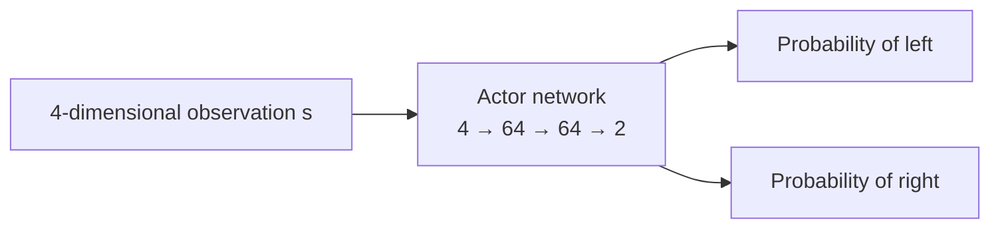
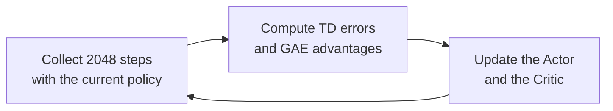

# 1.2 CartPole Principles

> **Goal of this section**: first explain the principles of CartPole and PPO, then start from the raw records of one real training run and learn to read the episode reward and four auxiliary PPO metrics.

> **Learning path**: [1.1 Run CartPole](./principles) → **1.2 CartPole Principles** → [1.3 PPO Training Visualization](./training)

> **Code and data for this section**: [Pure PyTorch PPO](https://github.com/saisandeshk/hands-on-modern-rl-en/blob/main/code/chapter01_cartpole/2-pytorch_ppo.py) · [Raw training metrics CSV](https://github.com/saisandeshk/hands-on-modern-rl-en/blob/main/code/chapter01_cartpole/output/training_metrics_seed42.csv) · [Plotting script](https://github.com/saisandeshk/hands-on-modern-rl-en/blob/main/code/chapter01_cartpole/plot_curves.py)

::: tip Optional reading
This section is optional. If you already have some background in Python, PyTorch, or deep learning, you can read straight through. If not, you can skip ahead to [1.3 Hands-on: PPO Training Visualization](./training) and come back to this section when you need to understand the mechanism behind training.
:::

In the previous section we ran our first CartPole training and watched the reward curve rise from 20 to 500. This section first takes apart the principles behind it: what information the environment gives the agent, how the agent makes decisions, and how PPO uses a batch of interaction data to improve the policy. Then we return to the training records themselves and learn to read the episode reward and four auxiliary PPO metrics.

## Environment Rules: Observations, Actions, and Rewards

Let's first look at the rules of the environment itself. The change in the curve in the previous section happens inside the interaction at every step.

The CartPole scene is simple: on a horizontal track there is a cart, and on top of the cart a pole is attached by a pivot. At every short time step, the controller has to make one choice, to push the cart left or to push it right. Besides that, it can do nothing.

Under gravity, once the pole starts to tilt it falls faster and faster. Only by continually adjusting the direction of the push can the controller keep the pole upright for as long as possible.

### Observations: Four Numbers Returned at Each Step

To decide which way to push, the controller must first know the current situation. A person can glance at the picture and tell whether the pole is tilting, but a program does not get the picture and needs numbers. At every step CartPole returns four numbers as the state the controller can see:

$$
s_t=[x_t,\ \dot{x}_t,\ \theta_t,\ \dot{\theta}_t].
$$

The subscript $t$ denotes the current time, and the four quantities are, in order, the cart position, the cart velocity, the pole angle, and the pole angular velocity.

| Index | Observation  | Meaning                                    | Bounds in `observation_space`  |
| ----- | ------------ | ------------------------------------------ | ------------------------------ |
| 0     | $x$          | Position of the cart on the track          | $[-4.8,\ 4.8]$                 |
| 1     | $\dot{x}$    | Direction and speed of the cart's movement | $(-\infty,\ +\infty)$          |
| 2     | $\theta$     | Angle of the pole from the vertical        | About $[-24^\circ,\ 24^\circ]$ |
| 3     | $\dot\theta$ | Direction and speed of the pole's rotation | $(-\infty,\ +\infty)$          |

The angle and the angular velocity must appear together. Knowing only that the pole leans to the right does not tell us whether it is falling quickly to the right or returning to the middle, and these two situations may call for exactly opposite actions.

The following code reads the observation ranges and termination thresholds declared by the environment:

```python
import gymnasium as gym
import numpy as np

env = gym.make("CartPole-v1")
print("Observation upper bound:", env.observation_space.high)
print("Observation lower bound:", env.observation_space.low)
print("Cart position threshold:", env.unwrapped.x_threshold)
print(
    "Pole angle threshold:",
    np.degrees(env.unwrapped.theta_threshold_radians),
    "degrees",
)
```

The infinity here means that Gymnasium declares no finite observation bound for the velocities. It does not mean that an actual run will produce infinite velocities.

### Actions: Left or Right

Knowing the state, the controller still has to choose an action from it. The action set of CartPole is

$$
\mathcal{A}=\{0,1\}.
$$

| Action | Meaning in the environment |
| ------ | -------------------------- |
| 0      | Push the cart left         |
| 1      | Push the cart right        |

Note that the action set has no "do not push," and the strength of the push cannot be chosen. At every step the program must choose between left and right.

From a control point of view, an action first changes the motion of the cart and then affects the pole through the connection between cart and pole. A single action usually cannot remove the tilt immediately, and the policy has to keep adjusting according to the new observation at the next step.

Controlling the pole requires continuous decisions, and every choice changes the situation at the next step.

### Rewards: One Point for Each Step Survived

Observations and actions define "what can be seen" and "what can be done." One more signal is needed to tell the program which behaviors are better, and this signal is the reward. The environment gives a reward of $+1$ for every step it runs. An episode ends when any of the following occurs:

- The cart position goes beyond $\pm 2.4$.
- The pole angle goes beyond about $\pm 12^\circ$.
- The episode reaches the 500-step time limit.

The episode reward of CartPole-v1 is therefore equal to the number of steps survived. Holding on for 37 steps earns 37 points, and reaching the limit earns 500 points.

Looking closely at this reward, we see that it does not directly say "the right move now is to push left." It only records whether the task is still going after an action. The program has to compare many interactions and gradually find which states and actions more easily lead to longer episodes, which is exactly what the policy and value networks below do.

## The Policy and the Actor Network

With observations, actions, and rewards in hand, one more rule is missing: in a given state, which action should be chosen. This rule is called the **policy**, written $\pi$.

For CartPole, the policy takes the four-dimensional observation and outputs the probabilities of the two actions:

$$
\pi(a\mid s)=P(A_t=a\mid S_t=s).
$$

Let's look at a concrete state. Suppose the pole is tilting to the right, and the policy may output

$$
\pi(0\mid s)=0.3,\qquad \pi(1\mid s)=0.7.
$$

This means that during training there is a 30% probability of pushing left and a 70% probability of pushing right. The policy computes the probabilities from the complete four-dimensional observation, and it cannot decide the action only by which side the pole leans toward, since the cart velocity, the pole angular velocity, and other information also affect the best choice.

In implementation, a small neural network represents the policy. The input layer receives the four numbers, the output layer produces a score for each of the two actions, and an action is then sampled from the resulting probability distribution:



The output layer of the Actor uses small initial weights, so at the start of training the probabilities of the two actions are usually both close to 0.5, and the policy tries both left and right actions. As training proceeds, the policy gradually learns to give different probability distributions in different states.

## The Critic and State Value

The policy can output action probabilities, but from the single-step reward of $+1$ alone it is hard to tell whether an action improved the long-term outcome. In CartPole, the same "push right" action sometimes lets the pole hold on for dozens more steps and sometimes only postpones the fall. The reward of a single step cannot tell the two situations apart.

PPO adds a second network for this, called the **Critic**.

The Critic takes the state $s_t$ and outputs the state value $V(s_t)$. This number says how much discounted return we can still expect to earn if we continue to act under the current policy from the current state.

The code puts the two networks in the same `ActorCritic` class:

```python
class ActorCritic(nn.Module):
    def __init__(self, obs_dim=4, act_dim=2, hidden=64):
        super().__init__()
        self.actor = nn.Sequential(
            nn.Linear(obs_dim, hidden),
            nn.Tanh(),
            nn.Linear(hidden, hidden),
            nn.Tanh(),
            nn.Linear(hidden, act_dim),
        )
        self.critic = nn.Sequential(
            nn.Linear(obs_dim, hidden),
            nn.Tanh(),
            nn.Linear(hidden, hidden),
            nn.Tanh(),
            nn.Linear(hidden, 1),
        )
```

The Actor decides how to act, and the Critic estimates the long-term value of the current situation. During training, both networks are updated from the collected trajectories. The PPO training procedure below uses the Critic's output to compute the advantage, that is, to judge how much better than expected the action at a given step was.

## The PPO Training Procedure

So far we have introduced the Actor and the Critic separately, but we have not said how they work together. Now let's connect the two networks and see how one complete PPO iteration proceeds.

An iteration first uses the current policy to collect 2048 steps. At every step it saves the state, the action, the reward, the log probability of the action, and the value given by the Critic:

```python
for _ in range(num_steps):
    action, log_prob, value = model.get_action(obs_tensor)
    next_obs, reward, terminated, truncated, _ = env.step(action.item())
```

This chunk of data is called a **rollout**. It can contain several complete episodes, or it may end in the middle of an episode.

After collection, the program does two things: it first judges how much better than expected the action at each step was (the advantage), and then updates the policy accordingly, but with a limit on the size of the update.

### TD Error and the GAE Advantage

After sampling, the program first computes the TD error of each step:

$$
\delta_t=r_t+\gamma V(s_{t+1})-V(s_t).
$$

$V(s_t)$ is the expectation the Critic gave before the action was executed, and $r_t+\gamma V(s_{t+1})$ is the new estimate obtained after executing the action. If $\delta_t>0$, the result of this step is higher than the Critic's original expectation.

Using the error of a single step is easily affected by bias in the Critic's estimates. The code uses GAE, which combines the TD errors of the current step and several following steps into the advantage $A_t$:

$$
A_t=\delta_t+\gamma\lambda\delta_{t+1}
+(\gamma\lambda)^2\delta_{t+2}+\cdots.
$$

When the advantage is positive, PPO raises the probability of this action in the same state, and when it is negative, PPO lowers that probability. This is precisely the purpose of the Critic: it provides a baseline for comparing the action at each step.

### The Probability Ratio and the Clipped Objective

With the advantage in hand, we still need an update rule to adjust the policy. There is a problem here: the same rollout data comes from the old policy before the update. If the new policy could deviate from the old one freely, a single update might push the policy into a very poor region.

To compare the new and old policies, PPO computes the probability ratio of the sampled action:

$$
r_t(\theta)=
\frac{\pi_\theta(a_t\mid s_t)}
{\pi_{\theta_{\mathrm{old}}}(a_t\mid s_t)}.
$$

The code takes the clipping range $[0.8,1.2]$. When the probability ratio goes outside this range, the clipped objective limits this sample from continuing to push the policy through a large change:

```python
ratio = torch.exp(new_log_probs - batch_old_log_probs)
surr1 = ratio * batch_advantages
surr2 = torch.clamp(ratio, 0.8, 1.2) * batch_advantages
policy_loss = -torch.min(surr1, surr2).mean()
```

Clipping does not guarantee that every update is better, but it limits how much policy change the same batch of data can produce, so that the new policy does not make an overly large single shift because of one batch of samples.

## Termination, Truncation, and Rollout Boundaries

Earlier we mentioned that an episode ends in three situations. Gymnasium distinguishes them with two flags: `terminated` and `truncated`. Both cause the environment to run `reset`, but they mean different things in the value computation.

`terminated=True` means the pole fell or the cart went out of bounds. The episode has ended naturally, no further reward can be obtained, and so the subsequent value is 0.

`truncated=True` means the episode reached the 500-step time limit. The pole may still be balanced at this point, so the program still uses $V(s_{t+1})$ to estimate the value after the truncation point.

Whichever way it ends, GAE must be cut at the `reset`. The advantage of a new episode cannot be passed back to the previous episode, or the outcome of the previous game would influence the judgment of the next one.

The 2048-step boundary of a rollout also does not mean the episode has ended. If sampling stops in the middle of an episode, the next iteration should continue from the current state and keep accumulating that episode's reward.

## The Main Training Loop

Now we can connect one complete training run. The core is three steps: collect trajectories, compute advantages, update the Actor and Critic, and then repeat.



The script repeats this process 40 times:

```python
for iteration in range(40):
    # Simplified: the real collect_rollout also threads the ongoing-episode
    # reward/length counters through each call; here we keep the
    # completed-episode lists and ignore the carryover with *_.
    transitions, obs, ep_rewards, ep_lengths, *_ = collect_rollout(
        model, env, obs, device, num_steps=2048
    )
    advantages, returns = compute_gae(transitions)
    metrics = ppo_update(
        model,
        optimizer,
        transitions,
        advantages,
        returns,
        device,
    )
```

Iteration 1 collects data with a nearly random policy. The updated policy changes the data distribution of the next iteration, and the new data in turn brings the next update.

The policy is corrected step by step through the iterations, and the reward curve likewise moves from 20 gradually toward 500.

## Where the Data on This Page Comes From

Once the principles are covered, there is more worth looking at in the training records: every point on the curve and every number in the log corresponds to some stage we just discussed. This page analyzes one real run saved in the repository. The training curve, the diagnostic curves, and the console numbers all come from the same CSV, and no results from different scripts or different random seeds are stitched together.

| Item              | Settings of this run                                                        |
| ----------------- | --------------------------------------------------------------------------- |
| Date              | 2026-08-13                                                                  |
| Environment       | `CartPole-v1`                                                               |
| Algorithm         | The repository's pure PyTorch PPO                                           |
| Random seed       | `42`                                                                        |
| Training amount   | 40 iterations × 2048 steps = 81,920 environment steps                       |
| Evaluation        | After training, 20 episodes run independently with the deterministic policy |
| Software versions | Python 3.12.13, PyTorch 2.13.0, Gymnasium 1.3.0, NumPy 2.5.2                |

The reproduction commands are as follows. `--swanlab-mode disabled` only turns off dashboard logging and does not change the training process.

```bash
cd code/chapter01_cartpole
python 2-pytorch_ppo.py \
  --seed 42 \
  --iterations 40 \
  --steps-per-rollout 2048 \
  --swanlab-mode disabled \
  --log-csv output/training_metrics_rerun.csv

python plot_curves.py \
  --input output/training_metrics_rerun.csv \
  --output-dir output
```

Below is an excerpt of six iterations from the training log. Every number can be found in the raw CSV. This record was generated before the 100-episode rolling average was added, so the mean reward in the log is the average over the episodes that ended in that iteration, which corresponds to the current `mean_episode_reward_rollout`. The commands above write a rerun to a new file so the archived CSV behind the figures is not overwritten; note that a freshly generated CSV stores the rolling 100-episode average in `mean_episode_reward`, unlike the archived file.

```text
Iteration  1/40 | episodes:  91 | mean reward:   21.4 | KL: 0.0087 | clip%: 14.5%
Iteration  5/40 | episodes:  15 | mean reward:  133.4 | KL: 0.0043 | clip%:  5.2%
Iteration 10/40 | episodes:   4 | mean reward:  500.0 | KL: 0.0059 | clip%:  7.4%
Iteration 11/40 | episodes:   5 | mean reward:  460.4 | KL: 0.0077 | clip%: 12.8%
Iteration 20/40 | episodes:   4 | mean reward:  500.0 | KL: 0.0019 | clip%:  1.6%
Iteration 40/40 | episodes:   4 | mean reward:  500.0 | KL: 0.0004 | clip%:  0.0%
Training complete! 20-episode evaluation: 500.0 +/- 0.0
```

## First Look at the Episode Reward

Once we have the records, the first thing we look at is the episode reward. The episode reward equals the number of steps survived, and the higher it is, the longer the policy keeps the pole upright.

The training script collects 2048 steps per iteration. An episode that spans the boundary between two sampling iterations keeps accumulating until the environment actually ends it. The current script records two averages: `mean_episode_reward` (SwanLab `rollout/ep_rew_mean`) is the rolling average over the most recent 100 complete episodes, the same statistics window as SB3's default, while `mean_episode_reward_rollout` (SwanLab `rollout/ep_rew_mean_rollout`) averages only the episodes that ended in the current iteration. The x-axis in SwanLab is the cumulative number of environment steps. The CSV saved in the repository was written by an earlier version of the script that kept only one column, `mean_episode_reward`, holding the per-iteration average, so every point in the saved file corresponds to the current `mean_episode_reward_rollout`.


<div class="figure-caption">Figure 1-3: The raw training reward for seed=42, plotted from the CSV's <code>mean_episode_reward</code> column. In this saved file that column holds the per-iteration average, i.e. the current <code>mean_episode_reward_rollout</code>. The curve is not smoothed, and the dashed line marks the 500-step limit for a single episode.</div>

Iteration 1 ended 91 episodes, with an average reward of 21.35. The policy is close to random, so most episodes end quickly.

Iteration 10 ended 4 episodes, with an average reward of 500.0. By then a cumulative 20,480 environment steps had been sampled.

The average reward in iteration 11 drops to 460.4. PPO training samples actions stochastically, and each iteration contains very few complete episodes, so a single point can drop temporarily. Most of the later iterations reach 500 again.

These numbers describe only one run with seed=42. To compare the sample efficiency of two algorithms, we need to run multiple random seeds and use the same training amount and evaluation method.

## Training Reward vs. Independent Evaluation

After reading the curve, one more issue needs clarifying: the training reward on the curve is not the same thing as "is the model actually good?" During training, the program draws actions according to the probabilities the policy gives. Even if the probability of right is higher, left may still be drawn. This randomness lets the policy keep trying different actions, and it also brings fluctuation into the training reward.

The independent evaluation uses the deterministic policy. At every step the program chooses the action with the highest probability, and runs 20 episodes from fresh initial states of the environment. The result of this run is:

```text
mean = 500.0
std  = 0.0
```

A mean of 500.0 means all 20 episodes ran to the time limit, and a standard deviation of 0.0 means there is no difference among the 20 scores.

The independent evaluation checks what result the saved policy achieves under fixed rules. When reporting experiments, the two must be described separately.

## Then Look at the Four Auxiliary Metrics

The episode reward tells us how well the task was completed, but when training fails it cannot give the reason. The four metrics below check exactly the three stages of the principles section: whether the policy has become fixed too early, whether the Critic has learned to predict, and whether each PPO update is too large.

The four curves below come from the same run as the reward curve.


<div class="figure-caption">Figure 1-4: Raw values of Value Loss, Policy Entropy, Approximate KL, and Clip Fraction. The four panels share the same training record with seed=42.</div>

### Policy Entropy: How Decisive the Action Choice Is

Start with the policy entropy. The principles section said that at the start of training the probabilities of the two actions are each close to 0.5. Policy entropy measures exactly this degree of spread, and at that point the entropy is close to

$$
\ln 2\approx 0.693.
$$

In this run the policy entropy falls from 0.685 to 0.421. This shows that the action distribution gradually concentrates on one action, but the policy still gives different results in different states.

A drop in entropy only means the policy has become more decisive. If the reward does not rise at the same time, the policy may simply be choosing a wrong action more decisively.

### Value Loss: The Critic's Prediction Error

Next, how well has the Critic learned? The Critic predicts the discounted return starting from state $s_i$, and the value loss compares the prediction $V(s_i)$ with the training target $\hat G_i$:

$$
L_V=\frac{1}{|B|}\sum_{i\in B}
\left(V(s_i)-\hat G_i\right)^2.
$$

$B$ denotes a training mini-batch. The larger the gap between prediction and target, the larger the value loss.

In this run the value loss stays between 41.8 and 64.1 over the first five iterations and finally falls to 0.00014. The rise in the middle of training partly reflects the policy reaching a new state distribution, which forces the Critic to readjust its predictions, and partly the growing scale of the regression targets themselves as episodes get longer.

A small value loss only shows that the Critic is closer to the current target. Whether the policy completes the task still has to be judged by the episode reward and the independent evaluation.

### Approximate KL: How Far the New Policy Is from the Old

The third metric corresponds to the probability ratio before the clipped objective. Approximate KL compares the action probabilities before and after the update, and the larger the value, the larger the change a PPO update made to the policy.

The maximum over the 40 iterations in this run is 0.00871, and the last iteration is 0.00038. The repository code does not stop training early based on KL, so this page only reports measured values and gives no fixed threshold that applies to all tasks.

### Clip Fraction: How Many Samples Hit the Limit

The last metric comes directly from the clipped objective. PPO uses $\epsilon=0.2$ to limit the probability ratio to around $[0.8,1.2]$. The clip fraction counts the share of samples that fall outside this range:

$$
\operatorname{clipfrac}=\frac{1}{|B|}\sum_{i\in B}
\mathbf 1\left[|r_i(\theta)-1|>\epsilon\right].
$$

In this run it is 14.48% in the first iteration and 0% in the last three. Later the learning rate decays linearly toward zero (from $3\times 10^{-4}$ to $7.5\times 10^{-6}$ at iteration 40), and the policy change shrinks with it.

The clip fraction must be read together with the approximate KL, the learning rate, and the reward. A single high or low value alone cannot show that training succeeded or failed.

## The Order of Checks When Training Behaves Abnormally

After linking the metrics to the principles, there is a clear troubleshooting path whenever training goes wrong. If the reward curve does not reach expectations, we can check along the order in which the data is produced:

1. Check `terminated` and `truncated`. After natural termination the value is 0, and after a time-limit truncation $V(s')$ must still be used.
2. Check whether GAE is cut at every `reset`. The advantage must not be passed from a new episode back to an old one.
3. Check whether the log counts only complete episodes and keeps accumulating episodes that cross rollout boundaries.
4. Compare the training reward with the independent evaluation, to confirm whether the problem lies in the training process or the final policy.
5. Then use the policy entropy, value loss, approximate KL, and clip fraction to locate the specific stage.

This order first checks whether the data is correct and only then interprets the optimization metrics. Wrong episode boundaries directly change the training target, and tuning the learning rate alone cannot fix that kind of problem.

## Section Summary

- CartPole defines the task with four observations, two actions, and a reward of $+1$ per step. The policy outputs action probabilities, the Critic estimates long-term value, GAE combines advantages, and the clipped objective limits the size of updates.
- The episode reward equals the number of steps survived and reflects task performance directly. The training reward includes the exploration brought by stochastic sampling, whereas the independent evaluation uses deterministic actions.
- Policy entropy, value loss, approximate KL, and clip fraction each correspond to a stage in the principles. They are used to explain the training process and cannot replace the reward.
- The curves on this page come from one reproducible single-seed run. Comparing algorithms requires multiple random seeds.

The next section, [PPO Training Visualization](./training), starts from the same reproduction commands and generates the raw CSV, the training curves, and real environment frames.

## References

[^1]: Schulman, J., Moritz, P., Levine, S., Jordan, M., & Abbeel, P. (2016). High-Dimensional Continuous Control Using Generalized Advantage Estimation. _ICLR 2016_.

[^2]: Schulman, J., Wolski, F., Dhariwal, P., Radford, A., & Klimov, O. (2017). Proximal Policy Optimization Algorithms. _arXiv preprint_ arXiv:1707.06347. <https://arxiv.org/abs/1707.06347>

[^3]: Sutton, R. S., & Barto, A. G. (2018). _Reinforcement Learning: An Introduction_ (2nd ed.). MIT Press.
