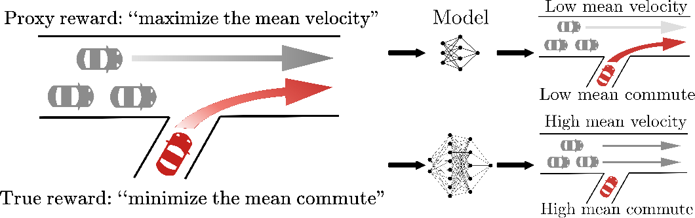
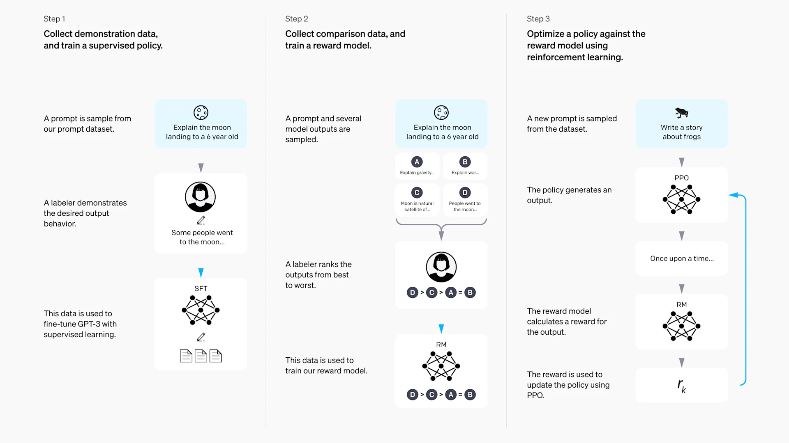

# 4.3 Reward Function Design

## Reading Guide

**Key Ideas**

- Understand how a reward function translates "the task we want done" into an optimizable scalar signal.
- See why giving points only at the goal is the most "correct" design yet the hardest to learn from, and why dense feedback can speed up learning but may change the task itself.
- Understand why Goodhart's law is especially deadly in RL: the stronger the optimization, the more visible the gap between the proxy reward and the true objective.
- Learn how weights and scales in a multi-objective reward lead to behavioral bias.
- Learn the basic path from hand-written rewards to preference learning (RLHF), and why a reward model can be over-optimized.

In the previous sections we discussed methods of value estimation: DP uses bootstrapping, MC uses the return of a whole episode, and TD takes a compromise between the two. We also discussed where data comes from: on-policy methods sample it themselves, and off-policy methods reuse experience. You may have noticed that, whichever algorithm is used, the direction of its updates comes from the same source. That source is the **reward**.

Let us pause and think. The last section answered "where does the data come from," but what is inside the data? It contains four-tuples of the form $(s, a, r, s')$. What the algorithm sees is not your intention, and not the sentence "reach the goal." It sees a number $r$. At every step it receives a number, and then it tries to make the discounted sum of those numbers as large as possible. If the number is written correctly, the algorithm moves in the direction you want. If the number is written wrongly, even by a small amount, the stronger the optimization, the further it drifts.

This is the central question of this section: **how does the reward determine the direction of optimization, and why is it so hard to write a good reward?**

::: info Key Concept
The reward function defines "what is worth pursuing." What the algorithm sees is not human intent but a scalar signal. If this signal disagrees with the true objective, the stronger the optimization, the larger the deviation.
:::

Let us start from a minimal example. Imagine a simple grid world: the agent starts at the bottom-left corner, and the goal is to reach the end point at the top-right. There are only four actions: up, down, left, and right. The map, the states, and the actions are all fixed. We change only one thing: the reward rule.

| Reward rule | Reward per step | Reaching the goal | Hitting a wall or going out of bounds |
| ----------- | --------------- | ----------------- | ------------------------------------- |
| Rule A      | $0$             | $+1$              | $0$                                   |
| Rule B      | $-0.01$         | $+1$              | $0$                                   |
| Rule C      | $+0.02$         | $+1$              | $0$                                   |

Look at Rule A first. It seems the most "correct": I give you 1 point only when you reach the goal and say nothing otherwise. Isn't that the cleanest definition of the objective?

Rule B adds something: each step costs 0.01 points. You may think, "Why deduct points? Isn't that adding something extra?" Don't rush; plug the numbers in and compute first.

Rule C is even stranger: each step gives 0.02 points? Doesn't this encourage the agent to wander around?

Let us work through concrete routes. Suppose the shortest route from the start to the goal takes 8 steps, and another, longer route takes 20 steps.

Under Rule A: what is the total return of walking 8 steps to the goal? Eight 0s, and a +1 at the end, add up to 1. And walking 20 steps? Twenty 0s and a final +1 also give 1. Do you see the problem? In the eyes of Rule A, reaching the goal in 8 steps and reaching it in 20 steps are **equally good**. It does not even care whether you walk in circles, as long as you touch the goal in the end.

Under Rule B, let us compute. The 8-step route: eight times -0.01, plus +1 at the goal, gives a total of $1 - 8 \times 0.01 = 0.92$. The 20-step route gives $1 - 20 \times 0.01 = 0.80$. Now the short route is better than the long one: the agent has to reach the goal, and also reach it **quickly**. That -0.01 is not a punishment. It tells the agent that "time has a cost."

And Rule C? A quick calculation shows something is wrong. If the agent does not go to the goal and circles near the goal instead, say for 100 steps, how many points can it collect? $100 \times 0.02 = 2$. That already exceeds the +1 at the goal! If the environment has no time limit, why would it go to the goal at all? Isn't circling and collecting points forever better?

These three environments have exactly the same map, exactly the same available actions, and exactly the same physical rules (transition probabilities). **Only the reward was changed, and the task changed with it.** Rule A says "just reach the goal," Rule B says "reach the goal quickly," and Rule C says "just keep walking, the goal does not even matter."

This is the weight of the reward function. The state space defines "what you can see," the action space defines "what you can do," and the transition probabilities define "how the world changes after you act." But **the reward defines what you "should" do**.

## Starting Point: Writing a Task as a Number

In the MDP five-tuple $\langle \mathcal{S}, \mathcal{A}, P, R, \gamma \rangle$, the most common way to write the reward is

$$
R(s,a)
$$

If the reward also depends on the next state (the more common case), we write

$$
R(s,a,s').
$$

What does this expression mean? Let us take it apart. The agent is in state $s$ and chooses action $a$, and the environment as a result moves to some next state $s'$. After this whole event has happened, the environment gives the agent a number, and that number is $R$. It is a scalar, that is, an ordinary real number.

Here is a concrete example. Use the grid world again, with states denoted by coordinates. Suppose the current state is $s = (1,1)$ (near the bottom-left corner), and the agent chooses the action $a = \text{right}$ and arrives at $s' = (2,1)$. If we adopt Rule B (each step costs 0.01), the reward for this step is:

$$
R\big((1,1), \text{right}, (2,1)\big) = -0.01.
$$

You see, $R$ takes three concrete things, "the original state, the action, and the next state," and outputs one number. The number output here is -0.01.

But, you may ask, reinforcement learning does not maximize the reward of a single step. In Section 2.2 (Chapter 2) we defined that what the agent really maximizes is the **discounted return** starting from the current time:

$$
G_t = R_{t+1} + \gamma R_{t+2} + \gamma^2 R_{t+3} + \cdots.
$$

The three dots "$\cdots$" mean the sum goes on until the episode ends. Let us "translate" this expression into words: starting now (step $t$), I take the reward of every following step, but the farther the future, the smaller the coefficient multiplying the reward, and this coefficient is a power of $\gamma$. The next step's reward is multiplied by $\gamma^0 = 1$ (no discount), the step after that by $\gamma^1 = \gamma$, the step after that by $\gamma^2$, and so on.

Why discount? Let us get a feeling with concrete numbers. Suppose the rewards of the next three steps are 0, 0, 1 in turn (no reward for the first two steps, and 1 point for reaching the goal at the third), and take $\gamma = 0.9$. The return computed from the current time is:

$$
G_t = 0 + 0.9 \times 0 + 0.9^2 \times 1 = 0.81.
$$

What happened? The 1 point at the third step, discounted back to "now," is worth only 0.81. If we change $\gamma$ to 0.5 (more short-sighted), the same three steps give:

$$
G_t = 0 + 0.5 \times 0 + 0.5^2 \times 1 = 0.25.
$$

The 1 point at the third step is now worth only 0.25. The closer $\gamma$ is to 1, the more "far-sighted" the agent is, and a point in the future matters almost as much as a point now. The smaller $\gamma$ is, the more "short-sighted" the agent is, and points in hand count for more.

Put the two together: $R$ is the **per-step** immediate feedback, and $G_t$ is the **long-term objective** that folds all future feedback into a current value. The reward function gives "how much this step earns," and the return computes "how much in total if I keep going from now on."

This also explains why reward design determines behavior: the object the algorithm optimizes is the expectation of $G_t$, and every point of $G_t$ comes from the reward function. If there is a deviation between the reward and your true intention, the more fully the optimization proceeds, the more thoroughly this deviation is exploited.

Having understood the reward itself, we still need to distinguish it from the "value" seen in the previous section. Recall the definition of the state value function:

$$
V^\pi(s) = \mathbb{E}_\pi[G_t \mid S_t = s].
$$

The two expressions look a bit alike, but they are entirely different things. Let us separate them using the simplest three-cell corridor of Section 3.1:

$$
S \xrightarrow{-1} M \xrightarrow{-1} G.
$$

From $S$ to $M$ the immediate reward is -1, and from $M$ to $G$ the immediate reward is also -1. The episode ends upon reaching $G$. If $\gamma = 1$ (no discount), what are the values of these three states?

- At $G$: the goal has been reached and there are no later rewards, so $V(G) = 0$.
- At $M$: one step to $G$ earns -1, and nothing afterward, so $V(M) = -1 + \gamma V(G) = -1$.
- At $S$: one step to $M$ earns -1, and the value from $M$ is -1, so $V(S) = -1 + \gamma V(M) = -2$.

Now do you see the difference? $R$ is **given directly by the environment**: it is part of the task definition, a rule you wrote. $V^\pi$ is **computed**: under some policy $\pi$, an estimate of the total return obtainable from this state in the future. Value always depends on the reward for its existence: change every step's reward from -1 to +1, and the entire value function flips, and the learned policy turns completely around.

## The First Difficulty: Too Little Reward at the Goal

Good, now we know how to write a task as a reward. What does the most "honest" reward look like? It is Rule A: give +1 only on reaching the goal and 0 at all other times.

$$
R(s,a,s') =
\begin{cases}
+1, & s' \text{ is the goal state}, \\
0, & \text{otherwise}.
\end{cases}
$$

This kind of reward has a name: **sparse reward**. Why is it attractive? Because it is clean. You hardly impose any of your own preferences. You say only "I want you to reach the goal," without saying "which route you should take," and without saying "I will give you a small reward to encourage you when you get close." In theory, this is the task itself.

But, as you should already have felt from the computation of Rule A, there is a problem. Let us magnify it. Suppose the maze is not 3 cells but a large 20×20 grid, and one episode allows at most 50 steps. The agent knows nothing at the beginning and can only walk randomly.

In its first episode it walked randomly for 49 steps without touching the exit. What are the rewards of these 49 steps? All 0. And step 50? It did not touch it either, still 0. After a whole episode, what the algorithm sees is $[0, 0, 0, \ldots, 0]$, fifty 0s.

The second episode: fifty 0s again.

The third episode: still fifty 0s.

The agent knows that it "did not succeed," because it did not receive that +1 at the end. But does it know **which step was "closer to success"**? No. At step 17 it once reached a place only two cells from the goal, and then took the wrong direction and wandered off. But the reward at step 17 is also 0, no different from the other 49 steps. From this string of 0s the algorithm cannot see that "step 17 was actually promising."

This is the fundamental problem of sparse rewards: **there is too little learning signal**. The agent may have to explore randomly for a long time before it bumps into the goal once, and only then can it begin to learn.

You may think: that is easy, why not just tell it at every step whether "the step just taken moved closer or farther"? This leads to the **dense reward**.

In a grid world, the most direct dense reward is this: compute the distance from the current state to the goal, compute the distance again after a step, and use the decrease in distance as the reward.

$$
R_{\text{dense}}(s, a, s') = d(s, \text{goal}) - d(s', \text{goal}).
$$

Here $d(s, \text{goal})$ denotes the Manhattan distance from state $s$ to the goal (horizontal difference plus vertical difference). Let us compute concrete numbers: suppose the current state is 4 cells from the goal and one step to the right leaves only 3 cells, so the reward is $4 - 3 = +1$. If it goes in the wrong direction and the distance grows from 4 cells to 5, the reward is $4 - 5 = -1$.

This is great! There is feedback at every step: approaching gives positive points and moving away gives negative points. The agent does not need to wait until the goal to know whether it is doing the right thing, since it knows after each step whether that step was good. The learning signal suddenly becomes dense.

But wait. Before we cheer for this clever trick, recall Rule C. Rule C also gives a reward at every step, and what went wrong? The agent learned to circle and farm points. Could this distance reward have a similar problem?

The good news is that this particular distance reward is safe. Let us verify: in a 5×5 grid, suppose the agent walks back and forth between (5,4) and (4,4). From (5,4) to (4,4) the distance goes from 1 to 2, and the reward is -1. Walking back, the reward is +1. Over one round trip the total reward is 0, so there is no free lunch. It is unlike the +0.02 per step of Rule C, where circling really does accumulate points.

The bad news is that **you cannot guarantee that every "dense reward" you come up with is this safe**. What if the extra reward you design has a loophole? How can extra feedback be added so that it helps learning without changing the optimal policy?

::: details Bonus: The Mathematics of Potential-Based Reward Shaping (PBRS)
Ng, Harada, and Russell proved in 1999 that one special form of extra reward guarantees that the optimal policy does not change, called **Potential-Based Reward Shaping (PBRS)**.

The idea is to define a "potential score" $\Phi(s)$ for each state, similar to gravitational potential energy in physics (the closer to the goal, the higher the potential), and let the extra reward be strictly the difference of potentials between adjacent states:

$$
F(s, s') = \gamma \Phi(s') - \Phi(s).
$$

Training uses $R' = R + F$.

**Why does this not change the optimal policy?** Let us compute the discounted sum of all the extra rewards along a trajectory $s_0 \to s_1 \to \cdots \to s_T$:

$$
\sum_{t=0}^{T-1} \gamma^t F(s_t, s_{t+1}) = \sum_{t=0}^{T-1} \gamma^t [\gamma \Phi(s_{t+1}) - \Phi(s_t)].
$$

After expansion, all the intermediate terms cancel (a telescoping sum):

- $\gamma \Phi(s_1) - \Phi(s_0)$
- $\gamma^2 \Phi(s_2) - \gamma \Phi(s_1)$
- $\gamma^3 \Phi(s_3) - \gamma^2 \Phi(s_2)$
- ...
- $\gamma^T \Phi(s_T) - \gamma^{T-1} \Phi(s_{T-1})$

Only $-\Phi(s_0) + \gamma^T \Phi(s_T)$ remains at the end. Setting the potential of the terminal state to 0 leaves only the constant $-\Phi(s_0)$, which depends only on the starting point and not on the path taken. A path that originally had a higher return therefore still has a higher return after adding this constant, and the ordering of policies is unchanged.

The distance-change reward we used earlier is exactly a special case of PBRS: take $\Phi(s) = -d(s,\text{goal})$ and $\gamma=1$, and we get $F = d(s) - d(s')$.

Now substitute actual numbers. Let $\gamma=0.9$. The current state is $4$ cells from the goal, so $\Phi(s)=-4$; the next state is $3$ cells away, so $\Phi(s')=-3$. The shaping term is

$$
F(s,s')=0.9\times(-3)-(-4)=1.3.
$$

If the move increases the distance from $4$ to $5$, then $\Phi(s')=-5$ and the term becomes $0.9\times(-5)-(-4)=-0.5$. The same formula gives positive feedback for approaching the goal and negative feedback for moving away.

**Limitation**: PBRS requires that you can write a reasonable potential function $\Phi(s)$. Distance is easy to compute in a maze, but for states such as "how is this conversation going," it is hard to define a potential. Moreover, PBRS guarantees only that the optimal policy does not change, and does not guarantee faster or more stable learning.
:::

PBRS solves the problem of "how to safely add intermediate rewards when there is a clear notion of progress," but for some tasks even "progress" is hard to define. Besides potential shaping, researchers have proposed other approaches to sparse rewards:

::: details Bonus: Other Advanced Methods for Sparse Rewards
**HER (Hindsight Experience Replay)**: Even if a trajectory did not reach the original goal, it still "successfully reached somewhere." HER relabels the failed trajectory as "successfully reached the place it actually reached," so that experience that was all zeros produces a learning signal. It is especially suitable for goal-conditioned tasks such as robot pushing and navigation.

**Intrinsic curiosity (ICM)**: In extremely sparse environments where the agent cannot even reach "meaningful states," one can directly reward exploration itself. Train a model to predict the next state, and give an extra "curiosity reward" to states with large prediction error (unseen, novel ones). But this introduces the "TV problem": if the environment has a TV screen playing random images, the agent may keep staring at the TV, because random images can never be predicted accurately and can yield curiosity reward forever. For example, suppose one transition has extrinsic reward $0$ and curiosity reward $4$. With a curiosity weight of $0.01$, the total reward is only $0.04$; with a weight of $1$, it becomes $4$. If random television frames keep producing prediction error near $4$, an overly large weight can make watching the television more attractive than searching for actual game score.

**GAIL (Generative Adversarial Imitation Learning)**: If humans can do the task but cannot write the reward rule, humans can demonstrate, and a discriminator is then trained to tell "expert actions" from "policy actions," turning the discriminator's output into a reward.
:::

There is a third common situation, called **delayed reward**. It is not completely sparse (it is not that only the last step has points), but the key feedback comes only after a long time.

CartPole is a good example. On the surface, it has a reward at every step: +1 as long as the pole has not fallen. Isn't that dense? But think carefully: the wrong action that actually causes the pole to fall may have happened **dozens of steps earlier**. For example, at step 12 you pushed in the wrong direction and the pole began to tilt slightly. After that you tried hard to recover, but the tilt grew worse, and finally at step 47 the pole fell, the episode ended, and this step did not receive +1.

Here is the problem: the reward at step 47 is 0 (failure), but did the mistake really happen at step 47? No. The mistake happened at step 12. Credit assignment has to trace the signal of "failure" back 35 steps, and that is hard. Game tasks are like this, and so is LLM generation: the final preference score of a response may be given only after the whole text ends, but the mistake that led to the low score may have appeared in the very first sentence.

Sparse, dense, and delayed are three words that describe three different dimensions of the learning signal: how much the signal appears (sparse vs dense), how early the signal arrives (delayed vs immediate), and whether the signal can clearly point out "this very step is good or bad." They are not mutually exclusive categories. You can have a "dense but delayed" reward, for example one with points at every step whose key consequences show up only long afterward.

Let us put all three back on one 50-step trajectory to get a feel for them:

- +1 only at step 50 when the exit is reached, and 0 for the other 49 steps: this is sparse.
- +1 or -1 at every step according to the change in distance, with an extra +1 for reaching the goal: this is dense.
- A bad action is chosen at step 8, but its consequence does not lead to failure until step 40: this is delayed.

## The Second Difficulty: A Task Has Several Requirements

Up to here we have been dealing with the case of a "single objective": the maze only needs the goal, and CartPole only needs to keep the pole upright. Real tasks are often not like this. A robot must walk forward, but also keep its balance, save power, and not fall. Putting several objectives together makes things more complicated.

The maze has only one requirement: reach the goal. You only need to answer "did it get there." But in robot control things immediately become complicated. For a humanoid robot walking, you want it at the same time to:

- move forward (with high forward speed),
- not fall (keep balance),
- not move too violently (save energy and reduce wear),
- not hit things (safety).

Each requirement taken alone is easy to write as a reward term. The question is: when they are **put together**, who has the final say?

### Adding Several Requirements Together

The most direct approach is to add the reward terms up. Take the MuJoCo Humanoid task as an example. Its reward is usually written as the sum of three parts:

$$
r = r_{\text{forward}} + r_{\text{alive}} + r_{\text{ctrl}}.
$$

| Sub-reward           | Meaning                             |
| -------------------- | ----------------------------------- |
| $r_{\text{forward}}$ | Forward speed                       |
| $r_{\text{alive}}$   | Alive bonus per step                |
| $r_{\text{ctrl}}$    | Joint torque penalty (control cost) |

Looks reasonable, right? Encourage moving forward, reward staying alive, penalize overly violent actions: all three are wanted. But the **numerical ranges** of the three things may be completely different. As a schematic illustration (not the exact gym coefficients), suppose $r_{\text{forward}}$ ranges from 0 to 5 while $r_{\text{ctrl}}$ ranges from -100 to 0. If they are added directly, the absolute value of the control cost may be dozens of times that of the forward speed. The result is that the agent would rather stand still (zero control cost) than dare to move a leg (moving a leg has a high control cost, while the forward reward is only a little).

You need to attach a weight coefficient to each term to decide which one matters more:

$$
r = w_1 r_{\text{forward}} + w_2 r_{\text{alive}} + w_3 r_{\text{ctrl}}.
$$

These coefficients **are hyperparameters**. If they are poorly tuned, the agent will give priority to optimizing the term with the largest numerical value.

::: details Bonus: Reward Design Examples in Continuous-Control Environments
Let us look at how several standard Gymnasium/MuJoCo environments design their rewards, to appreciate the complexity of weights and combinations of reward terms.

**HalfCheetah-v4** (a two-legged cheetah) is the cleanest design, with only two terms:

```python
forward_reward = x_velocity          # r1: forward speed
ctrl_cost = 0.1 * sum(a^2)           # r2: control cost (penalty)
reward = forward_reward - ctrl_cost
```

The coefficient 0.1 decides the trade-off between "run fast" and "do not move too violently."

**Ant-v4** (a four-legged ant) has four terms:

```python
forward_reward = x_velocity                # r1: forward speed
healthy_reward = 1.0                        # r2: alive bonus
ctrl_cost = 0.5 * sum(a^2)                  # r3: control cost
contact_cost = 0.5 * 1e-3 * sum(c^2)       # r4: contact cost
reward = forward_reward + healthy_reward - ctrl_cost - contact_cost
```

Note that the contact cost coefficient is only 0.0005. It barely matters early in training, and only later, when the policy has stabilized, does this tiny penalty begin to teach the robot to avoid unnecessary body collisions. Setting the coefficient higher makes the robot too conservative, and setting it lower makes the legs hit each other.

**BipedalWalker-v3** (a biped walking over rough terrain) also mixes PBRS potential shaping with penalty terms:

```python
shaping = 130 * pos.x / SCALE          # r1: forward-distance potential
shaping -= 5.0 * abs(hull_angle)       # r2: head-upright penalty
reward = shaping - self.prev_shaping    # potential difference (PBRS)
reward -= 0.00035 * MOTORS_TORQUE * sum(|a|)  # r3: action penalty
```

The posture penalty is written inside the potential function, which changes the trade-off between "moving forward" and "staying upright." It does not enjoy the PBRS guarantee of "does not change the optimal policy."
:::

### Tasks with a Sequential Order

"Add up all the terms and set the weights" has a hidden assumption: all the requirements are **equally important** from the very first step. Many tasks are not like this, though. They have a clear order.

Take a robot grasping task. You cannot ask it at the start to "put the object at the target position." It must first learn to approach the object, then learn to grasp it, then learn to lift it, and only finally carry it to the destination.

The reward of a grasping task is usually decomposed by stage:

$$
r = r_{\text{reach}} + r_{\text{grasp}} + r_{\text{lift}} + r_{\text{target}}.
$$

| Sub-reward          | Trigger condition                           | Intent                         |
| ------------------- | ------------------------------------------- | ------------------------------ |
| $r_{\text{reach}}$  | The gripper approaches the object           | First learn to "approach"      |
| $r_{\text{grasp}}$  | The gripper closes and grasps the object    | Then learn to "grasp firmly"   |
| $r_{\text{lift}}$   | The object leaves the table                 | Then learn to "lift"           |
| $r_{\text{target}}$ | The object is placed at the target position | Finally complete the transport |

Here is the problem: **the agent will stay in its "comfort zone."** If $r_{\text{reach}}$ and $r_{\text{grasp}}$ are easy to get while $r_{\text{target}}$ is very hard, the agent is content with "I approached and I grasped, and that is already quite a few points." It may learn to keep the gripper holding the object but never lift it.

One idea is a **curriculum reward**: the reward also changes with training progress. At first only $r_{\text{reach}}$ is activated, and once that is learned $r_{\text{grasp}}$ is added, then $r_{\text{lift}}$, and finally $r_{\text{target}}$, like a class that teaches the easy things first and the hard things later.

Another is called **Dense2Sparse**: first train quickly with a dense reward to a level that is "not bad," and then **switch back to the sparse true objective** and continue optimizing. The core insight is that a dense reward provides gradients early in training but may lock the policy into a "good enough" local optimum in the long run, while a sparse reward is hard to learn from but represents the true objective and can correct the deviation later.

### Requirements That Cannot Be Traded: Safety Constraints

The "weighted sum" and "stage-by-stage activation" methods above all assume that different reward terms are **interchangeable and can compensate for each other**: a little more forward speed can offset a little collision penalty.

But there is one kind of requirement that cannot be handled this way, and that is safety. You cannot say "it hit a person once, but its speed went up 20%, which cancels it out." Safety constraints are hard: the number of falls must not exceed a threshold, joint torque must not exceed its limit, and collisions must absolutely not happen.

Such constraints are not suited to being handled by "adding a penalty term." If the coefficient is small it does not work, and if it is large the agent is frightened into not moving at all. A more suitable approach is to write them as **constraint conditions** and not as reward terms, so that the policy update mathematically guarantees the constraints are not violated.

::: details Bonus: CPO, Constrained Policy Optimization
**CPO (Constrained Policy Optimization)** by Achiam et al. writes the optimization problem in a constrained form:

$$
\max_\pi \mathbb{E}[r_{\text{main}}] \quad \text{s.t.} \quad \mathbb{E}[c_i] \leq d_i, \quad \forall i.
$$

$\text{s.t.}$ means "subject to the following constraints." $c_i$ is the cost of the $i$-th constraint (such as the number of falls), and $d_i$ is the allowed upper bound. For example, a requirement of no more than $2$ falls per $100$ steps can be written as $\mathbb{E}[c_{\text{fall}}]\leq2$.

CPO uses Lagrange multipliers to adjust automatically during training: when the constraint is tight, the policy becomes more conservative, and when the constraint is loose, it can optimize the main objective boldly. This is fundamentally different from a "large penalty term": the latter relies on weights to threaten, while CPO limits the step size of the update.
:::

### Common Pitfalls of Combined Rewards

Whichever method is used, every time you add a new term to the reward you introduce a new possibility of bias. Four kinds of problem recur in engineering:

**Scale mismatch.** Schematically, $r_{\text{forward}}$ may be in 0 to 5, and $r_{\text{ctrl}}$ in -100 to 0. The terms with large values dominate the gradient direction. This has nothing to do with the weight question of "which is more important" and is purely a matter of numerical scale. A simple remedy is to scale each sub-reward by hand to a similar range (such as [-1, 1]).

**Weight sensitivity.** Changing the control penalty coefficient from 0.001 to 0.003, only a factor of three, may turn the policy from "a steady jog" into "stumbling and falling." Finding a suitable range of weights usually takes repeated trials.

**Local optimum traps.** When some sub-reward is especially easy to get, the agent will prioritize optimizing it. In the grasping task, "approach the object" is far easier than "put it at the target position," so the agent stops there and refuses to go on.

**Time-scale differences.** The collision penalty is **immediate**: you hit something and points are deducted at once. The task completion reward is **delayed**: it may come only hundreds of steps later. The immediate penalty often "overwhelms" the delayed reward and makes the agent too conservative.

::: details Bonus: Automatic Normalization (PopArt)
If you do not want to estimate the range of each reward term by hand, you can use **PopArt** (van Hasselt et al., 2016), which maintains the mean and standard deviation of each reward term online during training and standardizes automatically:

$$
\hat{r}_i = \frac{r_i - \mu_i}{\sigma_i}.
$$

$\mu_i, \sigma_i$ are running statistics that are updated as training goes on. Even if the raw scales differ by a factor of a hundred, they end up on the same order of magnitude when they enter the policy gradient.

A more radical approach is **reward clipping**, which truncates all rewards directly to [-1, 1] (DQN does this on Atari), but it loses the gradient information of "small win vs big win."
:::

## The Third Difficulty: A High Score Does Not Mean the Real Task Was Completed

Now let us return to the three maze rules at the beginning. Rule A has the "purest" objective but is the hardest to learn. Rule B uses a step cost to help the agent find the short path. Rule C provides dense feedback but makes circling more profitable than reaching the goal. All along the way, from sparse to dense and from a single objective to several, we keep running into an invisible wall: **the agent pursues only the number you wrote down, and it does not automatically understand the intention behind the number.**

Reward design therefore has a problem more fundamental than "how fast learning is": **does the behavior that earns a high score really complete the task you wanted it to complete?**

Economics has a law called Goodhart's law, which says: **"When a measure becomes a target, it ceases to be a good measure."** This law is deadlier in reinforcement learning than anywhere else, because RL is "extreme optimization." It will do everything possible to push the number you give it to the maximum.

Let us formalize the problem. What you truly want in your mind, we call $R^*$. This is the "true objective," the vague but correct intention in your head, such as "make the robot walk steadily," "make the boat win the race," or "make the answer genuinely helpful." But you cannot write $R^*$ directly as code. What you can write is only a **proxy reward** $R$. As long as $R \neq R^*$, that is, as long as there is even a slight gap between your proxy reward and the true objective, optimization will magnify the gap.

Maze Rule C is the smallest example. Let us look at a few bigger ones.

In the Coast Runners boat-racing game, the task is originally to "win the race," that is, to reach the finish line before the other boats. But the reward function mainly comes from the green score blocks along the course: you earn points when you hit a green block. What did the agent discover? It discovered that if it circles repeatedly in a corner with many green blocks, collecting them, its score rises especially fast, far higher than by running the whole course seriously. The policy it finally learned is to circle in the corner and eat green blocks, with a score far above the policy of racing normally, and it never finished the course, let alone won the race.

The same pattern repeatedly appears in Minecraft experiments. Researchers designed dense intermediate rewards to encourage the agent to complete a complex task (collect resources, craft tools, reach the final goal): a point for collecting a block of wood, a point for crafting a plank, a point for making a pickaxe. And the result? The agent learned to stay safely alive and keep collecting wood and resources, yet it almost never tried to complete the final goal, because "staying alive + collecting basic resources" was already enough to earn a high score steadily. The dense reward turned the "means" into the "end."

Remember the "TV problem" mentioned earlier? Prediction error is meant as a means of encouraging exploration of new things, but the agent found that "staring at a random TV" earns a steady high curiosity reward. The means of helping it find the goal once again replaced the goal itself.

Let us look at CartPole again. The common reward is "+1 for every step survived," which defines the task as "the longer alive the better." This reward is in the right direction, but it is already a proxy reward: what you really want is "keep the pole steadily upright at the center." If we design the reward to be more "refined," directly rewarding a small angle and a centered position:

$$
R(s,a) = 1 - c_1|\theta| - c_2|x|,
$$

learning is faster, since every step tells the agent "how crooked the pole is and how far off the cart is." But the two coefficients $c_1$ and $c_2$ immediately bring us back to the weight problem. Let us plug in specific numbers: at some step $|\theta| = 0.1$ and $|x| = 0.4$.

- If $c_1=2, c_2=0.5$: the reward is $1 - 0.2 - 0.2 = 0.6$.
- If $c_1=2$ stays and $c_2=2$: the reward becomes $1 - 0.2 - 0.8 = 0$.

Changing only the position coefficient from 0.5 to 2 turns the reward of the same state from "decent" to "very poor." If the position penalty is too strong, the agent may prefer to let the pole lean as long as the cart stays at the center.

Pan et al. describe reward misspecification patterns including three common ones:

- **Wrong weights**: the dimensions measured are right, but the proportions of importance among them are written wrongly. The choice of $c_1, c_2$ in CartPole is of this type.
- **Wrong ontology**: the dimension measured is itself wrong. Coast Runners uses "how many green blocks are eaten" to measure "boat performance," and the dimension is fundamentally wrong.
- **Wrong scope**: the reward is right in the training environment but does not cover new scenarios. A reward that works well in a simulator may fail in the real world.

In LLM preference training, none of these problems is missing. RLHF uses a reward model to score answers, but the reward model may learn surface correlations from the annotated data, such as "longer answers tend to score higher" and "answers with more polite phrases tend to score higher." After the policy is optimized, it starts to pile up boilerplate: answers get longer and more polite, the score is high, but actual accuracy does not improve and may even drop. More subtly, the model may learn expressions that "sound convincing but are actually wrong," since human evaluators are more easily misled by confident, fluent wrong answers.

All of these phenomena are in essence the same problem: **the proxy reward $R$ is an imperfect approximation of the true intention $R^*$, and optimization magnifies this imperfection.** The stronger the model, the more fully it is optimized, and the longer it is trained, the more clearly the gap between $R$ and $R^*$ shows.



<div style="text-align: center; font-size: 0.9em; color: var(--vp-c-text-2); margin-top: -10px; margin-bottom: 20px;">
  <em>Figure 1: Read this figure from left to right. The red car on the left truly wants to "reduce average commute time," but the engineer's proxy reward is "increase average speed," which leads the agent toward behavior that looks faster but actually makes the commute worse. The top and bottom rows on the right represent models of different sizes: the stronger the model, the more likely it is to find loopholes in the proxy reward. Source: Pan et al. (2022)</em>
</div>

## The Fourth Difficulty: The Reward Formula Simply Cannot Be Written

Whether the maze goal was reached and whether the robot fell are easy to judge with a program. But for many tasks you simply cannot write "good" as a few simple rules. Examples are "whether the robot's movements look natural," or "whether an answer is helpful and accurate."

For tasks that "humans can do but cannot write rules for," if experts can give **demonstrations**, imitation learning (such as GAIL) can learn a reward from the demonstrations. Language tasks are harder, since you cannot prepare an expert answer for every possible question. But although humans cannot write "the rules of a good answer," they can do something relatively easy: **compare**. Given two answers to the same question, you can usually say which one is better.

Reward design thus changes from "writing a formula" to "learning from preferences," which is the core idea of RLHF.

Given the same question $x$, let the model generate two answers $y_A$ and $y_B$, and have a person annotate which one they prefer. Use this preference data to train a **reward model** $r_\phi(x,y)$, whose goal is to give the preferred answer a higher score:

$$
r_\phi(x, y_w) > r_\phi(x, y_l)
$$

Here $y_w$ is the answer chosen by the human (win) and $y_l$ is the rejected one (lose). After training, $r_\phi$ can score any answer like an ordinary reward function, and then we use an algorithm such as PPO to optimize the language model with it as the reward signal. For example, if the reward model outputs $2.3$ for $y_A$ and $1.1$ for $y_B$, it predicts that $y_A$ better matches the preference. The function $r_\phi(x,y)$ ultimately produces one scalar used for comparison.



<div style="text-align: center; font-size: 0.9em; color: var(--vp-c-text-2); margin-top: -10px; margin-bottom: 20px;">
  <em>Figure 2: RLHF turns "the reward cannot be written" into "learn the reward from preferences." Step one, SFT, uses demonstration answers so the model can give basic answers. Step two trains a reward model from human rankings. Step three uses PPO to optimize the language model with the reward model as the scorer. Note that the reward model is itself a proxy reward and not the true intention. Source: OpenAI</em>
</div>

This pipeline greatly extends the boundary of what RL can do, but the reward model is **itself a proxy reward**: the problem of $R \neq R^*$ has not disappeared at all, it has only changed form. Because the reward model is known to be imperfect, the RLHF objective usually also includes a KL penalty term that limits how far the policy may drift from the initial reference model: "you may get better, but don't go too far." For example, suppose a response receives reward-model score $2.4$ and has KL divergence $0.3$ from the reference model. With a KL weight $\beta=0.1$, its combined score is $2.4-0.1\times0.3=2.37$. With $\beta=2$, the score falls to $1.8$. The response itself has not changed. Increasing the KL weight simply makes the policy more reluctant to depart from the reference model.

### Over-Optimization of the Reward Model

That the reward model is a proxy reward is no empty remark. Gao et al. used experiments to show systematically what happens if we keep optimizing the policy to maximize the reward model's score.

Their experimental design is clever: use a large model (6B parameters) as the "gold reward" and treat it as $R^*$ (the true preference), and use smaller models as proxy reward models for RL optimization. They found a clear pattern:

- Early in training: the proxy reward rises, and the gold reward rises with it. The policy is genuinely getting better.
- Past a certain peak: the proxy reward **keeps rising**, but the gold reward **starts to fall**.

Why? What a reward model learns from limited data has two parts. One part is truly related to "answer quality" (clear logic, accurate answers). The other part is **surface correlations** in the data (longer answers, more polite phrases, a summary at the end). At the start of optimization it mainly learns the first part, and the two rise together. After the first part is exhausted, the policy begins to exploit the second part, making answers longer and longer and piling up boilerplate. The proxy reward keeps climbing, but the relationship of these things to "truly helpful" gets weaker and weaker.

**What optimization finds is not the true human preference but the loopholes of the reward model.** This is the direct manifestation of Goodhart's law in RLHF.


<div style="text-align: center; font-size: 0.9em; color: var(--vp-c-text-2); margin-top: -10px; margin-bottom: 20px;">
  <em>Figure 3: The horizontal axis is optimization strength and the vertical axis is the reward score. The colored curve is the proxy reward, and the dashed gray line is the gold standard. Past the peak, the colored curve keeps rising while the gray one falls: the model starts to cater to the loopholes of the reward model instead of genuinely getting better. Source: Gao et al. (2023)</em>
</div>

::: details Bonus: From ORM to PRM, RLAIF, and GRPO
Within the RLHF framework, researchers have proposed improvements from different angles. They all try to ease $R \neq R^*$, but each introduces new problems:

**PRM (Process Reward Model)**: A standard reward model gives only one total score to the final answer (ORM), and in tasks such as mathematical reasoning it cannot point out which step went wrong. A PRM scores **each step** of the reasoning chain separately, splitting the sparse final reward into dense step-level feedback, so errors are located more precisely. The cost is a large increase in annotation effort, since people must judge step by step whether each step of reasoning is correct. Suppose a three-step solution receives scores $[0.98,0.12,0.20]$. The first step is close to $1$ and appears reliable, while the second drops sharply to $0.12$. The location of the error is now visible. An outcome reward model that only sees the final wrong answer would usually assign one low score to the entire solution without showing that the problem began at step two.

**RLAIF (Reinforcement Learning from AI Feedback)**: An AI compares answers according to a predefined "constitution" (behavioral principles) and generates preference data itself, replacing human annotation. This cuts cost greatly, but only moves the problem from "is human feedback accurate" to "is AI feedback accurate."

**GRPO (Group Relative Policy Optimization)**: It drops PPO's separate value network, generates a group of answers to the same problem (for example 8), and estimates advantages by standardizing the scores within the group. It works well on tasks such as mathematical reasoning where an answer checker can score directly, but it still depends on a reliable scoring signal. Concretely, suppose $3$ of the $8$ answers are correct and $5$ are incorrect, with verifier rewards $1$ and $0$. The group's mean reward is $3/8=0.375$ and the population standard deviation is about $0.484$. A correct answer therefore has standardized advantage $(1-0.375)/0.484\approx1.29$, while an incorrect answer has advantage $(0-0.375)/0.484\approx-0.77$. The absolute rewards $0$ and $1$ have been converted into "how far above or below this group's average" each answer lies.

| Method | Core idea                                              | What it eases                  | New risk introduced                        |
| ------ | ------------------------------------------------------ | ------------------------------ | ------------------------------------------ |
| ORM    | Learn an overall reward from preferences               | Hand-written rewards are hard  | Over-optimization, surface correlations    |
| PRM    | Score each step separately                             | Outcome rewards are too sparse | High annotation cost                       |
| RLAIF  | Replace human annotation with AI                       | Cost of human annotation       | Bias in the AI's own judgments             |
| GRPO   | Estimate advantages from within-group relative rewards | Removes the value network      | Still depends on a reliable scoring signal |

:::

## Summary

A reward function is not better for being more complicated, and not better for being denser. The question that really needs asking is whether it expresses the key preferences of the task clearly while leaving no obvious loophole for farming points. When designing a reward, you can check along these questions:

1. When the agent gets a high reward, do you, as a human, really think "the task was done well"?
2. If the agent keeps repeating some local action, can it keep farming points without completing the task?
3. Is the intermediate reward you added helping learning, or has it already changed the final objective?
4. Is the reward signal so sparse that the algorithm cannot discover a successful trajectory in a reasonable time?
5. For complex tasks (such as LLMs or robots), are hand-written rules no longer enough, so that the reward needs to be learned from preferences?
6. If a reward model is used, could over-optimization decouple the proxy reward from the true preference?

These questions have no uniform answer. The expression of the reward differs from scenario to scenario, but the underlying logic is the same: **the reward defines the direction of optimization, and the direction of optimization can almost never be perfectly aligned with the true intention. Good reward design is finding a good balance between "aligning with the true objective" and "making learning feasible."**

In this section we started from the simple maze that "gives 1 point only at the goal" and met four core difficulties of reward design:

1. **Writing a task as a number**: $R$ gives per-step immediate feedback, $G_t$ discounts and accumulates multi-step rewards into a long-horizon objective, and $V^\pi$ is an estimate of the future return. Value exists by depending on the reward.
2. **Too little learning signal**: A sparse reward is the cleanest but too hard to learn from, and a dense reward speeds up learning but may change the task. PBRS guarantees an unchanged optimal policy through the potential-difference form, but requires a reasonable potential function to be definable.
3. **Multi-objective trade-offs**: A weighted sum of several reward terms is simple but sensitive to weights and prone to scale mismatch. Staged curricula suit tasks with a sequential order. Safety requirements are better written as constraints and not as penalty terms.
4. **Imperfect proxy rewards**: Goodhart's law tells us that optimization magnifies the gap between the proxy reward $R$ and the true objective $R^*$. RLHF turns "writing the reward" into "learning the reward from preferences," which extends the boundary of capability, but over-optimization of the reward model is still a different manifestation of the same fundamental problem.

Tabular methods require states and actions to be enumerable one by one. Once the states become continuous or high-dimensional, the Q table cannot hold them. The next chapter starts from this point, approximates the Q function with a neural network, and enters deep reinforcement learning.

← Previous section: [Policy Sampling and Data Sources](./algorithm-taxonomy) | Next section: [5.1 From Q-Learning to DQN](../chapter05_dqn/from-q-to-dqn)

## References

[^1]: Amodei, D., Olah, C., Steinhardt, J., Christiano, P., Schulman, J., & Mané, D. (2016). Concrete problems in AI safety. _arXiv preprint arXiv:1606.06565_.

[^2]: Pan, A., Bhat, M., Shern, C., Phadnis, S., Guss, W., & Amodei, D. (2022). The effects of reward misspecification: Mapping and mitigating misaligned models. _arXiv preprint arXiv:2201.03544_.

[^3]: Ouyang, L., Wu, J., Jiang, X., Almeida, D., Wainwright, C. L., Mishkin, P., Zhang, C., Agarwal, S., Slama, K., Ray, A., Schulman, J., Hilton, J., Kelton, F., Miller, L., Simens, M., Askell, A., Welinder, P., Christiano, P. F., Leike, J., & Lowe, R. (2022). Training language models to follow instructions with human feedback. _NeurIPS_.

[^4]: Wen, J., Zhong, R., Khan, A., Jørgensen, E., Wu, J., Tran, D., Peng, Z., Peng, B., & He, H. (2024). Language models learn to mislead humans via RLHF. _arXiv preprint arXiv:2409.12822_.

[^5]: Gao, L., Schulman, J., & Hilton, J. (2023). Scaling laws for reward model overoptimization. _ICML_.

[^6]: Ng, A. Y., Harada, D., & Russell, S. (1999). Policy invariance under reward transformations: Theory and application to reward shaping. _ICML_.

[^9]: Amin, S., et al. (2024). Comprehensive overview of reward engineering and shaping in advancing reinforcement learning applications. _arXiv preprint arXiv:2408.10215_.

[^10]: Pathak, D., Agrawal, P., Efros, A. A., & Darrell, T. (2017). Curiosity-driven exploration by self-supervised prediction. _ICML_.

[^11]: Burda, Y., Edwards, H., Pathak, D., Storkey, A., Darrell, T., & Efros, A. A. (2018). Large-scale study of curiosity-driven learning. _ICLR_.

[^12]: Nair, S., Savarese, S., & Finn, C. (2020). Goal-aware prediction: Learning to model what matters. _CoRL_.

[^13]: Ho, J., & Ermon, S. (2016). Generative adversarial imitation learning. _NeurIPS_.

[^14]: Andrychowicz, M., Wolski, F., Ray, A., Schneider, J., Fong, R., Welinder, P., McGrew, B., Tobin, J., Abbeel, P., & Zaremba, W. (2017). Hindsight experience replay. _NeurIPS_.

[^15]: Achiam, J., Held, D., Tamar, A., & Abbeel, P. (2017). Constrained policy optimization. _ICML_.

[^16]: van Hasselt, H., et al. (2016). Learning values across many orders of magnitude (PopArt). _NeurIPS_.
