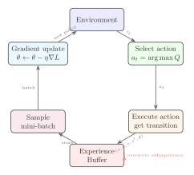
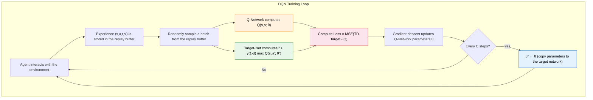

# 5.2 DQN Structure and Implementation

## Reading Guide

**Key Ideas**

- Master the architecture and loss function of the Q-network: a neural network approximates $Q(s,a)$ and is trained with the mean squared TD error.
- Understand how experience replay breaks sample correlation and improves data efficiency.
- Understand how the target network stabilizes the training target by delaying parameter updates.

**Key Formulas**

$$
\mathcal{L}(\theta) = \mathbb{E}\left[\left( r + \gamma (1 - d) \max_{a'} Q(s', a'; \theta^-) - Q(s, a; \theta) \right)^2\right]
$$

> **Deep Q-network loss function (MSE TD error):**
>
> - $\theta$: the parameters of the Q-network, the "student" being trained.
> - $\theta^-$: the parameters of the target network, a slowly updated copy used specifically to generate the "reference answer."
> - $Q(s, a; \theta)$: the Q-network's score for the current state-action pair, that is, "the student's answer."
> - $d$: the termination flag. If the episode really terminates, $d=1$ and there is no next-state value; otherwise $d=0$.
> - $r + \gamma (1-d) \max_{a'} Q(s', a'; \theta^-)$: the TD target, the immediate reward plus the discounted best future score given by the target network, that is, "the reference answer."
> - The outer $\mathbb{E}$: the expectation over all possible transitions $(s, a, r, s')$, which in practice is approximated by random sampling from the experience replay buffer.

The previous section answered "why DQN is needed": the Q table cannot hold continuous states and pixel input, and connecting a neural network directly to Q-Learning runs into sample correlation and a moving target. Now we turn to the second question: **how exactly does DQN organize this idea into an algorithm that can be trained?**

What happens if we use only one network, which both selects actions and computes Q values and also generates the TD target? A concrete example illustrates this.

**Step one: compute the TD target.** Suppose in some state the network predicts $Q(s, a) = 5.0$, and the network output for the next state is $\max Q(s', a') = 8.0$. Then:

$$\text{TD Target} = r + \gamma \times 8.0 = 1.0 + 0.99 \times 8.0 = 8.92$$

$$\text{TD Error} = 8.92 - 5.0 = 3.92$$

**Step two: update the parameters by gradient descent.** The network adjusts its parameters according to the TD error and pulls $Q(s, a)$ toward 8.92. So far everything is normal.

**Step three: the problem shows up.** The key is that the Q value of $s'$ is computed with the same set of parameters. After the parameter update, $\max Q(s', a')$ changes as well, perhaps from 8.0 to 4.0. The next time the same TD target is computed:

$$\text{TD Target}' = 1.0 + 0.99 \times 4.0 = 4.96$$

The "reference answer" jumps from 8.92 to 4.96, a difference of almost a factor of two. The network has just caught up with 8.92, and the target has run off to 4.96. When it catches up with 4.96, the target runs off somewhere else. The Q values oscillate violently or even diverge.

This is what Sutton & Barto call the "deadly triad": function approximation, bootstrapping, and off-policy learning, which make training extremely unstable when all three are present.

DQN's answer consists of three components. The Q-network replaces the table and outputs a value estimate for each action. Experience replay shuffles the samples obtained from continuous interaction so that a training batch no longer reflects only the most recent steps. The target network is a frozen copy of the Q-network used specifically to compute the TD target, and its parameters are hard-copied from the Q-network only every C steps, so the target stays still between two copies. Putting the three together gives the deep Q-network in the usual sense.

A reminder: in Chapter 4 we learned the core idea of **TD methods**: the value estimate can be updated after a single step, without waiting for a whole episode to end. The TD target is $r + \gamma V(s')$, that is, "the reward already in hand plus the estimated value of the next state." The TD target in a deep Q-network has exactly the same structure, with $V(s')$ replaced by $\max_{a'} Q(s', a')$, because Q-Learning evaluates action values and not state values.

Let us take the three components apart one by one.

## The Q-Network and the Loss Function

As noted above, using only one network makes the TD target move together with the parameters. DQN's solution is to maintain **two networks with the same structure but different update rhythms**:

- **The Q-network** (parameters $\theta$): responsible for selecting actions and for daily training, and updated by gradient descent at every step. This is the "student."
- **The target network** (parameters $\theta^-$): a frozen copy of the Q-network used specifically to compute the TD target. Its parameters are hard-copied from the Q-network every C steps and do not move at all between two copies. This is the "grader."

The two networks have exactly the same structure, and the difference lies only in the rhythm of the parameter updates. This design decouples "prediction" from "generating the reference answer," so the Q-network faces a stable optimization target for a stretch of time.

### The Architecture of the Q-Network

What the Q-network does is simple: it receives a state $s$ and outputs the Q value of each action. In LunarLander, the input is an 8-dimensional vector describing the lander's position, velocity, attitude, and leg-contact status. The output is 4 Q values, corresponding to the four discrete actions "no thrust," "left thruster," "main engine," and "right thruster."

```python
import torch
import torch.nn as nn

class QNetwork(nn.Module):
    """Q-Network: takes a state and outputs the Q value of each action"""

    def __init__(self, state_dim, action_dim, hidden_dim=128):
        super().__init__()
        self.net = nn.Sequential(
            nn.Linear(state_dim, hidden_dim),
            nn.ReLU(),
            nn.Linear(hidden_dim, hidden_dim),
            nn.ReLU(),
            nn.Linear(hidden_dim, action_dim)
        )

    def forward(self, x):
        return self.net(x)  # output shape: (batch_size, action_dim)
```

This code is very concise: a three-layer fully connected network with two hidden layers of 128 neurons each and ReLU activations. The input is the state vector, and the output is the Q value of each action. For LunarLander (`state_dim=8, action_dim=4`), the network still has only a few tens of thousands of parameters, light enough and still sufficient to express the nonlinear relationships in a low-dimensional control task.

Why does the network output the Q values of all actions instead of a single one? Because one forward pass gives the scores of all actions, with no need to run the network once per action. To select an action we only take the `argmax` of the output: whichever action has the largest Q value is chosen.

For Atari games, the input is an 84×84×4 stack of pixel frames, and a fully connected network is no longer enough: it has too many parameters and cannot capture the spatial structure of images. DeepMind's original paper used a convolutional neural network (CNN): a few convolutional layers first extract image features, and a fully connected layer then outputs the Q values. For low-dimensional vector input such as LunarLander, however, a simple MLP is enough. In the hands-on part of this chapter we first use an MLP to observe DQN on LunarLander, and leave the CNN architecture for the visual game project.

The training goal of the Q-network is to make the network's output Q values as close as possible to the "true" Q values. But we do not know what the true Q values are; if we could look them up, we would not need a neural network. So we construct the training target in the same way as Q-Learning:

$$\text{TD Target} = r + \gamma (1-d) \max_{a'} Q(s', a')$$

Then we minimize the mean squared error between the network output and the TD target:

$$\mathcal{L}(\theta) = \mathbb{E}\left[\left( r + \gamma (1-d) \max_{a'} Q(s', a'; \theta^-) - Q(s, a; \theta) \right)^2\right]$$

This formula looks complicated, so let us first sort out the "role" of each symbol in it:

| Symbol                                           | Meaning (intuitive reading)                                                           | Role                                              |
| ------------------------------------------------ | ------------------------------------------------------------------------------------- | ------------------------------------------------- |
| $\theta$                                         | The parameters of the Q-network (the network being trained)                           | The student, the one taking the exam              |
| $\theta^-$                                       | The parameters of the target network (a frozen copy of the Q-network)                 | The reference answer in the grader's hands        |
| $Q(s, a; \theta)$                                | The student's current answer: "I think this step is worth $X$ points"                 | The network's prediction                          |
| $r$                                              | The immediate reward actually received at this step                                   | Points already in the pocket                      |
| $d$                                              | Whether the episode truly terminated                                                  | Cuts off future value at termination              |
| $\gamma (1-d) \max_{a'} Q(s', a'; \theta^-)$     | From the new situation, the best future score given by the target network, discounted | "The most that can still be earned in the future" |
| $r + \gamma (1-d) \max_{a'} Q(s', a'; \theta^-)$ | The TD target: "how many points this should be worth"                                 | The reference answer                              |

Now let us assemble this loss function step by step.

**First building block: the TD target, the reference answer**

$$y = r + \gamma (1-d) \max_{a'} Q(s', a'; \theta^-)$$

The TD target is "the immediate reward plus the discounted best future score." If this step has reached a true terminal state, $d=1$ and the future term is zeroed out, so the target is only the immediate reward $r$. Note that the $Q$ here uses the target network's parameters $\theta^-$, and not the $\theta$ being trained. The reference answer must not change along with the student.

**Second building block: the TD error, how far the prediction is from the reference answer**

$$\delta = y - Q(s, a; \theta) = r + \gamma (1-d) \max_{a'} Q(s', a'; \theta^-) - Q(s, a; \theta)$$

The TD error is "the reference answer minus the student's answer." In a tabular method, we directly move the Q value by $\alpha \cdot \delta$ toward the TD target. In a neural network we cannot change a single Q value directly. We can only affect all Q values indirectly by modifying the parameters $\theta$.

**Third building block: the square, punishing large errors and tolerating small ones**

$$\mathcal{L}(\theta) = \mathbb{E}\left[\delta^2\right] = \mathbb{E}\left[\left(y - Q(s, a; \theta)\right)^2\right]$$

Why square instead of using $\delta$ directly? There are two reasons. First, $\delta$ can be positive or negative, and the signs cancel each other, so the average is close to 0 and looks like there is no error, even though the predictions may be wildly off. After squaring, the value is always positive and cannot be cancelled by sign. Second, squaring is lenient with small errors (an error of 0.1 costs 0.01) and harsh with large errors (an error of 1.0 costs 1.0, and an error of 3.0 costs 9.0), which forces the network to correct the most outrageous predictions first.

**Fourth building block: the expectation, averaging over all samples**

$$\mathcal{L}(\theta) = \mathbb{E}\left[\left(y - Q(s, a; \theta)\right)^2\right]$$

The outer $\mathbb{E}$ means "average over all possible transitions $(s, a, r, s')$." In practice we cannot enumerate all transitions, so we sample a batch at random from the experience replay buffer to approximate this expectation. This is the meaning of the "stochastic" in SGD (stochastic gradient descent).

Putting the four blocks together: the training process of a deep Q-network is to keep sampling from the experience replay buffer, compute the TD target (the reference answer), compare it with the network output (the student's answer), compute the loss as a mean squared error, and then update the parameters $\theta$ by backpropagation. In essence it is exactly the same as the tabular Q-Learning method, except that the parameters are now updated by gradient descent instead of directly modifying numbers in a table.

There is, however, a key detail we have mentioned repeatedly but not yet explained: how exactly do the "expectation" and the "random sampling" above work in practice? Why can we not simply train on the single piece of data the agent has just experienced? This leads to the second component.

## Experience Replay

The outer $\mathbb{E}$ of the loss function asks us to average over all transitions, but what does "all transitions" mean? In supervised learning the training data is collected in advance and shuffled, so the samples in each mini-batch are approximately independent. Reinforcement learning is nothing like this: each step the agent takes produces one experience $(s, a, r, s', d)$, and the experiences of consecutive steps describe tiny changes of the same scene.

This means that if we train the network directly on the data just experienced, adjacent samples are almost identical. In CartPole, the observation vectors of two consecutive frames may differ only in the digits after the decimal point. Deep learning requires data to be approximately independent and identically distributed (i.i.d.), and when training on such highly correlated data the gradient direction is dominated by the experience of the last few steps, and the network "forgets" what it learned before.

This is by no means an abstract theoretical worry. In its 2015 DQN paper DeepMind ran a comparison experiment: without experience replay, the agent on Atari Breakout repeatedly learns the policy of "bounce the ball to the left," because for hundreds of consecutive frames the ball bounces on the left. When the ball returns to the right, the network has already forgotten how to play the right side and has to learn it again from scratch. With experience replay, a batch can contain very different scenes at once, such as "ball in the upper left," "ball at the right edge," and "ball about to land," and only then can the network learn to handle all kinds of situations at the same time. A similar phenomenon appears in autonomous driving: if the model is trained only on the most recent 10 seconds of continuous data, it may learn to handle only "a straight road on a sunny day" and have no idea how to respond to a curve in the rain.

The solution of experience replay is simple but effective: store every transition $(s, a, r, s', d)$ that has been experienced in a buffer, and sample a small batch at random for each training step. Random sampling breaks temporal correlation. A batch may contain failed experience from early training and successful experience from later, so the gradient directions are more diverse.

What exactly is stored? Each interaction step produces one five-tuple:

| Component | Meaning            | CartPole example                                                           |
| --------- | ------------------ | -------------------------------------------------------------------------- |
| $s$       | Current state      | `[0.03, 0.12, -0.05, -0.32]` (position, velocity, angle, angular velocity) |
| $a$       | Action taken       | `0` (push left)                                                            |
| $r$       | Reward received    | `1.0` (the pole has not fallen; +1 each step)                              |
| $s'$      | Next state         | `[0.03, -0.05, -0.06, 0.18]` (the new observation after the action)        |
| $d$       | Whether terminated | `False` (the pole is still upright)                                        |

The replay buffer is a collection of such five-tuples. As the agent keeps interacting, the buffer gradually fills up. Here is what a replay buffer might actually store during CartPole training:

| #   | $s$ (state)                  | $a$ (action)     | $r$ (reward) | $s'$ (next state)            | $d$ (terminated) | Source                       |
| --- | ---------------------------- | ---------------- | ------------ | ---------------------------- | ---------------- | ---------------------------- |
| 1   | `[0.01, 0.12, 0.05, -0.32]`  | `1` (push right) | `1.0`        | `[0.01, 0.15, 0.04, -0.28]`  | `False`          | Episode 2, start             |
| 2   | `[0.02, 0.31, -0.12, 0.89]`  | `0` (push left)  | `1.0`        | `[0.01, 0.28, -0.10, 0.85]`  | `False`          | Episode 8, midway            |
| 3   | `[0.05, 0.44, 0.21, 1.02]`   | `1` (push right) | `1.0`        | `[0.06, 0.48, 0.24, 1.10]`   | `True`           | Episode 8, pole fell         |
| 4   | `[0.00, 0.02, 0.01, -0.05]`  | `0` (push left)  | `1.0`        | `[0.00, -0.01, 0.01, -0.03]` | `False`          | Episode 45, pole very stable |
| 5   | `[-0.03, -0.18, 0.08, 0.55]` | `1` (push right) | `1.0`        | `[-0.03, -0.14, 0.09, 0.50]` | `False`          | Episode 102, midway          |

A few things to note:

- In entry 3, $d=\text{True}$: the pole fell and the episode ended. In the TD target, $(1-d)=0$, so the future value is zeroed out and only the immediate reward $r=1.0$ remains. This experience teaches the network that "pushing right in this state makes the pole fall."
- Entry 4 comes from episode 45: the pole hardly moves, and the state vector is close to zero. This experience teaches the network that "when the pole is nearly vertical, staying still is also good."
- Different entries come from different times and different episodes. When a batch is drawn at random during training, the network sees starts, midgames, failures, and successes at the same time and is not dominated by a single phase.

During training, 64 such experiences are drawn at random, and each tells the network: "in this state, this action was taken, the result was this many points, and the environment became this." The network adjusts its Q-value predictions accordingly so that it can make better judgments when it meets similar states next time.



```python
import random
from collections import deque

class ReplayBuffer:
    """Experience replay buffer: stores and samples (s, a, r, s', done) transitions"""

    def __init__(self, capacity=10000):
        self.buffer = deque(maxlen=capacity)  # old data is evicted automatically when capacity is exceeded

    def push(self, state, action, reward, next_state, done):
        """Store one experience"""
        self.buffer.append((state, action, reward, next_state, done))

    def sample(self, batch_size):
        """Randomly sample a batch of experiences"""
        batch = random.sample(self.buffer, batch_size)
        states, actions, rewards, next_states, dones = zip(*batch)
        return (torch.FloatTensor(states),
                torch.LongTensor(actions),
                torch.FloatTensor(rewards),
                torch.FloatTensor(next_states),
                torch.FloatTensor(dones))

    def __len__(self):
        return len(self.buffer)
```

Experience replay has three benefits:

1. **Breaking temporal correlation**: random sampling ensures that each batch of training data comes from different time periods, so the gradient directions are diverse and the network is not trapped in the most recent experience.
2. **Improving data efficiency**: each experience can be sampled many times for training instead of being thrown away after one use. In a neural network, one experience can influence the Q-value estimates of all states, so reusing it is valuable.
3. **Smoothing the training process**: old and new experience are mixed together, so the network does not overfit to the most recent experience.

The size of the replay buffer is a hyperparameter that needs tuning. If it is too small, the experience in the buffer is not diverse enough and training works poorly. If it is too large, outdated experience from long ago (produced by a Q-network that was not yet accurate at the time) is still sampled and may slow convergence. Commonly used capacities in practice are $10^4$ to $10^6$.

Experience replay solves the problems of "where the data comes from" and "sample correlation." One problem remains unsolved, however: the TD target $r + \gamma \max_{a'} Q(s', a'; \theta^-)$ in the loss function can itself be unstable. If the TD target changes in step with the network parameters, the network faces a new target after every update, and the optimization becomes hard to converge. This leads to the third and last component.

## The Target Network

The update target of Q-Learning is $r + \gamma \max_{a'} Q(s', a')$. In a tabular method this target is relatively stable, because $Q(s', a')$ lives in a separate table cell, and updating $Q(s, a)$ does not change $Q(s', a')$. In a neural network the parameters are shared: updating $Q(s, a)$ may also change the value of $Q(s', a')$. That is, while the network modifies its own predictions, it also changes the target it has to approach next.

The solution of the target network is also simple: maintain two networks, a Q-network $\theta$ used to select actions and for daily updates, and a target network $\theta^-$ used specifically to compute the TD target. The target network's parameters do not take part in gradient descent. They are copied from the Q-network every fixed number of steps:

```python
# Every target_update steps, copy the Q-network's parameters to the target network
if step % target_update == 0:
    target_net.load_state_dict(q_net.state_dict())
```

Use the target network when computing the TD target:

```python
# Compute the TD target with the target network (a stable target)
with torch.no_grad():
    td_target = reward + gamma * target_net(next_state).max() * (1 - done)
```

As a result, between two parameter copies the TD target is fixed, and the target no longer moves around. The Q-network can learn calmly toward a stable target instead of chasing a moving one. Updating the target network every fixed number of steps amounts to moving the target to a new position from time to time, giving the Q-network a more accurate target to chase.

The update frequency of the target network is another hyperparameter. If it is updated too often (for example, at every step), the target network is almost identical to the Q-network and does not stabilize anything. If it is updated too rarely (for example, only every 10000 steps), the TD target given by the target network is too stale, and what the Q-network learns may be outdated information. Update frequencies commonly used in practice are once every 100 to 1000 steps.

## Implementing DQN from Scratch

So far we have taken apart the Q-network, experience replay, and the target network from the angle of concepts and formulas. Now let us change perspective: if you had to write a DQN from scratch, what would the line of thought be?

The idea is not complicated: build the network first, then prepare the data, then define the update logic, and finally assemble everything into a training loop. Using CartPole as the example (`state_dim=4, action_dim=2`), we build it step by step. At every step we explain why each parameter is set as it is and what would happen with another value.

### Defining the Q-Network

The first thing is to write a network that takes a state and outputs the Q value of each action. The CartPole observation is a 4-dimensional vector (cart position, velocity, pole angle, angular velocity), and the actions are 2 discrete choices (push left, push right). The network therefore has to map a 4-dimensional input to a 2-dimensional output.

```python
import torch
import torch.nn as nn

class QNetwork(nn.Module):
    def __init__(self, state_dim, action_dim, hidden_dim=128):
        super().__init__()
        self.net = nn.Sequential(
            nn.Linear(state_dim, hidden_dim),   # input layer → hidden layer
            nn.ReLU(),                          # activation function
            nn.Linear(hidden_dim, hidden_dim),  # hidden layer → hidden layer
            nn.ReLU(),
            nn.Linear(hidden_dim, action_dim),  # hidden layer → output layer
        )

    def forward(self, x):
        return self.net(x)  # output shape: (batch_size, action_dim)
```

Here are the implementation choices, one by one:

- **Two hidden layers**: One layer has limited expressive power, and three or more layers easily overfit a 4-dimensional input. Two layers are a common starting point for low-dimensional tasks.
- **`hidden_dim=128`**: The total number of parameters is about $4 \times 128 + 128 \times 128 + 128 \times 2 \approx 17000$. 64 is on the small side and 256 on the large side; 128 balances accuracy and efficiency and is also enough when migrating to LunarLander. Atari pixel input needs a CNN in place of the MLP.
- **ReLU activation**: It is fast to compute (it only checks the sign), its gradient is constantly 1 on the positive side so it does not vanish, and its output has no upper bound so it does not limit the range of Q values. Sigmoid/Tanh suffer from vanishing gradients and a restricted output range.
- **No activation on the output layer**: Q values can be any real number. ReLU would truncate negative values, and Sigmoid/Tanh would limit the output range.
- **Output the Q values of all actions at once**: Choosing an action needs only one forward pass plus `argmax`, with no need to run the network once per action. The limitation is that it handles only discrete actions, and continuous actions need Actor-Critic (Chapter 7).

::: details Why these choices?
**Why two hidden layers?** A network with one hidden layer can in theory work too, but its expressive power is limited: it can only learn a linear combination of the inputs followed by one nonlinear transformation. Two hidden layers let the network learn more complex state-action mappings, such as the nonlinear relationship "when the pole leans right and its speed is growing, the value of pushing right rises sharply." Three or more layers would of course also work, but the CartPole state has only 4 dimensions, and a network that is too deep easily overfits and trains more slowly.

**Why `hidden_dim=128`?** 64 also runs, but the capacity is on the small side and the Q-value approximation may not be precise enough. 256 or even 512 is too many parameters for CartPole (over 100 thousand), which makes training slower and prone to overfitting. 128 is an empirical balance point: the network has about 17000 parameters in total, which is very light for CPU training. It is equally sufficient when migrating to LunarLander (`state_dim=8, action_dim=4`). With Atari pixel input, a CNN is needed in place of the MLP.

**Why ReLU instead of Sigmoid or Tanh?** There are three reasons. First, ReLU is fast to compute, since it only checks whether the input is greater than 0, while Sigmoid and Tanh need exponentials. Second, the ReLU gradient is constantly 1 on the positive side, which eases the vanishing-gradient problem in multi-layer networks. The gradient of Sigmoid is at most 0.25, so after two stacked layers the signal has already decayed to 0.0625. Third, Q values can be large (the cumulative return in CartPole can exceed 200), and Sigmoid squashes the output into $(0, 1)$ and Tanh into $(-1, 1)$, which would severely limit the range of Q values that can be expressed.

**Why no activation function on the output layer?** The Q value is the expected cumulative return of an action and in theory can be any real number. With ReLU, a negative Q value ("this action is terrible") would be truncated to 0, and the network could not express "this action should be actively avoided." With Sigmoid or Tanh, the Q value would be restricted to $(0,1)$ or $(-1,1)$, while the actual returns in CartPole far exceed this range.

**Why output the Q values of all actions at once?** This is far more efficient than "input the state and the action, output a single Q value": choosing an action takes one forward pass followed by `argmax`, instead of running the network once for each action. The drawback is that it handles only discrete actions and cannot be migrated directly to continuous action spaces (that needs Actor-Critic methods, which we cover in Chapter 7).
:::

### Defining Experience Replay

The second thing is to prepare a container for historical experience and sample from it at random during training to break correlation. Every step the agent takes produces one transition $(s, a, r, s', d)$, and the replay buffer simply accumulates these transitions.

```python
import random
from collections import deque

class ReplayBuffer:
    def __init__(self, capacity=10000):
        self.buffer = deque(maxlen=capacity)

    def push(self, state, action, reward, next_state, done):
        self.buffer.append((state, action, reward, next_state, done))

    def sample(self, batch_size):
        batch = random.sample(self.buffer, batch_size)
        states, actions, rewards, next_states, dones = zip(*batch)
        return (
            torch.FloatTensor(states),      # (B, state_dim)
            torch.LongTensor(actions),       # (B,)
            torch.FloatTensor(rewards),      # (B,)
            torch.FloatTensor(next_states),  # (B, state_dim)
            torch.FloatTensor(dones),        # (B,)
        )

    def __len__(self):
        return len(self.buffer)
```

Here are the implementation choices, one by one:

- **`capacity=10000`**: 500 episodes of CartPole training produce thousands to tens of thousands of transitions, and 10000 entries keep roughly the most recent few dozen to a hundred episodes. If it is too small, the experience is not diverse enough, and if it is too large, outdated experience is retained and slows convergence. LunarLander commonly uses $10^4$ to $10^5$, and Atari uses $10^5$ to $10^6$.
- **`deque(maxlen=capacity)`**: When full, the oldest element is evicted automatically. Removal from the head is $O(1)$, unlike a `list`, and it is more flexible than a numpy array.
- **`FloatTensor` and `LongTensor`**: States, rewards, and so on use `FloatTensor` to take part in math operations. Actions use `LongTensor` because `gather` requires integer indices. `dones` uses `FloatTensor` because a `(1 - dones)` multiplication comes later.

::: details Why is the capacity 10000?
Each CartPole episode usually lasts 10 to 200 steps, so 500 episodes of training produce thousands to tens of thousands of transitions. 10000 entries retain roughly the experience of the most recent few dozen to a hundred episodes, enough to provide diverse training samples. If it is too small (for example 1000), the experience in the buffer is not diverse enough and training is easily dominated by the last few episodes. If it is too large (for example $10^6$), very early experience is retained, when the Q-network was still poor and produced low-quality "reference answers," and sampling this old experience slows convergence instead.
:::

### Defining the Loss Function and Parameter Update

The third thing is the core update logic. This is the most important part of the whole DQN: it combines the Q-network, the target network, and experience replay to complete one full gradient update. We first define the initialization of the `DQNAgent` class and then write the `update` method.

Why do we need two networks? The Q-network outputs Q values and selects actions, and is updated by gradient descent all the time. The target network is a frozen copy of the Q-network used specifically to compute the TD target. If only one network were used, the network would change its prediction while also using its freshly changed self to produce the "reference answer," like a student changing the reference answer while taking the exam, which can never be caught up with. The two networks have a clear division of labor: the Q-network is the "student" and the target network is the "grader." The grader updates the answer only from time to time (through a hard copy), and between two updates the student has a stable target to chase.

```python
import torch.optim as optim
from torch.nn.utils import clip_grad_norm_

class DQNAgent:
    def __init__(self, state_dim, action_dim, lr=1e-3, gamma=0.99):
        self.action_dim = action_dim
        self.gamma = gamma

        # Q-network (the student) and target network (the grader)
        self.q_net = QNetwork(state_dim, action_dim)
        self.target_net = QNetwork(state_dim, action_dim)
        self.target_net.load_state_dict(self.q_net.state_dict())
        self.target_net.eval()

        self.optimizer = optim.Adam(self.q_net.parameters(), lr=lr)
        self.buffer = ReplayBuffer(capacity=10000)
```

Here are the initialization parameters, one by one:

- **`lr=1e-3`**: The default learning rate of Adam and also a common starting point for DQN. If it is too large, the Q values oscillate and do not converge, and if it is too small, no improvement is visible in 500 episodes. When training is unstable, lower it first to $5 \times 10^{-4}$.
- **`gamma=0.99`**: The discount factor. With 0.99, a reward 100 steps later decays to $0.99^{100} \approx 0.366$, balancing the present and the future. 0.9 is too short-sighted and 0.999 has too much variance.
- **Synchronized initialization of `target_net`**: The two networks have the same parameters, which keeps the early TD target and the Q values on the same scale.
- **`target_net.eval()`**: Evaluation mode turns off the random behavior of Dropout and BatchNorm. The current MLP has no such layers, but this is a good habit.
- **The optimizer contains only the `q_net` parameters**: The target network does not take part in gradient updates and is only hard-copied through `update_target()`.

::: details Why do we need two networks?
The parameters $\theta$ of the Q-network are updated by gradient descent at every step. The TD target is computed as $y = r + \gamma \max_{a'} Q(s', a'; \theta)$. If the parameters of the Q-network were used here as well, the TD target would change after every update of $\theta$. The network would be chasing a moving target: at this step it thinks the TD target should be 5.0, after the parameter update the "reference answer" becomes 3.0, and at the next step it has to chase again.

The solution of the target network is to maintain two independent networks. The Q-network $\theta$ selects actions and handles daily updates. The target network $\theta^-$ is used only to compute the TD target, and its parameters are hard-copied from the Q-network every C steps. Between two copies the TD target is fixed, so the target stops moving and the Q-network can learn calmly.

This problem does not exist in tabular Q-Learning, because $Q(s, a)$ and $Q(s', a')$ are different cells of the table, and updating one does not affect the other. A neural network shares parameters, and changing one output affects all outputs, so an extra mechanism is needed to decouple them.
:::

::: details Why must target_net be initialized in sync?
If the target network used randomly initialized parameters and the Q-network used another set of random parameters, the Q-value outputs of the two networks could be on completely different scales, for example the Q-network outputs -5.0 and the target network outputs 200.0. This would make the TD target extremely large or small, the MSE loss would explode, and the gradients would push the parameters far away. `load_state_dict(q_net.state_dict())` makes the two networks start from the same point, so at least in early training the TD target and the Q values are on the same scale.
:::

::: details Why is lr 1e-3 and not another value?
The learning rate controls the step size of each parameter update. $10^{-3}$ is Adam's default in most deep learning tasks. If it is too large, the Q values oscillate violently: this step predicts 5.0, the next jumps to -3.0, the TD target jumps around too, and training cannot converge. If it is too small, convergence is extremely slow, and 500 episodes may show no improvement at all. If training is unstable, the usual first step is to lower it to $5 \times 10^{-4}$ or $1 \times 10^{-4}$, rather than changing the network structure right away.
:::

::: details Why is gamma 0.99?
The discount factor controls how much the agent values future rewards. 0.99 means a reward 100 steps later decays to $0.99^{100} \approx 0.366$. 0.9 decays faster, with $0.9^{100} \approx 2.7 \times 10^{-5}$, so the agent looks almost only at the next few steps. 0.999 decays extremely slowly, and the variance of the Q-value estimate grows, because estimating the cumulative return in the far future makes the uncertainty grow exponentially. 0.99 is the empirical starting point for most RL tasks.
:::

Now let us write the core `update` method:

```python
    def update(self, batch_size):
        """Core update: forward and backward pass over one batch"""
        if len(self.buffer) < batch_size:
            return 0.0

        # Sample a batch from the replay buffer
        states, actions, rewards, next_states, dones = self.buffer.sample(batch_size)

        # Forward pass of the Q-network
        q_values = self.q_net(states).gather(1, actions.unsqueeze(1)).squeeze(1)

        # Forward pass of the target network
        with torch.no_grad():
            next_q_max = self.target_net(next_states).max(dim=1)[0]
            targets = rewards + self.gamma * next_q_max * (1 - dones)

        # Compute the MSE loss
        loss = nn.MSELoss()(q_values, targets)

        # Backpropagation and parameter update
        self.optimizer.zero_grad()
        loss.backward()
        clip_grad_norm_(self.q_net.parameters(), max_norm=10)
        self.optimizer.step()

        return loss.item()
```

`update()` is the computational core of the whole DQN. Let us take it apart step by step:

- **Buffer check**: When `len(self.buffer) < batch_size`, it returns immediately. Early in training the buffer has fewer than 64 entries, and `random.sample` would raise an error.
- **`gather`**: From the `(B, action_dim)` output, pick the Q value corresponding to the action actually taken, using the action index.
- **`torch.no_grad()`**: The target network is frozen and no computation graph is built. The gradient flows only through `q_values`, and `targets` is a constant.
- **`.max(dim=1)[0]`**: Take the maximum of each row, that is, $\max_{a'} Q(s', a'; \theta^-)$. `[0]` takes the values and `[1]` takes the indices.
- **TD target**: `rewards + gamma * next_q_max * (1 - dones)`. At termination `dones=1` and the future value is zeroed.
- **MSE loss**: $\frac{1}{B}\sum (y_i - Q_i)^2$. It penalizes large errors more strongly than L1 (for an error of 2, MSE gives a penalty of 4 and L1 gives 2).
- **`zero_grad` → `backward` → `clip` → `step`**: PyTorch's fixed four-step update pattern.

::: details Intuition for the gather operation
`self.q_net(states)` outputs shape `(B, 2)`, and each row holds the Q values of the two actions. The loss function, however, needs only the Q value of the action actually executed. `gather(1, actions.unsqueeze(1))` picks one number from each row according to the column index given by `actions`:

```
q_net output:                actions:    gather result:
[[ 0.3,  0.8],              [1,          [0.8,    ← row 0 takes column 1
 [ 1.2, -0.5],               0,           1.2,    ← row 1 takes column 0
 [-0.1,  0.6],               1,           0.6,    ← row 2 takes column 1
 ...]                         ...]         ...]
```

`actions.unsqueeze(1)` changes the shape from `(B,)` to `(B, 1)`, since `gather` needs the index and the input tensor to have matching dimensions. `.squeeze(1)` squeezes the result from `(B, 1)` back to `(B,)`.
:::

::: details Why gradient clipping with max_norm=10?
The loss surface of reinforcement learning is more rugged than that of supervised learning. A batch may mix samples with a TD error of 0.1 and samples with a TD error of 50, and the gradient from the latter may push the parameters far away. `max_norm=10` is an empirical value, and many OpenAI experiments also use 10 or 0.5. If it is too large (100), it is as good as no clipping, and if it is too small (1), it limits the learning speed. If the loss suddenly spikes during training and then does not come down, try reducing this value.
:::

::: details Why Adam and not SGD?
Adam uses more than the current gradient. It also maintains a first-order momentum (an exponential moving average of the gradient) and a second-order momentum (an exponential moving average of the squared gradient), and it adjusts the effective learning rate of each parameter automatically. The gradient variance of DQN is large, since a batch may contain large and small values, and Adam's adaptivity helps stabilize training. Plain SGD is more sensitive to the learning rate and needs more careful tuning.
:::

### Action Selection and Target Network Synchronization

The fourth thing is to add action selection and the target-network update.

```python
    def select_action(self, state, epsilon):
        """ε-greedy action selection"""
        if random.random() < epsilon:
            return random.randint(0, self.action_dim - 1)
        with torch.no_grad():
            q_values = self.q_net(torch.FloatTensor(state).unsqueeze(0))
        return q_values.argmax(dim=1).item()

    def update_target(self):
        """Hard update: copy the Q-network parameters to the target network"""
        self.target_net.load_state_dict(self.q_net.state_dict())
```

Here are the implementation choices, one by one:

- **ε-greedy**: Early in training the Q-network's predictions are almost random, and always taking the `argmax` would repeat the action that happened to score high forever. ε-greedy forces exploration with probability $\varepsilon$, and once it decays to a small value later on, the agent turns to exploitation.
- **`unsqueeze(0)`**: `state` has shape `(4,)`, and the network expects `(B, 4)`. `unsqueeze(0)` inserts the batch dimension and gives `(1, 4)`.
- **`argmax(dim=1).item()`**: `(1, 2)` → `argmax` → `(1,)` → `.item()` → Python int. `env.step()` needs a plain integer and cannot take a tensor.
- **Hard update**: Directly $\theta^- \leftarrow \theta$, as in the original DQN paper. The soft update $\theta^- \leftarrow \tau \theta + (1-\tau) \theta^-$ is smoother and is an improvement from later algorithms such as DDPG.

::: details Why ε-greedy and not another exploration strategy?
Early in training the Q-network's predictions are almost random, and if it only takes the `argmax`, the agent keeps repeating the one or two actions that happened to score high at first and never discovers a better policy. ε-greedy forces random exploration with probability $\varepsilon$, which guarantees that the agent has a chance to visit all state-action pairs. Late in training $\varepsilon$ decays to a small value, and the agent mainly exploits what it has learned. More advanced exploration strategies (such as Noisy Networks and intrinsic curiosity) are discussed in later chapters.
:::

### The Training Loop

The last thing is to assemble all the parts into the training loop.

```python
import gymnasium as gym

num_episodes = 500
batch_size = 64
epsilon_start, epsilon_end, epsilon_decay = 1.0, 0.01, 0.995
target_update_freq = 10

env = gym.make("CartPole-v1")
agent = DQNAgent(state_dim=4, action_dim=2)
epsilon = epsilon_start

for episode in range(num_episodes):
    state, _ = env.reset()
    while True:
        action = agent.select_action(state, epsilon)
        next_state, reward, done, truncated, _ = env.step(action)
        agent.buffer.push(state, action, reward, next_state, float(done))
        agent.update(batch_size)
        state = next_state
        if done or truncated:
            break

    epsilon = max(epsilon_end, epsilon * epsilon_decay)
    if (episode + 1) % target_update_freq == 0:
        agent.update_target()
```

Here are the hyperparameter choices, one by one:

- **`num_episodes=500`**: The criterion for "solving" CartPole-v1 is an average of $\geq 475$ over 100 consecutive episodes, and DQN usually reaches it in 200 to 400 episodes. 500 episodes are enough. Failure to converge is usually not a matter of the number of episodes but of other hyperparameters being wrong.
- **`batch_size=64`**: 32 has large gradient variance and is unstable, and 256 drowns the key samples in ordinary experience. 64 or 128 is the common range in the original DQN paper.
- **`epsilon_start=1.0`**: Fully random at the start. The freshly initialized Q-network outputs meaningless values, and 100% exploration ensures uniform coverage of the state space.
- **`epsilon_end=0.01`**: Keeps 1% randomness as a safety net. With exploration eliminated completely, the Q-network can never correct itself when it judges wrongly.
- **`epsilon_decay=0.995`**: After 100 episodes $\approx 0.61$, after 200 $\approx 0.37$, and after 400 $\approx 0.14$. The first half explores thoroughly, and the second half shifts gradually toward exploitation. 0.95 is too fast and 0.999 too slow.
- **`target_update_freq=10`**: Sync the target network every 10 episodes. Too often is as good as having no target network, and too rarely makes the target too old. LunarLander usually counts in steps, updating every 1000 steps.
- **`float(done)`**: Gymnasium returns a boolean, which has to be converted to a float before it can take part in the `(1 - dones)` multiplication.
- **`update` at every step**: Train while collecting, which maximizes data usage. When the buffer holds fewer than a batch, `update` skips internally.

::: details Comparison of epsilon decay speeds
After each episode $\varepsilon \leftarrow \varepsilon \times \text{epsilon\_decay}$. The effect of different decay factors:

| Decay factor | After 100 episodes | After 200 episodes | After 400 episodes | Effect                                                         |
| ------------ | ------------------ | ------------------ | ------------------ | -------------------------------------------------------------- |
| 0.95         | 0.006              | —                  | —                  | Too fast: the policy hardens before any exploration            |
| 0.99         | 0.366              | 0.134              | 0.018              | Somewhat fast; usable for some tasks                           |
| **0.995**    | **0.606**          | **0.368**          | **0.135**          | **Balanced: explore in the first half, exploit in the second** |
| 0.999        | 0.905              | 0.819              | 0.670              | Too slow: still very random after 500 episodes                 |

:::

::: details Why call update at every step?
In this training loop, every action step is immediately followed by one round of sampling from the buffer and training. This is the approach of the original DQN paper: train while collecting data, which maximizes data usage. Some implementations train only after each episode ends, but that uses data less efficiently and converges more slowly. When the buffer holds fewer than a batch, `update` skips internally, so there is no need to worry about too little data early in training.
:::

At this point a complete DQN has been built from scratch. The core of the whole implementation is the `update()` method: the forward pass computes the Q values and the TD target, MSE computes the loss, and backpropagation updates the parameters. The rest of the code (the network definition, the replay buffer, action selection, and the training loop) all serves this logic.

## Learning and Inference: Two Uses of the Same Network

The training phase and the inference phase use the same Q-network, but run it in completely different ways:

|                       | Training (learning)                                            | Inference (use)                                   |
| --------------------- | -------------------------------------------------------------- | ------------------------------------------------- |
| Action selection      | ε-greedy: explore randomly with probability $\varepsilon$      | Pure greedy: $a = \arg\max_{a'} Q(s, a'; \theta)$ |
| Experience collection | Store each step in the replay buffer                           | Not needed                                        |
| Parameter update      | Sample from the replay buffer, compute the loss, backpropagate | No parameter updates                              |
| Target network        | Takes part in computing the TD target, copied periodically     | Not used                                          |
| Network mode          | `q_net.train()`                                                | `q_net.eval()`                                    |

Exploration is needed in training because the agent has to discover better policies. If it only ever picks the action it currently believes is best, it may never reach more valuable regions. Exploration is turned off at inference because we want to evaluate **what the network has really learned**, and not the luck of its random wandering.

The difference in code is a single line:

```python
# May explore randomly
action = agent.select_action(state, epsilon=0.1)

# Fully greedy
action = agent.select_action(state, epsilon=0.0)
```

With `epsilon=0.0`, `random.random() < 0.0` is always false, so the `argmax` branch is always taken. This is why exploration has to be turned off during evaluation: otherwise random actions mix into the evaluation result, and we cannot tell whether the network itself has learned well.

## The Complete Deep Q-Network Algorithm

The collaboration of the three components in the training loop is as follows:



Putting the three components together, the complete training procedure of the deep Q-network is as follows:

$$
\begin{aligned}
& \textbf{Algorithm: Deep Q-Network (DQN)} \\[6pt]
& \textbf{1:}\ \text{Initialize the Q-network parameters } \theta\text{, the target network } \theta^- \leftarrow \theta\text{, and the replay buffer } \mathcal{D} \\
& \textbf{2:}\ \textbf{for}\ \mathrm{episode} = 1, 2, \ldots\ \textbf{do} \\
& \textbf{3:}\ \quad \text{Obtain the initial state } s \\
& \textbf{4:}\ \quad \textbf{for}\ t = 1, 2, \ldots\ \textbf{do} \\
& \textbf{5:}\ \qquad a \leftarrow \varepsilon\text{-greedy}(Q(s, \cdot\,; \theta)) \\
& \textbf{6:}\ \qquad \text{Execute } a\text{, observe } r, s', d \\
& \textbf{7:}\ \qquad \mathcal{D}.\mathrm{push}(s, a, r, s', d) \\
& \textbf{8:}\ \qquad \text{Sample a batch } \{(s_i, a_i, r_i, s'_i, d_i)\}_{i=1}^{B} \text{ from } \mathcal{D} \\
& \textbf{9:}\ \qquad y_i \leftarrow r_i + \gamma (1 - d_i) \max_{a'} Q(s'_i, a'; \theta^-) \\
& \textbf{10:}\ \qquad \mathcal{L}(\theta) \leftarrow \frac{1}{B} \sum_{i=1}^{B} \bigl(y_i - Q(s_i, a_i; \theta)\bigr)^2 \\
& \textbf{11:}\ \qquad \theta \leftarrow \theta - \alpha \nabla_\theta \mathcal{L} \\
& \textbf{12:}\ \qquad \text{Every } C\text{ steps: } \theta^- \leftarrow \theta \\
& \textbf{13:}\ \qquad s \leftarrow s' \\
& \textbf{14:}\ \quad \textbf{end for} \\
& \textbf{15:}\ \textbf{end for}
\end{aligned}
$$

Here $\varepsilon\text{-greedy}$ means exploring at random with probability $\varepsilon$ and choosing $a = \arg\max_{a'} Q(s, a'; \theta)$ with probability $1-\varepsilon$.

Compared with the tabular Q-Learning method of Chapter 3, the deep Q-network makes only three changes: a neural network replaces the table (generalization), experience replay is added (breaking correlation), and a target network is added (stabilizing the target). The core TD error logic, "the gap between prediction and reality," is unchanged.

<details>
<summary>Question to think about: once the replay buffer is full, old experience is evicted. What if a "key experience" (such as reaching the goal for the first time) gets evicted?</summary>

In standard experience replay, old experience is evicted in first-in-first-out (FIFO) order. It is indeed possible for a key experience to be evicted, but since the buffer is not yet full early in training, key experiences are usually sampled many times. In addition, one improved version of DQN, Prioritized Experience Replay, gives experiences with a large TD error a higher sampling probability, so that "surprising" experiences are not easily overlooked. We discuss this improvement in [5.4 DQN Improvements](./dqn-family).

</details>

Now that we have taken apart the three components of the deep Q-network, let us put them into one complete training run on LunarLander and observe them: [Hands-On: LunarLander](./lunar-lander).

## Summary

- **The Q-network** approximates $Q(s,a)$ with a neural network, outputs the Q values of all actions in one forward pass, and uses `gather` to pick out the score of the action actually executed.
- **The loss function** is assembled from four building blocks: the TD target (the reference answer), the TD error (the prediction gap), the square (punishing large errors), and the expectation (the batch average).
- **Experience replay** stores the transitions obtained from continuous interaction in a buffer, and random sampling breaks temporal correlation and improves data efficiency.
- **The target network** provides a stable TD target through delayed parameter copying and `torch.no_grad()`, avoiding "chasing itself."
- **Training and inference** use the same Q-network: training uses ε-greedy exploration plus parameter updates, while inference uses pure greedy selection with frozen parameters.
- The data flow of one parameter update: sample a batch → Q-network forward pass → target-network forward pass → TD target → MSE loss → backpropagation → parameter update.
