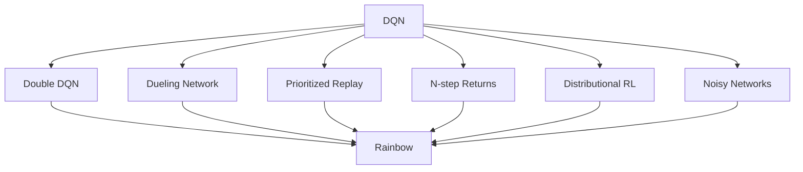

# 5.4 DQN Improvements

In the previous section, we used `LunarLander-v3` to watch a complete DQN training run.
That experiment shows two things. First, experience replay and a target network really do let the neural-network version of Q-Learning learn.
Second, even on a low-dimensional control task the evaluation curve still fluctuates, and some episodes still fail.

This is not an accident. The original DQN combines Q-Learning, a neural network, experience replay, and a target network,
but it still carries several structural problems.
For example, the maximum operation in the TD target tends to select actions whose values are overestimated.
Outputting a Q value for every action directly makes it hard for the network to exploit information about "how good the state itself is."
Uniform sampling of experience gives the same update budget to important samples and ordinary ones.

This section introduces the most common families of improvements that came after DQN.
These methods do not change the basic goal of "learning an action-value function."
Instead, they modify the original DQN in the TD target, the network structure, replay sampling, and the exploration scheme.
Understanding these improvements helps us judge,
when a DQN experiment behaves unstably, whether the problem lies in value estimation, function structure, data utilization, or insufficient exploration.

## Double DQN

Recall the TD target of the original DQN. Given an experience
$(s,a,r,s',d)$, where $d$ indicates whether the next state is terminal,
DQN uses the target network $Q(\cdot,\cdot;\theta^-)$ to compute

$$
y = r + \gamma (1-d)\max_{a'} Q(s',a';\theta^-).
$$

The maximum operation here plays two roles at once:
it selects the action that looks best in the next state,
and it also uses the same set of estimates to score that action.
If the estimates for all actions carry noise,
the maximum is more likely to pick an action that the noise has pushed up.
So even if each individual Q-value estimate is unbiased on average,
the estimate after taking the $\max$ can be too high.
Formally, since the maximum is a convex function, we generally have

$$
\mathbb{E}\left[\max_a \hat{Q}(s,a)\right]
\geq
\max_a \mathbb{E}\left[\hat{Q}(s,a)\right].
$$

Double DQN separates "selecting the action" from "evaluating the action."
It first uses the current network to select the action

$$
a^\ast = \arg\max_{a'} Q(s',a';\theta),
$$

and then uses the target network to evaluate that action:

$$
y_{\text{Double}}
=
r + \gamma(1-d) Q(s',a^\ast;\theta^-).
$$

Compared with the original DQN, the change happens only in the TD target.
The current network $\theta$ decides which action is best,
and the target network $\theta^-$ is only responsible for assigning a value to that action.
The errors of the two networks no longer add up directly through the same maximum operation,
so Q-value overestimation is alleviated.

In code, this change usually takes just a few lines:

```python
with torch.no_grad():
    best_actions = q_net(next_states).argmax(dim=1)
    next_q = target_net(next_states)
    next_q_selected = next_q.gather(1, best_actions[:, None]).squeeze(1)
    target = rewards + gamma * (1 - dones) * next_q_selected
```

The importance of Double DQN is that it introduces no new network structure
and does not change how the replay buffer is organized,
yet it directly corrects one of the most common estimation biases of the original DQN.
Many later implementations therefore adopt Double DQN as the default basic version of DQN.

## Dueling DQN

The original DQN has the network output the action value $Q(s,a)$ of every action directly.
This is natural when the number of actions is small,
but it does not explicitly separate two questions:
whether a state is favorable in itself,
and how much the different actions in that state differ from one another.

In Chapter 3 we already distinguished the state value $V(s)$ from the action value $Q(s,a)$.
If we let the advantage function $A(s,a)$ denote the extra value of action $a$ relative to the average level of that state,
we can write

$$
Q(s,a)=V(s)+A(s,a).
$$

However, this decomposition is not unique by itself.
If we add a constant to $V(s)$ and subtract the same constant from all $A(s,a)$,
the resulting $Q(s,a)$ does not change.
Dueling DQN therefore subtracts the mean of the advantages when it composes the Q values:

$$
Q(s,a)
=
V(s)
+
A(s,a)
-
\frac{1}{|\mathcal{A}|}\sum_{a'\in\mathcal{A}} A(s,a').
$$

Here $\mathcal{A}$ is the action set.
After subtracting the mean advantage, the mean of all action advantages is fixed at 0,
so $V(s)$ mainly represents the value of the state itself,
and $A(s,a)$ mainly represents the relative differences between actions.

In terms of network structure, Dueling DQN first shares a feature-extraction trunk
and then splits into two branches:
one branch outputs the scalar $V(s)$,
and the other branch outputs $A(s,a)$ for each action.
Finally the Q values of all actions are composed according to the formula above.

```python
features = backbone(states)

values = value_head(features)          # shape: [batch_size, 1]
advantages = advantage_head(features)  # shape: [batch_size, num_actions]
q_values = values + advantages - advantages.mean(dim=1, keepdim=True)
```

This structure is especially useful in states where the actions differ little.
In LunarLander, for example,
when the lander is still far above the ground,
several actions may not immediately change success or failure in the short term;
yet the height, velocity, and attitude of the state already determine
whether it is in a favorable or a dangerous position.
The Dueling structure lets the network learn this kind of state value early,
without relying entirely on independent estimates of each action's Q value.

## Prioritized Experience Replay

Standard experience replay samples uniformly from the replay buffer.
If the buffer holds $N$ experiences,
each experience is sampled with probability $1/N$.
This is simple and breaks temporal correlation,
but it ignores that different samples may contribute differently to learning.

A natural measure is the TD error.
For the $i$-th experience, write

$$
\delta_i = y_i - Q(s_i,a_i;\theta).
$$

If $|\delta_i|$ is large,
the current network's prediction for this experience is far from the TD target.
Prioritized Experience Replay (PER) accordingly assigns each experience the priority

$$
p_i = |\delta_i| + \epsilon,
$$

where $\epsilon>0$ keeps the priority from being 0.
The sampling probability is defined as

$$
P(i)=\frac{p_i^\alpha}{\sum_k p_k^\alpha}.
$$

The parameter $\alpha$ controls the strength of prioritized sampling.
When $\alpha=0$, $P(i)$ reduces to uniform sampling;
when $\alpha=1$, the sampling probability is proportional to the priority.
In practice a value between the two is usually chosen,
so that the model sees high-TD-error samples more often
while still retaining some coverage.

Non-uniform sampling, however, changes the distribution of the training data.
To reduce the bias this introduces,
PER uses importance sampling weights

$$
w_i = \left(\frac{1}{N P(i)}\right)^\beta,
$$

and often divides $w_i$ by the largest weight in the current batch to keep the values numerically stable.
The parameter $\beta$ controls the strength of the correction.
During training, the loss can be written as

$$
L(\theta)=\mathbb{E}_{i\sim P}\left[w_i\delta_i^2\right].
$$

PER therefore contains two steps:
the TD error decides which samples are drawn more often,
and the importance weights then correct the bias that non-uniform sampling brings.
What it improves is not the Bellman target itself,
but how efficiently experience is used under a limited number of updates.

## Multi-Step Returns, Distributional Value, and Parameter Noise

Before Rainbow there were several other improvements often combined with DQN.
They modify the original algorithm in three directions: return propagation, value representation, and the exploration mechanism.

The first is _n-step returns_.
The original DQN uses a one-step TD target:

$$
y_t = r_t + \gamma \max_a Q(s_{t+1},a;\theta^-).
$$

The one-step target has low variance, but rewards propagate slowly.
If we use an $n$-step return, the target becomes

$$
y_t^{(n)}
=
\sum_{k=0}^{n-1}\gamma^k r_{t+k}
+
\gamma^n \max_a Q(s_{t+n},a;\theta^-).
$$

This brings the real rewards of the next several steps directly into the target.
In tasks with sparse or long-delayed rewards,
a multi-step return lets useful signals propagate faster;
the cost is that the variance of the target usually grows.

The second is _distributional RL_.
Ordinary DQN learns the expectation $Q(s,a)$ of the action value.
But the same action can have many outcomes:
sometimes the payoff is high and sometimes it is low.
Distributional value methods estimate more than the expectation.
They estimate the distribution of the return random variable $Z(s,a)$,
which satisfies a distributional form of the Bellman relation

$$
Z(s,a) \overset{D}{=} R + \gamma Z(S',A').
$$

Here $\overset{D}{=}$ means the two random variables have the same distribution.
In implementations such as C51, the return distribution is discretized onto a set of fixed support points,
and the network outputs the probabilities at these support points.
This preserves more structural information about risk and uncertainty.

The third is _Noisy Networks_.
Epsilon-greedy explores through random actions,
but this randomness has nothing to do with the state or the parameters.
NoisyNet adds noise to the network parameters; for example, a linear layer uses

$$
W = \mu_W + \sigma_W \odot \epsilon_W.
$$

Here $\mu_W$ and $\sigma_W$ are learnable parameters,
$\epsilon_W$ is random noise,
and $\odot$ denotes element-wise multiplication.
Because the noise acts directly on the parameters,
the same noise sample produces a consistent behavioral preference across many states,
which is more structured than an independent random action at every step.

These methods solve different problems:
multi-step returns speed up reward propagation,
distributional value changes the object the value function represents,
and parameter noise improves how exploration is done.
They do not replace one another.
They can be combined with Double DQN, Dueling DQN, and PER.

## Rainbow

Rainbow combines several DQN improvements into one unified algorithm.
It usually includes the following six components:
Double DQN, the Dueling network, prioritized experience replay, multi-step returns, distributional value learning, and Noisy Networks.



The significance of such a combination does not lie in any single component solving every problem.
It lies in the different sources of error that the components address.
Double DQN mainly alleviates the overestimation caused by the maximum.
The Dueling network improves the function structure.
PER raises sample efficiency.
Multi-step returns change the speed of reward propagation.
Distributional value keeps information about the return distribution.
Noisy Networks improve exploration.

In visual game tasks such as Atari,
these problems often exist at the same time:
the state is high-dimensional pixels, rewards may be delayed,
action-value estimates are noisy,
and random exploration struggles to cover the key states.
Combining several improvements is therefore usually more effective than using just one.
Combination, however, also means more hyperparameters and a more complex implementation.
In teaching and debugging, we should still first understand the problem each component solves,
and only then decide whether the full Rainbow is needed.

## Exploration and Intrinsic Rewards

The improvements above mainly concern how to learn the value function better.
But if the agent never visits the key states,
even a perfectly accurate value estimate cannot learn from the missing data.
This is the exploration problem.

Epsilon-greedy is the simplest way to explore:
with probability $\epsilon$ it picks an action at random,
and with probability $1-\epsilon$ it picks the action with the largest current Q value.
Its advantage is simplicity,
and its drawback is that a random action does not know which states are new or which are important.

One way to improve on this is to give the agent an *intrinsic reward*.
The extrinsic reward comes from the environment,
while the intrinsic reward comes from the agent's own judgment of new or unpredictable states.
The total reward is often written as

$$
r_t^{\text{total}}
=
r_t^{\text{extrinsic}}
+
\beta r_t^{\text{intrinsic}},
$$

where $\beta$ controls the weight of the intrinsic reward.

ICM constructs the intrinsic reward from a prediction error.
Let $\phi(s)$ be the feature representation of a state.
A forward model predicts the next-state feature $\hat{\phi}(s_{t+1})$
from $\phi(s_t)$ and the action $a_t$.
The intrinsic reward can be defined as

$$
r_t^{\text{intrinsic}}
=
\left\|
\phi(s_{t+1})-\hat{\phi}(s_{t+1})
\right\|^2.
$$

If a state transition is hard to predict,
the prediction error is large,
and the agent is more inclined to explore that region.
ICM also uses an inverse model that predicts the action $a_t$
from $\phi(s_t)$ and $\phi(s_{t+1})$,
which encourages the feature representation to focus on changes related to actions.

RND uses a simpler construction.
It fixes a randomly initialized target network $f^\ast$
and trains a predictor network $f_\theta$ to fit it.
For a state $s_t$, the intrinsic reward is

$$
r_t^{\text{intrinsic}}
=
\left\|f_\theta(s_t)-f^\ast(s_t)\right\|^2.
$$

States that have been visited frequently are gradually fitted by the predictor network,
so their prediction error falls;
new states have a larger error
and therefore receive a higher intrinsic reward.
These methods are especially useful in sparse-reward tasks,
but they can also be attracted by uncontrollable noise.
The intrinsic reward therefore usually needs normalization, decay, or combination with the extrinsic reward.

## Section Summary

- The TD target of the original DQN uses a maximum operation, which easily causes Q-value overestimation.
- Double DQN separates action selection from action evaluation, which alleviates the bias brought by the maximum.
- Dueling DQN decomposes $Q(s,a)$ into the state value $V(s)$ and the advantage function $A(s,a)$, so the network can learn the value of the state itself separately.
- Prioritized experience replay uses the TD error to determine sampling probability and uses importance sampling weights to correct the bias of non-uniform sampling.
- Multi-step returns, distributional value learning, and parameter noise improve reward propagation, value representation, and exploration respectively.
- Rainbow combines several DQN improvements, but the combined algorithm is more complex, and debugging still requires understanding the role of each component.
- Intrinsic-reward methods write the exploration objective explicitly into the reward, and suit tasks with sparse rewards where random exploration struggles to find the key states.

The next section takes DQN from low-dimensional vector states to pixel inputs.
In Atari, the basic goal of the algorithm is still to learn the action-value function,
but state representation, environment wrappers, frame stacking, and convolutional networks become the new key issues.
[Hands-on: Visual Game Projects](./visual-game-projects)

## Exercises

1. In a state with 4 actions, suppose the true Q values are all 0, but the estimation errors are $0.1,-0.2,0.4,-0.1$. Which action would the maximum target of the original DQN select? Why does this produce overestimation?
2. Write the TD target of Double DQN as two steps: first define $a^\ast$, then define $y_{\text{Double}}$. Which network performs each of the two steps?
3. In Dueling DQN, why can we not use $Q(s,a)=V(s)+A(s,a)$ directly? What problem does subtracting the mean advantage solve?
4. If $\alpha=0$ in PER, what does the sampling reduce to? If $\beta=0$, what happens to the importance sampling correction?
5. Compared with a one-step return, what advantages and risks might a multi-step return add?
6. In LunarLander, which failures are more likely to be improved by Double DQN, and which are more likely to need better exploration or longer training?

## References

[^1]: Mnih, V., et al. (2015). Human-level control through deep reinforcement learning. _Nature_, 518(7540), 529-533.

[^2]: van Hasselt, H., Guez, A., & Silver, D. (2016). Deep Reinforcement Learning with Double Q-learning. _AAAI_.

[^3]: Wang, Z., et al. (2016). Dueling Network Architectures for Deep Reinforcement Learning. _ICML_.

[^4]: Schaul, T., et al. (2016). Prioritized Experience Replay. _ICLR_.

[^5]: Hessel, M., et al. (2018). Rainbow: Combining Improvements in Deep Reinforcement Learning. _AAAI_.

[^6]: Pathak, D. et al. (2017). Curiosity-driven Exploration by Self-supervised Prediction. _ICML_.

[^7]: Burda, Y. et al. (2019). Exploration by Random Network Distillation. _ICLR_.
