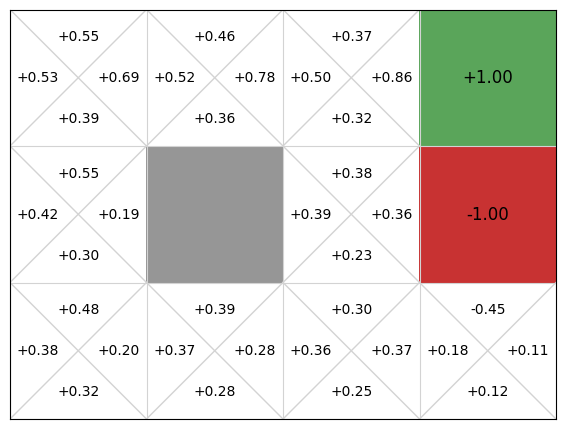
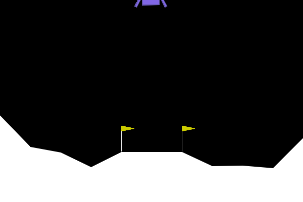
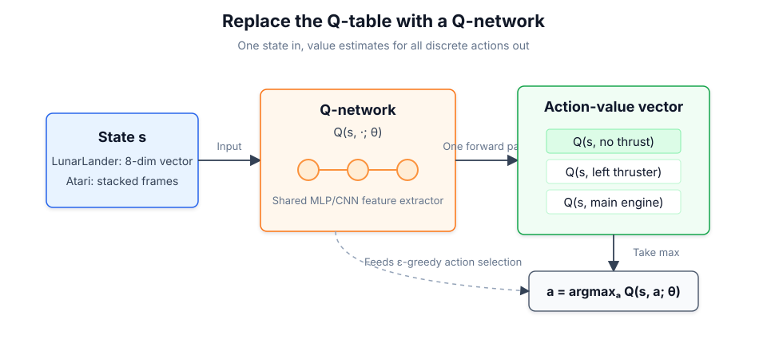
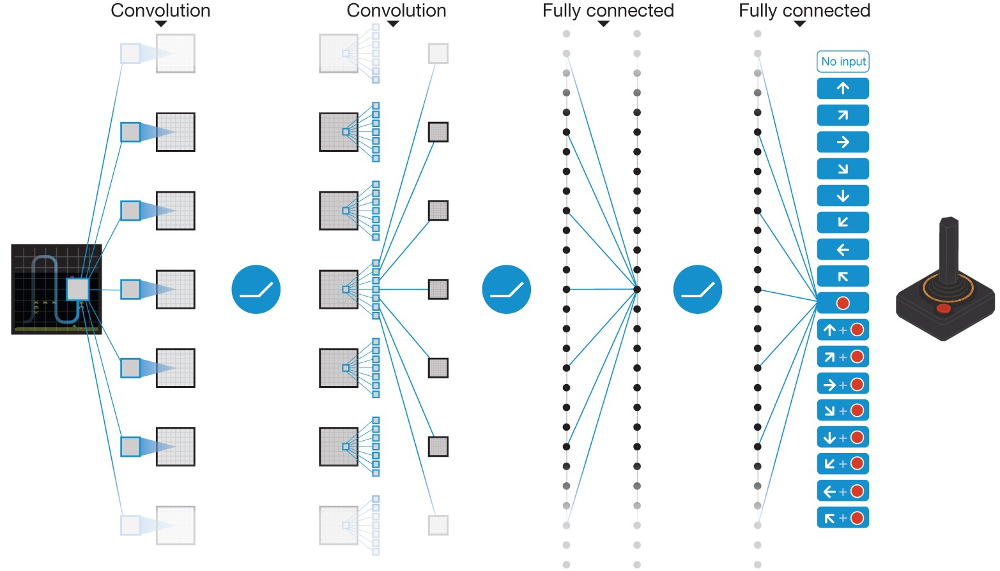
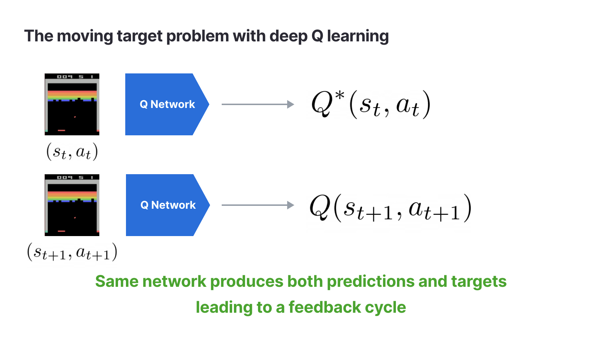

# 5.1 From Q-Learning to DQN

Part I used tables and explicit states to build the complete chain of value learning. The state spaces of real tasks are much larger, so the value function has to be approximated by a neural network. Part II starts from this change, takes Q-Learning forward to DQN, and then goes on to policy gradients, Actor-Critic, TRPO, PPO, and continuous control.

**Key Ideas**

- Understand why tabular Q-Learning can only handle small discrete state spaces and cannot go directly into continuous control and pixel-based games.
- Learn how a deep Q-network approximates $Q(s,a)$ with a neural network, turning the Q table into a function that can generalize.
- Understand why experience replay and the target network are the key to making DQN trainable, and not optional engineering details.
- Through LunarLander and visual game tasks, see the stability, exploration, and function-approximation problems that DQN meets when it moves from low-dimensional control to high-dimensional input.

**Key Formulas**

$$
Q(s,a;\theta)\approx Q^*(s,a)
\quad \text{(function approximation: a neural network replaces the Q table)}
$$

$$
y = r+\gamma\max_{a'}Q(s',a';\theta^-)
\quad \text{(DQN's TD target: the target network estimates the optimal value of the next step)}
$$

$$
\mathcal{L}(\theta)
=
\mathbb{E}_{(s,a,r,s')\sim\mathcal{D}}
\left[
\left(
r+\gamma\max_{a'}Q(s',a';\theta^-)
-Q(s,a;\theta)
\right)^2
\right]
\quad \text{(DQN loss function: minimize the mean squared TD error)}
$$

**What the Formulas in This Chapter Do**

This chapter continues along the **$Q(s,a)$ route** established earlier. The first formula states the core substitution in DQN: instead of storing a separate number for every state-action pair, a neural network with parameters $\theta$ outputs the action values. The second formula keeps the TD idea of Q-Learning: the current reward $r$ plus the discounted return of the most valuable action in the next state. The third formula turns this TD error into a loss function that a neural network can optimize, where $\mathcal{D}$ is the experience replay buffer and $\theta^-$ is the parameter set of the target network. In other words, this chapter introduces no new reinforcement learning objective. It reshapes the action-value estimation of Chapter 3 into a deep learning problem that can be trained on high-dimensional states.

When we studied Q-Learning earlier, we built its basic intuition: the agent takes action $a$ in state $s$, receives reward $r$, moves to the next state $s'$, and then corrects $Q(s,a)$ with the TD target. In GridWorld this is very natural. With 16 cells and 4 actions, a small table of 64 rows records all experience. Each time the agent takes a wrong path, the corresponding entry in the table is lowered, and each time it gets closer to the goal, the value of the relevant action is slowly raised.

The real problem is that this table rests on an unstated premise: the states must be few enough to be enumerated, named, and visited repeatedly. The state of LunarLander is 8 continuous numbers, and if the lander's position, velocity, or angle shifts by even a tiny amount, it is a new state. The state of an Atari game is a sequence of pixel images, and the ball's position, its velocity, and the background pixels can all change. The difficulty is then no longer "how should the TD target be written" but "do we still want to, and are we still able to, keep a separate entry for every state."

Seen from another angle, the valuable part of Q-Learning is not the table. It is the idea of "using current experience to correct a prediction of long-term value." The first thing DQN does is replace the table with a neural network: it takes a state as input and outputs the Q value of each action. The countless unrelated numbers in the table are compressed into one set of shared parameters $\theta$, and similar states no longer have to be learned from scratch. They can share experience through the generalization ability of the network.

This step does not succeed automatically, however. In supervised learning the labels are usually fixed, while the "reference answer" in DQN comes from the network's own estimate of the future. The sequence of states the agent has just experienced is also highly correlated, and training on it consecutively lets the gradient be pulled along by the most recent experience. What the deep Q-network really solves is therefore two problems in sequence: first the neural network handles the problem that **the Q table cannot hold everything**, and then experience replay and the target network handle the problem that **neural network training is unstable**.

The main line of this chapter can thus be summarized in one sentence: **how to extend tabular Q-Learning into a deep reinforcement learning algorithm that can handle continuous states, pixel input, and an unstable training process.** We start from the limits of the Q table and then take apart the three components of DQN. After that we move to the LunarLander hands-on section, where one and the same task lets us observe training curves, replay evaluation, and failure analysis. Finally we reach Double DQN, Dueling DQN, Rainbow, and a complete project that migrates from LunarLander to visual games.

## Chapter Layout

| Section                                                             | Core question                                                                                                                       |
| ------------------------------------------------------------------- | ----------------------------------------------------------------------------------------------------------------------------------- |
| [From Q-Learning to DQN](./from-q-to-dqn)                           | Why can the Q table not hold everything? How does a neural network replace the table?                                               |
| [The Three Components of a Deep Q-Network](./dqn-components)        | What problem does each of the Q-network, experience replay, and target network solve? How do the formulas map completely onto code? |
| [Hands-On: LunarLander](./lunar-lander)                             | How do we train, analyze, and evaluate a low-dimensional DQN control task?                                                          |
| [The Deep Q-Network Family](./dqn-family)                           | What do improvements such as Double, Dueling, and Rainbow each solve?                                                               |
| [Project: From LunarLander to Visual Games](./visual-game-projects) | How do we migrate the deep Q-network to pixel input and complex games?                                                              |

## Learning Objectives

After reading this chapter, you should be able to:

- Explain why tabular Q-Learning is no longer feasible on tasks with continuous states and pixel input.
- Describe how a deep Q-network approximates $Q(s,a)$ with a neural network.
- Write down the TD target and the mean squared error loss of the deep Q-network.
- Understand why experience replay and the target network stabilize training.
- Trace the complete data flow of one DQN parameter update, from batch sampling through the forward pass, loss computation, backpropagation, and parameter update, and say which symbol in the formulas each step corresponds to.
- Distinguish the training mode from the inference mode, and know when to use ε-greedy exploration and when to evaluate with the greedy policy.
- Recognize the main directions of improvement in the deep Q-network family and the problem each tries to solve.

We begin with the limits of tabular methods and explain why the deep Q-network is needed.

## Starting from Q-Learning

**Key Ideas**

- Review how Q-Learning corrects an action-value table with the TD target.
- Understand why the Q table depends on the premise that "states can be enumerated."
- Explain why DQN uses a neural network to represent $Q(s,a)$, and which stability problems appear when the table is replaced directly.

**Key Formulas**

$$
Q(s, a) \leftarrow Q(s, a) + \alpha \left[ r + \gamma \max_{a'} Q(s', a') - Q(s, a) \right] \quad \text{(Q-Learning update rule: correct the Q value with one step of experience)}
$$

> **Q-Learning Update Rule:**
>
> - $Q(s,a)$: the old estimate of the current state-action pair in the table.
> - $r+\gamma\max_{a'}Q(s',a')$: the TD target built from this experience, consisting of the immediate reward and the optimal action value of the next state.
> - $\alpha$: the learning rate, which decides how far the old estimate moves toward the TD target.

$$
\text{TD Target} = r + \gamma \max_{a'} Q(s', a') \quad \text{(TD target: the "deserved score" given by the actual reward and the estimate of the future)}
$$

> **TD Target:**
>
> - $r$: the immediate reward actually observed at this step (the per-step reward, written $r_t$ in the $n$-step target in Section 5.4).
> - $\gamma\max_{a'}Q(s',a')$: the optimal future value, according to the current table estimate, starting from the next state $s'$.
> - The two parts add up to the target value that $Q(s,a)$ should approach in this update.

$$
\delta = \text{TD Target} - Q(s, a) \quad \text{(TD error: the gap between prediction and target, the core signal of learning)}
$$

> **TD Error:**
>
> - $\delta>0$: the old estimate is below the target and must be raised.
> - $\delta<0$: the old estimate is above the target and must be lowered.
> - $\delta=0$: the old estimate already agrees with this target.

## Q-Learning Review

Chapter 3 already introduced the action-value function $Q(s,a)$ and Q-Learning. Now we return our attention to its implementation form. In the tabular version, the algorithm stores a current estimate for every state-action pair and corrects this table step by step with each step of experience.

Let us write out the update rule of Section 3.2 again:

$$Q(s, a) \leftarrow Q(s, a) + \alpha \left[ r + \gamma \max_{a'} Q(s', a') - Q(s, a) \right]$$

This line can be read as "use one new experience to correct one old number in the table." First construct the target of this update:

$$
\text{TD Target}=r+\gamma\max_{a'}Q(s',a').
$$

It has two parts: the reward $r$ actually received at this step, and the future value that currently looks best in the next state $s'$. Then subtract the old estimate in the table from this target:

$$
\delta=\text{TD Target}-Q(s,a).
$$

This difference is the TD error. Finally, the algorithm does not overwrite the old value directly. It moves $Q(s,a)$ a small step toward the target at the learning rate $\alpha$. The benefit of writing the update this way is that it can use the latest experience without being carried away entirely by one random outcome.

Initially the whole table can be all zeros. Each time the agent takes a step, only one state-action entry in the table is updated. As the number of interactions grows, the actions near the goal get more accurate estimates first, and these estimates propagate backward through $\max_{a'}Q(s',a')$ in the TD target. In the end the policy is not written by hand. It gradually emerges from the table: in each state, choose the action with the largest Q value.

This process works because of one premise: **the table must be able to hold all state-action pairs.** Every update has to read $Q(s,a)$ and compare all $Q(s',a')$ in the next state. In a small GridWorld like this, that is only a few dozen numbers. Once the states can no longer be enumerated, the problem changes.

## The Limits of the Table

The Q table is both the memory of Q-Learning and its limitation. As long as all state-action pairs can be listed, looking up, updating, and taking the maximum are all straightforward. Once the states cannot be listed as a finite number of rows, the implementation of "storing a separate number for each entry" no longer holds.

Let us first look at discrete states. Guessing a coin has 2 states, so the Q table has 4 rows. Tic-tac-toe has about $3^9 \approx 20{,}000$ positions, which can still just about be tabulated. Chess has about $10^{47}$ legal positions, already more than the total storage of all computers on Earth. Go has about $3^{361} \approx 1.7\times10^{172}$ board configurations (Tromp's count of legal positions is $\approx 2.1\times10^{170}$), while the total number of atoms in the observable universe is only about $\sim 10^{80}$.

These examples are huge, but they are at least still discrete states: in principle every position can be named. The real dividing line appears with continuous states.

The state of LunarLander is an 8-dimensional vector, consisting of position, velocity, angle, angular velocity, and whether each of the two legs touches the ground. The first 6 dimensions are continuous real numbers. As soon as one dimension can take any real number in some interval, for example $x\in[-1,1]$, that dimension alone already contains infinitely many possible values. With 6 continuous dimensions combined, the state set is of course infinite as well.

In an actual implementation we can also force a discretization. For example, if we cut each of these 6 continuous dimensions into 50 bins, the total number of states is $50^6 \approx 1.56 \times 10^{10}$. Multiplied by 4 actions, that is tens of billions of state-action entries. And this is only a low-dimensional control task.

Atari games make this even clearer. After standard preprocessing, the input is a stack of 4 grayscale frames of $84 \times 84$, 28224 pixel values in all, each with 256 possible values. The number of possible states is $256^{28224}$. The point of this number is not to count precisely but to show that pixel input can no longer be treated as an enumerable state table.

This is the **curse of dimensionality** in reinforcement learning. One distinction deserves care: the TD idea of Q-Learning does not fail because of this. What fails is the representation of "storing $Q(s,a)$ entry by entry in a table." The larger the state space, the harder it is for a tabular method to exploit relationships between similar states, and continuous and pixel states make building a table meaningless altogether.

What comes next is not to give up Q-Learning but to change how $Q(s,a)$ is represented.

## Function Approximation

In the previous section we saw that what holds the tabular method back is not the TD update itself, but the implementation premise that "Q values must be stored row by row, one per state." The problem to solve can now be stated more concretely: **if states cannot be enumerated, how can the algorithm still store and update action values?**

This is exactly what **function approximation** handles. It does not change the objective of Q-Learning. It changes the representation of action values: instead of storing a separate number for every state-action pair, a parameterized function outputs the corresponding value estimate when given a state and an action.

Let us first generalize the "value table" idea of Section 3.1 by one step. A state-value table stores one $V(s)$ for each state, and a Q table stores one $Q(s,a)$ for every action in each state. In a small discrete, enumerable environment, Q-Learning therefore maintains a "state × action" table:

| State | No thrust | Left thruster | Main engine | Right thruster |
| ----- | --------- | ------------- | ----------- | -------------- |
| $s_1$ | 0.10      | 0.05          | 0.40        | 0.00           |
| $s_2$ | -0.20     | 0.15          | 0.30        | 0.10           |
| $s_3$ | 0.00      | -0.10         | 0.20        | 0.05           |

This table reads exactly as in the earlier sections. State $s_2$ corresponds to the second row, and this row holds the value estimates of all actions in the current state:

$$
Q(s_2,\cdot)=[-0.20,\ 0.15,\ 0.30,\ 0.10].
$$

If we choose actions with the greedy policy, we compare the four numbers in this row and pick the action with the largest value. The agent then executes the action and obtains a transition $(s,a,r,s')$, and Q-Learning updates the corresponding entry $Q(s,a)$ in the table according to the TD error. In a tabular representation every state-action pair has its own slot, so this update does not directly change other entries.

The real problem is that this representation depends on a strong premise: the state must be writable as one row of the table. The state of LunarLander is 8 continuous numbers and the state of Atari is a pixel frame, and neither of them is a row index that can be listed in advance. The question is then no longer "how are the numbers in this row updated" but "where does this row itself come from."

The answer from function approximation is to avoid storing all the rows explicitly and to learn a function that generates them. In symbols, we use parameters $\theta$ to represent an approximate action-value function:

$$
Q(s,\cdot;\theta)
=[Q(s,a_1;\theta),Q(s,a_2;\theta),\ldots,Q(s,a_m;\theta)].
$$

This formula can be read as follows:

| Symbol              | Meaning                                                                             |
| ------------------- | ----------------------------------------------------------------------------------- |
| $s$                 | The current state, for example the 8-dimensional state vector of LunarLander.       |
| $a_i$               | The $i$-th available action.                                                        |
| $\theta$            | The parameters of the function; in DQN they are the neural network parameters.      |
| $Q(s,a_i;\theta)$   | The value estimate, under parameters $\theta$, of taking action $a_i$ in state $s$. |
| $Q(s,\cdot;\theta)$ | The vector of Q values of all actions, obtained from a single input of state $s$.   |

The meaning of this step is that the "row" that used to be looked up in the Q table is now computed on the fly by the function. For LunarLander, the input can be

$$
s=[x,y,\dot{x},\dot{y},\theta,\dot{\theta},c_L,c_R]
$$

fed into the network, which yields the value estimates of the 4 actions:

$$
Q(s,\cdot;\theta)
=[Q(s,\text{no thrust}),Q(s,\text{left thruster}),Q(s,\text{main engine}),Q(s,\text{right thruster})].
$$

Function approximation therefore replaces the way Q values are stored, and leaves the Bellman target of Q-Learning in place. A tabular method stores $|S|\times|A|$ independent numbers, while function approximation stores one set of shared parameters $\theta$. Parameter sharing brings an important effect: the value structure learned near one state influences the predictions for similar states. This is the generalization ability of function approximation, and it is the basis on which DQN can learn from continuous states and pixel input.

Using function approximation for reinforcement learning is not a new idea. Sutton's 1988 TD($\lambda$) paper already discussed neural networks as function approximators [^sutton1988]. In the 1990s, Lin [^lin1993] and Rummery & Niranjan [^rummery1994] successively tried combining neural networks with Q-Learning. But these early attempts worked only on very small problems. Limited by the computing power of the time, by training stability, and by the lack of a unified benchmark environment with fast, massive interaction such as Atari, they never managed to prove themselves.

The real breakthrough had to wait until 2013. Mnih and colleagues at DeepMind carried the idea of function approximation directly onto Q-Learning and approximated $Q^*(s, a)$ with a neural network:

$$Q(s, a; \theta) \approx Q^*(s, a)$$

This is the **Deep Q-Network** (DQN), where the "Deep" in the name refers to a deep neural network [^mnih2013].

The architecture of DQN is accordingly direct: the network takes the state $s$ as input and outputs the Q values of all possible actions at the same time, one input and many outputs. In LunarLander the input is an 8-dimensional vector and the output is 4 Q values. In Atari the input is an $84 \times 84 \times 4$ stack of pixel frames, and the output dimension equals the number of actions in the game.

To sum up, the first step of DQN is: **keep the update idea of Q-Learning, but replace the "Q table stored row by row per state" with a "function $Q(s,\cdot;\theta)$ with shared parameters."** In 2015 the paper was formally published in Nature, marking the beginning of the deep reinforcement learning era [^mnih2015].

## Why Direct Replacement Still Collapses

So far we have solved only the problem that "the table cannot hold everything." The next step is natural: since a neural network can output $Q(s,\cdot;\theta)$, can we replace all the table values in the Q-Learning formula with network outputs and then train directly?

This idea is the starting point of DQN, but it is not yet the complete answer. Direct replacement exposes two training problems: the samples are highly correlated, and the target moves together with the network.

Consider **sample correlation** first. In an Atari game, adjacent frames are usually very similar. Take Pong: after standard preprocessing the picture is $84 \times 84$ pixels, and two adjacent frames may differ only in a small region where the ball or the paddle moved. If the most recent few dozen frames are put directly into a batch in time order, what the model sees is not dozens of independent scenes but continuous tiny changes of the same scene.

This weakens the effect of stochastic gradient descent. A batch nominally has many samples, but if they come from one continuous stretch of trajectory, the gradient direction is dominated by the most recent experience. The network then easily adjusts its parameters around the current situation, and does not learn value estimates that hold for a wider range of states. This problem points to the first stabilizing component of DQN: the training data must not come only from the most recent steps, and must be sampled randomly from a larger collection of experience.

Next, consider the **moving target**. The TD target of Q-Learning is

$$
r+\gamma\max_{a'}Q(s',a').
$$

In a tabular method, updating $Q(s,a)$ usually changes only one entry. In a neural network, however, all Q values are computed by the same set of parameters $\theta$. One gradient update changes not only $Q(s,a;\theta)$ but may also change $Q(s',a';\theta)$. That is, while the network learns the current prediction, it also changes the target it will chase next.

Look at a minimal example. Suppose there are only 2 states and 2 actions, with $\gamma=0.99$. The current network outputs:

$$Q_\theta: \quad Q(s_1, a_1)=2.0,\; Q(s_1, a_2)=5.0,\; Q(s_2, a_1)=3.0,\; Q(s_2, a_2)=8.0$$

Now an experience $(s_1,a_2,r=+1,s_2)$ arrives, and the TD target is:

$$\text{TD Target} = r + \gamma \max_{a'} Q_\theta(s_2, a') = 1 + 0.99 \times 8.0 = 8.92$$

This update pushes $Q_\theta(s_1,a_2)$ toward 8.92. The problem is that after the parameter update, other outputs may change as well. Suppose the network becomes the following after the update:

$$Q_{\theta'}: \quad Q(s_1, a_1)=2.3,\; Q(s_1, a_2)=6.5,\; Q(s_2, a_1)=2.7,\; Q(s_2, a_2)={\color{red}6.3}$$

Note $Q(s_2,a_2)$: it was 8.0 and is now 6.3. The next time the TD target is computed with $s_2$, the future value in the target has already changed. In a tabular method, changing $Q(s_1,a_2)$ does not directly change $Q(s_2,a_2)$. In a neural network, parameter sharing makes such side effects the norm.

Directly applying a neural network to Q-Learning therefore meets at least two sources of instability: the training samples come from a continuous trajectory and are easily correlated, and the TD target depends on a network that keeps changing and therefore moves. What DQN has to solve goes beyond "replacing the table with a network." It also has to make the training process stable after the replacement.

This is also the key contribution of DeepMind's DQN. They were not the first to think of approximating the Q function with a neural network. The key was to split the problem into three components: use a **Q-network** to replace the table, use **experience replay** to break up sample correlation, and use a **target network** to slow down the movement of the TD target. In other words, this section explains "why DQN is needed," and the next section takes apart "how DQN organizes these components."

Question to think about: people tried neural-network Q-Learning in the 1990s, so why did it succeed only in 2013?

There are at least three reasons. First, the computing conditions were different: in the 1990s it was hard to train deep networks on pixel-level input. Second, training stabilization techniques were not yet mature: without experience replay and a target network, neural-network Q-Learning diverges easily. Third, the benchmark environments were different: the Atari emulator (the Arcade Learning Environment) provided a unified, repeatable evaluation task with massive interaction, so these methods could finally be tested systematically.

Next, we take apart the three core components of DQN one by one: the [Q-network, experience replay, and the target network](./dqn-components).

## References

[^sutton1988]: Sutton, R. S. (1988). Learning to predict by the methods of temporal differences. _Machine Learning_, 3(1), 9-44.

[^lin1993]: Lin, L.-J. (1993). _Reinforcement learning for robots using neural networks_. PhD thesis, Carnegie Mellon University.

[^rummery1994]: Rummery, G. A., & Niranjan, M. (1994). _On-line Q-learning using connectionist systems_. Technical Report CUED/F-INFENG/TR 166, Cambridge University.

[^mnih2013]: Mnih, V., et al. (2013). Playing Atari with deep reinforcement learning. _arXiv preprint_, arXiv:1312.5602.

[^mnih2015]: Mnih, V., et al. (2015). Human-level control through deep reinforcement learning. _Nature_, 518(7540), 529-533.
