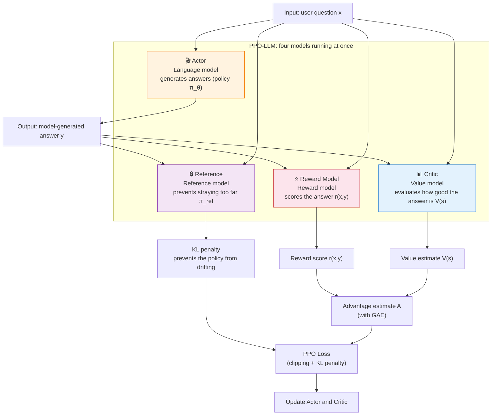

# 8.3 GAE Advantage Estimation

## Reading Guide

**Key Ideas**

- The two ends of advantage estimation: TD uses one step of information (low variance, biased), while MC uses the whole trajectory (unbiased, high variance)
- GAE: a single parameter $\lambda$ interpolates between TD and MC by exponential weighting
- Reward model: the Bradley-Terry model turns human pairwise preferences into scalar rewards
- Two new challenges in the LLM setting: sparse reward (a 500-step generation receives only 1 score) and four models running at once

In the previous section we took apart the clipping mechanism of PPO, which replaces the "KL divergence" constraint with "clipping" to restrain policy updates (review: [Constraint Mechanisms for Policy Updates](./trust-region-clipping)). The objective of PPO, $r_t(\theta) \cdot A_t$, still has another half unexpanded: **how is the advantage $A_t$ computed?** This is the problem GAE solves. In the LLM alignment setting, the environment no longer hands out rewards automatically, so **where does the reward come from?** That is the job of the reward model.

To make both topics concrete, this section follows one running example: a 5-step episode in which only the last step receives reward $1$ and all the others receive $0$. Think of it as a miniature version of an LLM generating 5 tokens and receiving a score only on the last token:

| Step $t$ | Immediate reward $r_t$ | Critic estimate $V(s_t)$ | Terminal? |
| -------- | ---------------------- | ------------------------ | --------- |
| 0        | 0                      | 0.1                      | No        |
| 1        | 0                      | 0.2                      | No        |
| 2        | 0                      | 0.3                      | No        |
| 3        | 0                      | 0.5                      | No        |
| 4        | 1                      | 0.8                      | Yes       |

The next three parts all use this table as input. First we see how TD and MC each estimate the advantage, then how GAE interpolates between them, and finally we return to the LLM setting and see why sparse reward makes the problem harder.

::: tip Prerequisites for This Section

- [The advantage function $A(s,a) = Q - V$](../chapter07_actor_critic/advantage-function): the quantity GAE estimates
- [TD error $\delta = r + \gamma V(s') - V(s)$](../chapter07_actor_critic/critic-training): the basic building block of GAE
- [The three methods DP/MC/TD](../chapter04_classical_methods/dp-mc-td): GAE interpolates between TD and MC
- [Reward function design](../chapter04_classical_methods/reward-design): the design of the RM follows the same line as the reward shaping in Chapter 4
  :::

## TD and MC

The advantage function is defined as follows (review: [Section 7.1](../chapter07_actor_critic/advantage-function)):

$$A(s_t, a_t) = Q(s_t, a_t) - V(s_t)$$

It means "how much better choosing this action in this state is than the policy's average level". The problem is that $Q(s_t, a_t)$ is unknown. We cannot know exactly "how many points the future will bring after this action", and can only estimate it.

Chapter 4 already discussed two ways of estimating (review: [comparison of DP/MC/TD](../chapter04_classical_methods/dp-mc-td)). Here we work out the gap between them on the 5-step episode.

### TD Estimation and the One-Step Signal

The TD estimate (review: [TD methods](../chapter07_actor_critic/critic-training)) uses only the one-step reward plus the Critic's estimate of the next state:

$$A_t^{\text{TD}} = r_t + \gamma V(s_{t+1}) - V(s_t) = \delta_t$$

Take $\gamma = 1$ and substitute the table above row by row:

| $t$ | $r_t + V(s_{t+1}) - V(s_t)$ | $\delta_t$ |
| --- | --------------------------- | ---------- |
| 0   | $0 + 0.2 - 0.1$             | $0.1$      |
| 1   | $0 + 0.3 - 0.2$             | $0.1$      |
| 2   | $0 + 0.5 - 0.3$             | $0.2$      |
| 3   | $0 + 0.8 - 0.5$             | $0.3$      |
| 4   | $1 + 0 - 0.8$               | $0.2$      |

At the last step $V(s_5) = 0$ (the episode ends). The TD advantage estimate is this column of $\delta_t$. Its variance is low, since only one step of randomness is involved. Its bias is high: if the Critic's $V$ is inaccurate, the error passes straight into $\delta_t$ through $\gamma V(s_{t+1})$.

**The source of the bias can be separated out exactly.** Let the Critic estimate be $V(s_t) = V^*(s_t) + b_t$, where $V^*$ is the true value and $b_t$ is the Critic's error at that state. Substituting into TD:

$$\delta_t = r_t + \gamma V(s_{t+1}) - V(s_t) = \underbrace{r_t + \gamma V^*(s_{t+1}) - V^*(s_t)}_{\text{true TD}} + \underbrace{\gamma b_{t+1} - b_t}_{\text{Critic bias term}}$$

When $\gamma = 1$ and the Critic error is approximately constant ($b_t \approx b$), the bias term is zero, because a constant bias cancels between adjacent states. When $\gamma < 1$, or the Critic's error differs a lot across states, $\gamma b_{t+1} - b_t \neq 0$ and it systematically contaminates the advantage estimate at every step. **The less accurate the Critic and the more its error varies across states, the more serious the TD bias.**

### MC Estimation and the Full-Trajectory Return

The MC estimate (review: [MC methods](../chapter04_classical_methods/dp-mc-td)) waits until the whole episode has run and subtracts $V(s_t)$ from the full return starting at $t$:

$$A_t^{\text{MC}} = G_t - V(s_t), \qquad G_t = \sum_{k=0}^{\infty} \gamma^k r_{t+k}$$

First accumulate $G_t$ backward ($\gamma = 1$):

| $t$ | Subsequent rewards  | $G_t$ |
| --- | ------------------- | ----- |
| 4   | $r_4 = 1$           | $1.0$ |
| 3   | $r_3 + G_4 = 0 + 1$ | $1.0$ |
| 2   | $r_2 + G_3 = 0 + 1$ | $1.0$ |
| 1   | $r_1 + G_2 = 0 + 1$ | $1.0$ |
| 0   | $r_0 + G_1 = 0 + 1$ | $1.0$ |

Then subtract $V(s_t)$:

| $t$ | $G_t$ | $V(s_t)$ | $A_t^{\text{MC}} = G_t - V(s_t)$ |
| --- | ----- | -------- | -------------------------------- |
| 0   | $1.0$ | $0.1$    | $0.9$                            |
| 1   | $1.0$ | $0.2$    | $0.8$                            |
| 2   | $1.0$ | $0.3$    | $0.7$                            |
| 3   | $1.0$ | $0.5$    | $0.5$                            |
| 4   | $1.0$ | $0.8$    | $0.2$                            |

The MC estimate does not depend on the Critic and is unbiased in expectation given enough samples. But $G_t$ contains all the randomness from $t$ to the end, so its variance is large, and it can only be computed after the episode ends, while an episode in the LLM setting may have thousands of steps.

**How large the variance gets can be felt with numbers.** Suppose that starting from the same $s_0$, the environment has a 50% chance of a "good ending" (terminal $r_4 = +1$) and a 50% chance of a "bad ending" (terminal $r_4 = -1$), with the rewards of all other steps fixed at 0. With $V(s_0) = 0.1$:

| Episode     | $G_0$ | $A_0^{\text{MC}} = G_0 - V(s_0)$ |
| ----------- | ----- | -------------------------------- |
| Good ending | $+1$  | $+0.9$                           |
| Bad ending  | $-1$  | $-1.1$                           |

The two samples give advantage estimates of $+0.9$ and $-1.1$, which differ by 2.0, a very large variance. TD behaves differently: $\delta_0 = V(s_1) - V(s_0)$, and once the Critic has learned the expected value of $V(s_1)$, $\delta_0$ barely changes from episode to episode. **TD trades on the smoothness of the Critic to control variance, and the price is that the source of bias moves from sampling noise to the accuracy of the Critic.**

Putting the two estimates side by side makes the gap clear:

| $t$ | $A_t^{\text{TD}}$ | $A_t^{\text{MC}}$ |
| --- | ----------------- | ----------------- |
| 0   | $0.1$             | $0.9$             |
| 1   | $0.1$             | $0.8$             |
| 2   | $0.2$             | $0.7$             |
| 3   | $0.3$             | $0.5$             |
| 4   | $0.2$             | $0.2$             |

For the same 5-step episode, TD gives the early steps an advantage of only 0.1, while MC gives 0.9. **The "credit" of the early steps is flattened in the TD view**, because the Critic has not yet propagated the reward of the future step backward. MC counts the terminal reward back onto every step directly, at the cost of high variance and having to wait for the whole episode to finish.

## The Bias-Variance Tradeoff

Schulman et al. proposed GAE (arXiv 2015, ICLR 2016), which uses a single parameter $\lambda$ to interpolate between TD and MC by exponential weighting:

$$\hat{A}_t^{\text{GAE}(\gamma, \lambda)} = \sum_{k=0}^{\infty} (\gamma \lambda)^k \delta_{t+k}$$

(Elsewhere in this chapter the same estimate is written without the hat as $A_t$, e.g. $A_t^{\text{TD}}$, $A_t^{\text{MC}}$, and the $A_t$ in the PPO objectives.)

Here $\delta_t = r_t + \gamma V(s_{t+1}) - V(s_t)$ is the TD error. The three typical values of $\lambda$ are:

- $\lambda = 0$: $\hat{A}_t = \delta_t$, which reduces to one-step TD
- $\lambda = 1$: $\hat{A}_t = \sum_{k=0}^{\infty} \gamma^k \delta_{t+k} = G_t - V(s_t)$, which reduces to MC
- $0 < \lambda < 1$: the distant $\delta_{t+k}$ decay exponentially as $(\gamma\lambda)^k$

### Why the Formula Takes This Form

The formula looks abrupt. Why exponential weights $(\gamma\lambda)^k$, and not uniform weights or linear decay? To answer, we start from the real difficulty of interpolation.

The naive scheme is a simple linear combination of TD and MC, $\hat{A}_t = \alpha \cdot \delta_t + (1-\alpha) \cdot (G_t - V(s_t))$. But we have already expanded $G_t - V(s_t) = \sum_{k=0}^{\infty} \gamma^k \delta_{t+k}$, so **MC is not another signal alongside TD. It is the infinite accumulation of TD.** Weighting a "local signal" against a "global accumulation" amounts to subtracting $\delta_t$ and adding it back at the same time, which has no clear physical meaning.

The right approach is to work on the weights of the $\delta$ sequence. Write the advantage as $\hat{A}_t = \sum_{k=0}^{\infty} w_k \delta_{t+k}$. TD corresponds to $w_0 = 1,\; w_{k>0} = 0$, and MC corresponds to $w_k = \gamma^k$. Interpolating between the two means starting the weights $w_k$ from $\gamma^k$ and compressing the distant terms by a decay factor $\lambda^k$:

$$w_k = (\gamma\lambda)^k$$

- $\lambda = 0$: everything except $w_0 = 1$ goes to zero, returning to TD
- $\lambda = 1$: $w_k = \gamma^k$, returning to MC
- $0 < \lambda < 1$: the contribution of distant $\delta$ decays at rate $\lambda^k$, fading out faster than the $\gamma^k$ of MC

Exponential decay is the most natural interpolation mathematically: it is recursive and memoryless, and the next part shows that it leads directly to an $O(N)$ recursive algorithm. The cleverness of GAE lies not in the formula itself but in the choice to apply the interpolation to the accumulation weights of $\delta$ instead of to the final value.

### From an $O(N^2)$ Sum to $O(N)$

Computing $\hat{A}_t$ straight from the definition requires evaluating an infinite series for every $t$, for a total complexity of $O(N^2)$. Expand $\hat{A}_t$ to see its structure:

$$\hat{A}_t = \delta_t + (\gamma\lambda)\delta_{t+1} + (\gamma\lambda)^2 \delta_{t+2} + (\gamma\lambda)^3 \delta_{t+3} + \cdots$$

Factor the common factor $\gamma\lambda$ out of the terms from the second one on:

$$\hat{A}_t = \delta_t + \gamma\lambda \cdot \underbrace{\left[\delta_{t+1} + (\gamma\lambda)\delta_{t+2} + (\gamma\lambda)^2 \delta_{t+3} + \cdots\right]}_{\hat{A}_{t+1}}$$

The series in brackets is exactly $\hat{A}_{t+1}$ (replace $\delta_t$ in $\hat{A}_t$ by $\delta_{t+1}$, shifting everything one step to the right). Therefore:

$$\hat{A}_t = \delta_t + \gamma\lambda \cdot \hat{A}_{t+1}$$

This is the recursion. It expresses each $\hat{A}_t$ as "this step's $\delta_t$ plus the subsequent advantage scaled by one step", and one backward sweep computes all of them, reducing the total complexity to $O(N)$. **This is where the benefit of exponential weights pays off**: only a memoryless form like $(\gamma\lambda)^k$ allows such a clean recursion.

### Computing with the Recursion

The actual computation runs backward (because $\hat{A}_t$ depends on $\hat{A}_{t+1}$):

$$\hat{A}_t = \delta_t + \gamma\lambda \cdot \hat{A}_{t+1}$$

Substituting the 5-step episode with $\gamma = 1$:

| $t$ | $\delta_t$ | $\gamma\lambda \cdot \hat{A}_{t+1}$ | $\hat{A}_t$ |
| --- | ---------- | ----------------------------------- | ----------- |
| 4   | $0.2$      | $0$ (terminal)                      |             |
| 3   | $0.3$      | $\lambda \cdot 0.2$                 |             |
| 2   | $0.2$      | $\lambda \cdot \hat{A}_3$           |             |
| 1   | $0.1$      | $\lambda \cdot \hat{A}_2$           |             |
| 0   | $0.1$      | $\lambda \cdot \hat{A}_1$           |             |

The concrete values depend on $\lambda$. Below, four representative values are each worked out ($\gamma=1$):

| $t$ | $\delta_t$ | $\lambda=0$ | $\lambda=0.5$ | $\lambda=0.95$ | $\lambda=1$ |
| --- | ---------- | ----------- | ------------- | -------------- | ----------- |
| 4   | $0.2$      | $0.20$      | $0.20$        | $0.20$         | $0.20$      |
| 3   | $0.3$      | $0.30$      | $0.40$        | $0.49$         | $0.50$      |
| 2   | $0.2$      | $0.20$      | $0.40$        | $0.67$         | $0.70$      |
| 1   | $0.1$      | $0.10$      | $0.30$        | $0.73$         | $0.80$      |
| 0   | $0.1$      | $0.10$      | $0.25$        | $0.80$         | $0.90$      |

This table gathers the threads of the whole section:

- The $\lambda=0$ column is the TD estimate (the left column of the earlier comparison table)
- The $\lambda=1$ column is the MC estimate (the right column of the earlier comparison table)
- $\lambda=0.95$ lies between the two: the closer to the terminal step, the closer to MC, and the earlier the step, the more it is pushed down by exponential decay

To see what "exponential weighting" looks like concretely, expand each value in the $\lambda=0.95$ column by the formula ($\gamma=1$):

| $t$ | Weighted expansion of $\hat{A}_t$                                              | Value  |
| --- | ------------------------------------------------------------------------------ | ------ |
| 4   | $\delta_4$                                                                     | $0.20$ |
| 3   | $\delta_3 + 0.95\,\delta_4$                                                    | $0.49$ |
| 2   | $\delta_2 + 0.95\,\delta_3 + 0.90\,\delta_4$                                   | $0.67$ |
| 1   | $\delta_1 + 0.95\,\delta_2 + 0.90\,\delta_3 + 0.86\,\delta_4$                  | $0.73$ |
| 0   | $\delta_0 + 0.95\,\delta_1 + 0.90\,\delta_2 + 0.86\,\delta_3 + 0.81\,\delta_4$ | $0.80$ |

The weight decays geometrically from $1$ along $0.95 \to 0.90 \to 0.86 \to 0.81$, taking a 0.95 discount for every additional step of backward propagation. The terminal $\delta_4 = 0.2$, after 4 steps of decay, still contributes $0.81 \times 0.2 \approx 0.16$ to $\hat{A}_0$. This is what "credit propagation" looks like in numbers.

As $\lambda$ grows, the advantage of the early steps climbs from $0.1$ all the way to $0.9$: **credit propagates from the last step back to every step**, but the variance rises in step (the randomness of the distant $\delta$ is added in). The usual engineering default for PPO is $\lambda = 0.95$, leaning toward the MC side, trading a little bias for a marked drop in variance.

| $\lambda$ value | Equivalent to | Bias     | Variance        | Use case                                 |
| --------------- | ------------- | -------- | --------------- | ---------------------------------------- |
| 0.0             | Pure TD       | High     | Low             | Sparse data, inaccurate Critic           |
| 0.9             | Leaning TD    | Moderate | Moderate to low | General purpose                          |
| 0.95            | Balanced      | Lower    | Moderate        | **PPO default**                          |
| 0.99            | Leaning MC    | Low      | Higher          | Accurate Critic, fine-grained evaluation |
| 1.0             | Pure MC       | None     | High            | Short episodes, plentiful data           |

```python
# ==========================================
# Manual GAE implementation
# ==========================================
import numpy as np

def compute_gae(rewards, values, dones, gamma=0.99, lam=0.95):
    """
    Compute GAE (Generalized Advantage Estimation)

    Args:
        rewards: list of immediate rewards for each step
        values: the Critic's estimate V(s) for each state
        dones: whether each step is terminal
        gamma: discount factor
        lam: the lambda parameter of GAE

    Returns:
        advantages: advantage estimate for each step
        returns: target return for each step (used to train the Critic)
    """
    advantages = []
    gae = 0  # accumulated GAE value

    # Compute backward (because Â_t depends on the later δ)
    for t in reversed(range(len(rewards))):
        if t == len(rewards) - 1:
            next_value = 0  # the value of the state after the last step is 0
        else:
            next_value = values[t + 1]

        # TD error: δ_t = r_t + γ * V(s_{t+1}) - V(s_t)
        delta = rewards[t] + gamma * next_value * (1 - dones[t]) - values[t]

        # GAE accumulation: Â_t = δ_t + γλ * δ_{t+1} + (γλ)² * δ_{t+2} + ...
        gae = delta + gamma * lam * (1 - dones[t]) * gae
        advantages.insert(0, gae)

    # target return = advantage + value estimate
    advantages = np.array(advantages)
    returns = advantages + np.array(values[:len(rewards)])

    return advantages, returns

# A 5-step episode
rewards = [0.0, 0.0, 0.0, 0.0, 1.0]  # only the last step has a reward
values  = [0.1, 0.2, 0.3, 0.5, 0.8]  # the Critic's estimates
dones   = [0,   0,   0,   0,   1  ]  # only the last step is terminal

advantages, returns = compute_gae(rewards, values, dones)
print("Advantage estimates:", advantages)
print("Target returns:", returns)
```

Output ($\gamma = 0.99$, $\lambda = 0.95$, slightly different from the $\gamma = 1$ tables in the main text):

```
Advantage estimates: [0.7611 0.7051 0.6465 0.4801 0.2   ]
Target returns: [0.8611 0.9051 0.9465 0.9801 1.    ]
```

Note that the advantage $0.76$ at $t = 0$ is larger than the $0.20$ at $t = 4$. The terminal reward $r_4 = 1$ propagates all the way back to the start through the exponential decay of GAE, while $t = 4$ sees only its own step, $\delta_4 = 1 - 0.8 = 0.2$. This is the key difference between GAE and pure TD: **tokens early in the sequence also receive a nonzero advantage signal.** With $\lambda = 0$, the whole column of advantages reduces to the one-step TD errors $[0.098, 0.097, 0.195, 0.292, 0.2]$ (the TD column above, minus a touch of $\gamma = 0.99$ discounting), and the start has almost no signal. The `returns` column adds the advantage back to $V(s_t)$ and serves as the regression target for the Critic. It rebuilds the "future return", so that the baseline $V(s_t)$ of the next $\delta$ becomes more accurate.

## Reward Models

In game environments (CartPole, LunarLander) the reward comes directly from the rules of the environment: a landing earns points and a crash loses points. The LLM alignment setting has no such source of rules. What score is the answer to "please write me a poem" worth? There is no objective answer. The reward model (RM) of this section turns human judgments into scalar rewards.

### Subjective Alignment and Objective Reasoning

LLM alignment has two reinforcement paths:

- **Subjective alignment** (politeness, safety, helpfulness): there is no objective standard of right and wrong, so an RM must be trained from human preferences
- **Objective reasoning** (math, code): clear rules can verify the answer, so rule-based rewards can be used directly ([Chapter 15, RLVR](../chapter15_grpo/rlvr) covers this in detail)

This chapter focuses on the subjective alignment setting, which is also the classic application of PPO in LLM alignment.

### The Bradley-Terry Model

It is hard for a human to give an answer an absolute score ("I give this answer 87 points") but easy to compare ("answer A is better than answer B"). The **Bradley-Terry model** turns pairwise comparisons into absolute scores:

$$P(y_w > y_l \mid x) = \sigma(r(x, y_w) - r(x, y_l))$$

Here $r(x, y)$ is the score the RM gives to the answer $y$ for the question $x$, and $\sigma$ is the sigmoid function. The larger the score gap between two answers, the closer to 1 the probability that the higher-scoring one is chosen.

### The RM Training Procedure

```python
# ==========================================
# RM training sketch (simplified)
# ==========================================
# Each sample contains a prompt + a good answer + a bad answer
# training_data = [
#     {"prompt": "xxx", "chosen": "good answer", "rejected": "bad answer"},
#     ...
# ]

# The RM loss (Bradley-Terry preference loss)
def reward_model_loss(rm, prompt, chosen, rejected):
    """
    rm: reward model, takes (prompt, response) and outputs a scalar score
    """
    r_chosen = rm(prompt, chosen)     # score of the good answer
    r_rejected = rm(prompt, rejected) # score of the bad answer

    # We want r_chosen > r_rejected
    # Using the Bradley-Terry model: maximize P(chosen > rejected)
    loss = -torch.log(torch.sigmoid(r_chosen - r_rejected))
    return loss.mean()
```

### Three Pain Points of the RM

Training a good RM is the heaviest burden in the whole RLHF pipeline:

1. **Very high annotation cost**: it needs tens of thousands of preference pairs, and every pair requires a human to compare the quality of two answers. When OpenAI trained InstructGPT, it hired about 40 annotators, who labeled tens of thousands of preference examples.

2. **Reward hacking**: what the RM learns is not necessarily "what is a good answer" and may be "what is an answer that looks good". The model may learn to lengthen answers (the RM favors long ones), pile on technical jargon (which looks more convincing), or use formatting to cover for empty content. The result is that the reward score keeps rising while human evaluators feel the quality of the answers is falling.

3. **Distribution shift**: the RM is trained on data generated by the old policy. After RL training the distribution of the policy's answers has changed, and the RM's scores on these "new answers" may no longer be reliable. It is as if the referee's training set had come apart from the real match.

## Sparse Reward and Credit Assignment

An LLM may need to output 500 tokens to generate one answer, which from the RL view is a continuous decision sequence of 500 steps. The RM gives a single score only at the **last token**. This is the most extreme sparse reward: 500 decision steps and 1 reward signal.

The earlier 5-step episode is a miniature of this structure: the reward appears only at $t=4$, and the rewards of the first 4 steps are all 0. **Among these 4 steps, which one contributed to the final 1 point?** This is the **credit assignment** problem.

Look back at the four-column GAE comparison table. With $\lambda=0$ (pure TD), the advantage of the first 4 steps is only the small $\delta_t$ and is almost unrelated to the terminal reward. With $\lambda=0.95$, the advantage at $t=0$ climbs to $0.80$, so the terminal reward has been propagated back to the start of the sequence. **GAE is the credit assignment tool of PPO**: by adjusting $\lambda$, it decides "how much of that final reward to distribute back to the earlier tokens".

Formally, the token-level policy gradient of PPO is written

$$\nabla_\theta L \propto A_t \cdot \nabla_\theta \log \pi_\theta(a_t \mid s_t)$$

The log probability of each token is multiplied by its advantage $A_t$, so tokens with large advantages are strengthened and tokens with small advantages are weakened. Adding the KL divergence penalty (which keeps the policy from straying too far from the reference model), PPO completes a relatively stable credit assignment at token granularity.

## The Full Picture of PPO in LLM Alignment

When PPO is used for LLM alignment, **four models must run at the same time**. This is spectacular in engineering terms and also extremely resource-hungry:



The role of each model:

| Model        | Role                                                    | Size                           | GPU memory |
| ------------ | ------------------------------------------------------- | ------------------------------ | ---------- |
| Actor        | The language model being trained, generates answers     | 7B-70B                         | Largest    |
| Critic       | Value network, evaluates how good an answer is          | Same as the Actor              | Large      |
| Reference    | Frozen original model, supplies the KL penalty baseline | Same as the Actor              | Large      |
| Reward Model | Referee model that scores answers                       | Usually smaller than the Actor | Medium     |

Cramming four models into GPU memory at the same time is the engineering difficulty of RLHF. A 7B model needs at least 4 A100s (80GB), and a 70B model may need 16-32 A100s. And this does not yet count the earlier SFT and RM training stages.

The core mechanisms of PPO are exactly the same in game environments and in LLM alignment: clipping, GAE, and importance sampling. But the LLM setting introduces three additional challenges:

1. **An RM has to be trained**: game environments come with a reward function, while LLMs have none
2. **Sparse reward**: a 500-step generation has only 1 reward signal
3. **Huge resource consumption**: four large models run at once

Among these, the RM is the biggest engineering bottleneck. It needs a great deal of human annotation, is easy to hack, and goes stale as the policy updates. A natural question follows: **can we do without an RM?**

<details>
<summary>Question: If the RM is trained "too well" (it separates good answers from bad answers perfectly on the training set), what problems can result?</summary>

An RM that performs perfectly on the training set may be **overfitting**. An overfit RM memorizes the features of every example in the training set (for example, "an answer containing 'happy to be at your service' is good") instead of learning the real preference pattern.

This leads to two problems:

1. **Reward hacking**: the model quickly discovers the RM's "preference patterns" (for example, "speaking at length earns a high score") and caters to exactly those patterns instead of genuinely improving answer quality. You will see the reward score keep rising while human evaluators feel the quality of the answers is falling.

2. **Poor generalization**: when the new answers generated after a policy update lie outside the training distribution, an overfit RM may give completely wrong scores. For answer types it has never seen, its judgment may be no better than random guessing.

This is why RM training must control capacity and regularization very carefully. It is better for the RM to be a little "blunt" than to be "too clever".

</details>

<details>
<summary>Question: When the Critic is completely random (its output is meaningless), what does GAE reduce to at λ=0 and λ=1? Which is more usable?</summary>

At $\lambda=0$, $\hat{A}_t = \delta_t = r_t + \gamma V(s_{t+1}) - V(s_t)$. A random Critic means $V$ is noise, so $\delta_t$ is also noise, and **the advantage estimate is entirely meaningless**.

At $\lambda=1$, $\hat{A}_t = G_t - V(s_t)$. $V(s_t)$ is noise, but $G_t$ is the true return. GAE reduces to **MC with a noisy baseline**, the main signal is still there, and it amounts to treating $V(s_t)$ as an irrelevant constant offset.

Conclusion: GAE at $\lambda=1$ is more robust to a failed Critic. This is one reason engineering practice leans toward a large $\lambda$ (such as 0.95): **it depends less on the quality of the Critic, and when the Critic has not been learned well it automatically degrades to MC.** Conversely, $\lambda=0$ bets everything on the Critic, and if the Critic breaks, everything breaks.

The price is that the variance is also largest at $\lambda=1$. The choice of $\lambda$ is in essence a balance between "how accurate the Critic is" and "how noisy the sampling is", which is the fundamental reason 0.95 became the default.

</details>

## Chapter Summary

With this, all three core components of PPO have been covered:

1. **[8.1 Hands-On: PPO on BipedalWalker](./ppo-bipedal-walker)**: run the experiment first and see how PPO actually performs on a continuous control task
2. **[8.2 Trust Regions and PPO-Clip](./trust-region-clipping)**: the clipped objective restrains the size of the policy update and solves the training instability problem
3. **[8.3 GAE Advantage Estimation](./gae-reward-model)**: a bias-variance tradeoff between TD and MC, together with the reward model in LLM alignment

The success of PPO is that it makes only two key changes to the Actor-Critic architecture (the clipped objective and GAE), which greatly improves training stability while keeping the implementation simple. This is why PPO has become one of the most commonly used reinforcement learning algorithms today.

**The RM is the heaviest burden of PPO in LLM alignment: training it needs large amounts of annotation, maintaining it needs large amounts of GPU memory, and trusting it means risking reward hacking. Can this step be skipped?** In Chapter 14 we will see the answer DPO gives: [DPO: Bypassing the Reward Model](../chapter14_dpo/dpo-objective-derivation).

---

**Further Reading**:

- For the complete mathematical derivation of PPO (the full argument from TRPO to PPO), see: [Bonus: PPO Mathematical Derivation](./ppo-math)
- For more PPO practice projects, see: [Bonus: A Practical Guide to PPO Game Projects](./ppo-game-benchmark)
- For long-horizon solutions beyond PPO, see: [Bonus: RL Exploration in Long-Horizon Tasks](./rl-long-horizon-planning)
