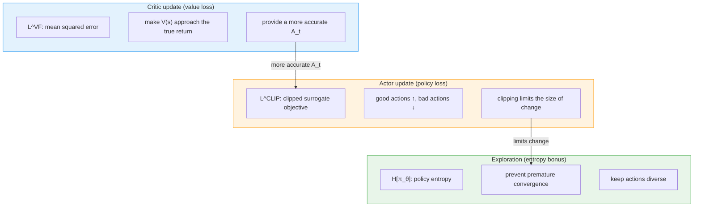
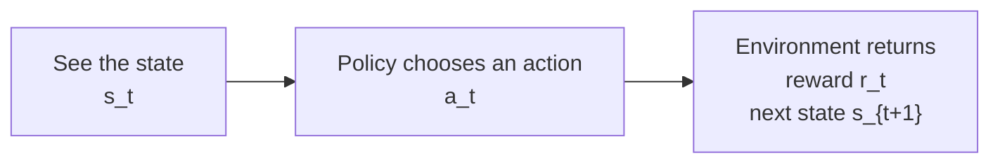
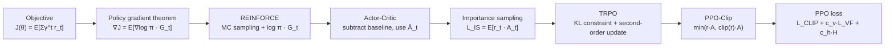

# 8.4 Hands-On: PPO Mathematical Derivation

We trained BipedalWalker with PPO, watched curves such as reward, entropy, and clip fraction, and built an intuition for the trust-region constraint and the clipping mechanism. This section answers a more basic question: **What exactly is PPO, and why does it end up written as a single loss?**

::: tip Prerequisites
This section derives PPO-Clip step by step, starting from the policy gradient update. For smoother reading, you should already have met the following concepts. If they are unfamiliar, read the [appendix](#appendix-deriving-policy-gradients-and-advantage-from-scratch) at the end of this section first and then return to the main text:

- **Policy gradient theorem**: $\nabla_\theta J(\theta) = \mathbb{E}_t[\nabla_\theta \log \pi_\theta(a_t\mid s_t)\hat{A}_t]$
- **Advantage function $A_t$**: measures how much better an action is than average, with the baseline provided by the Critic
- **Actor-Critic framework**: the Actor chooses actions, and the Critic estimates state values
  :::

The Actor-Critic framework of the previous chapter gives the basic division of labor in policy training. The Actor outputs action probabilities, the Critic estimates state values, and the advantage $\hat{A}_t$ judges how much better an action is than the average level of the current state.

If the advantage is positive, raise the probability of this action. If it is negative, lower the probability. This is the core intuition of the policy gradient.

Once this intuition meets real training, two problems remain.

**First problem: how many rounds can one batch of data be used for?** The vanilla policy gradient requires data from the current policy. As soon as the parameters are updated, this batch of rollouts becomes data from an old policy, and reusing it introduces bias.

**Second problem: how much may the policy change each time?** The advantage estimate comes from a finite sample and carries noise. If some action happens to perform well, the ordinary policy gradient may raise its probability too far. The sampling distribution of the next round then shifts sharply, and training oscillates.

PPO answers both problems as follows: **let the same batch of experience be learned from for several rounds, but in every round keep the new policy from moving too far from the old one.** It leaves the basic division of labor in Actor-Critic unchanged and adds a more stable set of rules to the step "how to update the Actor".

In practice, the PPO workflow looks like this:


PPO stands for **Proximal Policy Optimization**. Policy is the policy being trained, Optimization is the process of optimizing it, and Proximal means "nearby": the new policy should stay close to the old one and avoid jumping far away in a single step.

**PPO is a method for training a policy network.** It ends up written as a loss because a PyTorch optimizer can only backpropagate from a differentiable scalar objective. The derivation that follows translates two training requirements, "reuse old data" and "limit policy change", into a mathematical expression on which `loss.backward()` can run.

## The PPO Training Framework

Training an agent that makes decisions means answering six questions in order. The implementation structure below follows this order.

**First, what makes the decisions?** We need a neural network: the policy network outputs action probabilities, and the value network outputs a score for how good the current state is. This is what `[A] forward` does.

**Second, how does the agent interact with the environment?** After seeing a state, the Actor chooses an action from the action probability distribution and records the probability (log_prob) of the chosen action. This is what `[B] act / evaluate` does.

**Third, what is recorded during interaction?** The state, action, and reward of every step must be stored. The old policy's probability at that moment must also be stored separately, because the policy changes once the parameters are updated and the old probability is needed for comparison. This is what `[C] collect_rollout` does.

**Fourth, how is each action judged good or bad?** Looking at whether the reward is high is not enough. What matters is how much better the action is than the "normal level" of the current policy. This relative judgment is the advantage. This is what `[D] compute_gae` does.

**Fifth, once we know good from bad, how do we change the policy safely?** Strengthen good actions and weaken bad ones, but keep the update small. Otherwise the policy drifts off and the old data is no longer accurate. `actor_loss_fn` controls the size of the policy update with the ratio and clip, and `critic_loss_fn` trains the value network at the same time. This is what `[E]` does.

**Sixth, how is this process repeated?** Learn from the same batch of experience for several rounds (clip keeps the learning from going astray), then collect new experience and loop. This is what `[F]` does.

<PpoCodeFocus focus="overview" />

These six questions make up the complete implementation logic of PPO, and the mathematical derivation below maps each part back to specific code.

## Limitations of the Vanilla Policy Gradient

Step six of the implementation structure says that **the same batch of experience can be learned from for several rounds**. The vanilla policy gradient cannot do this, and the restriction comes from its update formula.

The goal of the policy gradient is to maximize the expected return under the current policy $\pi_\theta$, and the update direction is guided by the advantage function $\hat{A}_t$:

$$
\nabla_\theta J(\theta)
= \mathbb{E}_t\left[
\nabla_\theta \log \pi_\theta(a_t\mid s_t)\hat{A}_t
\right].
$$

This formula carries an implicit requirement: **the samples used to compute the gradient must come from the current policy $\pi_\theta$**.

The reason lies in the averaging symbol $\mathbb{E}_t[\cdot]$. It means: **take a weighted average over all the actions the agent actually sampled, weighted by empirical frequency.** An action the current policy picks often carries a high weight in the average, and an action it rarely picks carries a low weight.

Take an example. Suppose that in some state the current policy

- picks "left" with 80% probability
- picks "right" with 20% probability

The agent runs 100 steps and picks "left" about 80 times and "right" about 20 times. The formula averages the gradient weighted by this 80/20 frequency, and that is what $\mathbb{E}_t[\cdot]$ does.

Now suppose the 100 steps of data came from an old policy, which in this state picks "left" with 60% probability and "right" with 40%. The data then contains 60 "left" and 40 "right".

**The actual frequency (60/40) no longer matches the expectation in the formula (80/20)**, so a gradient computed from this data is wrong: the contribution of "left" is underestimated and the contribution of "right" is overestimated.

After one round of updates the parameters become $\theta$ and the policy becomes $\pi_\theta$. The same batch of rollouts still comes from $\pi_{\text{old}}$, but the expectation in the formula now points at $\pi_\theta$. **The data frequencies belong to the old policy and the formula's expectation belongs to the new policy, so the two are no longer aligned.** Actions the old policy picked often have high frequency in the data, yet the new policy may no longer favor them. Actions the old policy rarely picked have few samples, yet the new policy may now want to choose them. The bias in the gradient estimate accumulates with the number of update rounds, which is why on-policy methods use each batch of rollouts only once.

Why break this restriction at all? Sampling is expensive. In robot control, game simulation, and LLM answer generation, the cost of a batch of rollouts is usually higher than that of many backward passes.

PPO wants to update on the same batch of data for several rounds, and a practical problem arises: **how can data sampled by the old policy be used for the new policy?**

Importance sampling is the answer in the next part.

## Importance Sampling

Importance sampling addresses a plain question: **the samples come from one distribution, but we want to estimate an average under another distribution.**

Start with the ordinary sample average. Return to the policy gradient formula:

$$
\nabla_\theta J(\theta)
= \mathbb{E}_t\left[
\nabla_\theta \log \pi_\theta(a_t\mid s_t)\hat{A}_t
\right].
$$

The quantity inside the expectation is $\nabla_\theta \log \pi_\theta(a_t\mid s_t)\hat{A}_t$. Abbreviate it as $f(a_t)$. The problem becomes estimating the expectation of this quantity under the new policy $\pi_\theta$, which is ideally written as:

$$
\mathbb{E}_{a\sim\pi_\theta}[f(a_t)].
$$

If we had actions sampled from the new policy, we could simply average these $f(a_t)$. But we have no samples from the new policy, only actions sampled by the old policy $\pi_{\text{old}}$. Averaging them directly is biased, because the old and new policies have different preferences over the same action.

The idea of importance sampling is that the old samples are not garbage. They came from real interaction and were only "sampled with a skew" by the old policy. Each sample is multiplied by a correction weight that "translates" the old policy's distribution into the new policy's distribution. This weight is the ratio of the probability that the new policy chooses the action to the probability that the old policy chooses it:

$$
\frac{\pi_\theta(a\mid s)}{\pi_{\text{old}}(a\mid s)}
$$

The expectation under the new policy can then be rewritten as:

$$
\mathbb{E}_{a \sim \pi_\theta} [f(a_t)]
=
\mathbb{E}_{a \sim \pi_{\text{old}}}
\left[
\frac{\pi_\theta(a\mid s)}{\pi_{\text{old}}(a\mid s)}
f(a_t)
\right].
$$

If the new policy likes this action more than the old policy did, the weight exceeds 1 and the contribution of this sample to the new policy should be amplified. If the new policy is less likely to choose the action, the weight is below 1 and the contribution should be reduced. This step comes from a change of measure for expectations: the expectation under the new policy is rewritten as a weighted average under the old policy's distribution.

In the PPO code, [C] `collect_rollout` stores `old_logprobs` at sampling time:

<PpoCodeFocus focus="oldLogprobs" />

This `old_logprobs` is $\log \pi_{\text{old}}(a_t\mid s_t)$. During the later update, the model recomputes `new_logprobs` for the same batch of data under the new policy, and comparing new with old shows how far the policy has moved.

### Policy Ratio

The correction weight $\pi_\theta/\pi_{\text{old}}$ of importance sampling needs the probabilities of both the new and the old policy, which is not intuitive to compute. PPO first reads this ratio as two parts: **for the same action, how much probability the new policy gives it and how much probability the old policy gives it.**

Suppose that in some state $s_t$ the old and new policies assign the following probabilities to three actions:

| Action | Old policy probability $\pi_{\text{old}}(a\mid s_t)$ | New policy probability $\pi_\theta(a\mid s_t)$ | Ratio $r=\pi_\theta/\pi_{\text{old}}$ |
| ------ | ---------------------------------------------------- | ---------------------------------------------- | ------------------------------------- |
| Left   | 0.50                                                 | 0.25                                           | 0.5                                   |
| Right  | 0.25                                                 | 0.50                                           | 2.0                                   |
| Stay   | 0.25                                                 | 0.25                                           | 1.0                                   |

The old policy sampled "right", and the new policy likes this action more than the old one (ratio 2.0), so the contribution of this sample to the new policy should be amplified. The old policy sampled "left", and the new policy no longer wants to choose it much (ratio 0.5), so the weight of this sample should go down.

Written as a formula, this weight is the **policy ratio** (Policy Ratio):

$$r_t(\theta) = \frac{\pi_\theta(a_t \mid s_t)}{\pi_{\text{old}}(a_t \mid s_t)}$$

Here $a_t$ is the action the old policy actually sampled at that time. $r_t=1$ means the old and new policies give it the same probability, $r_t>1$ means the new policy is more inclined to choose it, and $r_t<1$ means the new policy is avoiding it.

The code computes it as the exponential of the difference of log probabilities, which avoids dividing two very small probabilities directly:

<PpoCodeFocus focus="ratio" />

After multiplying by this ratio, the expectation over the old data can be written as:

$$
\mathbb{E}_{a \sim \pi_\theta} [f(a_t)]
=
\mathbb{E}_{a \sim \pi_{\text{old}}}
\left[
r_t(\theta) \cdot f(a_t)
\right].
$$

This is the mathematical basis for letting old data serve as training samples for the new policy: multiply each sample by the policy ratio, and the old distribution is "translated" into the new one.

### Surrogate Objective

During the policy update, $f(a_t)$ corresponds to the advantage $A_t$ of this action. The advantage tells us whether the action is better or worse than the average level of the current state.

Putting the importance sampling weight and the advantage together, the training signal on old data becomes:

$$L^{\text{IS}}(\theta) = \mathbb{E}_t \left[ r_t(\theta) \cdot A_t \right]$$

In code this is `surr1 = ratio * advantages` inside `actor_loss_fn`:

<PpoCodeFocus focus="surr1" />

This is the **surrogate objective** (Surrogate Objective). It is computed on old data and pushes the new policy to improve in direction, while the true total return in the environment can still only be observed through sampling.

When reading this product, look at two things at once:

- $A_t$ decides the direction: good actions are strengthened and bad actions are weakened.
- $r_t$ decides the weight of this old sample under the new policy: the more the new policy endorses the action, the larger the weight, and the less it endorses it, the smaller the weight.

This objective is trustworthy when $r_t$ is close to 1. But $r_t$ can grow without bound. If the ratio of a good action ($A_t > 0$) is pushed to 5, 10, or 100, the objective value rises with it and the optimizer keeps pushing, while the reliability of the old data keeps falling.

## PPO-Clip

**Importance sampling solves one problem and introduces another.**

Importance sampling lets old data be used for the new policy, but it has a fundamental weakness: **the importance weight $r_t$ has no upper bound.** If a good action happens to appear many times in the old data, the new policy may push it too high. $r_t=5$ means the new policy already chooses this action 5 times as often as the old policy, while the frequency of this action in the old data was still drawn from the old policy's distribution.

This leads to two problems:

1. **The update step size runs away**: $r_t$ keeps growing, the optimizer keeps amplifying the probability of this action, and the policy may change drastically within a single step.
2. **The reliability of the data drops**: the larger $r_t$ is, the more the old and new policy distributions differ, and the more serious the bias of the old data becomes.

**What PPO-Clip sets out to solve is how to limit the step size of the policy update without losing the benefits of importance sampling.**

The approach is to restrict the policy ratio to a small interval:

$$
\overline{r}_t(\theta)
= \text{clip}(r_t(\theta), 1-\varepsilon, 1+\varepsilon)
$$

When $\varepsilon=0.2$ the interval is $[0.8, 1.2]$. A second objective is built with the clipped ratio, and the more conservative of the two objectives is taken:

$$
J^{\text{CLIP}}(\theta)
= \mathbb{E}_t
\left[
\min \left(
r_t(\theta)A_t,\;
\overline{r}_t(\theta)A_t
\right)
\right]
$$

In the code, `surr1` is the unclipped objective, `surr2` is the clipped objective, and `policy_loss = -torch.min(surr1, surr2).mean()`:

<PpoCodeFocus focus="clip" title="Core of the PPO-Clip Update" />

This code implements the four-step logic of PPO-Clip completely.

**Step 1: compute the policy ratio.** The code uses `torch.exp(new_logprobs - old_logprobs)` rather than dividing directly, because probability values are usually small (for example 0.01) and dividing them directly can underflow numerically. Subtracting log probabilities and then exponentiating is more stable. Here `ratio` is $r_t(\theta)$ and represents **the change in probability of the new policy relative to the old policy**.

**Step 2: compute the two objectives.** `advantages` is the advantage function $\hat{A}_t$ supplied by the Critic. It tells the Actor how much better each action is than the average level of the current state and serves as **the label for the update direction**. `surr1 = ratio * advantages` is the original objective without any restriction. `surr2 = torch.clamp(ratio, ...) * advantages` is the clipped objective: it restricts the ratio to the interval $[1-\varepsilon, 1+\varepsilon]$, and anything beyond that no longer grows.

**Step 3: take the more conservative one.** `torch.min(surr1, surr2)` implements the clipping mechanism, but it is not the whole of clipping.

PPO-Clip actually does two things:

**The first: use importance sampling to make old data usable.** The policy ratio $r_t = \pi_\theta/\pi_{\text{old}}$ is the heart of importance sampling. It "translates" the old policy's distribution into the new policy's distribution so that old data can train the new policy. This is the foundation of PPO-Clip. Without it, PPO could only resample after one round of updates, like the vanilla policy gradient.

**The second: clipping limits the update step size.** $\text{clip}(r_t, 1-\varepsilon, 1+\varepsilon)$ is the core innovation of PPO. It restricts the range of the policy ratio and keeps the new policy from moving too far from the old one.

`torch.min(surr1, surr2)` is how the second thing is carried out, and it accomplishes two tasks:

- **Gradient control**: when the ratio leaves the clipping interval in the same direction as the advantage sign (overshooting toward higher objective value), the clipped term becomes a constant, $\min$ picks the clipped term, and the gradient drops to zero
- **Distance penalty**: the closer the ratio is to the clipping boundary, the closer surr1 and surr2 are, with no penalty. The farther the ratio is from the boundary, the larger the gap and the larger the penalty in the loss

A concrete example shows how `torch.min` works. Suppose a sample has advantage $A_t = 2$ (a good action) and $\varepsilon = 0.2$, so the clipping interval is $[0.8, 1.2]$:

| ratio   | surr1 = ratio × 2 | surr2 = clipped × 2 | Which one torch.min takes | Meaning                                          |
| ------- | ----------------- | ------------------- | ------------------------- | ------------------------------------------------ |
| 0.7     | 1.4               | 1.6                 | surr1                     | Below the lower bound, optimize normally         |
| 1.0     | 2.0               | 2.0                 | Equal                     | ratio = 1, the old and new policies agree        |
| 1.1     | 2.2               | 2.2                 | Equal                     | Inside the clipping interval, optimize normally  |
| **1.3** | **2.6**           | **2.4**             | **surr2**                 | **Above the upper bound, take the clipped term** |
| 2.0     | 4.0               | 2.4                 | surr2                     | Far above, the clipped term caps the value       |

For a bad action with $A_t = -2$:

| ratio   | surr1 = ratio × (-2) | surr2 = clipped × (-2) | Which one torch.min takes | Meaning                                                             |
| ------- | -------------------- | ---------------------- | ------------------------- | ------------------------------------------------------------------- |
| 0.7     | -1.4                 | -1.6                   | surr2                     | Below the lower bound, take the clipped term                        |
| 1.0     | -2.0                 | -2.0                   | Equal                     | ratio = 1, the old and new policies agree                           |
| 1.1     | -2.2                 | -2.2                   | Equal                     | Inside the clipping interval, optimize normally                     |
| **1.3** | **-2.6**             | **-2.4**               | **surr1**                 | **Above the upper bound, unclipped term pulls the ratio back down** |
| 2.0     | -4.0                 | -2.4                   | surr1                     | Far above, the unclipped term keeps a nonzero recovery gradient     |

In the $A_t > 0$ case `torch.min` picks the clipped term only above $1+\varepsilon$ (same-direction overshoot, gradient zero); below $1-\varepsilon$ it picks the unclipped term, whose nonzero gradient pulls the ratio back up. The $A_t < 0$ case is the mirror image: the clipped term wins below $1-\varepsilon$ (gradient zero), the unclipped term above $1+\varepsilon$ (nonzero recovery gradient pulling the ratio back down). The full case analysis is in [the clipping section](./trust-region-clipping).

So far, Step 3, `torch.min(surr1, surr2)`, has produced the value of the **PPO-Clip surrogate objective**: inside the safe interval it equals surr1 (the original objective); outside it equals the clipped constant in the same-direction overshoot region, and the unclipped value (with a recovery gradient) in the opposite-direction overshoot region.

This value cannot be used for optimization directly, though. It is an "objective to maximize", while a PyTorch optimizer works by "minimizing a loss". Step 4 is therefore needed to turn the maximization objective into a minimization loss.

**Step 4: negate and average**

**From maximizing expected return to the surrogate objective**

The ultimate goal of PPO is to **maximize the expected return** $J(\theta)$, so that the policy earns as much total reward as possible in the environment. The policy gradient update direction $\nabla_\theta J(\theta)$ also points toward this goal.

Optimizing $J(\theta)$ directly has two problems:

1. **Data mismatch**: estimating the gradient of $J(\theta)$ needs samples from the current policy $\pi_\theta$, but the current batch of data comes from the old policy $\pi_{\text{old}}$
2. **The update step size runs away**: even with the data mismatch solved, the vanilla policy gradient has no mechanism that limits the update size

Importance sampling solves the first problem. The policy ratio $r_t$ translates the old data's distribution into the new policy's distribution, so the gradient of $J(\theta)$ can be estimated from old data.

But importance sampling introduces the second problem: $r_t$ has no upper bound, and the larger the ratio, the more outlandish the importance weight and the more serious the bias of the old data.

**The clipping mechanism solves the second problem.** $\text{clip}(r_t, 1-\varepsilon, 1+\varepsilon)$ restricts the range of the ratio and keeps the bias of the importance weights within an acceptable level.

**`torch.min(surr1, surr2)` merges the two solutions into one implementation.** surr1 is the importance sampling objective without restriction, surr2 is the clipped objective, and taking the minimum of the two guarantees that the result never goes beyond the clipping interval.

In the end, **the PPO-Clip surrogate objective $J^{\text{CLIP}}(\theta)$ is an approximation of $J(\theta)$.** It solves both the data mismatch and the runaway step size, so the direction of optimization is again to **maximize** this objective.

**How Step 3 and Step 4 connect**: Step 3 uses `torch.min(surr1, surr2)` to compute the value of the **PPO-Clip surrogate objective**, and Step 4 uses `-torch.min(surr1, surr2).mean()` to turn it into a loss PyTorch can optimize. Together they form the complete policy loss: **within the range set by clipping, guide the policy toward higher objective values.**

**Why `.mean()`?**

`surr1` and `surr2` are both vectors, with one value per sample in the batch. `.mean()` averages them into a scalar so that `loss.backward()` can compute the average gradient over the whole batch. If sum replaced mean, the gradient magnitude would change with the batch size and the learning rate would need extra tuning.

### The Clipping Mechanism

**$A_t > 0$ (good action)**: we want $r_t$ to increase. While $r_t \leq 1+\varepsilon$, the clipped and unclipped terms are equal and optimization proceeds normally. Once $r_t > 1+\varepsilon$, the clipped term caps at a constant, $\min$ takes the clipped term, and the gradient drops to zero. A good action can rise to at most $1+\varepsilon$ times the old policy's probability.

**$A_t < 0$ (bad action)**: we want $r_t$ to decrease. Once $r_t < 1-\varepsilon$, the clipped term floors, $\min$ takes the clipped term, and the gradient drops to zero. A bad action can fall to at most $1-\varepsilon$ times the old policy's probability.

**$A_t = 0$**: $r_t \cdot A_t = 0$, and PPO makes no adjustment.

Taken together, the three cases say: **PPO lets the policy learn inside the safe interval, and once the change goes too far, the objective stops rewarding that part of the change.**

```mermaid
flowchart LR
    subgraph safe ["Safe interval: r_t ∈ [1-ε, 1+ε]"]
        direction TB
        S1["unclipped = clipped term"]
        S2["normal gradient update"]
    end

    subgraph clip_high ["r_t > 1+ε"]
        direction TB
        H1["clipped term capped"]
        H2["gradient goes to zero"]
        H3["stop pushing probability up"]
    end

    subgraph clip_low ["r_t < 1-ε"]
        direction TB
        L1["clipped term floored"]
        L2["gradient goes to zero"]
        L3["stop pushing probability down"]
    end

    safe -->|"good action pushed up"| clip_high
    safe -->|"bad action pushed down"| clip_low
    clip_high -->|"falls back and re-enters"| safe
    clip_low -->|"rises back and re-enters"| safe

    style safe fill:#e8f5e9,stroke:#4caf50
    style clip_high fill:#fff3e0,stroke:#ff9800
    style clip_low fill:#fce4ec,stroke:#e91e63
```



<details>
<summary>Numerical analysis of the clipped objective (with visualization code)</summary>

When $A_t > 0$, the unclipped and clipped terms are equal on the interval $r_t \leq 1+\varepsilon$, so it does not matter which one $\min$ takes. Once $r_t$ passes $1+\varepsilon$, the clipped term stays at $(1+\varepsilon) \cdot A_t$ while the unclipped term keeps growing linearly, so $\min$ picks the clipped term automatically and the gradient drops to zero.

| Range of $r_t$             | Unclipped term $r_t \cdot A_t$ | Clipped term $\overline{r}_t \cdot A_t$ | Which one $\min$ takes         |
| -------------------------- | ------------------------------ | --------------------------------------- | ------------------------------ |
| $r_t \leq 1 + \varepsilon$ | $r_t \cdot A_t$                | $r_t \cdot A_t$                         | Equal, optimize normally       |
| $r_t > 1 + \varepsilon$    | $r_t \cdot A_t$ (larger)       | $(1+\varepsilon) \cdot A_t$ (constant)  | Clipped term, gradient is zero |

When $A_t < 0$, watch the sign. Let $A_t=-2$ and $\varepsilon=0.2$. At $r_t=0.7$ the unclipped term is $-1.4$ and the clipped term is $-1.6$, so $\min$ takes the smaller $-1.6$ (the clipped term) and the gradient is zero.

| Range of $r_t$             | Unclipped term $r_t \cdot A_t$            | Clipped term $\overline{r}_t \cdot A_t$ | Which one $\min$ takes                   |
| -------------------------- | ----------------------------------------- | --------------------------------------- | ---------------------------------------- |
| $r_t < 1 - \varepsilon$    | Larger than the clipped term, e.g. $-1.4$ | $(1-\varepsilon) \cdot A_t$ (constant)  | Clipped term, gradient is zero           |
| $r_t \geq 1 - \varepsilon$ | Unclipped term                            | Equal inside the interval               | Unclipped term, keep optimizing normally |

```python
import numpy as np
import matplotlib.pyplot as plt

epsilon = 0.2
r = np.linspace(0.0, 2.0, 500)

def clip_objective(r, A, eps=0.2):
    r_clipped = np.clip(r, 1 - eps, 1 + eps)
    return np.minimum(r * A, r_clipped * A)

fig, axes = plt.subplots(1, 3, figsize=(15, 4))

for ax, (A_val, title) in zip(axes, [
    (1.0, "A > 0 (good action)"),
    (-1.0, "A < 0 (bad action)"),
    (0.0, "A = 0 (neutral action)")
]):
    obj = clip_objective(r, A_val)
    ax.plot(r, r * A_val, 'b--', alpha=0.4, label='unclipped r·A')
    ax.plot(r, obj, 'r-', linewidth=2, label='PPO-Clip min(...)')
    ax.axvspan(1 - epsilon, 1 + epsilon, alpha=0.1, color='green', label='safe interval')
    ax.set_title(title)
    ax.set_xlabel('policy ratio r_t(θ)')
    ax.set_ylabel('objective value')
    ax.legend(fontsize=8)

plt.suptitle('The three cases of the PPO-Clip objective (ε=0.2)', fontsize=13)
plt.tight_layout()
plt.savefig("ppo_clip_three_cases.png", dpi=150)
```

</details>

## The PPO Loss Function

PPO-Clip gives the rule for the policy update. Neural network training needs a scalar loss so that the optimizer can update parameters through `loss.backward()`.

The total PPO loss has three terms, matching three goals. The **policy loss** $L^{\text{CLIP}}$ controls the direction of the Actor update. The **value loss** $L^{\text{VF}}$ makes the Critic estimate state values more accurately. The **entropy bonus** $c_2 H[\pi_\theta]$ keeps the policy exploring. After the three terms are combined with weights, a single backward pass updates the Actor and the Critic together.

$$
L^{\text{PPO}}(\theta)
= L^{\text{CLIP}}(\theta)
+ c_1 L^{\text{VF}}(\theta)
- c_2 H[\pi_\theta]
$$

### Policy Loss

The PPO-Clip surrogate objective is itself a **policy loss** (Policy Loss). It measures the gap between the current policy and the target policy and guides the parameter update of the Actor.

Maximizing the PPO-Clip surrogate objective guides the Actor toward a better policy. Specifically:

- When the advantage $A_t > 0$ (good action), we want the policy ratio $r_t$ to grow, meaning the new policy is more inclined to choose this action
- When the advantage $A_t < 0$ (bad action), we want the policy ratio $r_t$ to shrink, meaning the new policy lowers the probability of this action

The clipping mechanism keeps $r_t$ within $[1-\varepsilon, 1+\varepsilon]$, which guarantees that the policy does not change drastically in a single update. A PyTorch optimizer can only minimize a loss, so we take the negative:

$$
L^{\text{CLIP}}(\theta)
= -\mathbb{E}_t
\left[
\min \left(
r_t(\theta) \cdot A_t,\;
\overline{r}_t(\theta) \cdot A_t
\right)
\right]
$$

In code this is `policy_loss = -torch.min(surr1, surr2).mean()` in `actor_loss_fn`. This term adjusts the Actor parameters: **it raises the probability of good actions and lowers the probability of bad ones**, with the size of the change held inside a safe range by clipping.

### Value Function Loss

The Critic's prediction $V_\theta(s_t)$ has to approach the target return $V_t^{\text{targ}}$ (computed by GAE, derived in detail in the next section). The value loss is the mean squared error between the two:

$$L^{\text{VF}}(\theta) = \mathbb{E}_t \left[ \left( V_\theta(s_t) - V_t^{\text{targ}} \right)^2 \right]$$

**The accuracy of the Critic directly affects the quality of the advantage estimate $A_t$.** If the Critic predicts poorly, $A_t$ is biased and misleads the direction of the Actor's update. In the code, `critic_loss_fn` adds value clipping on top of the MSE to keep the Critic from changing too much in a single update:

<PpoCodeFocus focus="loss" title="Total PPO Loss and Backpropagation" />

### Entropy Bonus

Policy entropy measures how random the action distribution is:

$$H[\pi_\theta] = -\mathbb{E}_t \left[ \sum_a \pi_\theta(a|s_t) \log \pi_\theta(a|s_t) \right]$$

The higher the entropy, the fuller the exploration. The lower the entropy, the more easily the policy locks onto a suboptimal action. The clipping mechanism of PPO stabilizes training and also pushes the policy toward convergence, and the entropy bonus keeps exploration alive by subtracting $c_2 H[\pi_\theta]$ in the loss. In code this is `entropy_bonus = entropy.mean()`, entering the total loss with a minus sign.

### Total Loss

The three terms combine into the following line in `ppo_update`:

```python
loss = pg_loss + vf_coef * vf_loss - ent_coef * entropy_bonus
```

Industrial frameworks (DeepSpeed-Chat, VeRL, OpenRLHF) follow the same implementation structure as the code skeleton above: `actor_loss_fn` handles the clipped policy loss, `critic_loss_fn` handles the clipped value loss, and `ppo_update` combines them and backpropagates.



### Hyperparameters

| Symbol        | Name                   | Typical value | Role                                                      | Code parameter |
| ------------- | ---------------------- | ------------- | --------------------------------------------------------- | -------------- |
| $\varepsilon$ | Clip range             | 0.1–0.2       | Limits how far the policy ratio may move                  | `clip_eps`     |
| $c_1$         | Value loss coefficient | 0.5           | Balances the policy update against value function fitting | `vf_coef`      |
| $c_2$         | Entropy coefficient    | 0.01          | Encourages exploration                                    | `ent_coef`     |
| $\gamma$      | Discount factor        | 0.99          | How fast future rewards decay                             | `gamma`        |
| $\lambda$     | GAE parameter          | 0.95          | Bias-variance tradeoff in advantage estimation            | `lam`          |
| $T$           | Rollout length         | 2048          | How many steps of data to collect each time               | `steps`        |
| $K$           | Number of epochs       | 10            | How many rounds to update on the same batch               | `epochs`       |

### Advantage Normalization (Implementation Detail)

Raw advantages carry the reward scale with them: in one rollout the advantages may span $\pm 0.1$, in another $\pm 100$. The same learning rate then means very different step sizes. A common practice (used by this chapter's code, CleanRL, and modern LLM-RL stacks such as TRL/veRL) is therefore to standardize the advantages once per rollout, before the $K$ epochs begin:

$$\hat{A}_t \leftarrow \frac{\hat{A}_t - \mathrm{mean}(\hat{A})}{\mathrm{std}(\hat{A}) + 10^{-8}}$$

Centering removes a constant offset (which the baseline should already have removed, up to estimation error) and scaling puts the policy gradient on a predictable scale, so one learning rate works across tasks. Two cautions. First, normalize once over the whole rollout batch, not separately inside each minibatch: per-minibatch statistics are noisy estimates of the batch statistics and re-centering every minibatch distorts the update direction (a mild form of minibatch leakage). (Note: Stable-Baselines3, used in Section 8.1, leaves this off by default with `normalize_advantage=False`, and the original OpenAI baselines PPO2 normalized per minibatch — the once-per-batch form here is the recommended modern practice, not a universal default.) Second, normalize the advantages but never the value targets $V_t^{\mathrm{targ}}$: the Critic must predict returns on their true scale, and standardizing its labels would silently change the regression problem.

## The Complete Algorithm

Assembling all the components, the PPO training loop is as follows:

```mermaid
flowchart TD
    A[Loop begins<br/>current policy pi_theta] --> B[1. Collect T steps of data]
    B --> C[2. Use GAE to compute<br/>advantage estimates A_hat_t<br/>target returns V_t^targ]
    C --> D[3. Repeat K epochs<br/>update by mini-batch]
    D --> E[Compute the policy ratio<br/>r_t = pi_theta / pi_old]
    E --> F[Compute the clipped policy loss<br/>L^CLIP]
    F --> G[Compute the value loss<br/>L^VF]
    G --> H[Compute the policy entropy<br/>H[pi_theta]]
    H --> I[Compose the total loss<br/>L = L^CLIP + c1 L^VF - c2 H]
    I --> J[Update parameters by<br/>gradient descent theta]
    J --> K{K epochs done?}
    K -- No --> D
    K -- Yes --> L[Move to the next batch<br/>old policy record updated to current policy]
    L -. continue training .-> A
```

Compared with the implementation in the code, each step can be matched to specific lines:

<PpoCodeFocus focus="overview" title="Review: Full PPO Training Program" />

A few key design decisions:

- **Reuse the data for K epochs**: collecting data is expensive (the environment has to run), so the same batch is used for several updates. Clipping guarantees that multi-epoch updates do not push the policy off course.
- **Mini-batch updates**: split the $T$ steps of data into several mini-batches and compute the gradient of each mini-batch independently, which improves training efficiency.
- **Recompute r_t every epoch**: although the data is the same batch, $\theta$ changes after each update and so does $r_t$, so clipping takes effect dynamically.

<details>
<summary>Derivation note: TRPO and PPO-Penalty</summary>

TRPO (Trust Region Policy Optimization) and PPO solve the same problem: the policy update must not be too large. TRPO writes it as:

$$
\max_\theta L^{\text{IS}}(\theta)
\quad \text{s.t.} \quad
\bar{D}_{\text{KL}}(\theta_{\text{old}}, \theta) \leq \delta
$$

The surrogate objective may be optimized, but the average KL divergence between the old and new policies cannot exceed the threshold $\delta$. This is elegant in theory, but the implementation needs constrained optimization, conjugate gradients, and other complicated steps.

PPO approximates a similar effect by clipping the policy ratio, which is much simpler to implement. The PPO paper also proposes a variant called **PPO-Penalty**, which adds the KL constraint to the objective directly as a penalty term:

$$L^{\text{KL}}(\theta) = \mathbb{E}_t \left[ r_t(\theta) \cdot A_t - \beta \cdot D_{\text{KL}}(\pi_{\text{old}}, \pi_\theta) \right]$$

$\beta$ is an adaptive coefficient. PPO-Penalty works better in some settings, but it is more complex to implement than PPO-Clip, and PPO-Clip is more common in practice.

The "Proximal" in PPO comes from the trust-region idea, but what actually has to land in code is **`ratio`, `clamp`, `min`, and the total loss**.

</details>

<details>
<summary><strong>Question 1: What does PPO-Clip degenerate into if ε is set to 0?</strong></summary>

When $\varepsilon = 0$, the clipping interval degenerates to $[1, 1]$, that is, $\overline{r}_t(\theta) = 1$. The PPO-Clip objective becomes:

$$L^{\text{CLIP}}(\theta) = \mathbb{E}_t \left[ \min \left( r_t(\theta) \cdot A_t, \; 1 \cdot A_t \right) \right]$$

For $A_t > 0$, when $r_t > 1$ the objective takes the constant $A_t$, so further raising the probability of the good action does not increase the objective. When $r_t < 1$ it takes $r_t \cdot A_t$, and the gradient only pushes it back toward $1$.

For $A_t < 0$, when $r_t < 1$ the objective takes the constant $A_t$, so further lowering the probability of the bad action does not increase the objective. When $r_t > 1$ it takes $r_t \cdot A_t$, and the gradient only pushes it back toward $1$.

$\varepsilon = 0$ freezes the policy almost entirely near the old policy: whether the advantage is positive or negative, the policy cannot make any meaningful improvement. $\varepsilon$ controls both the "allowed amount of change" and the "ability to learn".

</details>

<details>
<summary><strong>Question 2: Can PPO's clipping mechanism fully replace a KL constraint?</strong></summary>

Clipping constrains only the policy ratio $r_t$ of each **individual** action. It does not directly constrain the overall KL divergence between the two policy distributions. In the extreme case where every action is pushed to the clipping boundary, the change in the overall distribution can far exceed a KL constraint of $\delta = 0.01$. This rarely happens in practice, but in settings such as LLM alignment that need strict control over policy change, the KL divergence is usually monitored as an extra safety indicator. The SB3 PPO run in Section 8.1 logs both `clip_fraction` and `approx_kl` for exactly this reason.

</details>

<details>
<summary><strong>Question 3: Why does PPO update on the same batch of data for K epochs?</strong></summary>

The two strategies have the same sample size (both $K \times T$ steps), but the data quality differs.

"Collect K times and update once each" collects new data with the current policy every round, so the gradient estimate is unbiased. But every collection means running the environment simulation, and its computational cost far exceeds that of a parameter update. In the LLM setting, generating a batch of answers can take minutes while one gradient update takes only seconds.

"Collect once and update K epochs" makes several rounds of updates on old data. From the importance sampling point of view, only the first round is unbiased, and in later rounds the estimation bias grows as $\theta$ departs from $\theta_{\text{old}}$. The clipping mechanism exists to handle this problem: when the bias becomes too large, clipping automatically sends the gradient to zero and stops the update. It is an engineering tradeoff that exchanges "slight bias" for "huge computational savings".

In practice $K$ is usually 3-10, and the clipping mechanism then keeps the bias within an acceptable range.

</details>

---

At this point you have seen **the complete mathematical picture of PPO**: from the importance sampling surrogate objective, through **the PPO-Clip policy loss built from `ratio`, `clamp`, and `min`**, and finally to **a total loss that can be backpropagated directly**. The next two sections go deeper into two key details:

- **Intuition and experiments for the clipping mechanism**: [Constraint Mechanisms for Policy Updates](./trust-region-clipping)
- **The derivation of GAE and its use in LLM alignment**: [Advantage Estimation and Reward Modeling](./gae-reward-model)

## Appendix: Deriving Policy Gradients and Advantage from Scratch

If you are not yet familiar enough with the policy gradient, the advantage function, or the Actor-Critic framework from the derivation above, this appendix starts from the most basic RL notation and builds up step by step to the starting point of the PPO derivation.

### A.1 A Probabilistic View of Reinforcement Learning

The most basic loop of reinforcement learning is:



Here $t$ is the time step. $s_t$ is the state the agent sees at step $t$, $a_t$ is the action it takes, and $r_t$ is the immediate feedback the environment gives for that action. **Reinforcement learning cares about the long-term outcome that a sequence of decisions produces together.**

We usually write the environment as a [Markov decision process (MDP)](../chapter02_rl_basics/mdp):

$$
\mathcal{M} = (\mathcal{S}, \mathcal{A}, P, R, \gamma)
$$

The meaning of each symbol (review: [the MDP five-tuple](../chapter02_rl_basics/mdp)):

- $\mathcal{S}$: the state space, the set of all possible states.
- $\mathcal{A}$: the action space, the set of all possible actions.
- $P(s_{t+1}\mid s_t,a_t)$: the state transition probability.
- $R(s_t,a_t)$: the reward function.
- $\gamma$: the [discount factor](../chapter02_rl_basics/mdp), which decides how important future rewards are from today's point of view.

**The policy is the object we want to train.** Written as a formula:

$$
\pi_\theta(a_t \mid s_t)
$$

This reads "the probability that the policy network with parameters $\theta$ chooses action $a_t$ in state $s_t$". In code, the Actor network first outputs action probabilities and then wraps them into an action distribution `dist`:

<PpoCodeFocus focus="dist" />

`action_probs` is $\pi_\theta(\cdot \mid s_t)$, the probability distribution over all actions. `dist` is a probability distribution object that provides several commonly used methods:

| Code                    | Meaning                                                         | Mathematical counterpart              |
| ----------------------- | --------------------------------------------------------------- | ------------------------------------- |
| `dist.sample()`         | Sample an action from the probability distribution              | $a_t \sim \pi_\theta(\cdot \mid s_t)$ |
| `dist.log_prob(action)` | Query the log probability of an action                          | $\log \pi_\theta(a_t \mid s_t)$       |
| `dist.entropy()`        | Compute how random the distribution is, encouraging exploration | $H[\pi_\theta]$                       |

Running from the initial state to the end gives a trajectory:

$$
\tau = (s_0,a_0,r_0,s_1,a_1,r_1,\ldots,s_T)
$$

Given a policy $\pi_\theta$, the probability of this trajectory can be written as:

$$
p_\theta(\tau)
= \rho_0(s_0)
\prod_{t=0}^{T-1}
\pi_\theta(a_t\mid s_t)
P(s_{t+1}\mid s_t,a_t)
$$

A crucial point: **in this product, only $\pi_\theta(a_t\mid s_t)$ contains the parameters $\theta$ that we can train.** The environment transition $P$ is usually unknown, non-differentiable, and cannot be modified directly by us. This is the root reason why policy gradient methods need only the `log_prob` of the action.

### A.2 Discounted Return

If we maximized only the immediate reward $r_t$, the agent would become shortsighted. What reinforcement learning really maximizes is **the sequence of future rewards from now on**:

$$
G_t = r_t + \gamma r_{t+1} + \gamma^2 r_{t+2} + \cdots = \sum_{k=0}^{T-t-1}\gamma^k r_{t+k}
$$

The discounted return has a **recursive form that suits implementation**:

$$
G_t = r_t + \gamma G_{t+1}
$$

The code usually computes it backward:

```python {4}
G = 0
returns = []
for reward in reversed(rewards):
    G = reward + gamma * G
    returns.insert(0, G)
```

The objective function of a policy can then be written as:

$$
J(\theta) = \mathbb{E}_{\tau \sim \pi_\theta}\left[\sum_{t=0}^{T-1}\gamma^t r_t\right]
$$

$J(\theta)$ reads "how good is the policy with parameters $\theta$". The training goal is to maximize **the long-term return in the average sense**, so that the agent is not misled by the chance reward of any single run.

### A.3 The Policy Gradient Theorem

How should $\theta$ be adjusted to make $J(\theta)$ larger? First write the objective as a sum over all possible trajectories:

$$
J(\theta) = \sum_{\tau} p_\theta(\tau)R(\tau)
$$

Take the gradient with respect to $\theta$, using the identity $\nabla_\theta p_\theta(\tau) = p_\theta(\tau)\nabla_\theta \log p_\theta(\tau)$:

$$
\nabla_\theta J(\theta) = \mathbb{E}_{\tau\sim\pi_\theta}\left[\nabla_\theta \log p_\theta(\tau)R(\tau)\right]
$$

After expanding $\log p_\theta(\tau)$, differentiating with respect to $\theta$ makes the environment transition $P$ and the initial distribution $\rho_0$ vanish, which gives the REINFORCE gradient:

$$
\nabla_\theta J(\theta) = \mathbb{E}_{\tau\sim\pi_\theta}\left[\sum_{t=0}^{T-1}\nabla_\theta \log \pi_\theta(a_t\mid s_t)G_t\right]
$$

A causality refinement cuts variance further at no cost in bias. The action $a_t$ cannot influence rewards earned before step $t$, so weighting $\log \pi_\theta(a_t \mid s_t)$ by the full trajectory return $G_{0:T}$ only adds noise. Dropping the past rewards gives the reward-to-go $G_t$ already used above, and the gradient becomes $\mathbb{E}[\sum_t \nabla_\theta \log \pi_\theta(a_t\mid s_t)\,G_{t:}]$. Every later technique in this chapter (baselines, GAE) builds on this causally trimmed form: credit flows only forward in time.

In an implementation, write an equivalent loss and let automatic differentiation compute the gradient:

```python {1-2}
policy_loss = -(log_probs * returns).mean()
policy_loss.backward()
```

### A.4 Value Functions, Baselines, and Advantages

Naive REINFORCE works but has **high variance**. The reason is that $G_t$ only tells us "how much reward was collected in total after this trajectory", and does not tell us "whether that counts as good in the current state". To judge whether an action is good, the score of this one run is not enough. We also need to know how much the current policy usually scores in the same state.

For example, in LunarLander, after some step we get $G_t=80$. That sounds decent, but if the current policy averages $120$ in the same state, the action chosen at this step is actually below average. We first need to separate three quantities: $G_t$ is the actual return from a single sample, while $V^\pi$ and $Q^\pi$ are the values obtained by taking the expectation of such returns.

Start with the [state value function](../chapter03_value_functions/value-bellman):

$$
V^\pi(s_t) = \mathbb{E}_{\pi}[G_t \mid s_t]
$$

$V^\pi(s_t)$ means: if we are now in state $s_t$ and choose actions according to policy $\pi$ from this step on, how much return we get **on average** in the future. The average contains two layers of randomness. The current action is sampled from $\pi(\cdot\mid s_t)$, and the later state transitions and later actions also unfold according to the environment and the policy. So $V^\pi$ evaluates "how good the current state is overall when paired with the current policy", and it does not fix any single action.

The [action value function](../chapter03_value_functions/value-q) fixes one more thing, the action:

$$
Q^\pi(s_t,a_t) = \mathbb{E}_{\pi}[G_t \mid s_t,a_t]
$$

$Q^\pi(s_t,a_t)$ means: in state $s_t$, **first execute action $a_t$**, then act according to policy $\pi$, and the average return obtained in the future. It differs from $V^\pi$ only in the first step: $Q^\pi$ fixes the current action, while $V^\pi$ averages over all possible actions under policy $\pi$.

This relationship can be written as:

$$
V^\pi(s_t) = \sum_a \pi(a\mid s_t) Q^\pi(s_t,a)
$$

That is, $V^\pi(s_t)$ is the weighted average of the action values under the current policy. The more the policy tends to choose an action, the more that action's $Q^\pi$ influences $V^\pi$.

Subtracting the two gives the [advantage function](../chapter07_actor_critic/advantage-function):

$$
A^\pi(s_t,a_t) = Q^\pi(s_t,a_t) - V^\pi(s_t)
$$

The meaning of the advantage is plain: **how much better this action is than the average action in the current state.**

- $A_t > 0$: this action is better than average, so its probability should be raised
- $A_t < 0$: this action is worse than average, so its probability should be lowered
- $A_t = 0$: roughly average, no special adjustment needed

Why does $Q - V$ mean "how much better than average"? Because $Q^\pi(s_t,a_t)$ evaluates the average return of "choose this action first", while $V^\pi(s_t)$ evaluates the average return of "choose actions normally under the current policy". Subtracting them removes the part for "how good the state itself is" and leaves "how much better this action is than the current policy's usual choice".

In real code we do not know the true $V^\pi$ and $Q^\pi$ and only get a batch of sampled trajectories. So "sample" and "expectation" must be kept apart:

- $G_t$: the discounted return this trajectory actually obtained after step $t$, a sample value.
- $Q^\pi(s_t,a_t)$: the expectation obtained by sampling many times from the same $s_t,a_t$ and averaging all the $G_t$.
- $V^\pi(s_t)$: the expectation obtained by sampling many times from the same $s_t$, with the current action also drawn from $\pi(\cdot\mid s_t)$, and averaging all the $G_t$.

A set of numbers makes this clearer. Suppose that in some similar state $s_t$ in LunarLander, the current policy has two common actions: fire left $a_L$ and fire right $a_R$. We sample several trajectories near this state and record the discounted return $G_t$ after step $t$:

| Trajectory | Current action | Actual return $G_t$ |
| ---------- | -------------- | ------------------- |
| 1          | $a_L$          | 80                  |
| 2          | $a_L$          | 100                 |
| 3          | $a_L$          | 70                  |
| 4          | $a_R$          | 120                 |
| 5          | $a_R$          | 140                 |
| 6          | $a_R$          | 130                 |

Looking only at action $a_L$, the three actual returns are 80, 100, 70, and their average is:

$$
Q^\pi(s_t,a_L) \approx \frac{80+100+70}{3}=83.3
$$

Looking only at action $a_R$, the three actual returns are 120, 140, 130, and their average is:

$$
Q^\pi(s_t,a_R) \approx \frac{120+140+130}{3}=130
$$

These two numbers approximate the action value $Q^\pi$: fix an action in the same state, keep acting according to the policy afterward, and see how much return is obtained on average.

Now the state value $V^\pi(s_t)$. If the current policy picks $a_L$ with half the probability and $a_R$ with half in this state, then:

$$
V^\pi(s_t) \approx 0.5\times 83.3 + 0.5\times 130 = 106.7
$$

The action advantages can then be computed:

$$
A^\pi(s_t,a_L) \approx \frac{250}{3}-\frac{320}{3}=-23.3\ldots
$$

$$
A^\pi(s_t,a_R) \approx 130-106.7=23.3
$$

This shows that in this state, $a_R$ is better than the average level of the current policy and $a_L$ is worse. The average level here comes from return estimates over many sampled trajectories.

The table above only illustrates the concept. In real training we usually do not sample many times from exactly the same $s_t,a_t$. A single rollout leaves only one actual outcome at a given time step. For example, trajectory 1 chose $a_L$ and actually received $G_t=80$ afterward. This 80 is one sample of the expectation $Q^\pi(s_t,a_L)$. The 100 in trajectory 2 and the 70 in trajectory 3 are also different samples of the same action value.

The relationship to hold on to is this: **$Q^\pi$ is the average of many $G_t$, and a single $G_t$ is one observation of that average.** In code we have only this one observation from the current rollout, so we first use it to stand for the action-value signal on the current sample:

$$
G_t \approx Q^\pi(s_t,a_t)
$$

Substituting into the definition of the advantage $A^\pi = Q^\pi - V^\pi$ gives an estimator that can start from sampled trajectories:

$$
\hat{A}_t \approx G_t - V^\pi(s_t)
$$

One problem remains: $V^\pi(s_t)$ is also unknown. The remedy is to train a **Critic network** to estimate it. The Critic is a small neural network running alongside the Actor. It takes the state $s_t$ as input and outputs a scalar $V_\theta(s_t)$, meaning "starting from this state and acting under the current policy, how much return is obtained on average".

A misunderstanding is easy here. The Critic is trained on $G_t$, and the advantage is written as $G_t - V_\theta(s_t)$, so could $V_\theta(s_t)$ learn to equal $G_t$, subtract itself, and make every advantage 0?

It cannot. The key is that the Critic learns the conditional expectation and does not memorize this one $G_t$:

$$
V^\pi(s_t)=\mathbb{E}_\pi[G_t\mid s_t]
$$

Return to the table of numbers. If in some similar states the return is sometimes 80, sometimes 100, sometimes 70, the Critic should not predict 80 at one moment, 100 at another, and 70 at another near the same state. Trained with mean squared error on these noisy samples, the most reasonable prediction is close to their average. In other words, $G_t$ is the sample label for training the Critic, and $V_\theta(s_t)$ is the average prediction the Critic learns from many samples.

So $G_t - V_\theta(s_t)$ expresses:

$$
\text{the return actually obtained this time} - \text{the return this state should usually obtain}
$$

This is exactly what the advantage function is meant to express. If the $G_t$ actually obtained at some step exceeds the Critic's average prediction for that state, the action chosen this time is better than the current policy's usual level. If it falls below the prediction, the action is worse. After training, the Critic serves as an approximation of $V^\pi$. The final practical approximation is then:

$$
\hat{A}_t \approx G_t - V_\theta(s_t)
$$

Here $G_t$ supplies the action-value signal of the current sample and $V_\theta(s_t)$ supplies the average level of the current state. If the outcome is better than expected ($G_t > V_\theta(s_t)$), the action is better than average and $\hat{A}_t$ is positive. Otherwise $\hat{A}_t$ is negative.

In code:

<PpoCodeFocus focus="advantages" />

Without GAE, the most naive approximation is `advantages = returns - values`. The code in this chapter uses GAE to compute `advantages`, and the next section derives GAE specifically. For now, read it as "the part that is better or worse than the Critic expected".

Why can $G_t$ be replaced by $A_t$? Subtracting from the policy gradient a baseline $b(s_t)$ that depends only on the state does not change the expected gradient (review: the mathematical explanation of [variance reduction with a baseline](../chapter06_policy_gradient/pg-improvements)):

$$
\mathbb{E}_{a_t\sim\pi_\theta}\left[\nabla_\theta\log\pi_\theta(a_t\mid s_t)b(s_t)\right] = b(s_t)\nabla_\theta\sum_{a_t}\pi_\theta(a_t\mid s_t) = b(s_t)\nabla_\theta 1 = 0
$$

This derivation shows that **subtracting a baseline leaves the expected gradient direction unchanged and only lowers the variance.** The policy gradient can then be written in the more common Actor-Critic form:

$$
\nabla_\theta J(\theta) = \mathbb{E}_t\left[\nabla_\theta \log \pi_\theta(a_t\mid s_t)\hat{A}_t\right]
$$

This is the **division of labor between Actor and Critic**: the Critic estimates $V_\theta(s_t)$ and tells the Actor "the average level of the current state", and the Actor adjusts action probabilities based only on the advantage $\hat{A}_t$.

### A.5 From the Policy Gradient to the PPO Derivation Chain

The previous four parts paved the starting point of the PPO derivation: policy gradient theorem → baseline → advantage function → Actor-Critic form. This part adds the last segment, from the Actor-Critic policy gradient to PPO-Clip, so that the main line PG → REINFORCE → TRPO → PPO takes shape in the book.

#### The Five Links of the Derivation Chain

Policy gradient methods evolve along the following main line, and each step answers a clear bottleneck of the previous one:

| Link | Method                                    | What it solved                                                    | Remaining bottleneck                                  |
| ---- | ----------------------------------------- | ----------------------------------------------------------------- | ----------------------------------------------------- |
| ①    | REINFORCE                                 | The first implementable algorithm for the policy gradient theorem | High variance, each batch of data usable only once    |
| ②    | Actor-Critic + advantage                  | Uses $V_\theta$ as a baseline to reduce variance                  | Size of a single update step is uncontrolled          |
| ③    | Importance sampling + surrogate objective | Lets old data be reused                                           | $r_t$ is unbounded, and updates become unstable       |
| ④    | TRPO                                      | Limits the update with a hard KL divergence constraint            | Needs second-order information, expensive to engineer |
| ⑤    | PPO-Clip                                  | Approximates the TRPO constraint with first-order clipping        | —                                                     |

The main text jumps from ③ straight to ⑤ and skips the key transition ④. TRPO was the first to write "constrain the size of the policy update" in strict mathematical form, and the design of PPO-Clip comes directly from simplifying TRPO.

#### Two Engineering Pain Points of Actor-Critic

Rewrite the Actor-Critic policy gradient from the end of A.4:

$$
\nabla_\theta J(\theta) = \mathbb{E}_t\left[\nabla_\theta \log \pi_\theta(a_t\mid s_t)\hat{A}_t\right]
$$

The formula works, but it has two engineering pain points.

**Pain point one: a batch of rollouts can be used only once.** $\mathbb{E}_t[\cdot]$ assumes the data comes from the current $\pi_\theta$. As soon as the parameters are updated, the old data was sampled by $\pi_{\text{old}}$, and reusing it mistakes the old policy's action frequencies for the new policy's, which biases the gradient estimate.

**Pain point two: a single update step has no upper bound.** If some good action with $\hat{A}_t > 0$ happens to be sampled many times, the ordinary policy gradient pushes $\pi_\theta(a_t\mid s_t)$ up all the way. One big step can make the policy jump to a very bad position, and irreversibly.

Importance sampling solves pain point one, and the surrogate objective becomes $L^{\text{IS}}(\theta) = \mathbb{E}_t[r_t(\theta) \cdot A_t]$. But $r_t$ is unbounded, and pain point two is amplified instead: the larger $r_t$ is, the larger the objective, and the harder the optimizer pushes on.

#### Giving the "Constraint" a Strict Form for the First Time

TRPO in 2015 formulated pain point two as a constrained optimization:

$$
\max_\theta \; \mathbb{E}_t[r_t(\theta) \cdot A_t] \quad \text{s.t.} \quad \bar{D}_{\text{KL}}(\pi_{\text{old}} \| \pi_\theta) \leq \delta
$$

The objective is still the importance sampling surrogate, with the extra requirement that the KL divergence between the new and old policies not exceed $\delta$ (usually 0.01). $\delta$ defines a **trust region**: the policy may move freely inside this region, and an update that crosses the boundary is rejected.

KL divergence measures the difference between two probability distributions and has a natural geometric meaning in policy space: locally it is equivalent to the Fisher information matrix of the policy distribution. Taking a Taylor expansion around $\theta_{\text{old}}$, the TRPO update direction is:

$$
\theta_{\text{new}} = \theta_{\text{old}} + \sqrt{\frac{2\delta}{g^\top F^{-1} g}} \cdot F^{-1} g
$$

Here $g$ is the gradient of the surrogate objective and $F$ is the Fisher information matrix. $F^{-1}$ is the engineering burden of TRPO: its dimension is $|\theta| \times |\theta|$, which a network with a million parameters can already not store, and an LLM is out of the question. TRPO uses the conjugate gradient method to compute only the vector $F^{-1} g$ and avoids forming the inverse explicitly, but each step still needs several matrix-vector products, which is slow, complex to implement, and prone to bugs.

For the numerical meaning of the TRPO KL constraint and a small worked example, see [Constraint Mechanisms for Policy Updates](./trust-region-clipping).

#### PPO-Clip: Replacing the Second-Order Constraint with First-Order Clipping

The core observation of PPO is that **the KL constraint of TRPO is not the goal. The goal is to keep the policy ratio $r_t$ from straying too far from 1.** Given that, a cheap hard limit directly on $r_t$ is enough. Translating "constrain $r_t \in [1-\varepsilon, 1+\varepsilon]$" into a differentiable objective gives exactly PPO-Clip:

$$
L^{\text{CLIP}}(\theta) = \mathbb{E}_t\left[\min\left(r_t(\theta) A_t,\; \text{clip}(r_t(\theta), 1-\varepsilon, 1+\varepsilon) A_t\right)\right]
$$

The key comparison between TRPO and PPO-Clip:

| Dimension                 | TRPO                             | PPO-Clip                        |
| ------------------------- | -------------------------------- | ------------------------------- |
| Object of constraint      | Distribution-level KL divergence | Sample-level policy ratio $r_t$ |
| Information used          | Second-order (Fisher matrix)     | First-order (ordinary gradient) |
| Implementation complexity | Conjugate gradient + line search | One line of `torch.clamp`       |
| Strength of constraint    | Hard constraint (exact)          | Soft constraint (heuristic)     |

PPO-Clip gives up the theoretical exactness of TRPO in exchange for engineering feasibility. For settings like LLM alignment at the scale of tens of billions of parameters, second-order methods are infeasible, and the simple implementation of PPO has become the de facto standard. A detailed analysis of the clipping mechanism, the $\min$ operation, and directionality is in [Constraint Mechanisms for Policy Updates](./trust-region-clipping).

#### The Whole Derivation Chain

Putting the derivation chain of the whole chapter together:



Each arrow solves one specific problem:

- $A \to B$: turn "long-term return" into a form that can be differentiated with respect to $\theta$ → the policy gradient theorem.
- $B \to C$: get an implementable algorithm from the theorem → Monte Carlo sampling + cumulative return.
- $C \to D$: reduce the high variance of REINFORCE → introduce the baseline $V_\theta$ and use the advantage $\hat{A}_t$.
- $D \to E$: reuse old data → importance sampling + the policy ratio $r_t$.
- $E \to F$: limit the unbounded growth of $r_t$ → the hard KL constraint of TRPO.
- $F \to G$: avoid the second-order cost of TRPO → the clipping approximation of PPO-Clip.
- $G \to H$: turn the surrogate objective into a loss that can be optimized → add the value loss and the entropy bonus.

The main text enters at $D \to E$ (importance sampling) and closes at $G$ (PPO-Clip), and Section 8.2 takes the clipping mechanism apart in detail. This appendix fills in the starting point $A \to D$ and, in this part, the transition $E \to F \to G$, so that the complete derivation chain PG → REINFORCE → TRPO → PPO takes shape in the book.
