# 8.6 Hands-On: Long-Horizon Tasks and Planning

We have used PPO to solve BipedalWalker and collected a set of game-project entry points. The decision horizon of those tasks usually runs from a few dozen to a few thousand steps, and their reward signals are relatively easy to design. Many real tasks are far more demanding. A robot in a kitchen has to carry out the long chain "open the fridge → take out the ingredients → chop → stir-fry → plate", and an agent in Minecraft has to gather resources and build a house starting from nothing. Tasks like these are called **long-horizon tasks**. Their decision horizon can reach thousands or even tens of thousands of steps, and there is almost no reward signal along the way.

In this section we review the main ideas that classical reinforcement learning (without LLMs) offers for long-horizon planning: hierarchical RL, hindsight experience replay, model-based planning, and several related directions. Understanding these methods makes it easier to compare them later with the strategies that LLM + RL uses for long-horizon planning.

## Why Long-Horizon Tasks Are Hard

The difficulty of long-horizon tasks comes down to three core problems that interact and aggravate one another.

### Sparse Rewards

In most long-horizon tasks the agent receives a reward only after completing the whole task (the outcome of a Go game, a robot finishing an assembly). The intermediate rewards are $r_t = 0$, and the policy gradient cannot extract any directional signal from zero reward. This is the **sparse reward problem**.

Compare CartPole, where every step the pole stays up earns $r_t = 1$ and the signal is very dense. In a "robot assembly" task, an agent may explore randomly for a million steps without ever meeting a nonzero reward. Formally, if an episode has $T$ steps and each step offers $A$ actions, a random policy hits a nonzero reward with probability $A^{-T}$. For $T=100, A=4$ this probability is about $10^{-60}$, practically zero.

Sparse reward does not mean "no reward". Sometimes the reward is nonzero but extremely infrequent. In Montezuma's Revenge, for example, passing through a door earns 100 points, yet the game has 24 rooms and getting through a single door takes over a thousand steps on average.

### Credit Assignment

Even when the agent finally receives a reward, it has trouble judging **which action at which step** contributed most to it. In a 1000-step episode whose final reward is $+1$, did the action at step 37 or the action at step 892 contribute more? This is the **credit assignment problem**, and it deteriorates sharply as the horizon grows.

The difficulty has a mathematical root: the variance of the policy gradient estimate grows with the effective horizon. Recall the REINFORCE gradient estimate:

$$\nabla_\theta J(\theta) \approx \frac{1}{N} \sum_{i=1}^{N} \sum_{t=0}^{T} \nabla_\theta \log \pi_\theta(a_t^{(i)} | s_t^{(i)}) \cdot \left(\sum_{t'=t}^{T} \gamma^{t'-t} r_{t'}^{(i)}\right)$$

When $T$ is large, the cumulative return $G_t = \sum_{t'=t}^{T} \gamma^{t'-t} r_{t'}$ has very high variance. Actor-Critic and GAE (Generalized Advantage Estimation), introduced earlier, are at heart attempts to ease credit assignment: they use a value function to "estimate" each step's contribution instead of relying directly on the high-variance cumulative return.

### Exploration-Space Explosion

The space of trajectories in a long-horizon task grows exponentially with the number of steps. If each step offers 4 actions, a 100-step task has $4^{100}$ possible trajectories, and random exploration has almost no chance of stumbling on a meaningful solution. This problem is called the **exploration bottleneck**.

Exploration explosion and sparse reward form a vicious circle. The exploration space is so large that a random policy almost never meets a reward, and without a reward signal the policy cannot learn "which directions are worth exploring". Simple exploration strategies such as $\epsilon$-greedy or added Gaussian noise are enough for short-horizon tasks, but they fall far short in long-horizon ones: they only explore a local neighborhood and cannot make "big leap" exploration moves.

The hierarchical RL and curriculum learning introduced below both work at the level of exploration. They change the structure or the difficulty of exploration so that the agent has a chance to meet meaningful reward signals.

## Hierarchical Reinforcement Learning

Hierarchical Reinforcement Learning (HRL) is the most classical response to long-horizon tasks. It splits a complex task into several subtasks, each with its own policy and objective. The high level is responsible for "assigning tasks", and the low level for "carrying them out".

This divide-and-conquer idea is everywhere. A company has a hierarchy of CEO → department managers → employees. The CEO does not need to know what each employee does every day, only to set quarterly goals for the managers. HRL layers work the same way: the high level makes decisions in an abstract "subgoal space", and the low level makes decisions in the concrete "action space".

HRL eases the three difficulties of long-horizon tasks for three direct reasons:

- **Lower decision frequency**: the high level decides only once every $c$ steps ($c \gg 1$), so the effective horizon shrinks from $T$ to $T/c$.
- **Abstract state space**: the high level sees states at the subgoal level instead of raw pixels or joint angles, so its state space is smaller.
- **Skill reuse**: the same low-level skill can be reused across different high-level tasks, which improves sample efficiency.

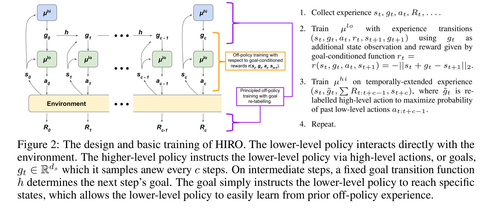

  <em>Figure 1: The two-level hierarchical architecture of HIRO. The high-level Manager observes the environment state and outputs a subgoal, and the low-level Worker executes primitive actions according to that subgoal. Source: <a href="https://arxiv.org/abs/1805.08296" target="_blank" rel="noopener noreferrer">Nachum et al., 2018</a></em>

### The Options Framework

The **Options framework**, proposed by Sutton et al. in 1999, is the theoretical foundation of HRL. An Option $o$ consists of three parts:

- **Initiation set** $\mathcal{I}_o \subseteq \mathcal{S}$: the states in which the Option may be started
- **Internal policy** $\pi_o: \mathcal{S} \times \mathcal{A} \to [0,1]$: the policy followed while the Option is running
- **Termination condition** $\beta_o: \mathcal{S} \to [0,1]$: the probability of terminating the Option upon reaching a given state

An Option can be understood as a "macro-action". It is a stretch of sustained behavior rather than a single-step action. In a robot task, "walk to the fridge" is an Option: it contains many low-level actions internally, but the high level only has to select the Option.

With Options, the decision frequency at the high level drops sharply: a 1000-step low-level task may need only 10 Option selections at the high level. This directly eases credit assignment and the exploration bottleneck.

### Goal-Conditioned Policies

Another way to build hierarchy is **goal-conditioned reinforcement learning** (Goal-Conditioned RL). The policy takes not only the state $s$ but also a goal $g$ as input:

$$\pi(a | s, g)$$

During training, the agent learns "given a goal, how to reach it". This generalization is powerful: the policy learns how to reach any goal, not just a single end point. It also means one trajectory can be reused many times. Suppose the agent walks from $s_0$ to $s_T$ and passes through states $s_5, s_{10}, s_{50}$ along the way. This trajectory then trains "from $s_0$ to $s_T$", and also "from $s_0$ to $s_5$", "from $s_5$ to $s_{10}$", and many other subtasks.

UVFA (Universal Value Function Approximator, Schaul et al., 2015) is the foundational work in this direction. It learns a single value function $Q(s, a, g)$ that gives a value estimate for any state-goal pair. HIRO (Nachum et al., 2018) builds a two-level architecture on top of this (Figure 1):

- **High level** $\pi^{hi}$: observes the state $s_t$ every $c$ steps and outputs a subgoal $g_t$ (usually a target state in the state space)
- **Low level** $\pi^{lo}$: executes primitive actions according to the current state and the subgoal, $a_t = \pi^{lo}(a_t | s_t, g_t)$
- **Goal relabeling**: when training the high level, it does not use the reward for the original goal $g_t$. Instead it uses the "state actually reached" as a virtual goal, in the spirit of HER

The key innovation of HIRO lies in how the high level is trained. Because the low-level policy keeps changing, the high-level goals have to adapt along with it. HIRO resolves this non-stationarity with a relabeling mechanism.

### Automatic Subgoal Discovery

A key challenge of HRL is: **where do the subgoals come from?** Designing subgoals by hand requires domain knowledge and defeats the "end-to-end learning" spirit of RL. Researchers have proposed several ways to discover subgoals automatically:

- **Based on state visitation frequency**: build a state-transition graph and find the bottleneck states that are "passed through often". In a maze, the corridor connecting two rooms is a bottleneck. Many trajectories go through it, so it is a natural subgoal. Representative work includes betweenness centrality and spectral clustering methods.
- **Based on mutual information**: maximize an objective such as DIAYN (Diversity is All You Need) to learn a set of skills, so that each skill shows stable and distinguishable behavior in a different region of the state space. Intuitively, each skill learns a "distinctive movement pattern" (such as going left or going right), and these skills naturally become reusable sub-policies.
- **Based on skill discovery**: related to the mutual-information approach but focused more on temporal abstraction. For example, the Option-Critic architecture unifies Option discovery and policy learning in one end-to-end framework. The initiation set, internal policy, and termination condition of each Option are all learned by gradient descent, with no manual specification.

::: info How well do hierarchical methods work?
The paper "Does Hierarchical Reinforcement Learning Outperform Standard RL?" makes a systematic empirical comparison of HRL. Its conclusion is that on tasks that truly require long-horizon planning, HRL does outperform flat RL, while on tasks of moderate difficulty a carefully tuned PPO or SAC may do better. The hierarchical structure itself adds complexity and makes training harder.
:::

## Hindsight Experience Replay

Hierarchical RL meets long-horizon tasks by changing the structure of the policy. Another direction **changes how data is used**. The best-known method here is **Hindsight Experience Replay (HER)**, proposed by Andrychowicz et al. at OpenAI in 2017.

### Core Idea

The starting point of HER is simple. The agent tried to reach goal $g$ and failed, ending in state $s_T$. For goal $g$ the episode is a failure, but if we **pretend the goal had been $s_T$ all along**, the same experience becomes a success.

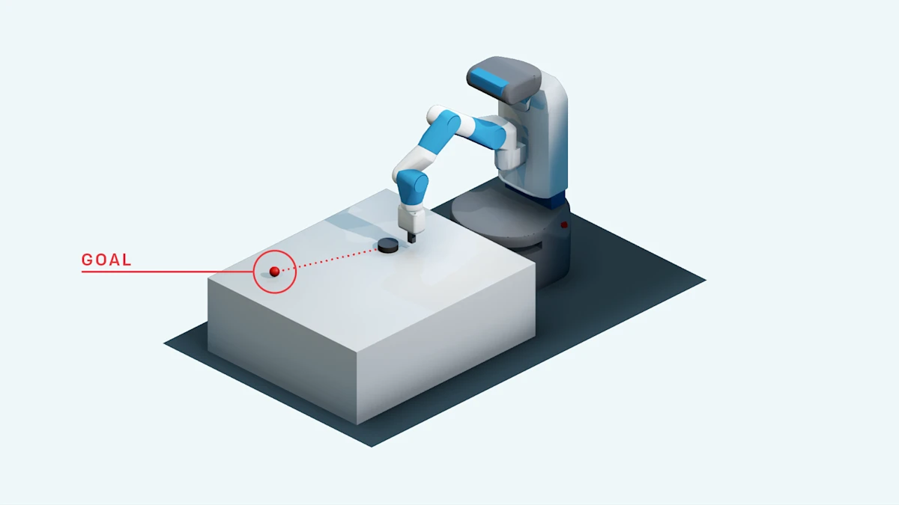

  <em>Figure 2: The notion of a goal in goal-conditioned tasks. The agent has to push an object to the target position (green dot), but the reward is sparse: it receives 0 only on reaching the goal and -1 otherwise. Source: <a href="https://openai.com/index/ingredients-for-robotics-research/" target="_blank" rel="noopener noreferrer">OpenAI Blog</a></em>

Concretely, training proceeds as follows:

1. The agent interacts with the environment as usual, trying to reach goal $g$.
2. When the episode ends, the collected trajectory is $(s_0, a_0, r_0, s_1, \ldots, s_T)$.
3. From the final state $s_T$ (or an intermediate state), extract a **virtual goal** $g' = \phi(s_T)$.
4. Replace the original goal $g$ with $g'$ and recompute the reward $r'_t = r(s_t, a_t, g')$.
5. Store $(s_t, a_t, r'_t, s_{t+1}, g')$ in the replay buffer.

In this way each trajectory can be reused many times: once for the original goal and several times for different virtual goals. Under sparse reward, HER turns "failed experience" into "successful experience" and greatly improves sample efficiency.

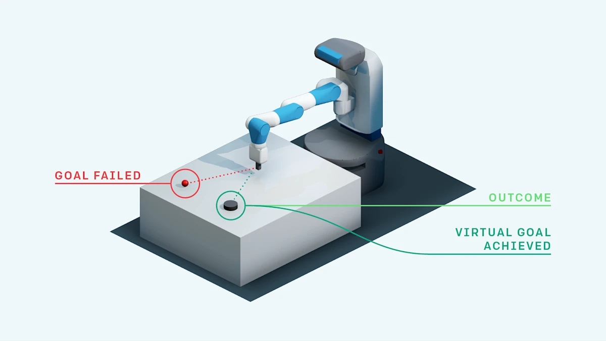

  <em>Figure 3: The core mechanism of HER, the virtual goal. The agent did not reach the original goal (red dot), but it did reach another position (blue dot). HER relabels this "position actually reached" as the goal and turns failed experience into successful training data. Source: <a href="https://openai.com/index/ingredients-for-robotics-research/" target="_blank" rel="noopener noreferrer">OpenAI Blog</a></em>

### Working with Goal-Conditioned RL

HER is normally used together with a goal-conditioned policy $\pi(a|s,g)$. The goal is part of the policy's input, so changing the goal changes the training signal for the policy. DQN + HER and DDPG + HER are common combinations, and the latter reached close to 100% success on OpenAI's Fetch family of robot tasks.

The original paper proposed four strategies for sampling virtual goals:

- **final**: use only the final state of the episode as the virtual goal (the simplest, and usually already works well)
- **episode**: pick a random state from the same trajectory as the virtual goal
- **future**: pick a random state from those **after** the current time step $t$ (the most common, since it avoids "backward-looking" virtual goals)
- **random**: pick a random state from all earlier episodes

Experiments show that the **future** strategy usually works best, because it guarantees that the virtual goal lies "ahead" in time, which is more logical. It is worth noting that HER's virtual-goal sampling overlaps naturally with the curriculum learning introduced below: if we preferentially sample virtual goals that are "not too far from what the current policy can do", we obtain an automatic curriculum.

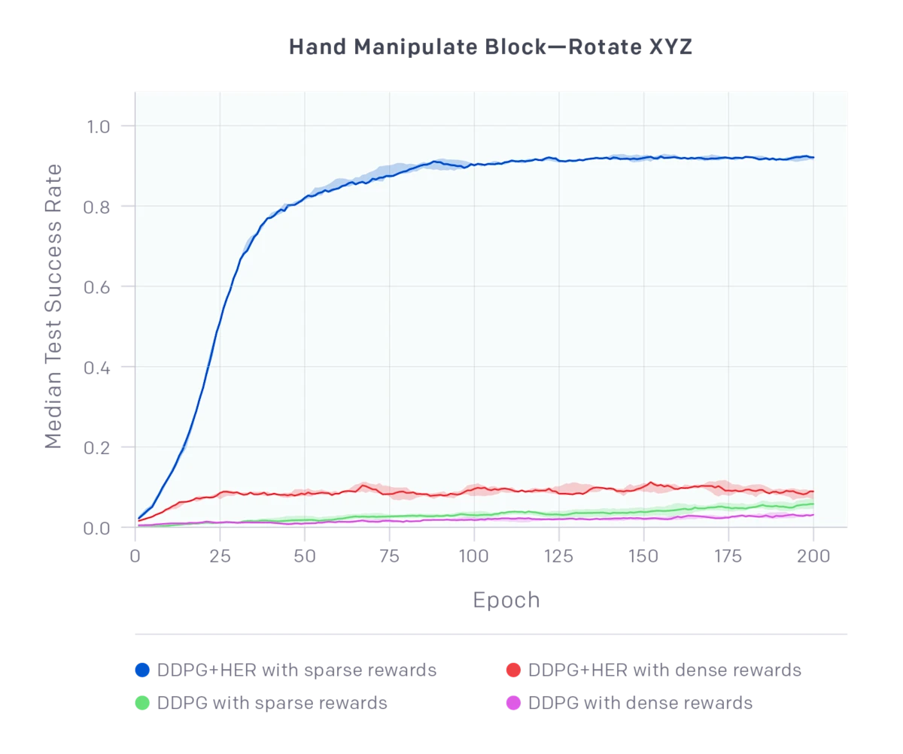

  <em>Figure 4: Training curves of DDPG + HER on the ShadowHand block-rotation task (Hand Manipulate Block—Rotate XYZ). DDPG + HER + sparse reward (blue) clearly outperforms all baseline configurations and finally reaches a success rate close to 100%. Source: <a href="https://openai.com/index/ingredients-for-robotics-research/" target="_blank" rel="noopener noreferrer">OpenAI Blog</a></em>

### Limitations

HER is clever, but it has several limitations:

- **It needs goal conditioning**: the environment must support goals of the form "reach a certain state". If the goal cannot be represented by a point in the state space (for example "win the game"), HER cannot be applied directly. Many physical manipulation tasks satisfy this condition naturally, though: "put the object at the target position" is a goal in the state space.
- **Quality of virtual goals**: if the states reached at random are meaningless, relabeling does not help. In a maze, for example, the position the agent randomly reaches may be next to a wall, and relabeling it as a "goal" has no training value. The problem is especially severe with sparse reward and a large state space.
- **Extremely long-horizon tasks**: when a task requires many precise steps in sequence (such as "open the fridge → take out the ingredients → chop → stir-fry"), random exploration still has great difficulty reaching a meaningful end state. HER solves the problem of "data reuse" and leaves "exploration" unsolved. If the agent cannot even do the first step, "open the fridge", all the later subgoals are empty talk.
- **Conflicting goals**: if several goals must be satisfied at once, plain HER may produce contradictory virtual goals. Extensions such as Multi-goal HER try to address this.

## Model-Based Planning

The third route is this. Instead of letting the agent learn by trial and error in the real environment, **first learn a world model, then plan inside it**.

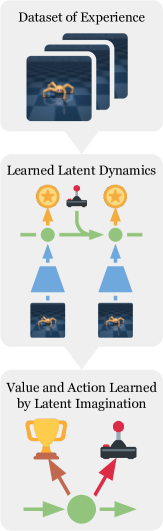

  <em>Figure 5: The overall architecture of Dreamer. A world model is learned from past experience, then an Actor-Critic is trained by backpropagation through imagination in latent space, and finally the learned policy is deployed in the real environment. Source: <a href="https://arxiv.org/abs/1912.01603" target="_blank" rel="noopener noreferrer">Hafner et al., 2020</a></em>

### Short-Horizon Model Rollouts

The idea of MBPO (Model-Based Policy Optimization, Janner et al., 2019) is to learn an environment dynamics model $\hat{T}(s'|s,a)$ and use it to generate **short virtual trajectories** that augment the training data. Concretely:

1. Collect data $(s, a, r, s')$ from the real environment.
2. Train the dynamics model $\hat{T}$ on this data (usually an ensemble of models is trained to estimate uncertainty).
3. Starting from real states, simulate $k$ steps with $\hat{T}$ ($k$ is usually short, such as 5) to generate "branched rollouts".
4. Add the virtual trajectories to the replay buffer and train the policy with SAC or PPO.

The key insight of MBPO is that short-horizon predictions are accurate enough, while long-horizon prediction errors accumulate too fast. If the per-step prediction error is $\epsilon$, the accumulated error after $k$ steps is roughly $O(\epsilon \cdot \frac{\gamma^k}{1-\gamma})$. Janner et al. derived a theoretical result: when the model rollout length $k$ satisfies a certain threshold, the expected return from using model data is better than that of a purely model-free method. In practice $k$ is usually around 5.

MBPO improves sample efficiency by a factor of 5-10 on continuous-control tasks such as HalfCheetah. Its limitation is also clear: it uses only the "short-horizon" ability of the model. It is still model-free training in essence, with the model used to enlarge the amount of data. For tasks that genuinely require long-term planning, MBPO helps only a little.

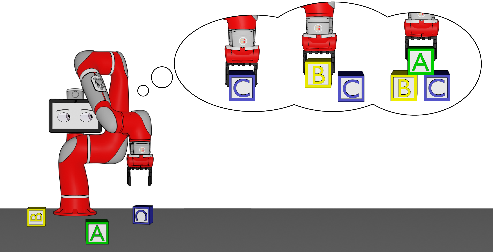

  <em>Figure 6: The core idea of MBPO. A dynamics model is learned to answer "if I take action $a$, what happens next?", and the virtual trajectories it generates augment the training data. Source: <a href="http://bair.berkeley.edu/blog/2019/12/12/mbpo/" target="_blank" rel="noopener noreferrer">BAIR Blog</a></em>

### Search as Planning

MBPO and Dreamer learn an **implicit world model** (a neural network fitted to the dynamics). The other route is to **skip learning a world model and search directly over known rules**. Monte Carlo Tree Search (MCTS) is the model example of this idea.

The core idea of MCTS is that there is no need to enumerate every possible future (there are far too many). Selective simulation is used to find good actions instead. It maintains a search tree, and each iteration performs four steps:

1. **Selection**: starting from the root, use the UCB (Upper Confidence Bound) formula to choose the most promising child node, until reaching a node that has not yet been expanded. The UCB formula is:

$$\text{UCB}(a) = Q(s, a) + c \cdot \sqrt{\frac{\ln N(s)}{N(s, a)}}$$

Here $Q(s,a)$ is the action-value estimate, $N(s)$ and $N(s,a)$ are visit counts, and $c$ is the exploration constant. The first term encourages exploiting actions already known to be good, and the second encourages exploring actions with few visits.

2. **Expansion**: for the selected node, simulate one action and add the new state to the search tree.

3. **Simulation (Rollout)**: starting from the new node, simulate to the end of the game with a fast policy (such as a random policy) and obtain a return estimate.

4. **Backpropagation**: propagate the simulation result back along the path and update the $Q$ values and visit counts of all nodes on the path.

The strength of MCTS lies in its **adaptive allocation of computation**. It spends more simulations on the more promising action branches rather than exploring uniformly. The depth and breadth of the search tree grow automatically with the amount of computation: the longer it thinks, the better its decisions.

**The AlphaZero revolution**

Pure MCTS needs a large number of simulations to get accurate $Q$ estimates. AlphaZero (Silver et al., 2017) combines MCTS with deep learning and makes a key upgrade:

- **A neural network replaces the rollout**: instead of simulating to the end of the game with a random policy, a value network $v_\theta(s)$ directly gives the state-value estimate. This "truncates" the search depth and replaces a long simulation with a learned intuition.
- **A policy network narrows the search**: the policy network $\pi_\theta(a|s)$ provides a prior probability for every action, and MCTS gives priority to the actions it recommends during selection. The search shrinks from all legal actions to a few candidates.
- **MCTS and learning reinforce each other**: the search result of MCTS serves as the "improved policy target" for training the network, and the trained network in turn makes the MCTS search more accurate. This forms a positive feedback loop.

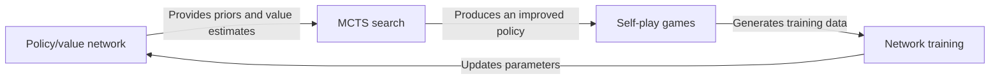

AlphaZero surpassed human champions and all earlier AI systems in Go, chess, and shogi. Its success illustrates a deep fact: **search and learning complement each other**. Learning provides intuition (the value network), search provides precise reasoning (MCTS), and the combination is far better than either alone.

MCTS also has a clear limitation, though: it needs an exact model of the environment (the rules of a board game are a perfect model), and the real world rarely offers one. The AlphaZero approach excels in environments that are **fully observable, with discrete actions and a perfect model**, such as Go, but it is hard to transfer directly to continuous, high-dimensional, partially observable tasks like robot control.

### Dreamer and Training in Imagination

The Dreamer family (Hafner et al., 2020-2023) goes further. It does not train the policy in the real environment at all, and trains **entirely inside the imagination of the world model**.

The core of Dreamer is a world model called **RSSM** (Recurrent State-Space Model). The key design of the RSSM is to split the latent state into two parts:

- **Deterministic state** $h_t$: computed recurrently from the previous step through a recurrent network (a GRU), like the hidden state of an RNN, and providing long-term memory
- **Stochastic state** $z_t$: inferred from observations, capturing the uncertainty of the current frame (for example, the unpredictable positions of other players)

Together they let the model remember "which room I am in" (deterministic) and also handle "the door may be open or closed" (stochastic).

The full Dreamer training has three stages:

**Stage 1: learn the world model**

Learn the RSSM parameters from real interaction data. The optimization objective includes:

- Observation reconstruction loss: the latent state must be able to reconstruct the original observation
- Reward prediction loss: predict the reward from the latent state
- KL divergence regularization: keep the posterior $q(z_t | o_{\leq t}, a_{<t})$ close to the prior $p(z_t | h_t)$

**Stage 2: train the policy in imagination**

The world model is frozen. Latent state sequences $z_1, z_2, \ldots, z_H$ are sampled from imagination ($H$ can reach hundreds of steps), and an Actor-Critic is trained on these imagined sequences:

- The Actor optimizes the policy parameters by backpropagating through the imagined time steps
- The Critic estimates state values in imagination and uses the $\lambda$-return to balance bias and variance

**Stage 3: deploy in the real environment**

The learned policy is used directly in the real environment, new data is collected, and the process returns to Stage 1 for the next iteration.

Concretely, the world model trained in Stage 1 has three learned parts:

1. **Representation model**: encodes raw observations (such as images) into latent variables $z_t$
2. **Transition model**: learns the dynamics in latent space, $p(z_{t+1}|z_t, a_t)$
3. **Policy model**: learns the policy in latent space, $\pi(a|z_{1:t})$

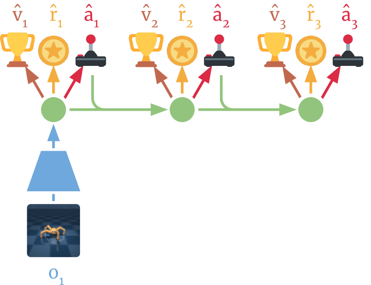

  <em>Figure 7: The three stages of Dreamer. (a) Learn the dynamics model from experience (encoder + RSSM + reward prediction); (b) train the Actor-Critic on imagined latent trajectories; (c) deploy the policy in the environment to act. Source: <a href="https://arxiv.org/abs/1912.01603" target="_blank" rel="noopener noreferrer">Hafner et al., 2020</a></em>

In training, the world model is first learned from real data, and then the policy is trained **entirely in the model's "imagination"**, optimizing the policy parameters by backpropagating through time steps. Because no interaction with the environment is needed, the policy can "foresee" the distant future and decide accordingly.

Dreamer-V3 (published in Nature in 2025; preprint arXiv 2023) reached SOTA performance on more than 150 different benchmark tasks with **a single set of hyperparameters**, from continuous control to Atari games to diamond collection in Minecraft, which shows the strong generalization of model-based methods. Dreamer-V3 made several key improvements over its predecessors:

- **symlog prediction**: a symmetric logarithmic transform handles values of different magnitudes (rewards, values, and so on), so the same network can fit targets in both the $[-1, 1]$ and the $[-1000, 1000]$ range
- **No normalization needed**: earlier Dreamer versions had to normalize rewards and states, and Dreamer-V3 handles this automatically through dynamic loss scaling
- **Robust critic**: it uses quantile regression to estimate the value distribution rather than a plain expected value, which is more robust to heavy-tailed rewards

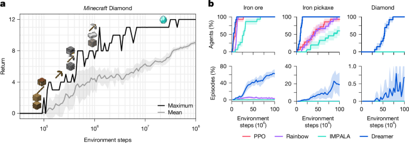

  <em>Figure 8: DreamerV3 on the Minecraft diamond-collection task. It is the first algorithm to collect diamonds in Minecraft from scratch (no human data, no curriculum), and the whole process requires more than 17,000 steps of continuous decision-making. Source: <a href="https://arxiv.org/abs/2301.04104" target="_blank" rel="noopener noreferrer">Hafner et al., 2023</a></em>

::: tip Why world models can handle long-horizon tasks
A world model decouples "exploring the environment" from "learning the policy". The real environment only needs to be explored enough to obtain a good dynamics model. Policy training then happens in imagination and is not limited by the number of real interactions. Dreamer can unroll trajectories of hundreds of steps in imagination, so the policy gets to "see" long-horizon consequences.
:::

## Exploration Methods

The methods introduced so far (hierarchical RL, HER, world models) tackle the long-horizon problem mainly through policy structure and training procedure. All of them carry an implicit assumption: the agent can collect sufficiently diverse data in the environment. When the task is extremely sparse and the exploration space explodes, that assumption fails, and the agent needs a **dedicated exploration strategy**.

### Go-Explore and Returning to Explore Again

Go-Explore (Ecoffet et al., 2019, 2021) is a landmark method for long-horizon sparse exploration. Its core insight is that **the problem of most exploration algorithms is not "failing to find new states" but "finding them and then forgetting them"**. The agent happens upon a promising new state, but because the policy is stochastic, it is almost impossible to return to that state in the next episode.

The solution of Go-Explore is direct: **store the promising states and start from them next time**. It has two phases.

**Phase 1: Explore**

1. Maintain an **archive** that stores all the "interesting" states visited.
2. Pick a random state from the archive and load it into the simulator (that is, "return to the past").
3. Explore from that state with a random or semi-random policy.
4. If a new state is found ("new" is defined by gridded cells), add it to the archive.
5. Repeat the process.

The intuition is this: if you find a promising new path while exploring a maze, you do not restart from the entrance next time. You continue exploring from where the new path begins.

**Phase 2: Robustify**

Phase 1 produces a set of high-return trajectories, but these trajectories can be very brittle. They depend on exact state loading and random seeds and cannot serve directly as a policy. Phase 2 uses **imitation learning** (introduced in the next part) to train a robust neural-network policy from these trajectories, so that it can complete the task without "save points".

Go-Explore scored more than 40,000 points on Montezuma's Revenge, over 10 times the average human score at the time. It also broke through on Atari games such as Pitfall that were previously considered "nearly impossible".

The limitation of Go-Explore is that it **depends on the environment being resettable**: the environment must be restorable to an exact historical state. In a simulator this is no problem (states can be saved and loaded), but on a real robot it is hard to achieve. Later work proposed a "policy-based" Go-Explore that uses a goal-conditioned policy to approximate state resets, at some cost in effectiveness.

### Intrinsic Rewards and Curiosity

Another family of exploration methods does not rely on a state archive. It gives the agent an **intrinsic reward** that encourages it to seek out novel states. The total reward becomes:

$$r_t^{\text{total}} = r_t^{\text{extrinsic}} + \beta \cdot r_t^{\text{intrinsic}}$$

Here $\beta$ controls the balance between exploration and exploitation. Common intrinsic reward designs include:

- **Count-based exploration**: record the visit count $N(s)$ of each state (or state-action pair) and set the intrinsic reward to $r_t^{\text{int}} = 1/\sqrt{N(s_{t+1})}$. The fewer visits a state has, the higher its reward. It is simple and effective but hard to scale to high-dimensional continuous state spaces (because the same continuous state is almost never "revisited").
- **RND (Random Network Distillation)**: train a fixed random neural network $f$ as the "target network" and train a predictor network $\hat{f}$ to imitate the output of $f$. The prediction error $\|f(s) - \hat{f}(s)\|^2$ serves as the intrinsic reward. A large prediction error at a state means the state is "novel" (nothing similar has been seen before) and worth exploring.
- **ICM (Intrinsic Curiosity Module)**: learn a forward dynamics model $\hat{s}_{t+1} = f(s_t, a_t)$ and use its prediction error as the curiosity signal. An inverse model is added to filter out "uncontrollable" noise (for instance, random changes on a TV screen should not produce curiosity).

The advantage of intrinsic reward methods is their generality: there is no need to modify the environment or the policy structure, only to add one term to the reward function. They face a fundamental **"noisy TV" problem**, however. If the environment contains a persistent source of random signals (such as a TV that switches channels at random), the agent may stay in front of the TV forever, because every frame is "novel". ICM partly solves this with the inverse model, but it remains a challenge in complex environments.

## Reward Shaping and Curriculum Learning

Beyond changing the policy structure and the training procedure, another family of methods starts from the **reward function itself**.

### Reward Shaping

The core idea of **reward shaping** is to design by hand, or learn automatically, **dense intermediate rewards** for sparse-reward tasks. The best-known theoretical result is due to Ng et al. (1999), who proved that potential-based reward shaping

$$F(s, s') = \gamma \Phi(s') - \Phi(s)$$

does not change the optimal policy (policy invariance), where $\Phi$ is an arbitrary function of the state. This guarantees that the artificially added reward cannot "mislead" the agent.

Here is an example. In a navigation task, the original reward is only "$+1$ for reaching the goal". We can set the potential function $\Phi(s)$ to the negative distance from state $s$ to the goal, so that $F(s, s') = \gamma \cdot (-\text{dist}(s')) - (-\text{dist}(s))$, which amounts to "a small reward for every step closer to the goal". Because $\Phi$ is a potential function, the extra reward satisfies policy invariance: it does not change what the optimal policy is, it only makes learning faster.

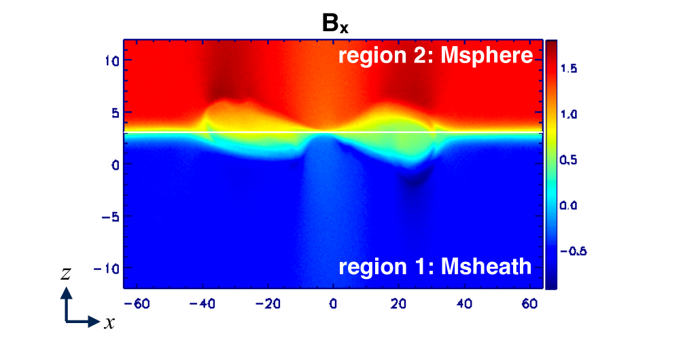

  <em>Figure 9: An example of a learned reward function. From a sparse environment, the agent learns a dense reward signal (brighter color means higher reward), which gives policy training richer gradient information. Source: <a href="https://arxiv.org/abs/1904.07854" target="_blank" rel="noopener noreferrer">Singh et al., 2019</a></em>

Designing a good potential function $\Phi$ already requires domain knowledge, though: you need to know what counts as a "good intermediate state". To reduce the reliance on manual design, researchers have developed several ways to infer rewards automatically:

- **Inverse reinforcement learning** (Inverse RL, IRL): infer the reward function from expert demonstrations. Assuming the expert's trajectories are optimal, work backwards to find which reward function would make the expert's behavior optimal. Representative methods include MaxEnt IRL and GAIL (Generative Adversarial Imitation Learning).
- **Preference-based RL**: have humans judge preferences between two trajectories ("A is better than B") and learn a reward function from them. This later became the core idea of RLHF, which later chapters cover in detail.
- **Self-supervised reward discovery**: no human input, and intrinsic rewards are generated automatically with information-theoretic or curiosity-driven methods. For example, RND (Random Network Distillation) uses prediction error as a curiosity signal that encourages the agent to explore novel states.

### Curriculum Learning

The idea of **curriculum learning** is not to hand the agent the hardest task at the start but to begin with easy tasks and increase the difficulty step by step. The concept was first proposed by Bengio et al. (2009) and is inspired by human education: a primary-school pupil does not start with calculus but with addition, subtraction, multiplication, and division.

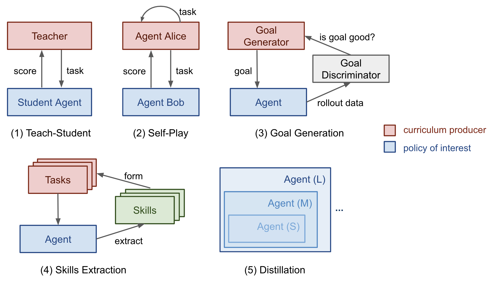

  <em>Figure 10: The five main types of curriculum learning in RL. The red part is the "curriculum producer" (responsible for generating training tasks), and the blue part is the "target policy" (the policy to be trained). Source: <a href="https://lilianweng.github.io/posts/2020-01-29-curriculum-rl/" target="_blank" rel="noopener noreferrer">Lilian Weng, 2020</a></em>

Lilian Weng (2020) divides curriculum learning in RL into five main types. Figure 10 shows, for each type, the relation between "who generates the curriculum" and "who carries it out".

**1. Task-Specific Curriculum**

The most direct approach is to design a sequence of tasks of increasing difficulty by hand. For example, when training a robot to open a door:

- Stage 1: the door is already half open and only needs a push
- Stage 2: the door is slightly ajar and needs more force
- Stage 3: the door is fully closed and needs the complete door-opening motion

The advantage of this method is strong controllability, and the drawback is the large amount of manual design. OpenAI used a carefully designed manual curriculum when training a robotic hand to solve the Rubik's cube.

**2. Teacher-Guided Curriculum**

A separate "teacher" policy generates suitable training tasks for the "student". The teacher adjusts the task difficulty dynamically according to the student's current ability: if a task is too easy it moves on faster, and if it is too hard it falls back to practice. The representative method is Prioritized Level Replay (PLR), which maintains a pool of tasks and preferentially samples the tasks with the most training value according to the agent's learning signal (such as TD error or the change in success rate).

**3. Self-Play Curriculum**

The agent trains by playing games against itself. AlphaGo and AlphaZero are the classic examples: the agent keeps playing against past versions of itself, the opponent grows stronger and stronger, and the training difficulty rises naturally. This works very well in zero-sum games but is less suitable for cooperative or single-agent tasks. OpenAI Five also used self-play plus curriculum when training for Dota 2, moving gradually from 1v1 to 5v5.

**4. Automatic Goal Generation**

The core idea is to **generate suitable training goals automatically with an algorithm** rather than rely on manual design. Representative methods include:

- **ALP-GMM** (Absolute Learning Progress - Gaussian Mixture Model): model the task parameter space with a Gaussian mixture model and sample new tasks according to "learning progress". Regions where the agent learns quickly are sampled more, and regions where it makes no progress are sampled less.
- **GoalGAN**: train a generative adversarial network to generate goals that are "just right for the current agent's ability". Goals that are too hard produce no gradient signal, and goals that are too easy waste computation.
- **SPDL** (Self-Paced Deep Learning): formulate curriculum learning as an optimization problem that automatically balances "training difficulty" against "learning progress".

**5. Skill-Based / Distillation Curriculum**

First train separate skill policies on several independent tasks, then distill these skills into one unified generalist policy. The method assumes that the different subtasks naturally form a curriculum from easy to hard. Representative work includes Distral and Policy Distillation.

#### Three Dimensions of Curriculum in RL

Whichever of the types above is used, a curriculum in RL usually adjusts difficulty along the following dimensions:

- **Initial-state curriculum**: at first let the agent start close to the goal and gradually increase the starting distance. In a navigation task, for example, start 1 meter from the goal, then 5 meters, 10 meters, and 50 meters.
- **Goal curriculum**: learn simple goals first and then complex ones. A robot arm first learns to "move to a specified position", then to "grasp an object", then to "grasp it and place it at the target position".
- **Environment curriculum**: train first in simple environments (few obstacles, low friction) and then transfer to complex ones. Domain Randomization can be viewed as a special curriculum strategy: train first on a narrow distribution of environment parameters and then widen the randomization range step by step.

#### Combining Curriculum Learning with HER

The combination of curriculum learning and HER (Curriculum-guided HER) is effective on long-horizon sparse-reward tasks: HER makes efficient use of failed experience, and the curriculum controls how the difficulty progresses. One concrete way to combine them is to introduce a preference into HER's virtual-goal sampling, preferring virtual goals that are not too far from the boundary of what the current policy can do instead of sampling completely at random. This keeps HER from sampling virtual goals that are "too easy" or "too hard" and therefore useless in extremely long-horizon tasks.

## Learning from Expert Demonstrations

So far every method has assumed that the agent learns from scratch. If we have **expert demonstrations**, the situation changes completely, because expert demonstrations contain the "answers" of long-horizon planning. The methods that learn from expert data are collectively called **imitation learning** (IL).

### Behavior Cloning

The simplest imitation learning method is **behavior cloning** (BC). It treats the expert trajectories as a supervised-learning dataset and trains a policy network $\pi_\theta(a|s)$ to imitate the expert's action choices:

$$\min_\theta \sum_{(s_i, a_i) \in \mathcal{D}_{\text{expert}}} \mathcal{L}(\pi_\theta(\cdot|s_i), a_i)$$

BC is so simple that one doubts it can work. In fact it works well on "short-horizon" tasks: for lane keeping in autonomous driving or simple robot-arm grasping, a few hundred thousand expert samples can train a decent policy.

But BC has a fatal problem: **distribution shift** (also called covariate shift). During training the policy has seen only the expert's state distribution $p_{\text{expert}}(s)$. At execution time, once the policy makes a small mistake, it enters a state never seen in training, makes a larger mistake, and a vicious circle follows:

$$s_0 \sim p_{\text{expert}} \to a_0 \text{ slightly off} \to s_1 \notin p_{\text{expert}} \to a_1 \text{ far off} \to s_2 \text{ collapse}$$

This compounding error is especially severe in long-horizon tasks. The policy must make hundreds of correct decisions in a row, and one wrong step can be unrecoverable. In theory, if the per-step error probability of the policy is $\epsilon$, the probability of making at least one error within $T$ steps is about $1 - (1-\epsilon)^T \approx T\epsilon$, which is proportional to the horizon.

### DAgger and Iterative Correction

DAgger (Dataset Aggregation, Ross et al., 2011) is the classical method for dealing with distribution shift. Its idea: since the policy will meet states outside the training distribution at execution time, **have the expert provide demonstrations on those states as well**.

The procedure is:

1. Train a policy $\pi_1$ on the initial expert data.
2. Run $\pi_1$ in the environment and collect the sequence of visited states $\{s_1, s_2, \ldots\}$.
3. Ask the expert to label the correct actions $\{a_1^*, a_2^*, \ldots\}$ for these states.
4. Add the new data to the dataset and retrain the policy $\pi_2$.
5. Repeat until convergence.

The theoretical guarantee of DAgger is a no-regret reduction: with a no-regret online learner, the average regret vanishes as the number of iterations grows, so the error compounding drops from the quadratic-in-$T$ blowup of plain BC (one early mistake ruins the whole trajectory) to near-linear in $T$. Its practical bottleneck is the **need for online access to the expert**: every iteration requires a human (or an expensive expert system) to label actions for the new states. In some settings (such as robot teleoperation) the cost of obtaining expert labels is very high.

### Adversarial Imitation Learning and GAIL

What if there is only a fixed batch of expert data and no way to obtain more labels online? **GAIL** (Generative Adversarial Imitation Learning, Ho & Ermon, 2016) offers an ingenious solution inspired by GANs (generative adversarial networks):

- **Generator** $G$: the policy $\pi_\theta$, which tries to generate trajectories similar to the expert's
- **Discriminator** $D_\phi$: tries to tell "expert trajectories" from "policy trajectories"

The training objective is for the discriminator to separate the two as accurately as possible while the policy tries to "fool" the discriminator:

$$\min_\theta \max_\phi \; \mathbb{E}_{\pi_\theta}[\log(1 - D_\phi(s, a))] + \mathbb{E}_{\pi_E}[\log D_\phi(s, a)]$$

After training, the discriminator is discarded and only the policy is kept. The elegance of GAIL is that it **does not need to define a reward function explicitly**. The discriminator output implicitly defines a reward, $r(s, a) = \log D(s, a)$: $(s, a)$ pairs the expert has produced score high, and those the policy produces itself score low.

GAIL performs well on robot manipulation, autonomous driving, and similar tasks, but its training is unstable (a common ailment of GANs) and its computational cost is high. Later work such as DAC (Discriminator-Actor-Critic) and AIRL (Adversarial Inverse Reinforcement Learning) improved the stability of GAIL.

::: info The relationship between imitation learning and RL
Imitation learning and reinforcement learning are not an either-or choice. In practice the most common pattern is to **initialize the policy with BC from expert data and then fine-tune with RL**. This combination was used in both AlphaStar (the StarCraft II AI) and OpenAI Five (the Dota 2 AI): BC provides a good starting point (avoiding the long exploration of RL from scratch), and RL optimizes further from there. We will see later that the "BC initialization + RL fine-tuning" pattern also appears in LLM alignment (RLHF), where SFT corresponds to BC and PPO/DPO correspond to RL fine-tuning.
:::

## Comparison and Summary of Methods

The table below summarizes the main method families of classical RL for long-horizon tasks:

| Method family        | Core idea                                     | Representative work          | Strengths                                            | Limitations                                         |
| -------------------- | --------------------------------------------- | ---------------------------- | ---------------------------------------------------- | --------------------------------------------------- |
| Hierarchical RL      | Split a long task into subtasks               | Options, HIRO, DIAYN         | Lower decision frequency, interpretable              | Subgoal discovery, complex training                 |
| HER                  | Relabel failed experience as successful       | DDPG+HER                     | Simple and effective, high sample efficiency         | Needs goal conditioning, very long tasks still hard |
| Model-based planning | Learn a world model / tree search             | MBPO, Dreamer, AlphaZero     | Very high sample efficiency or reasoning power       | Model error, or needs a perfect environment model   |
| Exploration methods  | Return to the past / curiosity-driven         | Go-Explore, RND, ICM         | Targets sparse-reward exploration directly           | Needs a simulator, or suffers from noisy TV         |
| Reward shaping       | Design intermediate rewards to guide learning | Potential-based shaping, IRL | Theoretical guarantee of an unchanged optimal policy | Needs domain knowledge                              |
| Curriculum learning  | Progress from easy to hard                    | ALP-GMM, GoalGAN, PLR        | Stable training, good for transfer                   | Curriculum design is itself hard                    |
| Imitation learning   | Learn from expert demonstrations              | BC, DAgger, GAIL             | Bypasses exploration, quick to get a policy          | Needs expert data, distribution shift               |

These classical methods have made substantial progress in robot control, game AI, autonomous driving, and other fields. What they share is a need for careful task-specific design (subgoal structure, reward shaping, curriculum strategy, expert data), and their ability to generalize to entirely new tasks is limited. In later chapters we will see that introducing LLMs brings a new paradigm to long-horizon planning: using the commonsense and reasoning ability of large models to generate subgoals, design rewards, and even plan directly, which greatly reduces the dependence on manual design.

## Section Summary

In this section we reviewed the main directions classical reinforcement learning explores for long-horizon tasks: hierarchical RL, HER, model-based planning (MBPO, Dreamer), exploration methods, reward shaping, curriculum learning, and imitation learning. The core goal of all these methods is to improve sample efficiency or to solve the sparse-reward problem.

Improving sample efficiency is in fact one of the main lines of RL development after PPO. The next chapter follows this line: from off-policy continuous control (DDPG/TD3/SAC) that reuses historical data, to model-based RL that trains on "imagined" data, to search and world models. All of these are more sample-efficient than PPO.

Next chapter: [9. Off-Policy and Model-Based RL](../chapter09_continuous_control/ddpg)
