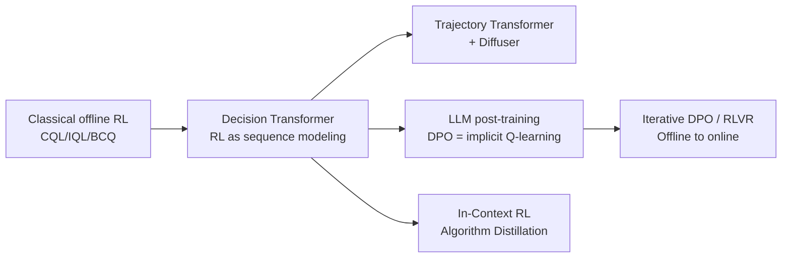

# 10.3 Offline Reinforcement Learning and Preference Data

## Reading Guide

**Key Ideas**

- Understand why DPO is essentially a form of offline reinforcement learning: the preference data is a fixed dataset, and the reference policy corresponds to the constraint of "do not stray too far from the behavior policy".
- Map LLM preference data item by item onto the traditional D4RL offline datasets, and see what the state, action, and reward each are in the LLM setting.
- See how the sequence-modeling idea pioneered by Decision Transformer extends to LLM reasoning search, in-context RL, and other directions.
- Understand what this cross-domain analogy can explain and what it cannot, so that different objective functions are not simply equated.

In the previous section, [10.2](./sequence-modeling), we saw how Decision Transformer writes fixed trajectories as a sequence-modeling problem and leaves the Bellman equation behind entirely. You may think: this approach looks a lot like how large language models are trained today. Both use fixed data for supervised learning, and both predict the next token...

Let's stop and think: does LLM preference optimization (for example DPO) also fit the "offline learning" setting? Yes! The training set already provides the prompt, a better answer, and a worse answer. During training you cannot go back to the annotators and ask "which of these two answers is actually better", and you cannot interact with an environment online to correct things. You can only use the fixed preference data that has already been collected.

In this section we connect the two fields. First we explain the deep link between DPO and offline optimization with a KL constraint, then we map preference data onto classical offline trajectories item by item, then we show how the sequence-modeling idea enters LLM reasoning search, and finally we point out what this analogy can explain and what it cannot replace. The goal is a unified view of offline RL for robots and post-training of large models.

## 1. Placing DPO Back in Offline RL

LLM preference data and traditional offline RL data share one crucial constraint: training can use only samples that have already been collected, and cannot rely on new environment interaction to immediately correct out-of-distribution behavior. This is their most fundamental common ground. However, the two kinds of data store feedback at very different granularities, so the same objective function cannot be applied directly. We need to look carefully at how they correspond.

### 1.1 DPO as Implicit Q-Learning

We derived the DPO objective in [Chapter 14: DPO](../chapter14_dpo/dpo-objective-derivation). Let's write it out again as a review:

$$\mathcal{L}_{\text{DPO}} = -\mathbb{E}_{(x, y_w, y_l)}\left[\log \sigma\left(\beta \log \frac{\pi_\theta(y_w \mid x)}{\pi_{\text{ref}}(y_w \mid x)} - \beta \log \frac{\pi_\theta(y_l \mid x)}{\pi_{\text{ref}}(y_l \mid x)}\right)\right]$$

Don't be intimidated by this expression. Let's look only at the core difference inside the parentheses and take it apart symbol by symbol:

- $x$: the prompt given by the user
- $y_w$: the answer marked as "better" in the preference data (win)
- $y_l$: the answer marked as "worse" in the preference data (lose)
- $\log(\pi_\theta(y \mid x) / \pi_{\text{ref}}(y \mid x))$: this is the **log probability ratio**, which measures by what factor the current model $\pi_\theta$ has raised the probability of an answer y relative to the reference model $\pi_{\text{ref}}$ (usually the SFT model)
- $\beta$: the temperature coefficient, which controls the scale of this difference
- $\sigma(\cdot)$: the sigmoid function, which maps the difference to between 0 and 1, turning it into a preference probability

The role of the whole loss is intuitive: the log probability ratio of the good answer $y_w$ relative to the reference model, minus that of the bad answer $y_l$, should be as large as possible. That is, **raise the relative probability of the good answer while lowering the relative probability of the bad answer**.

This objective looks like a simple binary classification loss ("good answer vs. bad answer"), but in a follow-up paper, "From $r$ to $Q^*$", Rafailov et al. 2024 proved a very deep result: DPO is implicitly learning a Q-function with a KL constraint. In other words, **DPO is essentially an implicit form of offline Q-learning**.

Let's define an implicit advantage function:

$$\hat{A}(x, y) = \beta \log \frac{\pi_\theta(y \mid x)}{\pi_{\text{ref}}(y \mid x)}$$

Note that we have not trained a separate reward model here at all! Through the form of the optimal policy under a KL constraint, we can back out an implicit reward, and the part of this implicit reward that depends on the answer is exactly the log probability ratio above.

If we view the process of an LLM generating an answer, token by token, as sequential decision-making in an MDP (generating each token is one action choice), we can go further and define a token-level Q-function:

$$Q^*(s_t, a_t) = \hat{r}(s_t, a_t) + \gamma \mathbb{E}_{s_{t+1}}\left[\max_{a'} Q^*(s_{t+1}, a')\right]$$

The DPO loss can then be rewritten in a form we know very well:

$$\mathcal{L} = -\mathbb{E}\left[\log \sigma\left(\hat{A}(x, y_w) - \hat{A}(x, y_l)\right)\right]$$

DPO is in effect using the relative order within an answer pair (good vs. bad) to train this implicit advantage function: the advantage of the good answer should be larger than that of the bad answer, and the larger the gap the better.

::: details Bonus: The Full Derivation of the Equivalence Between DPO and Q-Learning

The full derivation needs some mathematics (starting from the optimal policy under a KL constraint and using properties of the KL divergence to back out the implicit reward and Q-function), and the details can be found in the original paper by Rafailov et al. 2024. Here we only need to remember the three most direct conclusions, without grinding through the derivation:

1. **DPO really is offline RL**: during training it neither interacts online with a reward model nor interacts with an environment. It can only use the fixed preference dataset $(x, y_w, y_l)$, which fully fits the definition of offline learning.
2. **What is DPO's constraint?** It requires that the current policy not deviate too far from the reference model $\pi_{\text{ref}}$ (an implicit constraint through the KL divergence). This corresponds exactly to the constraint in offline RL that "the new policy must not deviate too far from the behavior policy $\pi_\beta$".
3. **How does DPO avoid extrapolation error?** It learns relative merits directly from preference data and avoids the explicit $\max_a Q(s',a')$ operation, and thus the extrapolation path where Q-learning most easily goes wrong. Of course, when the preference data has insufficient coverage there is still an out-of-distribution generalization problem, so independent evaluation is always necessary.
   :::

This correspondence also helps us understand the real role of the hyperparameter $\beta$: it controls the update step size of the current policy relative to the reference policy.

- If β is too large: the update steps are too big, and the model easily enters regions not covered by the preference data (OOD) and generates strange outputs
- If β is too small: the update is too conservative, the probability gap between good and bad answers cannot be pulled apart, and the training effect is not obvious

So when tuning DPO's β in practice, you cannot look only at the preference accuracy on the training set. You also need to monitor the KL divergence (the gap from the reference model), the answer-length distribution, and, most importantly, the actual performance on an independent evaluation set.

## 2. Viewing Preference Data as a Fixed Dataset

To make this correspondence clearer, we compare LLM preference datasets item by item with the familiar D4RL offline datasets (MuJoCo robot-control tasks) from [Chapter 9](../chapter09_continuous_control/ddpg):

| Dimension                          | D4RL (MuJoCo)                                                  | LLM Preference Data                                               |
| ---------------------------------- | -------------------------------------------------------------- | ----------------------------------------------------------------- |
| State $s$                          | Robot joint angles, velocities, etc.                           | prompt $x$ (the dialogue context)                                 |
| Action $a$                         | Joint torques (control signals)                                | response $y$ (the answer generated by the model)                  |
| Reward $r$                         | Scalar reward (given by the environment)                       | Preference $y_w \succ y_l$ (implicit reward, relative order only) |
| Data source                        | A behavior policy $\pi_\beta$ interacting with the environment | Human annotation / RM scoring produces preference pairs           |
| Training objective                 | $\max Q^\pi$ s.t. $\pi \approx \pi_\beta$                      | $\max$ implicit reward s.t. $\pi \approx \pi_{\text{ref}}$        |
| Corresponding offline RL algorithm | CQL / IQL / DT                                                 | DPO / IPO / KTO                                                   |

Isn't it instantly clear? Once you have this correspondence table, you will find that many algorithms in LLM post-training have counterparts in classical offline RL:

- **IPO (Identity Preference Optimization)**: changes DPO's sigmoid cross-entropy loss into a squared loss, which essentially changes the form of the conservative regularizer in offline RL
- **KTO (Kahneman-Tversky Optimization)**: it needs no preference pairs and trains on single data points (it only needs to know whether an answer is good or bad), which corresponds to advantage-weighted regression in offline RL (the AWR we used in the previous section when discussing IQL and AWAC)
- **Iterative DPO**: across multiple rounds, generate answers with the current model, collect preferences, and retrain. This moves the originally purely offline optimization gradually toward an offline-to-online update scheme (like the offline pretraining plus online fine-tuning that AWAC supports)
- **RLHF with PPO**: it uses a reward model to provide per-token scores as training feedback and uses a KL constraint to limit policy drift. But PPO keeps sampling new answers from the current policy to interact with the RM, so it is no longer purely offline training, and this point must be distinguished from DPO

## 3. How Sequence Models Connect Reasoning and Search

An LLM is itself a huge sequence model, so the trajectory-representation idea of Decision Transformer from the previous section can be used not only for robot control but also extended naturally to LLM reasoning and search tasks. Let's look at a few typical examples:

- **Process Reward Model + inference-time search** (see [Chapter 17](../chapter17_prm_search/inference-time-search)): we can view the thinking trajectory of an LLM doing mathematical reasoning as a decision sequence. A process supervision model (PRM) gives a step-level reward to every reasoning step, and methods such as beam search and MCTS then search for good reasoning trajectories. This is almost exactly the same idea as Trajectory Transformer using beam search to maximize the return of a whole trajectory.
- **Expert Iteration / STaR**: first generate a batch of reasoning trajectories with the current model, filter out the high-reward trajectories that reach the correct answer, and then fine-tune with SFT on these trajectories. Like DT it relies on trajectory data, but through multiple rounds of "generate, filter, train" it keeps updating the data distribution.
- **In-Context RL (the representative work is Algorithm Distillation, Laskin et al. 2022)**: feed an entire RL learning history (training data over multiple episodes) to a transformer as a prompt, so that the transformer learns to "do RL directly in context". Given a new interaction history, it automatically outputs better and better actions, with no gradient updates at all. This directly inherits the "RL as sequence modeling" philosophy pioneered by Decision Transformer.

Let's tie these developments together with a mermaid diagram:

From this diagram you can see clearly that although Decision Transformer was designed for robot offline RL, its core idea of "treating sequential decision-making as sequence generation" actually connects the two fields of traditional RL and large language models.

## 4. Which Post-Training Phenomena the Offline Perspective Explains

Offline RL gives us a very useful set of tools for understanding the various phenomena that appear in LLM post-training:

- Why does a model's ability hit a bottleneck after pure SFT? Because pure BC only imitates the average level of the data and does not actively lean toward high-return actions.
- Why does KL matter so much in DPO training? Because KL controls policy drift, which corresponds to the offline RL constraint of "do not stray too far from the data distribution". If the KL blows up, problems similar to extrapolation error appear and the output becomes strange.
- Why are Iterative DPO and online RLHF usually better than a single round of purely offline DPO? Because they add online interaction and data flowing back, similar to offline-to-online RL, which can correct the distributional limits of purely offline learning.
- Why does inference-time search (beam search, MCTS) often improve results directly? Because it corresponds to model-based planning: without changing the model parameters, it finds better trajectories through search. This is the idea of Trajectory Transformer.

These connections also give the later chapters a unified data perspective. Whether it is [Chapter 11: Imitation Learning and Inverse RL](../chapter11_imitation_meta_rl/bc-dagger), [Chapter 17: PRM Reasoning Search](../chapter17_prm_search/inference-time-search), or [Chapter 20: Code World Model](../chapter20_swe_agents/world-model-and-deep-swe), they are all, in essence, dealing with the problem of "how to learn a good policy from fixed, limited feedback data".

But an important reminder is needed here: **an analogy is a tool for understanding, not an identity**. The training signals of these methods are not the same:

- Classical offline RL usually stores step-by-step states, actions, and scalar rewards
- Preference optimization such as DPO has only the relative order between answers and no absolute per-token reward
- Pure sequence-modeling methods rely only on the behavior that has already appeared in the trajectories, and may not even need a reward signal

We discuss them in the same picture in order to compare the shared problem of "how fixed data restricts policy updates", and **we absolutely cannot treat these three objective functions as one and the same algorithm**. Their mathematical forms, application settings, and practical results differ greatly.

## Chapter Summary

In this chapter we walked completely through the two main routes of offline reinforcement learning, and saw how it helps us understand the post-training of large language models:

1. **Fixed data produces distribution shift**: the max operator in Q-learning may select actions outside the dataset, the extrapolation of a neural network in OOD regions is arbitrary, and this error is also amplified geometrically through the Bellman backup (about 100 times when γ=0.99), causing training to collapse
2. **Three ways the conservative-valuation route solves this problem**: BCQ directly constrains actions to be chosen near the data distribution, CQL actively adds a regularizer that pushes down the Q-values of OOD actions, and IQL goes the furthest, using expectile regression to learn V and avoiding the max over out-of-data actions entirely
3. **The engineering-oriented BC-regularization route is equally effective**: TD3+BC directly adds an L2 behavior-cloning term to the Actor loss, which is simple and strong. AWAC uses advantage weighting for "non-uniform imitation" and also supports a smooth transition from offline to online. Their policy losses resemble that of IQL, and the core difference is whether OOD actions are still maxed over in the target
4. **The sequence-modeling route leaves the Bellman framework entirely**: Decision Transformer uses return-to-go as the condition, arranges trajectories as (R,s,a) triples, and applies GPT to pure supervised learning, which is simple to implement and compatible with the LLM training stack. Trajectory Transformer does explicit planning with beam search. Diffuser generates a whole trajectory directly with a diffusion model and has stronger stitching ability
5. **The offline RL perspective helps us understand LLM post-training**: preference data is a fixed dataset, the KL constraint to the reference model corresponds to "do not stray too far from the behavior policy", and DPO can be viewed as implicit offline Q-learning. The sequence-modeling idea of Decision Transformer also extends to PRM search, in-context RL, and other directions

After this chapter you should have formed one concept: **any problem where "you cannot interact online and can only learn a policy from existing historical data" is essentially an offline learning problem, and needs to consider distribution shift and conservatism**. This principle is universal, whether in robot control, recommender systems, or large language model alignment.

In the next chapter, [Chapter 11: Imitation Learning, Inverse Reinforcement Learning, and Meta-Reinforcement Learning](../chapter11_imitation_meta_rl/bc-dagger), we deal with another setting that lacks a reward signal: if we have neither scalar rewards nor preference comparisons and can only observe an expert's behavior, how do we learn a policy, or even infer the reward function behind the expert in reverse?

## Further Reading

- [Fujimoto et al. 2019 "Off-Policy Deep Reinforcement Learning without Exploration" (BCQ)](https://arxiv.org/abs/1812.02900)
- [Kumar et al. 2020 "Conservative Q-Learning for Offline Reinforcement Learning" (CQL)](https://arxiv.org/abs/2006.04779)
- [Kostrikov et al. 2022 "Offline Reinforcement Learning with Implicit Q-Learning" (IQL)](https://arxiv.org/abs/2110.06169)
- [Fujimoto & Gu 2021 "A Minimalist Approach to Offline Reinforcement Learning" (TD3+BC)](https://arxiv.org/abs/2106.06860)
- [Nair et al. 2020 "AWAC: Accelerating Online Reinforcement Learning with Offline Data"](https://arxiv.org/abs/2006.09359)
- [Chen et al. 2021 "Decision Transformer: Reinforcement Learning via Sequence Modeling"](https://arxiv.org/abs/2106.01345)
- [Janner et al. 2021 "Offline Reinforcement Learning as One Big Sequence Modeling Problem" (Trajectory Transformer)](https://arxiv.org/abs/2106.02039)
- [Janner et al. 2022 "Planning with Diffusion for Flexible Behavior Synthesis" (Diffuser)](https://arxiv.org/abs/2205.09991)
- [Rafailov et al. 2023 "Direct Preference Optimization: Your Language Model is Secretly a Reward Model"](https://arxiv.org/abs/2305.18290)
- [Rafailov et al. 2024 "From r to Q\*: Your Language Model is Secretly a Q-Function" (the formal equivalence between DPO and Q-learning)](https://arxiv.org/abs/2404.12358)
- [Levine et al. 2020 "Offline Reinforcement Learning: Tutorial, Review, and Perspectives on Open Problems"](https://arxiv.org/abs/2005.01643)
- [Laskin et al. 2022 "In-Context Reinforcement Learning with Algorithm Distillation"](https://arxiv.org/abs/2210.14215)
