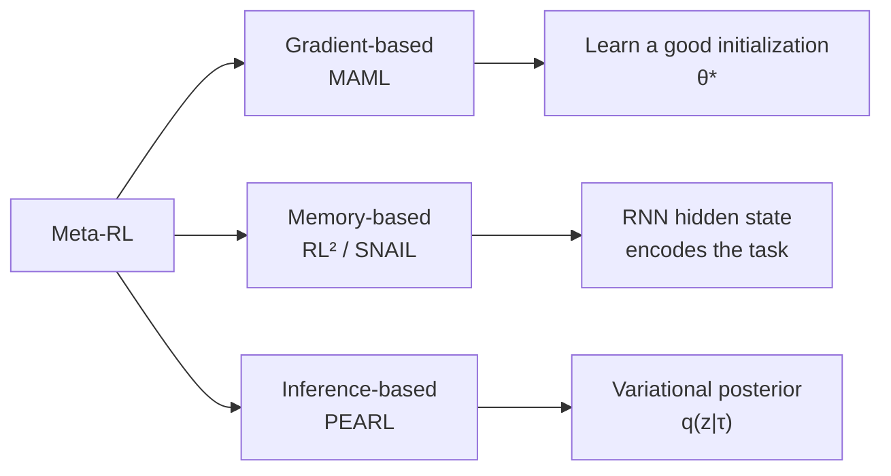
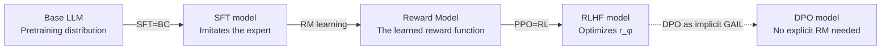

# 11.3 Meta-Reinforcement Learning and Contextual Adaptation

## Reading Guide

**Key Ideas**

- Understand the core problem of meta-RL: instead of learning the policy for a single task, learn "how to learn new tasks quickly", that is, learning to learn.
- Master three classic meta-RL mechanisms: MAML learns a good initialization, RL² encodes the learning process into the hidden state of an RNN, and PEARL infers the task latent variable explicitly.
- Understand how Algorithm Distillation distills an entire RL learning process into the context window of a Transformer, achieving in-context RL.
- See how Decision Transformer turns RL into a sequence-modeling problem, and its deep connection with in-context learning in LLMs.
- Finally, map all these concepts back onto LLM post-training: SFT = BC, reward model = IRL, PPO = forward RL, DPO = an implicit version of GAIL.

The imitation learning methods of the previous two sections (BC, DAgger, GAIL) share a common premise: **training and deployment face the same task**. The expert demonstrates on this task, the policy learns on this task, and it is then deployed on the same task.

But let's stop and think. People do not learn this way. When you learn to drive, you do not learn only to drive on one road. You learn "how to drive", and when you switch to a new car or a new city you need only a little time to adapt and can drive well. When you learn to ride a bicycle, you do not learn to ride only one particular bike. Switch to a bike of a different size and you can ride it after a few minutes of adjustment.

This is the problem that **meta-reinforcement learning** addresses: during training, the agent sees a large number of related but different tasks and learns the ability to "adapt quickly to new tasks". At deployment, given a small amount of experience on a new task, it can adapt immediately and perform well. This is "learning to learn".

This section first compares the three adaptation mechanisms of MAML, RL², and PEARL, then explains how Algorithm Distillation places the learning process in context, then connects Decision Transformer to LLMs, and finally puts these concepts back into the pipeline of SFT, reward models, and preference optimization.

## 1. Adapting to New Tasks through Three Mechanisms

A policy for a fixed task only needs to learn one behavior. When a robot is given a different workpiece, a vehicle enters a new city, or a language model moves to a new domain, the policy must also judge from a small amount of new experience "which kind of task is this right now". **Meta-RL** trains on a set of related tasks so that the model learns this adaptation step.

In the meta-RL setting we have a task distribution $p(T)$, for example navigation tasks with different goal positions, robot control tasks with different physical parameters, or dialogue tasks with different user preferences. During training many tasks are sampled from it, each with a little interaction experience. At test time a task never seen before is given, and the agent adapts quickly with a small amount of experience.

### 1.1 Three Adaptation Mechanisms

The core question of meta-RL is: where does "adaptation" happen? Different methods give different answers:



- **Gradient-based** (MAML): adaptation happens in the model parameters. Learn an initialization that is "easy to fine-tune".
- **Memory-based** (RL²): adaptation happens in the hidden state. The RNN records the interaction history in its hidden state, with no parameter updates.
- **Inference-based** (PEARL): adaptation happens in the task variable. Explicitly infer "what the current task is".

Let's look at them one by one.

### 1.2 MAML: Learning an Initialization That Is Easy to Adapt

The idea of Model-Agnostic Meta-Learning (Finn et al. 2017) is very plain: since we want to adapt to a new task quickly with a few gradient steps at test time, we should **optimize directly for this goal** during training. Find an initialization $\theta$ such that, starting from $\theta$, taking one step (or a few steps) of gradient on any task is enough to perform well on that task.

For each training task $T_i$, first do one inner update using that task's data:

$$\theta_i'=\theta-\alpha\nabla_\theta\mathcal L_{T_i}(\theta)$$

Let's take this expression apart:

- $\theta$: the meta-initialization parameters we want to learn
- $\alpha$: the inner learning rate (adaptation learning rate)
- $\mathcal{L}_{T_i}(\theta)$: the loss with parameters $\theta$ on task $T_i$
- $\theta_i'$: the parameters after adapting one step on task $T_i$

This step is simple: it is ordinary SGD. The key is in the outer level: the outer level then checks whether $\theta_i'$ performs well on new data from the same task:

$$\min_{\theta} \; \mathbb{E}_{T_i \sim p(T)}\left[\mathcal{L}_{T_i}\left(\theta - \alpha \nabla_\theta \mathcal{L}_{T_i}(\theta)\right)\right]$$

The meaning of the outer objective is: we want a $\theta$ such that **starting from it, the $\theta_i'$ obtained from one gradient step on task $T_i$ has a small loss on that task**.

Let's use a concrete family of tasks to see what MAML is looking for. Consider a family of mini mazes: the maze structure is the same and the exit position is random in each episode, with the exit at the upper left in task A and at the lower right in task B. Compare two initializations:

- Initialization one: the parameters have already trained the policy to "head straight for the upper left corner". It is close to full performance from the start on task A, but on task B this preference is completely wrong and one gradient step cannot bend it back.
- Initialization two: the parameters rest at a position that "favors no exit", but starting from it, one gradient step brings the policy to about 80% performance on either task A or task B.

Looking only at the starting score on task A, initialization one is higher. But the outer objective of MAML evaluates the performance **after one step of adaptation**, so it picks initialization two. "Learning an initialization that is easy to adapt" refers to a parameter position like this.

Because $\theta_i'$ is itself computed from $\theta$, taking the outer gradient with respect to $\theta$ passes through the inner update, which is realized with a gradient of a gradient (a second-order gradient):

$$\nabla_\theta \mathcal{L}_{T_i}(\theta_i') = \nabla_{\theta_i'} \mathcal{L}_{T_i}(\theta_i') \cdot (I - \alpha \nabla^2_\theta \mathcal{L}_{T_i}(\theta))$$

The Hessian $\nabla_\theta^2\mathcal L$ in the parentheses (the second derivative) adds computation and memory overhead. **FOMAML** (First-Order MAML) simply ignores this term and treats the gradient at the adapted parameters as the meta-gradient, greatly reducing cost. In practice the first-order approximation usually works well too.

```python
def maml_meta_update(meta_policy, tasks, inner_lr=0.1, outer_lr=0.001):
    meta_grad = 0
    for task in tasks:
        # === Inner: copy the parameters and adapt with a few SGD steps ===
        theta_prime = meta_policy.params.clone()
        for _ in range(n_inner_steps):
            inner_loss = task.compute_loss(theta_prime)
            theta_prime -= inner_lr * grad(inner_loss, theta_prime)

        # === Outer: evaluate the adapted parameters and backpropagate to the meta parameters ===
        outer_loss = task.compute_loss(theta_prime)
        # autograd handles the second-order gradient automatically here
        g = grad(outer_loss, meta_policy.params)
        meta_grad += g

    meta_policy.params -= outer_lr * meta_grad / len(tasks)
```

The strength of MAML is that it is **model-agnostic**: as long as the model is differentiable, whether a CNN, an RNN, or a Transformer, MAML can be used. The drawbacks are that second-order gradient computation is expensive and that hyperparameters such as the inner-loop step size are sensitive.

### 1.3 RL²: Encoding the Task in an RNN Hidden State

MAML must update parameters at test time. RL², proposed by Duan et al. 2016, takes a more radical route: **no parameter updates at all at test time**. An RNN uses its hidden state to "remember" the interaction history, thereby implementing adaptation implicitly.

The setup is simple: train an RNN policy $\pi_\theta(a_t \mid h_t)$ across multiple episodes, where $h_t = f_\theta(h_{t-1}, s_{t-1}, a_{t-1}, r_{t-1}, \text{done})$.

Let's see what goes into the hidden state $h_t$:

- $h_{t-1}$: the hidden state of the previous step (a compression of the history)
- $s_{t-1}$: the previous state
- $a_{t-1}$: the previous action
- $r_{t-1}$: the previous reward. This is crucial! Through the reward, the RNN can know whether the previous action was good.
- $\text{done}$: whether the last episode has ended

The interaction history within an episode (rewards, transitions) accumulates in the hidden state, letting the policy make better decisions in **later steps of the same task**. This is equivalent to the policy "learning" the current task.

Across multiple episodes of the same task the hidden state is not reset, so the RNN can use the states, actions, and rewards of the earlier episodes to adjust its later behavior. The parameters $\theta$ never change from start to finish, and adaptation takes place entirely in the hidden state. The training objective only requires later episodes to obtain higher return, and does not prescribe which update algorithm the network must implement. The RNN discovers by itself how to make use of the history.

Imagine a treasure-hunt maze: the maze structure is fixed and the treasure chest is placed at a new random position in each round. A trained RL² agent enters a new round. In the first episode it feels around everywhere and happens to hit the chest and get the reward. In the second episode the route is more direct. By the third episode it runs almost straight to the chest. Across the three episodes not a single parameter has moved, and the basis for the improved performance lies entirely in the hidden state: the RNN writes experience such as "going east last round earned a reward" into $h_t$, and the policy then acts by reading $h_t$.

::: details Bonus: Where the Name RL² Comes From
The full title of RL² is "Fast Reinforcement Learning via Slow Reinforcement Learning". The meaning is that the slow RL (the outer loop, training the RNN weights over many tasks) learns the fast RL (the inner loop, adapting quickly within one task through the hidden state).
:::

### 1.4 PEARL: Inferring a Task Variable Explicitly

MAML adapts in the parameters and RL² adapts in the hidden state. PEARL (Probabilistic Embeddings for Actor-Critic RL, Rakelly et al. 2019) takes a third route: **model the task itself explicitly**.

It assumes that each task can be described by a latent variable $z \sim p(z)$ (such as the goal position, a friction coefficient, or the type of user preference). The policy does not look only at the state $s$ but at both $s$ and $z$: $\pi_\theta(a \mid s, z)$.

Adaptation is the process of inferring the posterior distribution $q_\phi(z\mid\tau)$ from a small amount of experience $\tau$ (the context), that is, "having seen these few trajectories, what should the z of the current task be", obtaining the embedding $z$ of the current task, and then making decisions with this $z$.

A medical consultation follows exactly this procedure: the two or three symptoms the patient first describes are the context $\tau$. From them the doctor judges which kind of illness it is, obtaining the inference $z$. What tests to run and what medicine to prescribe next (the action) depend on both the current symptoms $s$ and the diagnosis $z$. The more symptoms are seen, the more accurately $z$ is inferred, and the more targeted the later actions become. In PEARL's task distribution $p(z)$, each kind of "illness" corresponds to a task, and $z$ is the task variable that is inferred.

Training requires the policy to obtain high return and also restricts the posterior from deviating from the prior without constraint:

$$\mathcal{L} = -\mathbb{E}_{z \sim q_\phi}\left[\sum_t r(s_t, a_t, z)\right] + \beta \cdot D_{\text{KL}}\left(q_\phi(z \mid \tau) \,\|\, p(z)\right)$$

Let's take this objective apart:

- First term: negative return. Minimizing it improves the policy's performance under the inferred $z$.
- Second term: KL divergence regularization, which keeps the posterior $q(z|\tau)$ from straying too far from the prior $p(z)$. $\beta$ controls the strength of the compression of task information, like the KL weight in a VAE.

The benefit of PEARL is that it separates "task inference" from "policy learning", and it is off-policy (experience replay can be used), so its sample efficiency is much higher than MAML and RL². The actual adaptation speed depends on the task distribution, the context length, and the implementation, and cannot be judged from the method name alone.

Let's compare the three methods side by side:

| Method | Where adaptation happens               | Needs second-order gradients                 | How new experience is used at test time |
| ------ | -------------------------------------- | -------------------------------------------- | --------------------------------------- |
| MAML   | Model parameters                       | Can use them, or a first-order approximation | Perform a few gradient updates          |
| RL²    | RNN hidden state                       | No                                           | Keep feeding in the interaction history |
| PEARL  | Task-variable posterior $q(z\mid\tau)$ | No                                           | Update the task-variable posterior      |

### 1.5 Meta-RL and Few-Shot Learning

You may have noticed that the idea of meta-RL runs completely parallel to few-shot learning in supervised learning.

- Supervised few-shot: train on many classification tasks (such as many classes in ImageNet), and then a new class given 5 examples (5-way 5-shot) can be classified
- Meta-RL: train on many control tasks, and then a new task given a few trajectories can be adapted to quickly

The two share a core idea: **train a prior with many similar tasks, and adapt quickly to a new task with a small number of samples**. This idea directly inspired in-context learning in LLMs. Let's continue.

## 2. Placing the Learning Process in Context

RL² uses the hidden state to carry the adaptation process, while Algorithm Distillation (Laskin et al. 2022, AD for short) goes further: it hands a complete RL learning history directly to a Transformer and has the model predict the next action within the learning process.

### 2.1 The Training Data of Algorithm Distillation

AD's key insight comes from a very simple observation. Imagine the complete training record of a DQN run from scratch to clearing the game: the first episode ends in death with 52 points, by the 50th it has learned to dodge bullets, and by the 200th it clears the game reliably. Hand this "from poor to good" history, the state, action, and reward of every step, to a Transformer in order and ask it to predict the next action at each step:

> Early episodes have low returns, and later episodes gradually improve. For a Transformer to predict the next action from the first $k$ episodes, it must use the states, actions, and rewards in the history to determine how behavior changes with experience.

In other words, as long as the Transformer sees enough "from poor to good" learning histories, it can "learn to learn" by itself in context.

The data is organized as follows: concatenate in order all the episodes of one complete RL training run (the whole process from a random policy to an expert policy) as one training sample for the Transformer:

```
[episode_1 (poor policy): s0 a0 r0 s1 a1 r1 ... |
 episode_2 (slightly better): s0 a0 r0 ... |
 ...
 episode_N (expert): s0 a0 r0 ...]
            ↑
     transformer input: concatenation of the whole history
     target: predict the next action within each episode
```

Note that the `|` separators between episodes correspond to the done flag, exactly the same information that RL² feeds to the RNN. But this time a Transformer is used, and what the context window holds is the **entire learning process** (hundreds of episodes), not just a few steps.

### 2.2 Differences Between Algorithm Distillation and RL²

AD and RL² look similar, but there are several key differences:

| Dimension                        | RL²                  | Algorithm Distillation          |
| -------------------------------- | -------------------- | ------------------------------- |
| Model                            | Small RNN (LSTM/GRU) | Large transformer               |
| Data                             | Online meta-training | **Offline** learning histories  |
| What is learned in context       | Task ID (implicit)   | **The RL algorithm itself**     |
| Generalization across algorithms | A single algorithm   | Can distill DQN, PPO, A2C, etc. |

RL² interacts with the environment online during training, and it can only learn "how to adapt on this kind of task", which is in essence an implicit inference of the task identity. AD uses offline data and can distill the training process of any RL algorithm (DQN, PPO, A2C) into it. What the Transformer sees is the more general pattern of "how actions change once reward goes up". What it learns is not a particular task but **the RL update rule itself**.

The experiments of AD ask whether the Transformer can recover from training histories the regularity of "how to change actions after obtaining a reward". What it imitates is the learning process exhibited in the trajectories, and its generalization depends on whether the training tasks and learning histories cover the changes needed at test time.

```python
def algorithm_distillation_data_generate(env, rl_algorithm, n_runs=1000, n_episodes_per_run=200):
    """Collect AD training data: across many runs, where each run is one RL learning process"""
    dataset = []
    for run in range(n_runs):
        policy = init_random_policy()
        run_history = []
        for ep in range(n_episodes_per_run):
            trajectory = rollout(env, policy)
            run_history.append(trajectory)
            # An online RL algorithm updates the policy (DQN/PPO/A2C, take your pick)
            policy = rl_algorithm.update(policy, trajectory)
        # Each run is one training sample: a complete learning curve
        dataset.append(run_history)
    return dataset


def ad_inference(transformer, env, n_adapt_episodes=10):
    """At test time the transformer learns in-context in a new environment"""
    context = []  # Accumulated history
    for ep in range(n_adapt_episodes):
        s = env.reset()
        done = False
        while not done:
            # Key: the action is predicted by the transformer from the context
            a = transformer.predict_next_action(context, s)
            s_next, r, done = env.step(a)
            context.append((s, a, r))
            s = s_next
        # Note: the transformer parameters are NOT updated! It only "learns" in the context
```

Note the most important point of the inference stage: **the Transformer's parameters are not updated at all!** Learning takes place entirely in the context. Every additional episode makes the context a bit longer, and the Transformer can make better decisions from more history. This is the same principle as in-context learning in large language models.

## 3. Connecting Decision Transformer to LLMs

Before AD, Decision Transformer (Chen et al. 2021) had already revealed that RL can be turned entirely into a sequence-modeling problem.

### 3.1 Decision Transformer's Conditional-Policy Approach

Decision Transformer (DT for short) takes the conditional-generation route. It does not learn a policy directly but feeds $(R, s, a)$ triples to a transformer, where $R$ is the **return-to-go** (the remaining return from the current time to the end of the episode):

$$a_t = \text{Transformer}\left(R_t, s_t, a_{t-1}, R_{t-1}, s_{t-1}, \ldots\right)$$

DT's training objective is simple: given the history, the current state, and "I want to obtain return $R_t$ in the future", predict which action $a_t$ to take.

Let's look at $R_t$ with numbers. In one game the expert scored 900 points in total and had already obtained 300 points in the first 20 steps, so $R_{20} = 900 - 300 = 600$, the number of points still obtainable from the current time to the end of the episode. In the training data, every state is annotated with such a remaining return, and what DT learns is "given such a history and state, what is the next action that deserves this remaining return".

At deployment, you give it a target return $R^*$ (say I want 1000 points), and it generates an action sequence that can reach this return. If the target return you give is higher than the expert's, it may not be able to achieve it, but if you give a reasonable target, it can generate the corresponding behavior.

DT is not in-context RL; it is a **conditional policy**. But it inspired later work such as Online DT and Elastic DT, which gradually merged with in-context RL. More importantly, it proved one thing: **RL does not necessarily need Bellman backups, and sequence modeling can also make decisions**.

### 3.2 The Connection Between In-Context RL and LLMs

You may have noticed that in-context learning in LLMs runs closely parallel to in-context RL: the two mechanisms share the same template, but they operate on different signals and should not be called the same thing.

- **In-context learning in GPT-3** (2020): give a few input-output examples in the prompt, and the model performs the task without updating parameters. This is the in-context version of **supervised learning**: the context carries task identifiers, not rewards.
- **In-context RL of Algorithm Distillation** (2022): give reward-bearing trajectories ordered from poor to good in the context, and the model improves its behavior without updating parameters. This is the in-context version of **reinforcement learning**: the context additionally carries reward signals and policy-improvement structure.

Both put examples or interaction history into the context and then predict the next output, so the machinery looks the same. But whether a model truly implements an RL update in context has to be tested through adaptation curves on new tasks; one cannot conclude it from the model merely changing its answers in context. The safe reading is that they are analogous mechanisms applied to different learning signals, not one discovery made twice.

## 4. Returning Imitation and Adaptation to LLM Post-Training

Let's put all the concepts from the preceding three parts, behavior cloning, inverse reinforcement learning, GAIL, meta-learning, and in-context RL, back into the framework of LLM post-training, and you will find that they correspond almost one to one.

### 4.1 SFT and Behavior Cloning

Recall the SFT loss from the RLHF of Chapter 13:

$$\mathcal{L}_{\text{SFT}}(\theta) = -\sum_{t=1}^T \log \pi_\theta(y_t \mid x, y_{<t})$$

This objective has exactly the same form as the behavior cloning of Section 11.1:

- $(x,y)$ is the demonstration (instruction $x$, answer $y$)
- $\pi_\theta$ is the policy to be trained (the language model)
- Maximizing the log probability of the expert tokens is BC

Several problems of behavior cloning also appear one by one in autoregressive generation:

- **Distribution shift**: during training the model sees high-quality instruction-answer pairs (expert states), while at deployment the next token it generates may deviate from the distribution
- **Error accumulation**: once a generated token deviates, later tokens are more error-prone in "states never seen". This is the "hallucination snowball" of language models.
- **Insufficient coverage**: an SFT dataset cannot cover all the states the model will visit at deployment, and you cannot prepare perfect answers for every question

The PPO stage of RLHF shares one data characteristic with DAgger: the training signal comes from the states actually visited by the current policy. The difference is that DAgger asks the expert for the correct action, while PPO uses rewards and advantages to update the probability of the current action. One is supervision and the other is RL.

### 4.2 Understanding Three-Stage Training through Imitation Learning

The three-stage training of InstructGPT (Ouyang et al. 2022) can be reinterpreted from the perspective of imitation learning:



1. **The SFT stage = behavior cloning**: learn the behavior format from human demonstrations. It is just that simple.
2. **The RM stage = an approximation of inverse reinforcement learning**: infer a "reward function" from preference data ("answer A is better than answer B"). This is the LLM version of the MaxEnt IRL idea (although it specifically uses the Bradley-Terry model rather than the maximum-entropy principle).
3. **The PPO stage = forward RL**: use the learned reward function for on-policy optimization, solving the distribution shift of SFT. This is the same logic as training a policy with a reward learned by IRL.

The DPO of Chapter 14 can be viewed as a simplified version of GAIL. The implicit reward of DPO

$$\log \pi_\theta(y_w \mid x) - \log \pi_\theta(y_l \mid x) - \log \pi_{\text{ref}}(y_w \mid x) + \log \pi_{\text{ref}}(y_l \mid x)$$

internalizes the discriminative learning of "expert vs. non-expert" into the policy itself, with no need to train a separate discriminator or reward model.

### 4.3 LLM Adaptation from a Meta-RL Perspective

Few-shot in-context learning in LLMs can be seen as "**a large-scale version of RL²**":

- RL²: meta-training across tasks, with the RNN hidden state implicitly encoding the task and adapting without parameter updates
- LLM in-context: pretraining across a massive corpus, with the context window implicitly encoding the task and adapting without parameter updates

Both are "**adapting without updating parameters, just by looking at the context**". Algorithm Distillation goes further and reveals that the in-context ability of a transformer can encode a complete RL algorithm. This hints that **an LLM after RLHF training has, to some extent, "internalized the RL process"** and can keep improving in context at inference time through interaction with users (receiving feedback).

### 4.4 Offline Imitation Learning and the DPO Family

The offline RL of Chapter 10 merges with this chapter. When there are only **expert demonstrations + suboptimal data** (which is exactly the typical RLHF setting: there are high-quality answers and also poorer answers generated by the model itself), offline imitation learning (DemoDICE, SMILe, DWBC) uses conservative estimation to avoid overestimating suboptimal actions. This is of the same origin as DPO's idea of an "explicit reference-policy regularizer": do not let the policy deviate too far from the reference model.

### 4.5 The Limits of These Correspondences

Note that these correspondences are **conceptual analogies** and not strict mathematical equivalences:

- SFT and behavior cloning use the same conditional-likelihood objective. This one is an exact equivalence.
- Reward models and inverse RL both recover a training signal from human behavior or preferences, but their specific objectives and data assumptions differ (an RM uses pairwise preferences, IRL uses complete trajectories).
- DPO and GAIL both avoid first training a separate reward model, but their optimization forms cannot be equated directly. DPO is preference optimization and GAIL is distribution matching.
- In-context RL shows how a sequence model can use reward-bearing history without updating parameters, but an ordinary few-shot prompt (which gives only input-output examples with no reward) does not necessarily execute a complete RL algorithm.

## Chapter Summary

In this chapter we started from "no reward, only expert demonstrations", walked through the three routes of imitation learning, inverse RL, and meta-RL, and finally returned to LLM post-training, where you will find that all the concepts are connected:

1. **Behavior cloning (BC)** treats imitation learning as supervised learning but suffers from **distribution shift**, with errors accumulating as $O(T^2\epsilon)$. **DAgger** iteratively collects failure states for the expert to label, improving the error bound to $O(T\epsilon)$, but needs online interaction with the expert.
2. **MaxEnt IRL** infers the reward function from expert demonstrations and uses the maximum-entropy principle to resolve the ill-posedness of IRL, but the partition function $Z$ is hard to compute and every update needs an inner RL solve.
3. **GAIL** expresses the reward implicitly with GAN adversarial training, bypassing the computation of the partition function, and is the theoretical precursor of DPO in the LLM era.
4. **Meta-RL** learns "how to learn quickly": MAML learns an initialization that is easy to fine-tune, RL² compresses the adaptation ability into the RNN hidden state, and PEARL explicitly infers a task posterior.
5. **In-Context RL / Algorithm Distillation** distills an entire RL algorithm into the in-context ability of a transformer, learning through the context without parameter updates.
6. **LLM post-training** can be understood through the concepts of BC, inverse RL, and forward RL: SFT = BC, RM = IRL, PPO = forward RL, DPO = implicit GAIL. Few-shot learning in LLMs is in essence large-scale in-context meta-RL.

The next chapter, [Chapter 12: Exploration, MARL, and Hierarchical RL](../chapter12_exploration_marl_hierarchical/intrinsic-motivation-exploration), turns to three more advanced topics: how to explore when rewards are sparse, how to train when multiple agents interact, and how to plan hierarchically when the horizon is extremely long.

## Further Reading

- [Pomerleau 1989 "ALVINN: An Autonomous Land Vehicle in a Neural Network" (the earliest BC)](https://www.ri.cmu.edu/publications/alvinn-an-autonomous-land-vehicle-in-a-neural-network/)
- [Ross, Gordon & Bagnell 2011 "A Reduction of Imitation Learning and Structured Prediction to No-Regret Online Learning" (DAgger)](https://arxiv.org/abs/1011.0686)
- [Ziebart et al. 2008 "Maximum Entropy Inverse Reinforcement Learning"](https://www.aaai.org/Papers/AAAI/2008/AAAI08-227.pdf)
- [Ho & Ermon 2016 "Generative Adversarial Imitation Learning" (GAIL)](https://arxiv.org/abs/1606.03476)
- [Finn, Abbeel & Levine 2017 "Model-Agnostic Meta-Learning for Fast Adaptation of Deep Networks" (MAML)](https://arxiv.org/abs/1703.03400)
- [Duan et al. 2016 "RL²: Fast Reinforcement Learning via Slow Reinforcement Learning"](https://arxiv.org/abs/1611.02779)
- [Rakelly et al. 2019 "Efficient Off-Policy Meta-Reinforcement Learning via Probabilistic Context Variables" (PEARL)](https://arxiv.org/abs/1903.08254)
- [Laskin et al. 2022 "In-Context Reinforcement Learning with Algorithm Distillation"](https://arxiv.org/abs/2210.14215)
- [Chen et al. 2021 "Decision Transformer: Reinforcement Learning via Sequence Modeling"](https://arxiv.org/abs/2106.01345)
