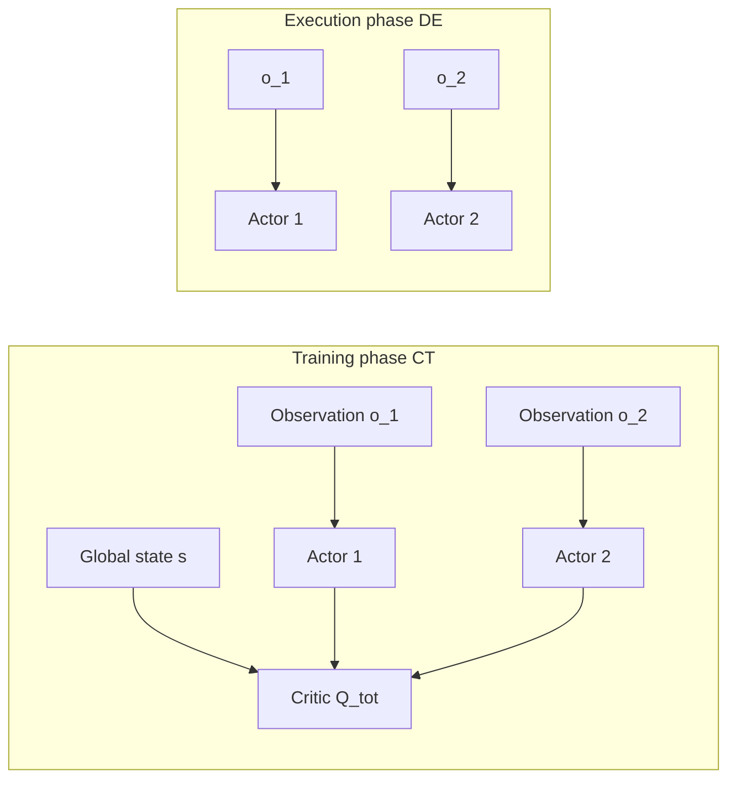

# 12.2 Multi-Agent Reinforcement Learning

## Reading Guide

**Key Ideas**

- Understand the central difficulty of multi-agent learning: **non-stationarity**. When the other agents are learning too, the environment, seen from a single agent's perspective, becomes one where "the rules change while you play".
- Master the CTDE (centralized training, decentralized execution) paradigm: why is it the most practical compromise in industry? During training we can take a "god's-eye view", but during execution every agent must make its own decisions.
- Understand how MADDPG extends DDPG to multiple agents: each agent has its own Actor, but the Critic must see everyone's observations and actions.
- Understand why MAPPO became a strong baseline for cooperative multi-agent tasks: PPO's clipped update suits multiple agents naturally, and it is stable, easy to tune, and effective.
- Compare the settings in which different CTDE algorithms apply, and know when to use value decomposition and when to use Actor-Critic.

<OnlineTraining studios="multiagent" compact />

In the previous section, [12.1](./intrinsic-motivation-exploration), we dealt with how a single agent can "explore out of curiosity" under sparse rewards. Now we push the problem one step further: what if there is more than one agent in the environment?

You might think: what is hard about that? Let each agent learn on its own. Everyone uses PPO, each learns separately, and together they finish the task. That sounds reasonable, doesn't it?

Let's stop and think: what happens if all the agents update their own policies at the same time?

## 1. Why Multiple Agents Make the Environment Non-Stationary

How does the environment work from the perspective of a single agent $i$? In a single-agent MDP, the next state $s'$ depends only on the current state $s$ and my own action $a_i$. The transition probability $P(s' \mid s, a_i)$ is fixed, and as long as the rules of the environment do not change, this probability does not change.

But in the multi-agent setting, the next state depends not only on my own action $a_i$ but also on the joint action $a_{-i}$ of all the other agents (that is, everyone's actions except $i$'s):

$$P(s' \mid s, a_i) \quad \text{becomes} \quad P(s' \mid s, a_i, a_{-i})$$

Here is the problem: the policies of the other agents are also being updated constantly! In round one, the teammate is still wandering at random. By round one hundred, the teammate has learned to cooperate. So even if I stand in the **exact same state** $s$ and take the **exact same action** $a_i$, the outcome can be completely different, because the teammate has changed.

Let's make this concrete with a two-player cooperative game. There are two buttons and a door in a room, and the door opens only when both players press their buttons **at the same time**. You have practiced your part: stand in front of the left button and press it when you see your teammate reach out. In round 1 the teammate is still running around, you press the button, and the door does not move. By round 100 the teammate has learned the timing, you stand in the same position and press the same button, and the door opens. For you the observation is the same and the action is the same, yet the outcome is completely different. The "environment rules" that changed are in fact the teammate's policy.

This is the central difficulty of multi-agent RL, **non-stationarity**: from a single agent's perspective, the environment's transition probabilities keep changing. Old data goes stale faster, and the learning target of independent Q-learning (each agent learns its own Q-function) keeps moving, like chasing a target that is running.

### 1.1 From Normal-Form Games to Multi-Agent RL

Let's start with the simplest formalization of multiple agents, the **normal-form game**, also known as the "matrix game" from introductory game theory courses.

In a normal-form game:

- There are $n$ agents (players)
- Each agent $i$ chooses its own action $a_i$
- Everyone's actions together form the joint action $a = (a_1, a_2, \ldots, a_n)$
- Based on the joint action, each agent receives its own reward $r_i(a)$

The classic example is the "prisoner's dilemma":

|                 | Opponent confesses | Opponent denies |
| --------------- | ------------------ | --------------- |
| **You confess** | (-3, -3)           | (0, -5)         |
| **You deny**    | (-5, 0)            | (-1, -1)        |

You may remember the concept of the "Nash equilibrium" from game theory: no agent can raise its expected payoff by changing its own strategy **unilaterally**, and the joint strategy at that point is a Nash equilibrium.

But classical game-theoretic solutions rest on two strong assumptions:

1. The opponent is assumed to be "rational" and will play the optimal strategy
2. The reward matrix is assumed to be known, so that reasoning is possible

What does deep MARL (multi-agent reinforcement learning) face instead? High-dimensional visual observations, unknown reward functions, and most importantly, **opponents who are also learning and also changing**.

You may ask: can we merge all the agents into one "super-agent" and learn that? Concatenate everyone's observations as the state, concatenate all actions as the joint action, and learn the joint policy directly with a single-agent algorithm?

This is possible in theory, but it is simply infeasible in practice:

- The action space **explodes exponentially** with the number of agents: with 6 actions each, 2 agents give $6^2=36$ joint actions, and 10 agents give $6^{10} \approx 60$ million, which cannot be learned at all
- During execution, if the agents are spread over different machines, they may not be able to communicate at all and cannot "negotiate" a joint action in real time
- Even if they could communicate, this kind of centralized policy has no scalability at all, since adding one agent means retraining everything

What can we do? This leads to the most important paradigm in MARL: CTDE.

## 2. Separating Training and Execution with CTDE

**Centralized Training, Decentralized Execution** (CTDE) is currently the most practical compromise in industry. The idea fits intuition well:

- **Training phase (CT)**: we are training the model in the lab, where we can take a "god's-eye view". We can obtain all agents' observations, actions, and even the global state, and use them to train a better Critic.
- **Execution phase (DE)**: the model is to be deployed in the real setting, where each agent may be on a different machine, cannot rely on real-time communication, and must decide using only its own local observation.

Formally:

- Each agent has its own **decentralized policy** $\pi_i(a_i \mid o_i)$, which depends only on its own local observation $o_i$. This is what is actually used at execution time.
- We train a **centralized Critic** $Q_i^{\text{tot}}(s, a_1, \ldots, a_n)$, which can see the global state $s$ and the joint action $(a_1,\ldots,a_n)$ of all agents. It is used during training to supply gradients to the Actors.

This design satisfies two constraints at once:

1. **Rich training signal**: the Critic sees global information and knows what the other agents are doing, so it does not treat changes in the other agents' policies as "random environment noise", which avoids the non-stationarity problem
2. **Feasible execution**: each Actor sees only its own local observation, so when deployed in a real multi-machine system the agents need no communication and simply make their own decisions

Let's draw this flow clearly with a mermaid diagram:



From this diagram you can see that during training the Critic is like a "coach" standing at the side of the field with a view of the whole pitch, seeing the position of every player and the ball, and so able to give accurate evaluations. When the game is actually played (execution), each player can only see what is in front of them and makes their own decisions.

Under the CTDE paradigm there are several families of mainstream methods:

1. **Value decomposition methods** (VDN, QMIX, etc.): decompose the total Q-function into a sum or a monotonic combination of each agent's own Q-function
2. **Actor-Critic methods** (MADDPG, MAPPO, etc.): each agent has its own Actor, with a shared or per-agent centralized Critic
3. **Explicit communication methods** (CommNet, TarMAC, etc.): let agents also learn to send messages to each other at execution time

In this section we focus on the two most commonly used Actor-Critic representatives: MADDPG and MAPPO.

## 3. Learning a Centralized Critic with MADDPG

### 3.1 How Each Agent Updates Its Own Actor

Multi-Agent DDPG (MADDPG, Lowe et al. 2017) is one of the earliest classic algorithms to put the CTDE idea into practice, and it extends single-agent DDPG directly to the multi-agent setting.

Recall how single-agent DDPG updates the Actor. The Actor's goal is to choose an action $a = \mu_\theta(s)$ such that the Q-value $Q(s, a)$ given by the Critic is as large as possible, so the gradient is:

$$\nabla_\theta J(\mu_\theta) = \mathbb{E}\left[\nabla_\theta \mu_\theta(s) \cdot \nabla_a Q(s, a)\big|_{a=\mu_\theta(s)}\right]$$

MADDPG generalizes this directly: each agent $i$ holds its own Actor $\mu_{\theta_i}(o_i)$ and its own **centralized Critic** $Q_i(o_1, a_1, \ldots, o_n, a_n)$. Note the input of this Critic: it sees the observations and actions of **all agents**, not just agent $i$'s own.

What does the update gradient of Actor $i$ look like? The chain rule tells us:

$$\nabla_{\theta_i} J(\mu_{\theta_i}) = \mathbb{E}\left[\nabla_{\theta_i} \mu_{\theta_i}(o_i) \cdot \nabla_{a_i} Q_i(o_1, a_1, \ldots, o_n, a_n)\big|_{a_i = \mu_{\theta_i}(o_i)}\right]$$

Let's take this expression apart:

- First term $\nabla_{\theta_i} \mu_{\theta_i}(o_i)$: if the Actor parameters $\theta_i$ change a little, how does the action $a_i$ output by the Actor change?
- Second term $\nabla_{a_i} Q_i(\ldots)$: the Critic sees everyone's observations and actions. If my action $a_i$ changes a little, how does the total return predicted by the Critic change?
- Multiplying the two: the gradient carries the Critic's global evaluation back to the Actor, telling the Actor "if you change that action a little, in which direction will the whole team's payoff move."

There is a key detail here: when updating Actor $i$, we differentiate only with respect to **its own action** $a_i$, and the actions of the other agents $(a_{-i})$ are treated as known constants taken from this batch of data. We do not need to know the parameters of the other Actors, and we do not pass gradients to them.

Let's put this in a concrete match. Agent $i$ is the forward with the ball, whose available actions are "shoot" or "pass wide". The Critic sees the whole field. The goalkeeper's position and the teammates' runs are taken from this batch of data and held fixed, and only the forward's action is swapped for "what if it were a shot". The Critic's evaluation can therefore answer "given the teammates' current runs, which has the higher expected team score, shooting or passing wide?" This is exactly the information that the forward, deciding in a decentralized way, needs and cannot get by itself.

Let's look at the code skeleton to understand more clearly:

```python
class MADDPG:
    def __init__(self, n_agents, obs_dim, action_dim):
        # One actor + one centralized critic per agent
        self.actors = [Actor(obs_dim, action_dim) for _ in range(n_agents)]
        self.critics = [Critic(n_agents * (obs_dim + action_dim), 1)
                        for _ in range(n_agents)]

    def update(self, batch):
        obs, actions, rewards, next_obs = batch  # Trajectories of all agents
        for i in range(self.n_agents):
            # === Update Critic i ===
            # Compute the target: needs the next actions of all agents
            next_actions = [self.actors_target[j](next_obs[j])
                            for j in range(self.n_agents)]
            target_q = self.critics_target[i](
                torch.cat([*next_obs, *next_actions], -1))
            y = rewards[i] + self.gamma * target_q
            # Current Q-value: uses the current observations and actions of all agents
            current_q = self.critics[i](
                torch.cat([*obs, *actions], -1))
            critic_loss = F.mse_loss(current_q, y.detach())

            # === Update Actor i ===
            # My own action is predicted by the current Actor; the others' actions come straight from the replay buffer
            pred_action_i = self.actors[i](obs[i])
            all_actions = list(actions)
            all_actions[i] = pred_action_i  # Replace only my action with the predicted one
            actor_loss = -self.critics[i](
                torch.cat([*obs, *all_actions], -1)).mean()
            ...
```

From the code you can see that when updating Actor i, we replace only agent i's action with "the action the current Actor would choose", and the other agents' actions are the old actions sampled from the replay buffer. The Critic can then tell Actor i: "if you change your action a little under this observation, here is how the Q-value changes."

MADDPG is a milestone, but it also has clear weaknesses:

1. **Curse of dimensionality**: the input dimension of the centralized Critic is $n \times (\text{obs\_dim} + \text{action\_dim})$, which grows linearly with the number of agents. With dozens of agents the Critic input becomes very large and hard to train.
2. **It inherits DDPG's stability problems**: recall the problems of DDPG discussed in [Chapter 9](../chapter09_continuous_control/td3-sac#td3-three-stability-patches-for-ddpg), namely overestimation, hyperparameter sensitivity, and easy training collapse. These problems are amplified further in the multi-agent setting.

Is there a way to do CTDE with a more stable on-policy algorithm such as PPO? That is the problem MAPPO addresses.

## 4. Stabilizing Multiple Policy Updates with MAPPO

Multi-Agent PPO (MAPPO, Yu et al. 2022) extends the familiar PPO (the strong baseline we have used since Chapter 8) to the CTDE setting. This "simple" extension turned out to work remarkably well: to this day, MAPPO remains the first-choice baseline for the vast majority of cooperative multi-agent tasks.

MAPPO's design is very direct:

- Each agent has its own **decentralized Actor** $\pi_{\theta_i}(a_i \mid o_i)$, which sees only its own local observation, just like the Actor in MADDPG
- But instead of one Critic per agent, **all agents share one centralized Critic** $V_\phi(s)$ whose input is the global state $s$ (one could also use $Q_\phi$ with the joint action as input, but in practice $V(s)$ is enough)

Why is PPO especially suited to multiple agents? Recall the core of PPO, the **clipped policy-gradient objective**:

$$L^{\text{CLIP}}(\theta) = \mathbb{E}\left[\min\left(r_t(\theta) A_t,\ \text{clip}(r_t(\theta), 1-\epsilon, 1+\epsilon) A_t\right)\right]$$

where the policy ratio is $r_t(\theta) = \frac{\pi_\theta(a_t \mid s_t)}{\pi_{\text{old}}(a_t \mid s_t)}$ and $A_t$ is the estimated advantage (see §8.3).

In the multi-agent setting this policy ratio is **computed independently for each agent**. Agent i only needs the ratio of its own new policy to its old policy and does not have to care about the other agents. PPO's clip mechanism naturally prevents any single agent's policy from being updated too aggressively and collapsing the distribution of the joint policy. This is much more stable than the off-policy deterministic update of DDPG.

Let's look at the code skeleton of the MAPPO update:

```python
def mappo_update(actors, critic, buffer, n_agents, clip_eps=0.2):
    for epoch in range(E):
        for batch in buffer.iter():
            s, obs_list, a_list, old_logp_list, adv, ret = batch
            # Centralized critic: estimate V(s) from the global state s
            values = critic(s)
            # Each actor computes the log probability under its new policy
            new_logp_list = [log_prob(actors[i](obs_list[i]), a_list[i])
                             for i in range(n_agents)]
            # Update each agent's actor in turn
            for i in range(n_agents):
                ratio = (new_logp_list[i] - old_logp_list[i]).exp()
                s1 = ratio * adv[i]
                s2 = torch.clamp(ratio, 1 - clip_eps, 1 + clip_eps) * adv[i]
                policy_loss = -torch.min(s1, s2).mean()
                entropy_bonus = -new_logp_list[i].mean()
                update(actors[i], policy_loss - 0.01 * entropy_bonus)
            # Finally update the shared critic
            value_loss = F.mse_loss(values, ret)
            update(critic, value_loss)
```

As you can see, this is almost identical to single-agent PPO. The only difference is that we have n Actors, each computing its own ratio and loss, but they share one Critic and use the same global advantage function adv.

Why has MAPPO been so successful? It has several big advantages:

- **Good stability**: PPO's clip mechanism is much more robust than DDPG's off-policy update, and it is not very sensitive to hyperparameters. One set of hyperparameters often works directly across many tasks.
- **Highly reusable hyperparameters**: the authors found that almost the same configuration can be used directly on completely different tasks such as the _StarCraft Multi-Agent Challenge_ (StarCraft multi-agent micromanagement), _Hanabi_ (the card game), and _Multi-Agent MuJoCo_ (multi-robot continuous control), obtaining very good results without much tuning.
- **Good scalability**: the Critic is shared, so there is no need for one per agent, and the Actors are independent of each other, which makes distributed training convenient and suits large clusters.

::: details Bonus: Implementation Details and Tricks of MAPPO
MAPPO looks simple, but training it well still involves some engineering details:

1. **Value normalization**: as in R2D2, normalizing the Critic's output stabilizes training significantly
2. **Agent-specific global state**: sometimes the "global state" fed to the Critic can include extra information related to the current agent, which works better
3. **Action masking**: in many environments some actions are illegal in certain states (in a card game you cannot play a card you do not hold), and then the logits of illegal actions must be set to negative infinity in the Actor's output layer
4. **Shared or independent parameters**: if the agents are homogeneous (for example several marines in StarCraft), they can share Actor parameters to reduce training cost. If they are heterogeneous (for example one heals and one deals damage), each needs its own independent Actor.

The most interesting point of the original paper, "The Surprising Effectiveness of PPO in Cooperative Multi-Agent Games", is that it showed that a "simple" on-policy method, if implemented well, can outperform the complex off-policy methods of the time (such as QMIX). This follows the same trajectory as PPO becoming the default baseline in the single-agent field.
:::

Because it trains stably, is clear to implement, and performs well, MAPPO has now become the **default strong baseline** for cooperative multi-agent tasks. Whatever new MARL algorithm you propose, you have to compare against MAPPO first, and if you cannot even beat MAPPO there is no need to look further.

### 4.1 Comparing Common CTDE Algorithms

Let's put the CTDE algorithms mentioned in this chapter side by side to help you choose in practice:

| Algorithm                  | Critic input                         | Actor input | On/off-policy | Representative tasks          |
| -------------------------- | ------------------------------------ | ----------- | ------------- | ----------------------------- |
| IQL (independent learning) | $o_i$                                | $o_i$       | off           | Weak baseline                 |
| VDN / QMIX                 | $s$ (linear/monotonic decomposition) | $o_i$       | off           | Cooperative tasks             |
| MADDPG                     | $(o_1,a_1,\ldots,o_n,a_n)$           | $o_i$       | off           | Mixed cooperative-competitive |
| MAPPO                      | $s$                                  | $o_i$       | on            | SMAC, Hanabi                  |

### 4.2 What Value Decomposition Solves

Let's briefly mention the value-decomposition methods (VDN, QMIX). They also belong to the CTDE paradigm but take a different route.

VDN (Value Decomposition Networks) makes a strong assumption: **the total Q-function can be decomposed into the sum of each agent's Q-function**:

$$Q_{\text{tot}}(s, a_1, \ldots, a_n) = \sum_{i=1}^n Q_i(o_i, a_i)$$

During training we then only need to train each agent's own $Q_i$, and at execution each agent simply picks the action that maximizes its own $Q_i$, which automatically maximizes the total $Q_{\text{tot}}$ when summed.

Take two robots carrying a table. $Q_1$ evaluates the value of "the left robot grasps the left edge of the table", $Q_2$ evaluates the value of "the right robot grasps the right edge of the table", and the team's total value is the sum of the two. Each chooses the grasp point that maximizes its own $Q_i$, and the table is naturally lifted steadily.

QMIX relaxes this assumption a little: the total Q need not be a sum, as long as it is a **monotonic function** of the individual $Q_i$, that is, it satisfies:

$$\frac{\partial Q_{\text{tot}}}{\partial Q_i} \geq 0, \quad \forall i$$

This condition guarantees that $\arg\max_{a} Q_{\text{tot}}$ can be obtained by taking $\arg\max_{a_i} Q_i$ separately, so actions can still be chosen in a decentralized way at execution time.

Back to carrying the table: QMIX allows the total value to combine the two robots' $Q_i$ in a more complex way (as long as monotonicity is kept), for example with an extra bonus when the two robots coordinate well. As long as monotonicity holds, that "if either party's own action value rises, the team's total value will not fall", each robot choosing its locally optimal grasp point is still the globally optimal combination.

Value decomposition methods work well on some cooperative tasks, but they share one limitation: they apply only to **fully cooperative** settings (all agents share one team reward). MADDPG and MAPPO are more flexible and can handle cooperative, competitive, and mixed reward structures. Moreover, with the rise of MAPPO, on most cooperative tasks MAPPO now outperforms QMIX and is also simpler to implement.

### 4.3 A Note on Privileged Information and Fair Comparisons

Step back and notice what the centralized Critic really is: **privileged information**. During training it sees the global state (and, in MADDPG, every agent's action; MAPPO's centralized Critic instead takes only the global state $s$), inputs the decentralized policies will never have at execution. Privileged inputs are legitimate — they only shape gradients, never decisions — but they make comparisons treacherous. An algorithm whose Critic sees the true state will beat one whose Critic sees only concatenated local observations, and the gap may come from the information, not the algorithm. When you read MARL (or exploration) papers, check that baselines share the same Critic inputs, the same global-state features, and the same observation preprocessing; otherwise the "improvement" may be an unfair information advantage rather than a better method. The same caution applies to RND-style bonuses evaluated with extra environment resets or oracle state features.

## Section Summary

The central difficulty of multi-agent reinforcement learning is **non-stationarity**: when the policies of the other agents are also being updated, the environment's transition probabilities keep changing from a single agent's perspective, like chasing a moving target.

CTDE (centralized training, decentralized execution) is currently the most practical paradigm. During training the Critic can use global information as a "coach" and provide a stable, accurate learning signal. During execution each Actor sees only its own local observation and decides independently without communication.

We looked at two classic CTDE Actor-Critic algorithms:

- **MADDPG**: extends DDPG to multiple agents, with each agent having its own centralized Critic. It can handle tasks that mix cooperation and competition, but inherits DDPG's training instability and does not scale well.
- **MAPPO**: extends PPO to CTDE, with all agents sharing one centralized value function and using PPO's clipped objective to update multiple policies stably. It is simple to implement, trains stably, has robust hyperparameters, and is now the default strong baseline for cooperative tasks such as StarCraft multi-agent micromanagement and Hanabi.

Good, we can now let multiple agents learn together. But back in the single-agent setting, what if the task is especially long? For example, having a robot clean a whole house may need thousands of consecutive actions, and the final reward can hardly reach the earliest steps. Even with intrinsic rewards, such a long horizon is still hard to train. How can we solve this problem?

That is the topic of the next section, **hierarchical reinforcement learning**: split a long task into a multi-level structure in which "the high level chooses subgoals and the low level executes actions", cutting a long horizon into short horizons.

The next section, [12.3 Hierarchical Reinforcement Learning and World Models](./hierarchical), handles long-horizon tasks, showing how high-level subgoals and low-level actions shorten the reward propagation distance, and how generative world models turn the environment itself into an object of learning.
