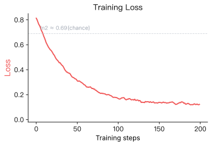
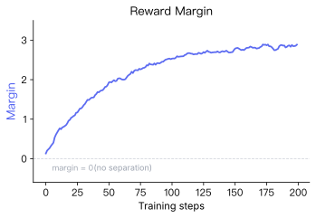
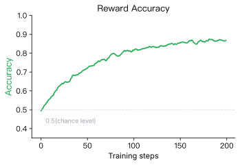

# 14.2 DPO Training and Evaluation Metrics

In Section 14.1, we derived the DPO loss. Now let's come back to the experiment and interpret the metrics that `DPOTrainer.train()` prints during training.

Compared to classic RL benchmarks like CartPole, preference alignment does not have an environment-provided scalar reward per step. As a result, the training log exposes a richer set of internal signals.

When you run `trainer.train()`, you will typically see logs like:

```
Step  Training Loss  Rewards/Margins  Rewards/Chosen  Rewards/Rejected  Rewards/Accuracies
  5       0.6821          0.0312          -0.0156          -0.0468              0.52
 10       0.6543          0.1247           0.0891          -0.0356              0.58
 15       0.5987          0.3421           0.2314          -0.1107              0.72
 ...
 45       0.2103          1.5632           0.9201          -0.6431              0.92
```

(Illustrative values averaged over a logging window. A single batch at the chapter's `per_device_train_batch_size=2` can only give accuracies of 0.0, 0.5, or 1.0; intermediate values like 0.52 arise from averaging per-batch accuracies across the window.)

If you also log to SwanLab or TensorBoard, you can inspect the same signals as curves. We'll go through each column and explain what it means and how to diagnose problems.

## Training Loss

`Training Loss` is the DPO loss $\mathcal{L}_{\text{DPO}}$ evaluated on the current minibatch.

At the start of training, the policy $\pi_\theta$ is usually initialized from the same checkpoint as the reference model $\pi_{\text{ref}}$. That means the ratio terms are close to 1, the log ratios are close to 0, and the margin inside the sigmoid is near 0.

Since $\sigma(0) = 0.5$, the initial loss is roughly:

$$ -\ln(0.5) = \ln 2 \approx 0.693 $$

This explains why early logs are often near $0.69$. A steadily decreasing loss that later stabilizes is usually a healthy sign.

But "lower is always better" is not the right mindset here. If the loss collapses too quickly toward 0, it can indicate overfitting: the model memorizes preference pairs instead of learning a robust preference notion.



Typical healthy behavior:

- starts near $\ln 2 \approx 0.69$
- decreases over time
- stabilizes at some positive value (label noise prevents it from reaching 0)

Common failure patterns:

| Symptom                 | Likely Cause                                      | Severity |
| ----------------------- | ------------------------------------------------- | -------- |
| Loss stays near 0.69    | learning rate too low, data issues                | high     |
| Loss drops then spikes  | learning rate too high, batch quality instability | medium   |
| Loss quickly goes to ~0 | overfitting to preference data                    | medium   |

<details>
<summary><strong>If the preference labels are wrong, what happens to the loss?</strong></summary>

The loss can still decrease "normally". The policy is simply fitting the preference relations you provided; it does not know which side is ethically or factually correct. If the data says that toxic responses are chosen, the model will learn that.

This is the central rule of post-training: data quality dominates. Garbage in, garbage out.

</details>

## Reward Margin

`Rewards/Margins` corresponds to the margin term inside the sigmoid. It directly measures how strongly the policy prefers the chosen answer over the rejected one:

$$
\text{Margin}
= \beta \ln \frac{\pi_\theta(y_w \mid x)}{\pi_{\text{ref}}(y_w \mid x)}
- \beta \ln \frac{\pi_\theta(y_l \mid x)}{\pi_{\text{ref}}(y_l \mid x)}
$$

A healthy margin curve usually starts near 0 and gradually increases, then stabilizes.



Interpretation guide:

- margin positive and increasing: the model is separating chosen vs rejected more confidently
- margin negative or oscillating near 0: the model is struggling to learn the preference relation

Common causes of poor margins include: ambiguous preference pairs, extreme length imbalance between chosen and rejected, and unstable hyperparameters.

<details>
<summary><strong>What happens if we change <code>beta</code> from 0.1 to 1.0?</strong></summary>

`beta` is the regularization strength controlling how far the policy is allowed to drift from the reference model. In [3-train_dpo.py](https://github.com/saisandeshk/hands-on-modern-rl-en/blob/main/code/chapter14_dpo/3-train_dpo.py), it is set by `DPOConfig(beta=0.1)`.

- if `beta` is large (e.g. 1.0): the policy is heavily constrained, so margins may grow slowly or barely grow
- if `beta` is tiny (e.g. 0.01): the policy may drift too far, sometimes learning degenerate hacks that optimize the objective but hurt response quality

Suggested exercise: run the same training with `beta = 0.01` and `beta = 0.5`, and compare the margin curves.

</details>

## Reward Accuracy

`Rewards/Accuracies` measures the fraction of examples in a batch for which the implicit reward of the chosen response exceeds that of the rejected response:

$$
\text{Accuracy}
=
\frac{\#\{i\in B:r(x_i,y_w^{(i)})>r(x_i,y_l^{(i)})\}}{|B|}.
$$



At initialization, the two responses often receive similar implicit rewards, so accuracy is near 0.5. Training should raise it above chance toward roughly 0.8 to 0.95 (window-averaged; a single batch of size 2 only takes values 0.0/0.5/1.0). Accuracy and margin answer different questions: accuracy records which response ranks higher (a coarse, binary signal: chosen wins or not), while margin records the size of that separation (a finer, continuous signal: by how much). In a healthy run, they tend to improve together: accuracy rises and margin grows.

If accuracy is high but margin stays tiny, the ordering is usually correct but weak: the model can barely rank correctly, with low-confidence separation.

## Chosen Reward vs Rejected Reward

Margin is a difference. Looking at only the difference can hide important dynamics.

The margin might increase because:

- chosen reward increases while rejected reward stays flat
- rejected reward decreases while chosen reward stays flat
- both change, but chosen changes more

These scenarios have very different meanings. That is why TRL logs both:

$$
r_{\text{chosen}} = \beta \ln \frac{\pi_\theta(y_w \mid x)}{\pi_{\text{ref}}(y_w \mid x)}, \quad
r_{\text{rejected}} = \beta \ln \frac{\pi_\theta(y_l \mid x)}{\pi_{\text{ref}}(y_l \mid x)}
$$

A healthy trend is:

- $r_{\text{chosen}}$ gradually increases
- $r_{\text{rejected}}$ gradually decreases

If both increase or both decrease, you need to interpret them together with the loss and margin.

<details>
<summary><strong>Extra: expanding the log ratio</strong></summary>

For the chosen response:

$$
\beta \ln \frac{\pi_\theta(y_w \mid x)}{\pi_{\text{ref}}(y_w \mid x)}
= \beta \ln \pi_\theta(y_w \mid x) - \beta \ln \pi_{\text{ref}}(y_w \mid x)
$$

Since $\pi_{\text{ref}}$ is fixed, changes in this term come entirely from $\ln \pi_\theta(y_w \mid x)$. TRL often logs `logps/chosen` and `logps/rejected` which are batch means of these log-probabilities; they can be useful for debugging.

</details>

## Beyond the Five Columns: KL, Entropy, Length, and Validity

The five logged signals above share one blind spot: they are all computed on the fixed preference batch. A margin can grow while the policy quietly drifts or degenerates, so before declaring victory, check four extra diagnostics:

- **KL drift.** Estimate per-token or per-sequence $\mathbb{E}[\log \pi_\theta - \log \pi_{\text{ref}}]$ on the batch (the batch mean of the chosen and rejected log-ratios is a rough proxy). The margin grows only if the gap $\Delta_w - \Delta_l$ grows: if the two log-ratios drift _together_ (both far from zero) the margin is unchanged even though the policy has left the reference, so track the drift separately. Joint drift with a flat margin means the policy is leaving the reference behind and $\beta$ is effectively too small.
- **Entropy / log-probability level.** Track the raw means `logps/chosen` and `logps/rejected`, not just their difference. A healthy run keeps both in a plausible range; a fall in both means the completions became less likely (or longer), while a rise toward 0 is the peaky/repetitive signature -- compare the length-normalized value before drawing conclusions. Note the metric is length-confounded, since the sum grows with the number of tokens.
- **Length.** Log mean completion length for chosen and rejected generations. Summed log-probabilities penalize longer responses (more tokens multiplied means a more negative sum), so a "better margin" achieved only by shortening outputs is a length hack, not a preference win. Compare against a length-normalized margin when lengths differ systematically.
- **Validity.** For constrained outputs (JSON, code, fixed format), track the fraction of generations that still parse. Preference training can trade validity for style; a rising margin with falling validity is overoptimization, not alignment.

Two cheap invariance tests catch plumbing bugs before they waste a run. Put the policy in `eval()` (dropout off) and recompute the loss on one fixed batch twice: the numbers must match up to floating-point tolerance (a mismatch means nondeterminism -- e.g. dropout left on or a nondeterministic kernel -- or the mask moved). This test does not catch a trainable reference, whose weights only change when the optimizer steps; catch that separately by recomputing the reference log-probs after an optimizer step -- they must be unchanged. Then swap chosen and rejected on that batch: the margin must change sign exactly and accuracy must map $a \mapsto 1 - a$. If either check fails, the data loader or the mask, not the optimizer, is broken.

One final plumbing rule: chosen and rejected sequences must pass through the identical tokenizer, chat template, and truncation settings. TRL builds the prompt once and masks it out (labels of $-100$), so prompt tokens contribute nothing and the prompt cancels in the ratio; but if one side is truncated from the left and the other from the right, or templated differently, the "margin" measures formatting, not preference.

---

## Quick Reference Table

| Metric          | TRL log key          | Healthy behavior                           | Red flags                        |
| --------------- | -------------------- | ------------------------------------------ | -------------------------------- |
| Training Loss   | `loss`               | decreases from ~ln2 then stabilizes        | stuck near 0.69; collapses to ~0 |
| Reward Margin   | `rewards/margins`    | increases from ~0 then stabilizes          | negative; oscillates near 0      |
| Reward Accuracy | `rewards/accuracies` | rises from ~0.5 to ~0.8-0.95 (window avg.) | stays near 0.5                   |
| Chosen Reward   | `rewards/chosen`     | increases                                  | decreases or flat                |
| Rejected Reward | `rewards/rejected`   | decreases                                  | increases                        |

---

## Section Summary

In this section, we learned to read DPO training logs:

1. **Training Loss** starts near $\ln 2$ and should fall, but a collapse to zero means memorization.
2. **Reward Margin** measures the policy's chosen-over-rejected separation; it should rise from near zero and stabilize.
3. **Reward Accuracy** records ranking wins; it should climb from about 0.5 toward 0.8-0.95 (window-averaged), but says nothing about separation size.
4. **Chosen and rejected rewards** decompose the margin; both drifting together, or validity and entropy degrading, warns of drift even when the margin looks good.

The next section, [14.3 DPO Improvements](./dpo-theory-and-family), continues with the theory and variants of preference optimization.

## References

[^1]: Schulman, J., et al. (2017). Proximal Policy Optimization Algorithms. _arXiv preprint_. [arXiv:1707.06347](https://arxiv.org/abs/1707.06347)

[^2]: Ouyang, L., et al. (2022). Training language models to follow instructions with human feedback. _arXiv preprint_. [arXiv:2203.02155](https://arxiv.org/abs/2203.02155)

[^3]: Rafailov, R., et al. (2023). Direct Preference Optimization: Your Language Model is Secretly a Reward Model. _arXiv preprint_. [arXiv:2305.18290](https://arxiv.org/abs/2305.18290)

[^4]: Christiano, P. F., et al. (2017). Deep reinforcement learning from human preferences. _Advances in Neural Information Processing Systems_, 30.
