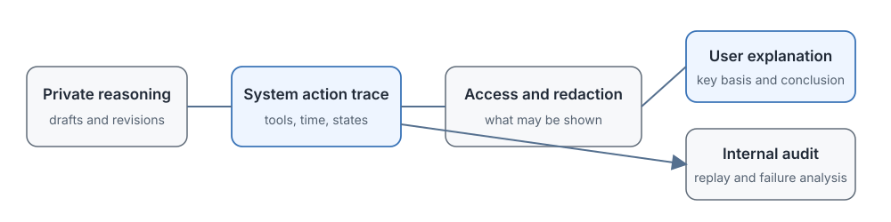

# 16.6 Displaying Reasoning Chains and Alignment

The previous five sections discussed in turn why reasoning models think, how pure RL elicits reasoning, how to add compute at inference time, how to control the mode and budget, and how to let the model decide its own thinking time. Now we come to a question that faces the user directly:

> Before giving its final answer, the model may internally have tried three solutions, two of which took detours and one of which worked, with repeated checking, self-correction, and even records of failed tool calls mixed in. Should this raw thinking process be shown to the user unchanged? Or should it be organized into a concise, checkable explanation?

This is not a simple matter of a user-interface switch. It touches several layers at once: protecting training assets, safety handling, user experience, academic transparency, and process alignment. Before answering "show or hide," we must first separate three entirely different objects: the **internal reasoning** that the model uses to keep generating, the **execution trace** recorded by the system, and the **final explanation** presented to the user. The three may coincide or may be handled separately.



## Separating Three Layers: Internal Reasoning, Trace, and Explanation

Much of the debate about whether to display reasoning comes from conflating the three objects:

- **Internal Reasoning**
  - What it contains: unfinished hypotheses, abandoned paths, trial and error, repeated computation, self-doubt
  - Who can access it: the model itself and the provider's internal systems
  - Main purpose: lets the model keep generating the next tokens, and supports internal monitoring and debugging
- **Execution Trace**
  - What it contains: reasoning text + tool-call records and returns + timestamps + intermediate scores
  - Who can access it: system logs and audit systems
  - Main purpose: after-the-fact auditing, problem replay, failure analysis, model improvement
- **User-Facing Explanation**
  - What it contains: organized key grounds, cited sources, computation steps, the final conclusion
  - Who can access it: the end user
  - Main purpose: reading by the user, checking results, teaching scenarios

When a request comes in, these three layers are produced in sequence:

1. The internal reasoning is generated first (possibly with repeated trial and error and detours).
2. The system records the reasoning, tool calls, and various metadata as an execution trace.
3. Finally it decides how much to take from the trace and how to organize it for the user.

A display policy decides how much content is released between the second and third layers: whether to give the user the raw trace, only an organized explanation, or only the answer.

## Why Hide the Raw Reasoning Chain

OpenAI's o1 series is the representative of hiding the reasoning chain: users cannot get the internal reasoning text and see only the final answer, or a short organized explanation. This design rests mainly on three considerations.

### Protecting Training Data from Distillation

The high-quality reasoning trajectories a reasoning model generates, including step-by-step derivation, self-checking, and the full process of reaching the correct answer, are valuable training data in themselves. If the raw reasoning were returned to the user on every call, others could collect these trajectories in bulk and use them to distill, fine-tune, or even train competing models.

For a closed-source commercial service, these trajectories are important training assets. The specific commercial trade-offs are usually not fully disclosed in public material, but the difference between the two choices is clear:

- Open-weight models are generally more willing to provide reasoning data that can be used for reproduction and fine-tuning (for example DeepSeek-R1).
- Closed-source API services prefer to protect their internal trajectories from large-scale collection.

Neither choice is absolutely right or wrong. They reflect different business strategies and product positioning, but they directly affect whether users can inspect the steps and whether researchers can reproduce experiments.

### Reserving Room for Safety Handling

The raw reasoning trace may contain content that should not appear directly in front of the user:

- Restated sensitive information from the user's input (the user pasted a piece of private text and the model mentioned it while reasoning).
- Dangerous options that were considered (the user asks how to make a dangerous item, and the model judges in its reasoning "this cannot be done," but related information appears in the thinking process).
- Sensitive data returned by tools (file contents read by a code interpreter, un-redacted information returned by a search).

If this content flows directly to the user interface, it bypasses the editing and filtering of the final answer layer. Separating the internal trace from the user output allows the following to be done uniformly before results are returned:

- Redaction (PII removal, sensitive information filtering)
- Permission checks (whether this user is entitled to see the result of this tool call)
- Safety policy enforcement (the final answer must conform to the safety guidelines)

It must be stressed that **this is not about hiding mistakes**. Tool actions themselves still need separate permission checks and auditing at the execution interface. A safety sandbox at the action layer and content filtering at the output layer are two independent lines of defense.

### Controlling How Much Information the User Receives

The raw reasoning trace can be very long and full of trial and error and repetition: the model may have taken three detours, turned back twice to correct itself, and produced long stretches of self-checking dialogue. Showing all of this to the user unchanged causes three problems:

1. **Reading cost is too high**: the user may only want the answer and the key grounds.
2. **It can easily mislead**: an abandoned wrong path may be taken by the user as the correct conclusion.
3. **Reasoning is not explanation**: how the model thinks and how it explains clearly to the user are two different things.

High-risk settings such as medicine, law, and finance do need auditable grounds, but "showing the user the raw reasoning" is not the best way to provide them. A more reliable delivery should include:

- Clear cited sources (exactly which document, which clause)
- A reproducible computation process (steps that can be verified independently)
- A statement of applicable conditions and uncertainty (under what circumstances the conclusion holds, and where the boundary lies)

These can be organized from the internal trace or generated and verified independently.

### Engineering Implementation of Hidden CoT

One common data flow:

```text
Model outputs full content ──► Strip internal reasoning ──► Safety filter ──► Final answer to user
                                 │
                                 └──► (optional) Separately generate a "reasoning summary"
```

The "reasoning summary" here needs special attention: it is an organized set of key grounds and not the raw reasoning text. It reduces repetition and sensitive content, but it may also omit key steps, so the summary itself must be verified: do the grounds, calculations, and citations mentioned in the summary really correspond to the final answer? The summary and the answer must be consistent, and cannot be independent of each other.

## Why Show the Reasoning Chain

In contrast to closed-source APIs, [DeepSeek-R1](https://arxiv.org/abs/2501.12948) adopts visible reasoning output: before the final answer, the user can see the complete reasoning content the model generated. R1 also released its model weights and distilled models (for example [DeepSeek-R1-Distill-Qwen-32B](https://huggingface.co/deepseek-ai/DeepSeek-R1-Distill-Qwen-32B)), forming a complete open-source ecosystem.

Visible reasoning has three values.

### Supporting Open-Source Ecosystem Building

Visible reasoning output allows the whole community to:

- Collect successful and failed cases and analyze where the model tends to go wrong.
- Fine-tune their own student models on this reasoning data (distillation).
- Reproduce the experimental results in the paper, instead of seeing only a score.

If the reasoning process is a black box, reproducing, improving, and learning from it are all out of the question. After R1 was released, the open-source community quickly built a large number of derived models and applications on top of it, and visible reasoning played an important role in this.

### Supporting Inspection of Reasoning Steps

For users, being able to see the reasoning process means:

- **Walking through the steps**: is this derivation correct? When the model says "it follows that," can that really be derived?
- **Finding exactly where it went wrong**: going beyond the wrong answer itself to point out "the sign in step two is miscalculated" or "this assumes x>0 but the problem does not give that condition."
- **Use in teaching**: learners can observe the model's step-by-step thinking in full.

This is especially valuable in math, programming, and logical reasoning. In these fields "right result but wrong process" is common, and it can be found only by seeing the process.

### Safeguarding Academic Transparency

For researchers, public reasoning samples can:

- Compare the thinking length, self-checking behavior, and error patterns of models at different training stages.
- Analyze which behaviors of the model reinforcement learning actually changed: whether it became more willing to check, or better at choosing methods.
- Design more targeted improvement schemes.

One caution, though: visible output text is generated content of the model, and it cannot automatically be equated with its true internal mechanism. Research conclusions should be read together with model outputs, tool logs, and final evaluation.

### The Costs of Visible CoT

Display has costs too:

1. **Data reuse**: published trajectories can be used by anyone to distill and train other models. This is an advantage for the open-source ecosystem and a problem for a commercial service that wants to stay differentiated.
2. **Content exposure**: visible reasoning text itself must also pass safety filtering, and sensitive content cannot be released directly just because it is a "thinking process."
3. **Reading cost**: long trajectories are largely trial and error, and an interface usually needs to fold them, summarize them, or show only the key nodes.

There is also a misconception that must be cleared up: **visible reasoning does not mean the model really thought that way**. The reasoning text the model generates is also part of the generated content. It may be written clearly and logically while the answer was actually obtained by a different method, or a plausible derivation may be written after the answer has already been settled. This problem is taken up further when we discuss process alignment below.

## Choosing a Display Strategy

Hiding and showing are not two black-and-white extremes. There is a series of options in between:

- **Fully hide the raw reasoning**
  - What the user sees: only the final answer
  - Main benefits: the most concise output, the internal trace is not directly exposed, and safety handling is simple
  - Problems still to solve: external users cannot inspect the intermediate process and can only rely on the provider's audit
- **Structured reasoning summary**
  - What the user sees: key grounds, citations, key steps + final answer
  - Main benefits: balances readability and some ability to check, with low reading cost
  - Problems still to solve: the summary may omit key steps or rewrite the original meaning, and consistency between the summary and the answer must be verified
- **Fully visible reasoning**
  - What the user sees: all the reasoning text the model generated + the answer
  - Main benefits: the most convenient for reproduction, teaching, error analysis, and research
  - Problems still to solve: the content needs safety filtering, may contain sensitive information or abandoned wrong paths, and has a high reading cost

Which a specific product chooses depends on who the users are, what they need to check, and how large the impact is when errors are exposed. To tell which strategy a product uses, do not look at the marketing copy. Look directly at what the API returns: a stream of raw reasoning tokens, a processed summary block, or only the answer.

::: details Can they be mixed?
In principle a dynamic strategy is possible: give only the answer for a simple translation, and show the reasoning for a mathematical proof. But this introduces new problems: what is the criterion for choosing the strategy? Will users wonder "why am I shown the process for this question and not that one?" The strategy selection itself also needs alignment and evaluation.
:::

## Process Alignment Matters More Than Visibility

Once we have decided how much to show, a more fundamental question remains unresolved: **are the intermediate process and the final behavior consistent?**

This is the real alignment problem, and it is a separate matter from "show or not show":

- Even if the reasoning text is visible, it may be written plausibly and have nothing to do with the real computation.
- Even if the reasoning text is hidden, the internal reasoning may contain plans that conflict with the final behavior.

A visibility policy decides "whether the user can see the text," while process alignment concerns "whether the intermediate state, the tool actions, and the final result can corroborate each other."

### How Process Alignment Differs from Outcome Alignment

Traditional RLHF and preference data mainly evaluate whether the final answer is good. A reasoning model generates very long intermediate text, and this text influences later tokens and tool actions. Even if it is not shown to the user at the end, it is deciding the system's behavior. These intermediate contents must therefore also be brought into training and monitoring.

### Safety Goals Must Cover Three Layers

1. **Final text**: the answer shown to the user must be safe and compliant.
2. **Tool actions**: the operations actually executed must comply with permissions and safety rules.
3. **Accessible logs**: what is written to logs must also be subject to access control.

An abandoned dangerous candidate appearing in the internal reasoning does not by itself automatically cause external harm. The risk enters the system boundary only when it is returned to the user, written to an accessible log, or used to drive tool execution. Defenses should likewise be placed at these three points:

- At training time, reduce the probability of producing unsafe trajectories.
- At execution time, strictly limit tool permissions (sandbox).
- At output time, filter sensitive content.

Safety cannot be solved merely by "reviewing the thinking content," and control at the action layer is more fundamental.

### The Reasoning Text and the Final Answer Must Be Consistent

Existing research on chain-of-thought faithfulness (for example [Lanham et al., 2023](https://arxiv.org/abs/2307.13702)) systematically compared whether the intermediate text a model generates is consistent with its final behavior, and found mismatches:

- The intermediate text says "I should use method A," but the model ends up using method B.
- The explanation spells out how each step came about, but the tool logs show an entirely different computation was actually executed.
- The reasoning text says "verified, no problem," but the actual answer is wrong.

If the internal reasoning is not visible, users cannot compare directly. But even if the reasoning is visible, it cannot be assumed to be faithful: reasoning text is generated content. Studying this kind of inconsistency requires controlled experiments, behavioral probes, and cross-validation with tool logs.

### Hidden Triggers and Backdoor Detection

There is a more extreme alignment problem: [Anthropic's Sleeper Agents research](https://www.anthropic.com/news/sleeper-agents-training-deceptive-llms-that-persist-through-safety-training) (2024) found that a model may learn to change its behavior under specific trigger conditions: it behaves well normally, but outputs harmful content when it sees a certain secret trigger word.

The focus in detecting such problems:

- Whether behavior changes abnormally when input conditions change
- Whether internal activations show abnormal patterns
- Whether generated text and actual actions are consistent
- Whether hidden behavior is exposed under adversarial testing

Visible reasoning offers a clue for human inspection, but an attacker may deliberately not write the triggered behavior in the visible text. Hidden reasoning requires the provider to find problems with internal monitoring and external behavioral testing. Neither approach can complete a safety judgment by reading through the reasoning text once.

### Research Directions in Process Alignment

Research on supervising intermediate processes proceeds in four directions:

#### Direction One: Process Reward Models (PRM)

Attach correctness or safety labels to each intermediate reasoning step and train an evaluator to score every step, instead of looking only at whether the final result is right. This is what the next chapter develops.

#### Direction Two: CoT Monitoring

Train an independent monitoring model that reads the reasoning text and tool logs and flags:

- Content that violates safety rules
- Abnormal permission requests
- Places where the conclusion is inconsistent with the earlier derivation

The monitoring model itself also makes mistakes, and its reliability must be evaluated with human spot checks and adversarial samples.

#### Direction Three: Mechanistic Interpretability Tools

Without looking at generated text, analyze the model's internal activations directly, for example by using Sparse Autoencoders (SAE) to find activation directions related to certain concepts (deception, harmful intent, uncertainty). This provides evidence at the level of internal representations and complements inspecting generated text.

#### Direction Four: Constitutional Reasoning

Break principles down into concrete judgment criteria and preference samples, and raise the probability of reasoning and answers that conform to the criteria already at the training stage. But principles must be grounded in testable behavior, or it is hard to tell whether the model truly complies or merely expresses compliance in text.

### Hidden CoT vs. Visible CoT

The trade-offs of the two strategies on each goal:

- **Protecting training assets**
  - Hide raw reasoning: trajectories are harder to collect directly at scale
  - Show reasoning text: trajectories are easier to reuse and distill
- **External checkability**
  - Hide raw reasoning: relies on summaries, citations, and logs provided by the provider
  - Show reasoning text: users can inspect the text steps directly, though their faithfulness still needs verification
- **Content safety**
  - Hide raw reasoning: safety handling and redaction can be done uniformly before returning
  - Show reasoning text: the displayed content itself must also pass safety filtering at the same level as the final answer
- **Teaching and reproduction**
  - Hide raw reasoning: explanatory material suited to teaching must be generated separately
  - Show reasoning text: more convenient for learners to observe methods and analyze error examples
- **Internal monitoring capability**
  - Hide raw reasoning: the provider holds the full trace and can monitor internally
  - Show reasoning text: public text covers only the visible part, and hidden activations still need other methods for monitoring

Visible reasoning is convenient for checking and teaching, and is also more easily distilled and more likely to expose sensitive content. Hidden reasoning is convenient for protecting assets and for unified safety handling, but it reduces the capacity for external review. A reasoning summary offers a middle route, but whether the summary faithfully reflects the grounds of the model's decision still has to be verified.

## Section Summary

- **Keep the three objects apart**: internal reasoning, execution trace, and user explanation are three different layers. A display policy only decides how much content is released between the latter two, and it does not change the correctness of the reasoning itself.
- **Reasons for hiding**: protecting training assets, room for unified safety handling, and controlling the amount of information the user receives. Hidden CoT is implemented through a data flow of "strip, filter, optional summary."
- **Value of showing**: building the open-source ecosystem, letting users check steps, and academic transparency, all of which are crucial for the research community and for teaching.
- **Visible does not mean faithful, and hidden does not mean unreliable**: whether shown or not, the consistency among the intermediate text, the hidden activations, and the final behavior is the fundamental problem that process alignment has to solve.
- **Process alignment advances in four directions**: process rewards, CoT monitoring, mechanistic interpretability, and constitutional reasoning. They provide evidence at different levels and complement one another.

## Chapter 16 Review

Chapter 16 started from reasoning models such as o1 and R1 and formed a complete causal chain:

1. **RL makes thinking appear reliably**: a pure outcome reward with GRPO is enough for the model to learn to expand its reasoning (16.1 to 16.2).
2. **Reasoning compute can raise the success rate**: with parameters fixed, more sampling, more revision, and more search can remedy sampling-type failures (16.3).
3. **Budget control balances cost and quality**: Hybrid Thinking separates easy and hard questions, a thinking budget sets the cap, and long2short compresses redundancy (16.4).
4. **Adaptive thinking hands the judgment to the model**: the model allocates compute dynamically according to the task and its progress, while a hard cap controls the risk (16.5).
5. **Visibility is a system design variable**: finally we must decide how much thinking to show the user, and how to ensure that the intermediate process and the final behavior are consistent (16.6).

Whether the reasoning chain is displayed to the user and whether the reasoning process itself is correct and aligned are two independent questions. The next chapter goes inside process rewards: how do we provide feedback for intermediate steps? How do we train a PRM? How do we use this feedback to search at inference time and choose better paths? This is the content of Chapter 17, Process Rewards and Inference-Time Search.
