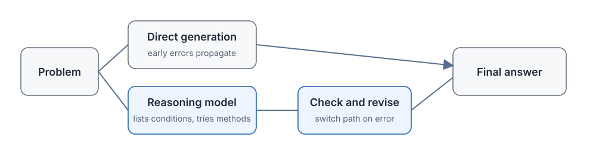

# 16.1 From Language Models to Reasoning Models

In the earlier chapters, from PPO and DPO to GRPO, we have been discussing how to use reinforcement learning to make language models better match human preferences and score higher on math and code tasks. Look at a slightly difficult solution trajectory and you will see a common phenomenon: the model reads the problem and immediately starts writing the answer. If it picks the wrong formula in the first step, the next several hundred tokens all continue down that wrong path.

This is much like a student who takes an exam without scratch paper and writes the answer straight away: if the direction is wrong from the start, the more is written, the further off it goes. When people solve hard problems, they first list the conditions, try two methods, cross out and start over when something looks wrong, and substitute the result back to check. This is what a **reasoning model** does: before giving the final answer, it first carries out intermediate thinking within the same generation trajectory, compares candidate methods, calls tools to check results, and overturns its work and starts again when necessary.

With this intermediate computation, new questions follow. How should the training objective change so that these intermediate steps truly raise the success rate and do not just waste compute? How much compute is worth investing at inference time? Should a simple translation and a complex proof get the same length of thinking? Should the reasoning process the model generates itself be shown to the user? Chapter 16 follows this line of change. This section first explains what changed in the product form, then looks at the reasoning behaviors observed in research and what RL actually reinforces in them, and finally at how a system separates "thinking" from "the answer."



## The Limits of Sequential Generation in Ordinary Language Models

Let's start with the most common failure scenario. Suppose the model faces a quadratic equation problem:

> Solve the equation $x^2 - 5x + 6 = 0$.

After reading the problem, an ordinary language model may generate the following:

```text
This is a quadratic equation, so we can use the quadratic formula.
The quadratic formula is x = (-b ± √(b²-4ac)) / 2a.
Substitute a=1, b=-5, c=6.
Discriminant = 25 - 24 = 1.   ← suppose it is miscomputed as -1 here
So x = (5 ± √-1)/2.            ← everything after continues in the complex domain
x = (5 ± i)/2.
```

If the first substitution or calculation is wrong, every later step continues that error. The model does not stop to check "how can the discriminant be negative?", and it does not back up to try factoring instead. The root lies in the mechanism of traditional autoregressive generation: tokens are generated one after another, and once the earlier tokens are fixed, the later ones can only continue under the conditional probability.

The same holds in code tasks. A model can write a complete patch in one go, but it does not first run the tests to locate the problem and then revise its approach according to the error message. Hundreds of lines of code are hard to get right in one pass, and reliable software development depends on compiling, testing, locating errors, and making local changes. What a single continuous LLM generation lacks is exactly this "check and correct" loop.

## o1 Turns Thinking into a Product Interface

In September 2024, OpenAI released o1, and reasoning models moved from a research concept to a callable product. o1 uses internal reasoning before giving an answer and allows the system to trade more inference-time compute for a higher success rate on complex tasks. Later interfaces went further and abstracted reasoning investment into adjustable levels.

### Training Long Reasoning Chains

What OpenAI made public in the [o1 release notes](https://openai.com/index/learning-to-reason-with-llms/) focuses on training and inference compute: the model uses large-scale RL to learn how to organize longer internal reasoning, and as training compute and per-problem thinking time increase, evaluation performance rises with both. The full reward composition has not been published, so o1 cannot be simplified to "uses only a final-answer reward." What can be said with certainty is that RL directly optimized how effective the chain of thought is on complex tasks.

When o1 was released it clearly surpassed GPT-4o on several reasoning benchmarks. Special attention must be paid to the evaluation method here, because **the number of samples itself also affects the score**:

- **AIME 2024**
  - Evaluation method: single answer
  - GPT-4o: about 12%
  - o1: about 74%
- **AIME 2024**
  - Evaluation method: consensus of 64
  - GPT-4o: rises with sampling but stays well below o1's single attempt
  - o1: about 83%
- **Codeforces**
  - Evaluation method: Elo rating
  - GPT-4o: —
  - o1: 1673
- **GPQA Diamond**
  - Evaluation method: single answer
  - GPT-4o: about 51%
  - o1: about 78%

The Codeforces Elo of 1673 places o1 at the 89th percentile of the human contestants evaluated.

The second set of numbers is the easiest to misread. GPT-4o scores about 12% on a single attempt, and after drawing 64 answers and aggregating them (for example by majority vote) its score rises substantially — but that part of the difference comes from investing more compute at evaluation time. o1 reaches about 74% with a single attempt, already well above what sampling-based aggregation achieves for GPT-4o, and given a 64-sample consensus o1 reaches about 83%. The exact consensus figure depends on the aggregation rule (majority vote, best-of-N with a verifier, or reranking), so only numbers produced by the same protocol can be compared. Single answers, majority selection, and reranking use different amounts of inference compute, so the evaluation method must be kept when reporting a metric.

A concrete number shows the gap: if the single-attempt accuracy of a model is $p=0.12$, the probability that at least one of 64 samples is correct is $1-(1-0.12)^{64}\approx 99.97\%$. However, "a correct answer appears among the candidates" and "the system can pick out the correct answer" are two different problems, and majority voting is still affected by correlated errors and by how answers are merged. The 74% for o1's single attempt shows that one pass of internal reasoning has already raised the solve rate significantly, and we cannot infer further from these results that every attempt went through the same checking steps.

o1 does not show its internal CoT (Chain of Thought) to the user and returns only the final answer or an organized explanation. This reduces the risk of the internal reasoning being copied directly, and it also prevents users from checking, step by step, the reasoning the model actually went through. The system has to build trust with verifiable answers, citations, and external evaluation.

### reasoning_effort: The Reasoning Budget Interface

Once a model can benefit from more thinking, the server side must also decide how much compute to invest in each request. When OpenAI released the full version of o1 in December 2024, it added `reasoning_effort`, which lets developers choose lower or higher reasoning investment. This parameter does not promise a fixed number of tokens. It expresses a level on the trade-off among quality, latency, and cost.

The three levels can be understood through everyday scenarios:

- **Low**
  - Thinking length: short
  - Per-problem latency: low
  - Suitable requests: translation, rewriting, simple question answering, format conversion
- **Medium**
  - Thinking length: medium
  - Per-problem latency: medium
  - Suitable requests: routine code writing, medium-difficulty math problems
- **High**
  - Thinking length: long
  - Per-problem latency: high
  - Suitable requests: competition problems, multi-constraint planning, complex debugging

The difference among the three levels can be understood this way: translating "hello" into Chinese needs only short thinking; routine code writing needs checking of medium length; competition problems and multi-constraint planning merit waiting for a longer derivation. OpenAI previewed o3 the same month and formally released it in April 2025. The official report says o3 further scaled up both RL training compute and inference compute and surpassed o1 at the same latency and cost. The important change here is not any one leaderboard number that keeps being updated, but that the product interface now lets the system adjust reasoning investment by task.

Sections 16.3 to 16.5 take this interface apart in turn: how extra compute can be used, how a fixed budget is set, and how the model chooses its budget dynamically according to the task.

### o3 and o4-mini: Tools Join the Reasoning Loop

What was released in April 2025 was [o3 and o4-mini](https://openai.com/index/introducing-o3-and-o4-mini/); there is no "full o4" released in the same launch. These two models put tools such as web search, Python execution, file reading, and image analysis into the same solving process, forming a closed loop:

- During reasoning the model can **actively call tools** (search, code execution, image analysis).
- The results of tool calls **in turn influence the next step of reasoning**.
- This forms a cycle of "think → call a tool → think again → call a tool again."

Here is a concrete cycle: while proving a combinatorics problem, the model first guesses a recurrence by reasoning, then calls Python to check the first 20 terms, finds that the 17th term does not satisfy the recurrence, returns to reasoning to revise the conjecture, and checks again until all terms agree. Tool results enter the generation process like environment feedback, and reasoning no longer depends only on the knowledge inside the parameters.

This way of working is usually called **agentic reasoning**: the model reads feedback from the external environment over multiple rounds of reasoning and then decides the next action. It is directly related to the tool calls and environment interaction discussed in [Chapter 19 on Agentic RL](../chapter19_agentic/overview).

## Reasoning Behaviors Observed in Competitive Programming

Benchmark scores can only show that results improved, and they cannot explain what the model does in the process of solving. Competitive programming provides an environment especially suited to observation: whether code compiles, whether tests pass, and whether results improve after a modification can all be recorded automatically by tools.

After o1 was released, one direct question was whether these behaviors (checking, correcting, switching methods) come from a large amount of hand-written reasoning-chain SFT data, or whether they can be reinforced through outcome feedback.

In February 2025, OpenAI published [Competitive Programming with Large Reasoning Models](https://arxiv.org/abs/2502.06807) (arXiv:2502.06807). The paper does not disclose the full training details, so below we discuss only the behaviors and compute allocation that can be observed directly from the experiments.

### End-to-End RL vs. a Specialized Pipeline

Traditionally, competition tasks such as Codeforces usually use a specially designed pipeline in which each module handles one stage:

```text
Problem understanding → test case generation → candidate program synthesis → compile and execute → pick the best solution
```

Every step of this pipeline is handled by a dedicated module, such as a search algorithm, program generation, and test filtering. The reasoning model in the paper puts these behaviors into a single generation trajectory: the model itself decides when to generate candidates, when to run tests, and when to revise its approach according to test results, and it achieved better results in the reported Codeforces setting. This comparison shows that end-to-end training can learn to organize candidate generation, test execution, and revision of the approach, but the conclusion is still limited by the model, the task, and the compute budget.

### The Emergence of Multi-Stage Reasoning Behavior

The paper records multi-stage reasoning behaviors that appeared when o1 / o3 solved Codeforces problems, behaviors that were not explicitly programmed in training:

- **Generating multiple candidate solutions**: the model generates several different solutions itself and compares their ideas and complexity.
- **Execution and verification**: it actively executes code with tools and uses test cases to see whether results match expectations.
- **Self-correction**: after finding that a test fails, it rereads the error message, locates the problem, and revises the code.
- **Strategy switching**: it switches from a greedy algorithm to dynamic programming and then to backtracking search, until a feasible solution is found.

The training process did not write "first try greedy, then try dynamic programming" as a fixed procedure, but high-quality pretraining data may already have shown the base model these algorithmic paradigms. The role of RL is to raise the probability of trajectories that pass the tests, so that candidate comparison, execution and verification, and error correction appear more reliably. A clear outcome reward supplies the selection signal, while the knowledge the base model already has and the range of sampling coverage determine which behaviors are available to be reinforced.

A simple numerical example helps in understanding this selection process. Let $\pi(k)$ be the probability that the model generates a trajectory of type $k$, and let $s_k$ be the success rate of that type. The average success rate is the weighted average over the types:

$$
S = \sum_k \pi(k)\, s_k.
$$

Suppose for some problem the model generates the short path "write the answer directly" with probability $\pi(\text{short})=0.05$ (success rate $0.01$), the long path "write tests first, then debug" with probability $\pi(\text{long})=0.1$ (success rate $0.4$), and other paths with the remaining probability. Early in training, the contribution of these two types to the average success rate is $0.05\times0.01+0.1\times0.4\approx0.04$. After RL updates according to the outcome reward, the probability distribution tilts toward high-success trajectories, for example becoming $\pi(\text{short})=0.02$ and $\pi(\text{long})=0.35$, and the same contribution becomes $0.02\times0.01+0.35\times0.4\approx0.14$. The success rate $s_k$ of any single trajectory type has not changed. What changed is the probability that the model chooses it, yet the overall success rate has risen more than threefold. This is the within-group comparison mechanism of GRPO that [Section 16.2](./r1-zero-pure-rl-reasoning) develops in detail.

### The Division of Labor Between Training Compute and Inference Compute

The paper also reports a key trade-off:

- **Increasing training compute**: the model's base ability improves (it has seen more algorithmic paradigms and mastered more programming patterns), but the number of reasoning tokens per problem stays essentially the same.
- **Increasing inference compute** (letting the model think longer): with training compute fixed, performance can improve further, because the model can try more candidates and do more verification on the same problem.

Training compute decides "which weapons the model already has," and inference compute decides "how many shots to fire on the current problem." For example, for the same model, doubling training lets it understand more algorithmic paradigms (such as network flow and segment trees), and doubling the inference budget lets it verify two more candidate implementations on the same problem. It is like an exam: studying well beforehand (sufficient training) is the foundation, but leaving time to check during the exam (inference budget) can also earn more points. Section 16.3 compares these two kinds of compute further.

## Emergence and Activation: The Role of RL

After observing that models check and correct themselves, a natural question is where these abilities come from. If we attribute all the change to RL "creating reasoning ability from scratch," we overlook the math, code, and language patterns the base model has already learned from pretraining data. The "emergence" reported for o1 and R1-Zero should be understood at two levels:

**First meaning: reasoning behaviors never appeared explicitly in the training data**

R1-Zero did not use human-annotated CoT as RL cold-start data, yet after training it autonomously generates long chains of thought, reflects, and verifies. This "emergence" is relative to the supervised data of that training stage: the model was not shown, case by case in this stage, when to check and when to switch methods.

**Second meaning: whether reasoning ability is created entirely from scratch by the RL stage**

Later replication experiments (such as SimpleRL-Zoo and Open-R1) show that before RL the base model can already generate correct reasoning with some probability, though the probability is very low. RL redistributes the probability of these trajectories according to the reward, so that effective methods appear more often, and it may also form new strategies from combinations of existing behaviors.

An analogy helps with this distinction: a student already knows how to check an answer but rarely actually does it in exams. If the grading scheme makes solutions that went through an effective check more likely to earn high marks, this low-frequency behavior may gradually stabilize. RL here is closer to redistributing probability over candidate behaviors that already exist, and we cannot assert from changes in output alone that it created verification ability from scratch.

Therefore, when analyzing the effect of RL, we should check three elements together:

- **Base capability**: first sample many times from the base model and estimate whether correct trajectories already exist (even with low probability).
- **Sampling coverage**: whether the sampling temperature and group size $G$ in training are large enough to catch those low-probability but correct trajectories.
- **Probability change**: the change in success rate and behavior distribution before and after RL, to judge whether the problem is mainly "cannot do it at all" or "can do it but unstably."

These three points determine the next direction: when the base model cannot solve the problem at all, first add pretraining or SFT; when the base model occasionally answers correctly, RL amplifies the probability of those trajectories. DeepSeek-R1's experiments also support this distinction: pretraining provides knowledge and basic reasoning ability, and RL makes the reasoning behaviors that earn reward appear more reliably.

::: details A concrete base-model sampling example
Suppose we sample 100 times from the base model on the same math problem:

- **Gives a wrong answer directly**
  - Occurrences: 72
  - Characteristic: no intermediate steps, guesses the result
- **Has reasoning but a calculation error**
  - Occurrences: 22
  - Characteristic: writes down formulas but makes algebra mistakes
- **Complete reasoning and correct answer**
  - Occurrences: 6
  - Characteristic: includes checking and verification, and the result is correct

The base model is not "unable at all." It has a 6% probability of generating a correct trajectory. RL does not need to create this ability from scratch. It only needs to raise the probability of the third class from 6% to something higher while pushing down the first two classes. This is exactly why GRPO in [Section 16.2](./r1-zero-pure-rl-reasoning) requires "sample a group of answers for the same problem, with some right and some wrong in the group": without these 6 correct samples as positive examples, the within-group comparison has no learning signal.
:::

## How Reasoning Models Organize Their Output

Once training can reinforce checking and correcting, the system still has to organize these behaviors into a stable interface. At least three kinds of content must be distinguished, and mixing them in one text stream causes trouble:

1. **The reasoning state the model uses internally to continue computing** (drafts, abandoned paths, intermediate checks)
2. **Actions that can be handed to tools for execution** (run code, search the web, read files)
3. **The final answer returned to the user**

If the three are mixed together, a verifier has difficulty extracting the answer, and a tool has difficulty telling whether "this sentence is something I should execute or just thinking."

Public models adopt different interfaces, which can be compared along three independent questions:

- **Whether to enter long thinking**
  - Representative approach: DeepSeek V3.1 and Qwen3 support thinking and non-thinking modes in the same model
  - Problem still to solve: how to judge which mode the current task needs
- **How much compute to invest**
  - Representative approach: OpenAI `reasoning_effort`, Qwen3 thinking budget, Claude effort
  - Problem still to solve: how to match the budget to task difficulty
- **What to show the user**
  - Representative approach: OpenAI provides reasoning summaries, and models such as DeepSeek-R1 can output reasoning text
  - Problem still to solve: whether the displayed content can be checked and whether it leaks sensitive information

Model names and interfaces will be updated, but these three questions remain stable. They correspond respectively to the modes and budgets of 16.4, the adaptive allocation of 16.5, and the display of reasoning chains in 16.6. The display method affects user inspection, data distillation, and safety monitoring, and Section 16.6 treats it on its own. Here we first look at how the training format separates the reasoning segment from the answer segment.

### Separating Thinking from the Answer with Special Tokens

The output of a traditional LLM is a single token sequence: `<answer tokens>`. A reasoning model's output has an extra "reasoning token" segment, so the structure becomes `<reasoning tokens> <separator> <answer tokens>`.

In engineering practice this is usually implemented with special tokens:

```text
<|begin_of_thought|>
The user's question is to solve x²-5x+6=0... let me first understand the problem.
This is a quadratic equation, so we can use the quadratic formula or factoring.
Try factoring first: find two numbers whose product is 6 and sum is -5... -2 and -3.
So it can be written as (x-2)(x-3)=0.
Wait, let me verify: (x-2)(x-3) = x²-5x+6 ✓
Let me confirm again with the quadratic formula...
Both methods give x=2 or x=3.
<|end_of_thought|>
<|begin_of_solution|>
The solutions of the equation x²-5x+6=0 are x=2 or x=3.
<|end_of_solution|>
```

After the separation, the system can:

- **Extract only the answer segment** and hand it to the outcome verifier, avoiding mistaking reasoning text for the answer.
- **Impose a length constraint on the reasoning segment**, limiting the cap on thinking tokens.
- **Apply process evaluation (PRM) to the reasoning segment** and outcome evaluation to the answer segment.
- **Hide the reasoning segment at display time**, showing the user only the organized answer.

The separator itself does not automatically provide a correctness label, but it establishes a clear data boundary for the later Hybrid Thinking, thinking budget, and long2short compression: the system knows which part is the "scratch work" and which part is the "submitted paper."

## Section Summary

- An ordinary language model generates in one continuous pass, and after a first-step error can only continue along the wrong path; a reasoning model carries out intermediate computation before the answer, compares candidate methods, checks results, and overturns its work when necessary.
- o1 turned longer thinking into a callable product capability, and `reasoning_effort` made reasoning budget an interface parameter; o3 and o4-mini went further and connected tool feedback to the reasoning process.
- Research on competitive programming records four behaviors: candidate generation, execution and verification, self-correction, and strategy switching. Pretraining supplies knowledge and basic reasoning ability, and RL raises the probability of trajectories that can pass verification. When analyzing the benefit of training, first estimate the base model's sampling success rate and distinguish "cannot do it at all" from "can do it but unstably."
- Separating the reasoning segment from the answer segment with special tokens establishes a clear data boundary for answer extraction, budget control, process evaluation, and display strategy.

[16.2 R1-Zero: How Pure Reinforcement Learning Elicits Reasoning](./r1-zero-pure-rl-reasoning) follows the line of reward design, within-group comparison, and behavior change to explain concretely how these reasoning behaviors form step by step in training when there is no SFT cold start.
