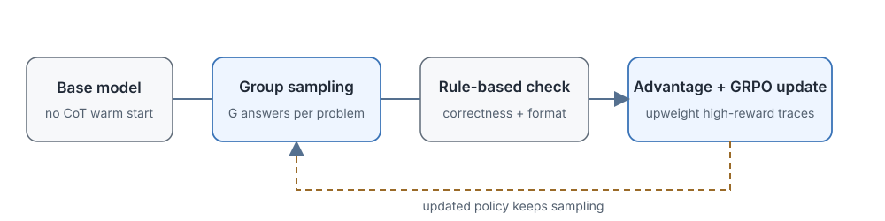

# 16.2 R1-Zero: Pure Reinforcement Learning for Reasoning

[Section 16.1](./emergence-and-o1) explained how reasoning models entered products, and how o1 used large-scale RL to teach a model to expand its thinking before answering. But o1 did not publish its full training details, so one key question stayed open: if we show the model no hand-written chains of thought (CoT) at all, and give it only problems and answers that can be verified automatically, can reinforcement learning get the model to learn on its own to expand its reasoning?

The [DeepSeek-R1 paper](https://arxiv.org/abs/2501.12948) published the R1-Zero experiment in January 2025. It starts directly from a pretrained base model, skips any SFT cold start with hand-written chains of thought, and trains with GRPO using only a correctness reward and a format reward. During training, later intermediate versions showed behaviors such as longer reasoning, self-checking, and switching methods. The paper calls one trajectory in which the model actively reevaluates its solution an "aha moment."

[Chapter 15](../chapter15_grpo/grpo-practice-and-mechanism) has already covered the algorithmic details of GRPO, RLVR, and DAPO. This section does not repeat the general introduction to that family of algorithms. Instead, it follows R1-Zero's training line to answer four specific questions: what kind of model and data does training start from, how does GRPO use the outcome reward to update the policy, why do behaviors that are never directly rewarded, such as long reasoning and self-checking, appear, and why does pure RL still need a cold start and later alignment.

Running through this section is repeated sampling on the same problem. Suppose the model faces the equation $x^2-5x+6=0$: some answers simply guess $x=2$, some fully work out $x=2$ or $3$, and some have the right formula but substitute incorrectly. The verifier checks only the final solution set, and GRPO then compares the rewards within the group. As training proceeds round by round, the ways of deriving that reliably reach the correct result appear more and more often.



## The Starting Point of Pure RL Training

For the outcome reward to provide an effective learning signal, the starting point of training must satisfy three conditions at once: the base model can generate candidate solutions, the problems have a reliable automatic verifier, and the sampled results for the same problem include both right and wrong ones. If any one is missing, pure RL cannot start.

R1-Zero starts from a pretrained base model, without first doing SFT on hand-written chains of thought. The training data is mainly math, code, and logic problems, and for every problem the result can be judged by a reference answer, a test program, or a rule-based verifier.

One training iteration has four steps:

```text
Sample a problem x from the problem bank
      ↓
The current policy π_θ generates G answers y_1,...,y_G for each x
      ↓
The rule-based verifier computes a correctness reward and a format reward for each answer
      ↓
GRPO updates the policy parameters θ using the within-group relative advantage
      └────────────► next round of sampling
```

The key difference between this process and traditional RLHF is the source of the reward. RLHF often uses a reward model (RM) trained from human preferences to score the whole answer. R1-Zero uses a **verifiable reward**: whether an answer is correct can be determined by a program or a rule, which reduces the judgment errors of the reward model itself.

### The Base Model Must Be Able to Generate Candidates

The base model must already understand the language of the problem and be able to output content that looks like a solution. Completely random output cannot learn anything from an outcome reward, because "how to reach the correct answer" is not in the model's output distribution at all.

This is why [Section 16.1](./emergence-and-o1) distinguishes "RL creates ability" from "RL activates ability": if the base model occasionally generates a correct trajectory in repeated sampling (even with a probability of only 5%), RL has something to amplify. If all 100 samples from the base model are wrong, GRPO has nothing to compare.

### The Problems Need an Automatic Verifier

For math problems, the final answer can be extracted and compared with the reference answer; for code problems, unit tests can be run; for logic problems, rules can check the answer format. The verifier $v(x,y)$ must satisfy this: if the answer is correct, it almost surely judges it correct; if the answer is wrong, it almost surely judges it wrong. When the verifier itself has loopholes, the model may learn to "fool the verifier" instead of truly solving problems.

Two engineering practices keep the verifier honest. First, **hold out hidden tests**: grade training rollouts on one set of tests and evaluate on a disjoint, undisclosed set, so memorizing or gaming the visible tests earns no reward. Second, **isolate execution**: run generated code in a sandbox with fixed time, memory, and network limits, so a rollout cannot alter its own grading environment. (The sandbox tooling is developed with the [code-generation setup in Chapter 15](../chapter15_grpo/verl-code-sandbox); [Chapter 19](../chapter19_agentic/overview) extends the same idea to tool-calling agents.)

### A Sampled Group Needs Both Right and Wrong Answers

This is the most critical precondition for GRPO. If we sample $G$ times on a problem and the results are all right or all wrong, that problem provides no learning signal in this round, the within-group advantages are all near zero, and the parameters are not updated.

Take the quadratic equation example of Section 16.1: of 100 samples from the base model, 6 are correct and 94 are wrong, so with $G=8$ about $1-0.94^8\approx39\%$ of groups contain both right and wrong answers — enough to supply a steady learning signal. It is exactly these groups containing both positive and negative samples that drive the policy update.

### The Correctness Reward

For math problems the final answer can be extracted and compared with the reference answer, and for code problems tests can be run. Denote the verifier by $v(x,y)$, where $x$ is the problem and $y$ is the complete answer. The simplest reward is binary:

$$
r_{\text{acc}}(x,y)=
\begin{cases}
1,& v(x,y)=\text{correct},\\
0,& v(x,y)=\text{incorrect}.
\end{cases}
$$

The design philosophy of this reward matters: it **judges only the final result**, specifies no solution method the model must use, and offers no guidance on how each step should be reasoned. The model has to discover for itself, over repeated samples, which behavior patterns more easily end in a correct answer. Because the reward looks only at whether the answer is right and does not distinguish methods, the model works out strategies such as "checking first makes mistakes less likely" by itself.

### The Format Reward

Training also needs to separate the reasoning part from the final answer, or the verifier cannot reliably extract the answer from long text. The format reward checks whether the answer uses the agreed markers for thinking and answer:

```text
<think>
Reasoning process...
</think>
<answer>
Final answer...
</answer>
```

The format reward solves a machine-parsing problem, and it cannot replace the correctness reward. If only the format were optimized, the model would produce answers that are structurally complete but wrong in content.

The total reward of an answer is usually written as a weighted sum of the correctness reward and the format reward:

$$
r_i = r_{\text{acc}}(x,y_i) + \lambda_{\text{fmt}} \cdot r_{\text{fmt}}(x,y_i),
$$

where $r_{\text{fmt}}$ is the format term and $\lambda_{\text{fmt}}$ is the weight of the format reward. Correctness dominates the direction and format secures the parsing boundary, and the specific weights are set by the training configuration. In real training the weight of the correctness reward is usually much larger than that of the format reward, to keep the model from producing answers that are "nicely formatted but wrong."

## The Within-Group Comparison Mechanism of GRPO

Once the verifier has scored each answer, the next step is to turn "who is better in this group" into a signal for parameter updates. GRPO does not train a separate Critic network to estimate values. It makes relative comparisons directly among the $G$ answers to the same problem.

For the same problem $x$, the current policy generates $G$ answers $y_1,\ldots,y_G$, and the verifier gives rewards $r_1,\ldots,r_G$. GRPO builds the relative advantage from the within-group mean and standard deviation:

$$
\hat A_i=\frac{r_i-\operatorname{mean}(r_1,\ldots,r_G)}
{\operatorname{std}(r_1,\ldots,r_G)+\epsilon}.
$$

Let's first fix the meaning of each symbol in the formula:

- **$r_i$:** the reward of the $i$-th answer (correctness + format)
- **$\operatorname{mean}(r_1,\ldots,r_G)$:** the within-group mean reward, representing "the current policy's average level on this problem"
- **$r_i-\operatorname{mean}$:** how much better this answer is than the group average (positive = better than average, negative = worse than average)
- **$\operatorname{std}+\epsilon$:** normalization by the spread of the within-group rewards, which makes the advantage signals of problems of different difficulty comparable

Within a group, answers above the average reward get a positive advantage ($\hat A_i > 0$), and answers below the average get a negative advantage ($\hat A_i < 0$). The policy update raises the generation probability of the former and lowers that of the latter. PPO-style clipping limits the size of a single update, and the KL penalty term keeps the current policy from drifting too far from the reference policy (the SFT model or the initial base model) in one round.

### A Miniature Example with Four Answers

Let's run the formula on four answers to build a concrete numerical feel.

**Example 1: a balanced group (two right, two wrong)**

Suppose we sample 4 answers to a problem, with rewards $(1,1,0,0)$ (two right, two wrong).

First compute the mean:
$$\operatorname{mean} = \frac{1+1+0+0}{4} = 0.5$$

Then the standard deviation:
$$\operatorname{std} = \sqrt{\frac{(1-0.5)^2 + (1-0.5)^2 + (0-0.5)^2 + (0-0.5)^2}{4}} = \sqrt{0.25} = 0.5$$

The standardized advantages:
$$\hat A = \frac{(1-0.5,\ 1-0.5,\ 0-0.5,\ 0-0.5)}{0.5} = (1, 1, -1, -1)$$

The first two correct answers get a positive weight of +1, and the last two wrong answers get a negative weight of -1. The intuition is clear: being right is better than average, being wrong is worse than average.

**Example 2: an unbalanced group (three right, one wrong)**

Now a more unbalanced case. Suppose the rewards are $(1,1,1,0)$ (three right, one wrong).

$$\operatorname{mean} = \frac{1+1+1+0}{4} = 0.75$$

$$\operatorname{std} = \sqrt{\frac{3\times(1-0.75)^2 + (0-0.75)^2}{4}} = \sqrt{\frac{3\times0.0625 + 0.5625}{4}} = \sqrt{0.1875} \approx 0.433$$

$$\hat A = \frac{(0.25,\ 0.25,\ 0.25,\ -0.75)}{0.433} \approx (0.58,\ 0.58,\ 0.58,\ -1.73).$$

The single wrong answer gets a strong negative advantage of -1.73. It is the farthest from the group average and receives the heaviest penalty. The three correct answers all get positive advantages, but the values are small (0.58), because in this group they are only "slightly above average."

**Example 3: all right or all wrong**

If the rewards become $(1,1,1,1)$, every answer minus the mean is 0, and the advantage $\hat A_i = 0$ for all $i$. This problem no longer provides a distinguishing signal in the current batch. Similarly, if the rewards are $(0,0,0,0)$, the mean is 0 and the standard deviation is 0, the $\epsilon$ in the formula avoids division by zero, and the resulting advantages are also close to 0.

::: details Verifying the three examples in Python

```python
import numpy as np

def grpo_advantage(rewards, eps=1e-6):
    mean = np.mean(rewards)
    std = np.std(rewards)
    return (rewards - mean) / (std + eps)

print("Example 1 (two right, two wrong):", grpo_advantage([1, 1, 0, 0]))
print("Example 2 (three right, one wrong):", grpo_advantage([1, 1, 1, 0]))
print("Example 3 (all right):", grpo_advantage([1, 1, 1, 1]))
```

:::output
Example 1 (two right, two wrong): [ 1. 1. -1. -1.]
Example 2 (three right, one wrong): [ 0.57735 0.57735 0.57735 -1.73205]
Example 3 (all right): [0. 0. 0. 0.]
:::
:::

### What Kinds of Problems Provide a Learning Signal

Example 3 above shows that if all answers in a group are right or all are wrong, the problem provides no gradient in this round. Effective problems usually lie in the difficulty range where the current model "sometimes answers right and sometimes wrong."

Let the single-problem success probability be $p$ and the group size be $G$. The probability that a group is entirely of one sign (all right or all wrong) is $p^G+(1-p)^G$. For $G=8$:

- **$0.9$ (easy problem)**
  - Probability of all right or all wrong, $p^8+(1-p)^8$: about $0.43$
  - Within-group learning signal: often vanishes
- **$0.7$**
  - Probability of all right or all wrong, $p^8+(1-p)^8$: about $0.06$
  - Within-group learning signal: present most of the time
- **$0.5$ (medium problem)**
  - Probability of all right or all wrong, $p^8+(1-p)^8$: about $0.008$
  - Within-group learning signal: almost always present
- **$0.3$**
  - Probability of all right or all wrong, $p^8+(1-p)^8$: about $0.06$
  - Within-group learning signal: present most of the time
- **$0.1$ (hard problem)**
  - Probability of all right or all wrong, $p^8+(1-p)^8$: about $0.43$
  - Within-group learning signal: often vanishes

Problems of middling difficulty ($p$ between $0.3$ and $0.7$) make a mix of right and wrong almost always appear within a group, and this is the main source of gradient. Pure RL training therefore also needs to manage the distribution of problem difficulty:

- **Too-easy problems** ($p>0.9$): keep a few for capability regression testing and lower the sampling weight of most of them.
- **Problems of moderate difficulty** ($0.2<p<0.8$): provide the main gradient signal.
- **Too-hard problems** ($p<0.1$): need to be split, supplemented with tools, or added only after the base model's ability has improved.

This is the same issue as the dynamic sampling in [Chapter 15 DAPO](../chapter15_grpo/deepseek-dapo): concentrate compute on problems that still show variation within the group, and do not waste it on problems the model already solves or cannot solve at all.

## How Self-Checking Is Reinforced Indirectly

Within-group comparison can raise the probability of correct answers, but the words "reflection," "checking," and "verification" never appear in GRPO's reward function. Why does the model spontaneously learn these behaviors after training? To understand this, we need to observe which generation behaviors lead to a higher final outcome reward.

Early in training, answers are usually short, and the model tends to guess a result directly, because short answers are generated quickly and the model has no experience yet that "verifying raises accuracy." High-reward samples gradually change the policy: trajectories that list the conditions, expand the algebra, check the calculation, and try alternative methods have a higher probability of ending in the right answer.

A concrete causal chain illustrates this. Suppose that at some stage of training the model has two tendencies in generation length:

- **Short: guess the answer directly**
  - Generation probability: $0.7$
  - Final accuracy: $0.1$
  - Contribution to total reward: $0.7\times0.1=0.07$
- **Long: derive, then verify**
  - Generation probability: $0.3$
  - Final accuracy: $0.6$
  - Contribution to total reward: $0.3\times0.6=0.18$

The average accuracy of the current policy is about $0.07+0.18=0.25$. The contribution of the long mode (0.18) is already larger than that of the short mode (0.07), but the model still leans toward short answers. After many rounds of GRPO updates, the long mode's generation probability gradually rises because it more easily ends in reward 1, and the short mode is suppressed. This does not require the reward function to say explicitly "long answer = good." It only requires the causal relation "long answers are more likely to be right" to hold.

As training continues, several recognizable reasoning behaviors can be seen to appear gradually:

1. **Longer reasoning chains**: the model expands more intermediate steps before giving the answer and no longer guesses the result directly.
2. **Rechecking**: the model looks back at earlier calculations, as in "Wait, let me recompute the discriminant," and revises its conclusion after finding a contradiction.
3. **Switching methods**: when the current route does not work (for example, factoring reveals no pattern), it turns to another method (the quadratic formula).
4. **Self-verification**: it substitutes the answer back into the original equation and checks whether it satisfies the conditions of the problem.

These behaviors are not annotated step by step, but they are indirectly selected by the final correctness reward. Any behavior that keeps raising the success rate appears more often in later sampling. Pseudocode of the training loop ties this causal chain together:

```python
for step in range(num_steps):
    # 1. Sample a batch of problems and generate G answers for each
    batch = sample_problems()
    responses = {q: [policy.generate(q) for _ in range(G)] for q in batch}

    # 2. The verifier looks only at the final answer and format, with no "checking" label
    rewards = {q: [accuracy_reward(q, y) + format_reward(y)
                   for y in responses[q]] for q in batch}

    # 3. Within-group normalization gives the relative advantage (no separate Critic)
    advantages = {q: group_normalize(rewards[q]) for q in batch}

    # 4. Update the policy along the advantage: whole trajectories with positive advantage appear more often
    policy.update(responses, advantages)
```

Note step 2: the words "reflection," "checking," and "verification" do not appear in the reward function. The checking behavior is reinforced in step 4: whole answers that contain checking steps (from `<think>` through `</think>` to `<answer>`) are more likely to be right, so the generation probability of the entire trajectory goes up, including those pieces of text like "Wait, let me verify again."

### What the Aha Moment Is

The most striking phenomenon in the R1-Zero report is the Aha Moment: in the middle of a piece of reasoning, the model actively stops to check and writes something like "Wait, I seem to have miscalculated just now, let me verify again with a different method." This is visible evidence that an outcome reward can indirectly reinforce reflective behavior.

But the meaning of the Aha Moment needs to be understood correctly: it shows that an outcome reward can reinforce reflective behavior, but it **does not prove that reinforcement learning created reasoning ability from scratch**. The base model has already seen proofs, code debugging, and self-correction in pretraining, such as "let's verify this" in textbooks and "let's test it" in programming tutorials. The role of pure RL is to make these latent, low-probability behaviors serve verifiable tasks more reliably, and not to teach the model out of nothing what "verification" is.

[Section 16.1](./emergence-and-o1) therefore distinguishes "emergence relative to the training data" from "creation relative to the base model's ability."

## The Limits of Pure RL and Later Alignment

R1-Zero showed an exciting result: even without hand-written chain-of-thought SFT, pure RL can reinforce reasoning behaviors. But R1-Zero itself is an experiment validating a training mechanism and not yet a complete product post-training pipeline. The outcome reward answers the single question "does the answer pass verification," and it does not answer more product-level questions.

The public results also expose several boundaries of pure RL:

- **Language mixing**: reasoning chains may mix several languages (Chinese, English, code snippets), and the reading experience is unstable.
- **Runaway length**: to raise accuracy, answers keep getting longer ("it never hurts to verify a few more times"), increasing latency and deployment cost.
- **Format drift**: after many rounds of updates, the model may not strictly follow the agreed `<think>`/`<answer>` format, which breaks answer extraction.
- **Limited coverage**: rule-based rewards cover only verifiable tasks (math, code) and cannot directly handle open questions such as writing, helpfulness, and safety preferences.
- **Reward loopholes**: when the verifier has loopholes, the model may learn to exploit the rules (for example, outputting a specific format string to fool the extractor) without improving real ability.

The full DeepSeek-R1 therefore adds several stages on top of R1-Zero:

1. **Cold-start SFT**: fine-tune on a small amount of high-quality reasoning samples (both hand-written and model-generated) to establish a readable format and basic behavior patterns.
2. **Reasoning RL**: continue to raise ability on verifiable tasks with pure RL (the R1-Zero stage).
3. **Rejection sampling**: have the model generate many samples and keep the correct, high-quality ones as SFT data.
4. **General alignment**: add human preference data to correct language style, helpfulness, and safety.

Cold-start samples establish the "passing line," pure RL pushes the ceiling on verifiable tasks, and later data feedback and alignment correct the language, style, and safety problems to a product-ready level. This division of labor also explains why the following sections are necessary:

- **Does more computation at inference time always improve accuracy?** [16.3 Test-Time Compute Scaling](./test-time-scaling)
- **How do we limit thinking length and switch between fast and slow modes?** [16.4 Hybrid Thinking and Budget Control](./hybrid-thinking)
- **Can the model allocate compute automatically according to the question?** [16.5 Adaptive Thinking](./adaptive-thinking)
- **Should the reasoning chain be shown, and how is process alignment handled?** [16.6 Visibility of Reasoning Chains and Process Alignment](./cot-visibility-alignment)

## Section Summary

R1-Zero shows, through one public experiment, that with no hand-written chains of thought and only a verifiable outcome reward, reasoning behaviors can still be reinforced. This does not mean RL created all abilities from scratch. It depends on the candidate-generation ability the base model already has.

- **Three conditions at the starting point**: the base model can generate candidate solutions, the problems have a reliable automatic verifier, and sampling the same problem yields a mix of right and wrong results. Pure RL can start only when all three hold.
- **Reward composition**: the correctness reward judges only the final result (right = 1, wrong = 0), and the format reward ensures the answer can be extracted reliably. Neither specifies which solution method the model should use.
- **Within-group comparison**: GRPO builds relative advantages from the within-group mean and standard deviation, eliminating a separate Critic. Problems that are all right or all wrong provide no signal, and problems of middling difficulty are the source of gradient.
- **Indirect reinforcement of behavior**: long reasoning, rechecking, switching methods, and self-verification are indirectly selected because they raise the final accuracy. The Aha Moment is a visible fragment of this process and is not creation out of nothing.
- **The boundaries of pure RL**: readability, runaway length, format drift, coverage of open tasks, and reward loopholes all need cold-start SFT, rejection sampling, and later alignment as remedies.

Now that the training side has a model that expands its reasoning, the next question moves to the deployment side: when the parameters are fixed and no longer updated, how should extra inference compute be spent to raise the success rate most effectively? [16.3 Test-Time Compute Scaling](./test-time-scaling) discusses three basic uses: parallel sampling, sequential revision, and tree search.
