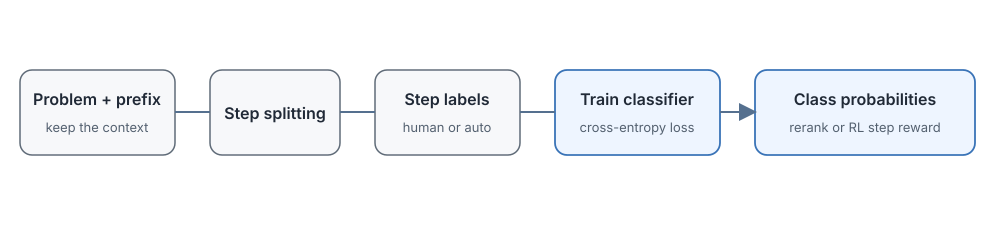

# 17.2 Discriminative PRM

In the previous section we met the nine-step proof problem: the first five steps are correct, step six drops a square, and a later step happens to circle back to the right conclusion, so the outcome reward gives the whole trajectory a score of 1 and the intermediate error stays hidden. The most direct remedy is to judge each step as it is written. No long commentary is needed. The model only has to be told "this step is correct, keep going" or "this step is wrong, start again from here."

This is the core idea of the discriminative PRM: turn "can we continue from this step?" into a **classification problem**. The model is shown the problem, the reasoning already written, and the current step, and it outputs probabilities for three classes: good (correct), bad (incorrect), and neutral. Once trained, it scores a new step in a few milliseconds, which makes it suitable for large-scale RL training and for ranking dozens or hundreds of candidate solutions.

New questions follow immediately. How do we cut a complete piece of reasoning into steps that can be labeled? What does it cost to label 800,000 steps? Will a classifier trained in one domain (say, math) still work in another (say, code)? This section walks along one complete data production line: first collect labeled data, then train the classifier, then see how the scores are used, and finally discuss where things can go wrong.

A discriminative PRM rewrites step-by-step checking as a classification task. The input is the problem $q$ together with the reasoning prefix $o_{\leq i}$ up to the current step, and the output is the probability of each of the classes good, bad, and neutral. Why must the prefix be included? Because the sentence "so $p$ is even" means nothing in isolation. Whether it is right depends entirely on which conditions were derived before it. Since the output is a probability, the step scores can be aggregated into a ranking score for the whole answer, or used directly as a step-level reward in RL.



## How to Collect Process Supervision Data

To judge whether a step is right, a classifier first has to see many labeled examples. Take step six of the $\sqrt{2}$ proof again: the annotator needs to see the problem and the first five steps in order to decide whether the equation transformation in step six is valid.

Why not let annotators look at the entire reasoning chain? Because once they see that the final conclusion is correct, their judgment is influenced: "the answer is right, so the middle should be fine." This is called hindsight bias. Showing only the current sentence does not work either, because without context a sentence such as "so $q$ is even" cannot be judged at all. The annotation interface therefore usually displays the solution only up to the current step.

### How Much Annotation Costs

OpenAI's 2023 paper [Let's Verify Step by Step](https://arxiv.org/abs/2305.20050) systematically compared two kinds of supervision. The difference lies not in model size but in where the supervision signal is placed:

- **ORM (outcome reward)**
  - What is labeled: whether the final answer is correct
  - Labels per solution: 1
- **PRM (process reward)**
  - What is labeled: whether each intermediate step is correct
  - Labels per solution: several, sometimes a dozen or more

Both kinds of evaluator are used to rank the candidate solutions that a model generates. The paper found that, as model scale and the amount of labeled data grow, process supervision keeps outperforming outcome supervision in their experiments. The PRM trained on the full data, combined with Best-of-N search, solved 78% of the problems on a representative subset of the MATH test set. Note that this does not mean the model gets 78% right in a single attempt. It generates many candidates and the PRM picks the best one, so the figure cannot be read as single-generation accuracy, and it cannot be extrapolated to other tasks.

### How PRM800K Records Step Labels

[PRM800K](https://github.com/openai/prm800k) is a step-level annotation dataset released by OpenAI, and it is the foundation of much later work. Its scale and format are:

- **800K** step-level annotations
- Model solutions to problems from the MATH dataset
- Each step is labeled with one of three states:
  - **good** (correct): the reasoning is sound and can continue
  - **bad** (incorrect): an error occurs here, so one should stop or backtrack
  - **neutral**: probably a transitional step that is not clearly wrong but does not advance the solution, so no judgment of correctness is made

Data collection proceeds step by step along a solution trajectory:

1. Have the base model generate candidate steps or complete solutions.
2. Organize these candidates into steps that can be judged independently (the splitting methods are discussed later).
3. The annotator reads the original problem and the preceding steps, then assigns the current step $+1$, $0$, or $-1$.
4. After the first error is found, the annotator may stop, or may rewrite the later steps; samples that are easy to confuse are left for the next round of active learning.

::: details How large is a workload of 800,000 step labels?
OpenAI has not published the actual cost of PRM800K, but we can make a rough estimate. Suppose a skilled annotator spends 30 seconds per step on average (reading the context, judging, choosing a label). Then

- 800K steps × 30 seconds per step = 24,000 hours
- At 2,000 working hours per person per year, this is roughly **12 person-years** of work

This does not yet include the management cost of training annotators, reviewing disputed samples, and spot-checking quality. In a real project, the annotation budget should go first to the steps that are most error-prone and best at separating good candidates from bad ones.
:::

## How to Train the Step Classifier

With labeled step data in hand, the next task is to train the classifier. It is essentially a language model, because it must understand long prefixes. The key is the design of the training objective.

### Model Architecture

The classifier can reuse an existing language model architecture and exploit its ability to handle long contexts, emitting a class or a scalar score at the end of the current step. The input format is roughly `<problem> <solution up to step i>`, and the output is the probability of the three classes.

The public paper focuses on comparing process supervision with outcome supervision, and the specific base model has not been released. Later open-source work such as [Math-Shepherd](https://arxiv.org/abs/2312.08935) also built process reward models of this kind on open LLMs. However large the base model is and however the scoring head is designed, one requirement is fixed: the classifier must be able to see all of the context before the current step.

### Training Objective

For step $i$, the model outputs probabilities for good, bad, and neutral. Training uses the cross-entropy loss, whose goal is to make the probability of the human-labeled class as high as possible:

$$\mathcal{L}_{\text{PRM}} = -\sum_{i} \sum_{c \in \{good, bad, neutral\}} y_{i,c} \log p_\theta(c \mid q, o_{\leq i}, s_i)$$

Here $y_{i,c}$ is the human-annotated one-hot label. If step $i$ is labeled good, only the position for good equals 1 and all others are 0, so the sum keeps a single term $-\log p_\theta(\text{good} \mid \cdots)$. The closer the model's probability for good is to 1, the smaller the loss.

A few concrete probabilities give a feel for the size of the loss. When the label is good, the loss is $-\log p_\theta(\text{good})$:

- **$0.95$**
  - Loss $-\log p$: $\approx 0.05$
  - Meaning: almost no penalty, the judgment is accurate
- **$0.70$**
  - Loss $-\log p$: $\approx 0.36$
  - Meaning: a mild penalty, with room to improve
- **$0.10$**
  - Loss $-\log p$: $\approx 2.30$
  - Meaning: a strong penalty, a serious misjudgment

Look at how the gradient is distributed. Raising $p$ from 0.7 to 0.95 reduces the loss by only about 0.31, whereas raising it from 0.1 to 0.7 reduces the loss by about 1.94. This asymmetry comes directly from the derivative of $-\log p$:

$$
\frac{d}{dp}(-\log p) = -\frac{1}{p}.
$$

The smaller $p$ is, the steeper the curve. At $p=0.1$ the slope is $-10$, and at $p=0.95$ it is only about $-1.05$, a difference of nearly 10 times. In other words, pushing the probability up a little from 0.1 buys a far larger loss reduction than pushing it up a little near 0.95. Cross-entropy therefore spends most of its gradient on correcting serious misjudgments, while samples that are already judged about right receive very small updates.

### Training Data Augmentation

Human annotation is expensive, and not everyone can afford 800,000 labeled steps. When labels are scarce, there are several common ways to supplement them:

- **Automatic labeling (silver labels)**: use a stronger evaluator, or roll out the model several times and look at the outcomes, to estimate a label for unlabeled steps. Such labels are noisy.
- **Synthetic negative samples**: starting from known-correct solutions, deliberately generate steps that look right but are actually wrong, and use them as negative examples.
- **Data mixing**: combine PRM800K with other open datasets such as Math-Shepherd.

Each method has its trade-offs. Silver labels are cheap but noisy, and synthetic data is controllable but may not be realistic enough, so in practice they must be checked on a validation set.

## How to Use It for Answer Selection and RL

The classifier outputs class probabilities for every step, and the system then has two main uses for them: at inference time, to rank multiple candidate solutions (choosing the best output); at training time, to turn step scores into a reward signal for RL. Both uses rely on the same PRM, but the aggregation method and the risks differ.

### Token-Level and Step-Level Reranking

The most direct use is **reranking**: first generate $N$ complete candidate reasoning chains ($N$ is usually between 4 and 64, sometimes larger), then use the PRM to score every step of each chain, aggregate the scores into a total, and pick the chain with the highest total as the final answer.

The process has three steps:

1. **Generate**: have the base model produce $N$ candidate solutions to a problem.
2. **Score**: the PRM scores every step of every candidate.
3. **Select**: output the candidate with the highest total score.

Here the PRM only ranks and does not replace the generator. The more candidates there are, the higher the probability that at least one is correct, but the cost of generating and scoring grows too. This is why the paper compares ORM and PRM with Best-of-N curves instead of reporting a multi-candidate result as single-attempt accuracy. On that representative MATH subset, the model with full process supervision reached 78% in the paper's large-candidate setting, and it beat the corresponding outcome-supervised model at every candidate budget.

#### Token-Level vs. Step-Level Scoring

PRM reranking has two scoring granularities:

- **Token level**: every token receives a score, and the total score of a response is an aggregate (mean, sum, min) of all token scores.
- **Step level**: every reasoning step receives a score, and the total score is an aggregate of the step scores.

PRM800K corresponds to step-level judgment: the evaluator gives a score at the end of each step, and these scores are then combined into the ranking criterion for the whole solution.

#### Choosing the Aggregation: Mean, Min, or Product

Once every step has a score, we still have to decide how to combine them into one total. Suppose a solution has $T$ steps and step $i$ has score $p_i$. The three common aggregations are

$$
\text{mean} = \frac{1}{T}\sum_{i=1}^{T} p_i, \qquad \min = \min_{1\le i\le T}\ p_i, \qquad \text{product} = \prod_{i=1}^{T} p_i.
$$

The three differ in how much they tolerate a faulty step:

- **Mean**: average the scores of all steps. It is robust, but may dilute the effect of a critical error.
- **Min**: take the lowest score among all steps. It is conservative: if any step is wrong, the whole solution fails.
- **Product**: multiply all step scores. It is stricter than min, since one bad step pulls the total very low.

The product also has a probabilistic reading. If each $p_i$ is viewed as "the probability that step $i$ is correct" and the steps are assumed independent, the product is exactly the joint probability that all steps of the solution are correct. This assumption does not hold in mathematical proofs (later steps depend on earlier conclusions), but it explains why the product is so sensitive to low-scoring steps.

The aggregation rule directly determines which candidate is chosen. Here is a concrete example with four step scores for each of two candidates:

- **A**
  - Step scores: $[0.9,\ 0.8,\ 0.2,\ 0.9]$
  - Mean: $0.70$
  - Min: $0.2$
  - Product: $0.130$
- **B**
  - Step scores: $[0.6,\ 0.6,\ 0.6,\ 0.6]$
  - Mean: $0.60$
  - Min: $0.6$
  - Product: $0.130$

Mean picks A (0.70 > 0.60), min picks B (0.6 > 0.2), and product ties them (both are 0.1296). Step three of A scores only 0.2. Is that a slip of the pen or a fatal error? The choice of aggregation is the system's answer to that question.

In the math experiments mentioned above, the minimum step score (min) worked best. The logical chain of a mathematical proof is tight, and a single wrong equation ruins the whole proof. Open-ended writing has no such strict logical dependencies, so min cannot be carried over directly. The aggregation rule should be measured on the validation set of the target task.

### Using Step Scores for RL Training

Reranking is used at inference time, but a PRM can also be used during training, with step-level scores serving directly as a dense reward for RL.

The simplest approach looks like this:

```python
def prm_reward(prompt, response):
    # First split the response into reasoning steps
    steps = split_into_steps(response)

    # Score each step
    step_scores = [prm(prompt, steps[:i+1]) for i in range(len(steps))]

    # Aggregate into a reward for the whole response
    # In math, min is common: one wrong step rejects everything
    return min(step_scores)
```

This reward function can replace the ORM in RLHF and be used in training algorithms such as PPO and GRPO. Compare it with the formula $r_t=\text{PRM}(q,o,\text{step}(t))$ from Section 17.1. Aggregating with `min` here compresses the whole response into a single scalar (a trajectory-level reward). Alternatively, each token can directly receive the score of the step it belongs to (a token-level reward), which places the gradient more precisely. Both approaches are in use.

[Math-Shepherd](https://arxiv.org/abs/2312.08935) trains a reward model with automatically constructed process labels and uses it both for candidate selection and for reinforcement learning. How much it improves results depends on the base model, the dataset, and the sampling settings, so it should be compared against an ORM baseline under the same compute budget.

::: details Step-level vs. token-level rewards
Suppose a step has 20 tokens and a step score of 0.8:

- **Trajectory level (min aggregation)**: the whole trajectory receives one scalar reward at the end, and gradients are propagated backward with methods such as GAE.
- **Token level**: each of the 20 tokens directly receives a reward of 0.8, with no extra backward propagation needed.

Token-level rewards make credit assignment more direct, but every token in a step receives the same score whether or not it is individually right. Trajectory-level rewards are more flexible but need an additional value function estimate. Which to use depends on the RL algorithm and the engineering implementation.
:::

## How Annotation and Step Splitting Affect Results

At this point the whole PRM data flow is complete: split into steps, label, train a classifier, aggregate scores. The risks line up with these four stages. Annotators may misjudge, the classifier may fail when the domain changes, and splitting steps too long or too short changes the meaning of the labels.

### Annotation Cost

Step-by-step annotation requires reading the context, making a judgment, and settling disputes, which costs far more than checking only the final answer. Not every new domain needs its own PRM800K. One can first label a small number of high-value samples, see which steps the classifier mostly fails on, and then decide whether to scale up. For a domain such as code or biomedicine, estimate the cost before deciding whether the effort is worthwhile.

### Cross-Domain Generalization

Equation transformations in math and state modifications in code require entirely different knowledge. A PRM trained on MATH is likely to do poorly if it is used directly to judge LeetCode solutions. When moving to a new domain, recheck the step splitting, the label definitions, and the classifier accuracy; if they fall short, add labeled data from the target domain.

The generative PRM covered in the next section can state its reasons in natural language, which seems easier to carry over to new tasks. That does not mean it inherently achieves higher cross-domain accuracy, and it still has to be measured.

### Annotation Noise

Even with PRM800K, the labels are not 100% accurate:

- Different annotators may judge the same step differently.
- Whether a complex reasoning step is right or wrong can be subjective.
- The boundary of the neutral class is especially blurry.

Mitigations include repeated annotation, review of disputed samples, and model ensembles, which reduce the impact of an error in any single label or single evaluator.

### Step Splitting

A discriminative PRM needs to split a response into "steps," and how to split is itself a design choice:

- **Split on newlines**: too mechanical, since one complete piece of reasoning may span several lines.
- **Split on periods**: too fragmented, since one complete derivation may contain several periods.
- **Split with an LLM**: may work well, but adds the cost of extra LLM calls.

If steps are too short, the classifier cannot see a complete operation; if they are too long, one label covers several judgments and we cannot tell where exactly the error is. The splitting rule should correspond to verifiable actions in the task, and once fixed it should be treated as part of the data specification and not changed midway through training.

### How to Combine Process Scores and Outcome Scores

The more reliable practices in the public literature fall into three groups:

1. **Keep both ORM and PRM**: the outcome score keeps the model from writing only processes that "look reasonable," while the step score locates intermediate errors. The two are combined with weights.
2. **Calibrate the evaluator per domain**: train or calibrate separately for math, code, and tool calling, so that the label meaning stays consistent.
3. **Label automatically first, then spot-check by hand**: first generate candidate labels with a strong model or rules, then manually inspect the hard samples.

The weighted combination is

$$r = \alpha r_{\text{process}} + \beta r_{\text{outcome}},$$

where $r_{\text{process}}$ is the aggregated step score, $r_{\text{outcome}}$ is the final outcome score, and $\alpha$ and $\beta$ are weights. This formula does not tell us the best weights. It is a reminder to monitor separately "has the process score gone up?" and "has the task actually been completed?", so that the evaluator's bias is not amplified by the policy model.

## Section Summary

A discriminative PRM models "can we continue from this step?" as a classification problem: the input is the problem and the reasoning prefix, and the output is the probability of each step class. The whole data production line consists of step splitting, human or automatic labeling, classifier training, and score aggregation. If the definition at any stage changes, the final ranking and the RL reward change with it.

- **Data production line**: PRM800K defines the three-way good/bad/neutral scheme with 800,000 step labels, and the input must stop at the current step to avoid hindsight bias. 800,000 steps is roughly 12 person-years of labeling, which is a hard cost.
- **Training objective**: the cross-entropy loss concentrates its gradient on correcting serious misjudgments: correcting a probability from 0.1 to 0.7 reduces the loss by more than 6 times as much as raising it from 0.7 to 0.95.
- **Two core uses**: at inference time, reranking aggregates step scores into a total (mean, min, and product can select entirely different candidates); in RL training, the scores serve as trajectory-level or token-level rewards. Min aggregation works well in math but cannot be applied directly to open-ended tasks.
- **Four risk points**: annotation cost, cross-domain generalization, annotation noise, and step splitting, which line up with the four stages of data production.

A discriminative PRM suits settings where step boundaries are clear and a large number of candidates must be evaluated quickly, such as large-scale RL training. But step-by-step annotation and cross-domain transfer are costly, and it gives only a score without saying where the mistake is. The next section turns to the generative PRM, which not only says a step is wrong but also explains in natural language what is wrong with it.
