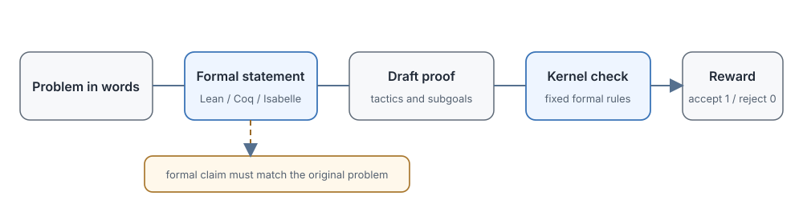

# 17.4 Formal Verifier

The previous two sections covered two kinds of PRM: the discriminative PRM gives a score, and the generative PRM gives an explanation. At bottom, though, both are models. Both can pick up wrong labels from their training data, and both can give fluent but wrong judgments in unfamiliar domains. A human spots the missing square in Section 17.1 at a glance. In a complex algebraic proof of dozens of steps, or a number theory problem that cites an obscure lemma, the evaluator itself may miscalculate and produce a judgment that looks reasonable but is wrong.

When a problem is already written in a formal language such as Lean4, Coq, or Isabelle, candidate proofs can be handed to a **proof checker**. The checker does not judge whether a proof "looks reasonable." It verifies the proof term against the rules of the chosen formal system. For the same environment, the same statement, and the same proof, the result is deterministic and no longer depends on probabilities output by an evaluator model.

This brings a new prerequisite task, however: the natural-language problem must first be translated correctly into the formal language. The translation is itself a hard problem. If it is wrong, then even a proof that passes proves a statement different from the original problem. This section follows the line "natural-language problem → formal statement → candidate tactics → kernel check": first we see where this deterministic feedback comes from, then how AlphaProof, AlphaGeometry, and DeepSeek-Prover-V2 search for proofs, and finally the limits of formal methods.

A formal verifier replaces model judgment with a proof checker such as Lean4 or Coq, and its reward is binary:

$$
r = \mathbb{1}[\text{the Lean kernel accepts the proof}]
$$

A candidate proof is Lean4 code made of a sequence of tactics, and the kernel check verifies that the proof term produced by these tactics is valid. $\mathbb{1}[\cdot]$ is the indicator function: it equals 1 if the check passes and 0 otherwise. Compared with the step classification in 17.2, this reward carries no probabilistic noise from human step labels, but it still depends on the formalization, the theorem library, the axioms, and a correct implementation of the trusted kernel. The checker only verifies that "the formal statement has been proved." It does not verify whether that statement faithfully expresses the original natural-language problem.



## Why Formal Checking Can Provide Deterministic Feedback

A generative PRM decides whether a sentence is right by relying on statistical regularities the model has learned, so it is probabilistic at bottom. A formal checker is different: it requires the candidate proof to actually construct a proof term for the target statement. Comparing what the same proof omits in natural language and in Lean4 shows where the determinism comes from.

### Formal Language vs. Natural Language

Take the proof that "$\sqrt{2}$ is irrational." Written in the two languages, it looks very different.

**Natural-language version**:

```text
Prove that sqrt(2) is irrational:
Suppose sqrt(2) = p/q, with p and q coprime.
Then p^2 = 2q^2, so p is even.
Let p = 2k. Substituting gives 2k^2 = q^2, so q is also even.
This contradicts the coprimality of p and q. Hence sqrt(2) is irrational.
```

A human reads this smoothly, but each "so" skips a large number of intermediate steps. Why does $p^2=2q^2$ imply that $p$ is even? Why is a number even if its square is even? What exactly is the definition of coprime? All of this relies on the reader's mathematical common sense and need not be written out.

**Formal version** (Lean4 code, only the beginning is shown):

```lean
theorem sqrt_two_irrational : Irrational (√2) := by
  intro h
  rcases h with ⟨p, q, h1, h2⟩
  -- Suppose √2 = p/q
  have h3 : p^2 = 2 * q^2 := by
    have : (√2)^2 = (p/q)^2 := by rw [h1]
    simp at this
    rw [div_pow] at this
    field_simp at this
    linarith
  -- ... many more lines follow
  sorry  -- placeholder meaning "proof not yet given"
```

Note the `sorry` in this code. It is only a placeholder and does not count as a real proof. A proof submitted to the verifier must have every `sorry` removed, so that the Lean kernel can check, one by one, the proof term produced by each tactic. Passing the check means that, under the chosen axioms, theorem library, and formalized statement, this proof term obeys the rules. It does not guarantee that the natural-language problem was translated correctly, and it does not rule out problems in the chosen axioms themselves.

### Properties of the Lean4 Verifier

A proof checker such as Lean4 has several properties that make it especially suited to supplying process feedback:

- **Deterministic checking**: given the formal system, the axioms, and the implementation, checking the same proof repeatedly gives the same result.
- **Fully automatic**: the check is completed automatically at compile time and needs no human judgment.
- **Extensible**: one can define new mathematical structures, prove new theorems, and add new theorem libraries.
- **Community foundation**: [Mathlib](https://github.com/leanprover-community/mathlib4) has already formalized a large body of university-level mathematics, so one does not start from scratch.

### Where Formalization Applies

Formal checking is highly deterministic, but it comes at a large cost:

- **Very restricted domain**: Lean4 is used mainly for mathematics. For tasks such as natural-language reasoning and open-domain question answering, there is no mature formal system.
- **Extremely scarce data**: the total amount of Lean4 code is several orders of magnitude smaller than general natural-language corpora, so LLMs have seriously insufficient pretraining data on it.
- **High barrier to entry**: writing Lean4 code requires specialized training. Most mathematicians are unfamiliar with it, let alone ordinary engineers.

::: details What is a tactic in Lean4?
A tactic can be understood as a "proof instruction." For example:

- `rw [h1]`: substitute hypothesis h1 into the current goal
- `simp`: automatically simplify the goal using simple simplification rules
- `linarith`: automatically solve simple inequalities over integers or reals using linear arithmetic
- `intro h`: introduce a hypothesis h

After each tactic runs, the proof state changes: the goal may be solved, or it may be broken into several smaller subgoals. The Lean kernel verifies that each tactic executes legally, and reports an error immediately if it does not.
:::

## How AlphaProof and AlphaGeometry Search for Proofs

A proof checker can only answer "is this step legal?" It does not tell the system what tactic to write next. To solve new problems automatically, we also need a policy model that recommends which tactic to use next, a value model that estimates how far the current proof state is from success, and a search algorithm that allocates compute among candidate actions.

In July 2024, DeepMind announced that [AlphaProof and AlphaGeometry 2](https://deepmind.google/discover/blog/ai-solves-imo-problems-at-silver-medal-level/), used together, solved 4 problems from the International Mathematical Olympiad (IMO) 2024, with a total score in the silver-medal range. AlphaProof handles formal proofs in areas such as algebra and number theory, and AlphaGeometry 2 handles the geometry problems.

### The Architecture of AlphaProof

AlphaProof connects AlphaZero-style reinforcement learning, proof search, and Lean checking into a closed loop:

```text
┌────────────────────────────────────────────────────────┐
│ 1. Formalization: translate the natural-language       │
│    math problem into a Lean4 statement                 │
│                                                        │
│ 2. AlphaZero-style search:                             │
│    - Policy network: recommends the next Lean4 tactic  │
│    - Value network: judges whether the current proof   │
│      state is worth searching further                  │
│    - Search algorithm: allocates compute among         │
│      candidate tactics                                 │
│                                                        │
│ 3. Lean4 verifier: automatically checks legality       │
│    after each tactic runs                              │
│                                                        │
│ 4. Self-play training: use successful proofs found by  │
│    search to update the networks                       │
└────────────────────────────────────────────────────────┘
```

This structure follows the classic architecture of [AlphaGo Zero](https://www.nature.com/articles/nature24270): the policy network proposes actions, the value network evaluates states, and search produces better training targets than single-step greedy choice. The difference is that an action in Go is placing a stone, while an action in formal proof is a tactic, and the proof state, the termination condition, and the way data is generated all differ from a board game.

### How AlphaProof Builds the Training and Search Loop

**Design one: how do we get formal training problems?**

A natural-language problem must first become a Lean statement, and this step cannot be skipped. During training, DeepMind used a formalizer to automatically convert about one million informal problems into formal ones, building a training library of varying difficulty. Note, however, that the six official IMO 2024 problems were translated by hand by experts. The automatic formalization of training data should not be confused with the competition input.

An autoformalizer can make all kinds of mistakes: misreading a quantifier, getting the range of a variable wrong, dropping an implicit condition in the problem. Lean can only check whether "the translated statement has been proved," so the system must separately verify that the formal statement faithfully corresponds to the original problem. If the translation is wrong, everything done afterward is wasted effort.

**Design two: where does large-scale Lean4 training data come from?**

The training library holds not only the formal statements converted automatically from natural-language problems, but also related problems produced by the search process itself. AlphaProof keeps trying to prove or disprove these statements, and uses the results that pass the Lean check to update the policy and value networks. The public material does not give enough detail to reproduce the full data mixture.

**Design three: Lean checking goes directly into the search loop**

Each node of the search tree corresponds to a current proof state, and each edge corresponds to a candidate tactic. At each node the Lean checker performs a first filter: an illegal tactic is eliminated at once and the search does not continue below it. Only a whole trajectory that reaches a leaf with a completed proof becomes a positive sample for reinforcement learning.

Putting the three designs together: the formalizer decides "is the problem right?", the search algorithm decides "which direction to try?", and the Lean kernel decides "is this step legal?" The binary reward appears only when a whole trajectory is complete, but the legality check happens immediately at every node. This is exactly the process feedback described in 17.1, except that the feedback comes from a deterministic checker and not from a neural network.

### AlphaProof's Results

Of the 6 problems in IMO 2024, AlphaProof solved 2 algebra problems and 1 number theory problem, and AlphaGeometry 2 solved 1 geometry problem. Together the two systems scored 28 points (out of 42), reaching the silver-medal range for that year. The remaining 2 problems went unsolved, and the cause could be a wrong formalization, candidate generation that never covered the correct path, or an insufficient search budget. We cannot conclude which stage failed merely from the fact that a problem was not solved.

### How AlphaGeometry Handles Geometry Problems

Geometry problems differ from algebra and number theory, and AlphaProof did not work well on geometry, so DeepMind built [AlphaGeometry 2](https://www.nature.com/articles/s41586-024-07819-5) specifically for it.

It takes a neuro-symbolic route: a neural language model proposes auxiliary constructions (auxiliary lines and points), while a symbolic reasoning engine performs deductive reasoning and deterministic checking. The system also generated a large number of synthetic geometry problems to supplement its training data. Many geometry problems stay unsolved because no one thought of which auxiliary line to add; once the line is added, the symbolic system can run through the rest of the deduction by itself.

In IMO 2024, after receiving a problem that had been formalized by hand, AlphaGeometry 2 solved Problem 4 in just 19 seconds. This case shows that a dedicated formal system can check and combine geometric relations very quickly, but the translation from a natural-language problem to a formal input was still done by humans outside the boundary of the system.

::: details Why geometry needs a separate system
Geometry proofs differ from algebra proofs in an important way. Algebra proofs mostly consist of rewriting and transforming equalities and inequalities, and the tactics are mostly rewrite rules. Geometry proofs often require "adding an auxiliary construction," such as drawing a line, constructing an altitude, or taking a midpoint. These constructions do not exist in the original problem, and the system must work out where to add them. The space of auxiliary lines is too large for pure symbolic search, so a language model is used to propose potentially useful constructions, which are then handed to the symbolic system for verification.
:::

## How DeepSeek-Prover-V2 Generates Checkable Proofs

AlphaProof showed that search and a checker can work together, but it is not open source. The open-source community had to answer several questions: how do we construct the training data? How do we break complex theorems into smaller ones? How do we use the binary pass signal for RL? DeepSeek-Prover-V2 provides a reproducible open-source implementation.

[DeepSeek-Prover-V2](https://arxiv.org/abs/2504.21801) (April 2025) is DeepSeek's open-source formal proving work, with the goals of:

- training an open-source model that can solve math competition problems, using Lean4 and RL
- advancing the industrial usability of formal process feedback

### The Method of Prover-V2

**Improvement one: recursive proof search that breaks big theorems into small lemmas**

For a complex theorem, proving it in one shot is too hard. Prover-V2 uses the idea of **recursive theorem proving**: decompose a hard theorem into several subgoals, keep decomposing any subgoal that is still hard, until the subgoals are simple enough to prove directly.

```text
Main goal: prove A
  ├── Subgoal 1: prove B (if B holds, A holds)
  │     ├── Sub-subgoal 1.1: prove C
  │     └── Sub-subgoal 1.2: prove D
  └── Subgoal 2: prove E
```

This decomposition turns one long proof into small lemmas with clear dependencies. Subgoals that have already been proved can be used directly as premises for the later subgoals, and finally all the locally verified proofs are assembled into the complete proof.

**Improvement two: the purest binary reward**

Prover-V2 uses the cleanest binary outcome reward: 1 if the proof passes the Lean check, 0 if it fails, with no intermediate scores. For the same formal statement and the same proof, the Lean4 check result is fully deterministic. But it bears repeating: if a natural-language problem is formalized incorrectly, then even a proof that passes earns a reward that corresponds to a wrong statement. The checker removes noise from proof judgment, but it cannot remove data errors or translation errors.

**Improvement three: generate training data automatically from proofs that pass the check**

DeepSeek automatically generated a large number of Lean4 theorems and proofs for training. The process is roughly:

- use an LLM to translate natural-language math problems into Lean4 statements
- use the proof model to recursively decompose and solve the subgoals
- take the proofs that were found and passed the Lean check as training data

### Prover-V2's Results

The paper reports that the 671B model reaches 82.4% on MiniF2F-test with Pass@32, and 88.9% when the candidate budget is raised to Pass@8192; it also solves 49 of the 658 problems in PutnamBench. The candidate counts here differ by two orders of magnitude, so 88.9% cannot be read as a single-attempt proof success rate. The two figures come from different reported settings and cannot be treated as two points on one same-model budget-scaling curve.

We need to be clear about what Pass@k means: it measures the probability that "at least one of $k$ independent attempts succeeds." (Here $k$ is the candidate count, written $N$ in Section 17.2.) If the single-attempt success rate is $p$, then

$$\text{Pass}@k = 1-(1-p)^k$$

This is exactly the coverage formula from Section 16.3. Because the two reported Pass@k figures belong to different settings, working them backward into a single $p$ is not valid, so no single-attempt rates are derived here.

When reporting formal proving results, the candidate budget must be stated, or the number has no meaning. Larger candidate budgets can cover more problems, but the compute cost grows linearly with the number of candidates.

## Where Formal Verification Can Be Used

Formal checking makes "judging whether a step is correct" extremely reliable, but it does not automatically solve every problem. It does not even solve the problem of "what the problem is." To apply formal process feedback, check in order: can the task be given a precise definition? Can the natural-language input be translated reliably? Is the cost of proof search acceptable?

### Restricted Domains

Systems such as Lean4 currently cover mainly mathematics. In other domains:

- **Code logic**: tools such as Dafny, F\*, and Coq can be used, but a complete formal specification and invariants must be written first. Most code lacks even a precise specification, let alone a formal proof.
- **Natural-language reasoning**: only a tiny fraction of tasks can be turned into logical constraints, and open-domain problems cannot be fully formalized.
- **Multimodal reasoning**: perception results (images, speech) carry uncertainty themselves, so usually only a small part of the purely symbolic reasoning can be formalized.

The best coverage today is in mathematical proof and in program verification with clear specifications; open-ended language tasks can at most have their sharply bounded parts formalized.

### Scarcity of Formal Data

Lean4 corpora and theorem libraries are several orders of magnitude smaller than general natural-language corpora, and "lines of code" cannot be converted directly into "text tokens." The tactic usage, library interfaces, and proof patterns a model can learn are all limited by data coverage, so it tends to fail at syntax, theorem retrieval, and proof search. The quality of autoformalization and the cost of checking further limit the range of problems that can be covered.

### Translation Cost

Formal feedback requires translating the task into Lean4. This is no small amount of work: a mistranslated quantifier, a wrong type, or a missing implicit condition can make the checker prove a statement entirely different from the original problem. A reliable system must keep the correspondence between the natural-language problem and the formal statement, and must have human review, tests, or a separate translation checker to catch semantic drift. If the translation is wrong, every proof that follows is meaningless.

### Training Cost

During proof search, tactics are generated repeatedly and the Lean checker is called again and again. When the branching factor and the proof depth grow, the number of checks grows quickly. The actual cost depends on caching strategy, parallelism, theorem library size, and search budget, and the public material is not enough to summarize all systems with a fixed multiplier.

### Soundness, Completeness, and Verifier Tests

"Deterministic" needs a precise reading. For a fixed formal system, statement, library version, and timeout, a kernel check is deterministic. Two further properties decide whether that determinism is useful.

**Soundness** means the checker accepts only genuinely valid proofs: no false positives. **Completeness** means the checking pipeline accepts every valid proof in its fragment: no false negatives. The kernel itself only checks a handed-in proof term, so it is the automation around it — timeouts, tactic inventories, search strength — that bounds completeness in practice. A failure therefore has three possible readings: the proof is wrong, the proof is right but beyond the automation budget, or the input did not parse into the intended statement. Treating all three as "the model was wrong" corrupts the reward.

**Parser and elaboration boundaries** are where most silent errors enter. Implicit coercions, overloaded notation, universe levels, and missing side conditions can turn the checked statement into a different claim from the English original. Keep the natural-language problem, the formal statement, and the elaborated kernel term as three separately versioned artifacts, and re-check the correspondence whenever the library or the formalizer changes.

**False-positive and false-negative tests** should run in CI around the verifier. Mutate known-good proofs (drop a hypothesis, weaken an inequality, swap a tactic) and require the checker to reject them; replay a corpus of known-good proofs and require acceptance within the timeout. Add **hidden verifier tests**: held-out statements and mutated edge cases the policy never sees during training, so that a policy that games the visible test set still fails the hidden one. Execute all of this in an **isolated sandbox** with reset and deterministic replay: fixed library versions, no network, no persistent state between checks, and logged seeds, so a pass today reproduces tomorrow.

### How to Expand the Coverage of Formal Checking

To use formal checking more widely, three problems must be solved separately: input translation, proof generation, and domain specifications.

#### Direction One: Autoformalization

Teach an LLM to translate natural language into Lean4 automatically. This is the formalizer in AlphaProof and the direction of studies such as [Autoformalization with Large Language Models](https://arxiv.org/abs/2205.12615). The quality of automatic translation is currently one of the biggest bottlenecks.

#### Direction Two: Hybrid Lean4 and LLM Verification

A compromise: have an LLM first propose a natural-language proof idea, then translate the key lemmas that can be formalized into Lean4 for checking. Note that passing the check for some lemmas does not mean the whole natural-language argument is correct. The steps that were not formalized still have to be evaluated separately.

#### Direction Three: Extension to Other Domains

Code can be checked for specifications and invariants with tools such as Dafny and F\*. Tasks in physics and biology can be handed to a formal system only when the objects of study, the assumptions, and the rules can all be precisely defined. Perceptual data and open-semantics problems still have to rely on probabilistic models or human judgment.

#### Direction Four: Neuro-Symbolic Integration

The most practical pattern today is for the language model to propose lemmas, recommend candidate steps, and suggest auxiliary constructions, while the formal system checks them by rule. Complete failure information must be kept between the two: which tactic is illegal? Which subgoal is unsolved? Is the natural-language statement consistent with the formal one? Only when the "generate, check, revise" loop is complete can formal feedback really guide the next round of search.

## Section Summary

Formal process feedback replaces neural network judgment with a proof checker such as Lean4: a candidate proof must construct a proof term for the target statement, and the kernel checks it by fixed rules. The results of AlphaProof and DeepSeek-Prover-V2 show that this division of labor, in which a generative model proposes candidates and search directions and a proof checker verifies the combination of formal rules, can already handle some hard competition math problems. The coverage is still limited by formal data, translation quality, and search budget.

The limits of formal feedback are also clear, however: Lean data is far scarcer than natural-language corpora, autoformalization can change the meaning of a problem, proof search needs a large number of candidates, and only domains that can be formalized are covered. It suits tasks with precise rules and cannot directly replace outcome rewards or model evaluation in open-ended language tasks.

With this, we have seen all three technical routes for PRMs:

- **Discriminative PRM** (17.2): high annotation cost, but fast inference and high throughput, suited to large-scale training
- **Generative PRM** (17.3): can explain its judgments and is efficient in annotation, but inference is also costly and depends on the evaluator model's ability
- **Formal verification** (17.4): feedback is deterministic (within the formal system), but it covers only tasks that can be formalized, and translation and search are costly

The next two sections put these evaluators back into the generation process: 17.5 covers how to use step scores to guide search algorithms such as Beam Search, ToT, and MCTS, and 17.6 covers how to compare multiple complete reasoning chains and aggregate their answers.
