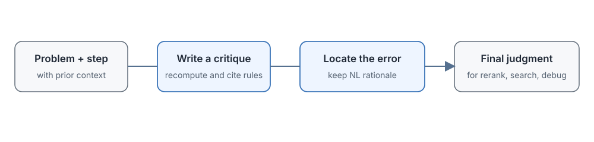

# 17.3 Generative PRM

When the discriminative PRM from the previous section meets the step-six error that drops a square, it outputs only `bad: 0.96`. That score works fine for ranking, but for training a model it explains nothing. Was the square lost? Was a premise misused? Or was an earlier step already wrong, with the error only showing up here?

The problem becomes more obvious when we move to a new domain. Take a PRM trained on math and use it to judge code: it gives some line a low score, but we cannot tell whether it truly spotted a bug or whether the code style simply differs from the training data. Fixed good/bad/neutral labels do not reveal what knowledge the evaluator is missing.

The **generative PRM** takes a different approach. Instead of letting the evaluator output a single score, it makes the evaluator write out its checking process first: "This step tries to divide both sides by 2, which should give $2k^2=q^2$, but it is written as $4k=q^2$, so the equation does not hold." Only then does it give an explicit verdict. The evaluator is itself a generative model: it writes a natural-language check and ends with a conclusion that can be extracted.

What does this cost? Why does it need only about 1% of the process labels? Is generating an explanation too slow? Using ThinkPRM as the example, this section looks at how natural-language evaluation works, why a small number of labels is enough, how verification compute can be scaled, and when to use it and when to stay with the discriminative PRM.



## How to Generate Natural-Language Evaluations

The task of a generative PRM is the same as that of a discriminative PRM: read the problem, read the preceding reasoning, read the current step, and decide whether the step holds. Only the output side changes: the three-class probabilities are replaced by text consisting of "checking evidence plus a final label."

### How Discriminative and Generative Outputs Differ

Let's put the two outputs side by side.

**Discriminative PRM** (for example, OpenAI's PRM800K):

```text
Input: problem + reasoning prefix up to step i
Output: good / bad / neutral (three probabilities)
```

The model is a language model that can read long prefixes, with a classification head or scoring head added at the end to output three numbers.

**Generative PRM** (for example, ThinkPRM):

```text
Input: problem + reasoning prefix up to step i + "Please evaluate this step"
Output: a natural-language check + a final judgment
```

The model is a standard decoder-only LLM, and its output is text.

Take the step-six error of the $\sqrt{2}$ proof again and compare the two outputs:

```text
Discriminative output:
bad: 0.96

Generative output:
This step tries to divide both sides of 4k^2 = 2q^2 by 2, which should give 2k^2 = q^2;
writing 4k = q^2 amounts to taking a square root of only the k^2 on the left, with no
corresponding transformation on the right, so the equation no longer holds.
Judgment: INCORRECT
```

The former goes straight into a ranking pipeline and returns in a few milliseconds. The latter hands over both the location and the cause of the error, but we have to wait until it finishes generating the whole explanation.

### How Generative Evaluation Reuses Existing Capabilities

A generative PRM has two advantages, and they are also why it can be trained with fewer labels.

**First, it directly reuses the LLM's pretrained knowledge.**

A discriminative PRM needs a classification head trained from scratch, and it needs a large number of step labels to calibrate the boundaries between good, bad, and neutral: what counts as right, what counts as wrong, and what counts as neutral all have to be supplied by labels. A generative PRM starts from a language model that has already been pretrained. That model can already do math, read code, and follow basic logic, so fine-tuning mainly teaches it to check steps in a uniform format and to state a conclusion at the end. Most of its knowledge comes from pretraining and not from the fine-tuning data.

**Second, natural language preserves the grounds for the judgment.**

A discriminative PRM outputs good/bad/neutral. Ranking is fast, but it does not say why it gave that score. A generative PRM states what rule it applied, what values it substituted, and where exactly the error occurred, so the trainer can check directly whether its reasons are right.

For example, it might output this evaluation: "This step tries to factor, but writes `x² - 1` as `(x-1)(x-2)`. The correct expansion is `(x-1)(x+1)`, so the current step is wrong." Reading this, one can tell whether it truly understands factoring or is producing a plausible-looking wrong explanation. The explanation itself may also be wrong. But at least it can be checked, and we do not have to guess the cause from a score of 0.96.

### How ThinkPRM Builds Its Training Data

[ThinkPRM](https://arxiv.org/abs/2504.16828) (April 2025) is the representative work on generative PRMs. Its starting point is still the problems, solution prefixes, and human step labels of PRM800K, but the labels now serve a different purpose. They are no longer used to train a classification head directly. They are used to filter the checking processes that a language model generates itself.

#### What a Step-by-Step Evaluation Looks Like

Training samples require the model to verify the grounds of each step in turn and finally give a correct/incorrect judgment that can be extracted. Here is a concrete example:

```text
Prompt: Evaluate step 3 of the following reasoning:
Problem: Solve the equation x² - 5x + 6 = 0
Reasoning:
  Step 1: This is a quadratic equation, so we can use the quadratic formula
  Step 2: The quadratic formula: x = (-b ± √(b²-4ac)) / 2a
  Step 3: Substitute a=1, b=-5, c=6, x = (5 ± √(25-24)) / 2 = (5 ± 1) / 2
  Step 4: x = 3 or x = 2
Please evaluate Step 3.

ThinkPRM output:
Let me check Step 3:
- a=1, b=-5, c=6. Checking: the original equation is indeed x²-5x+6, correct ✓
- The quadratic formula is x = (-b ± √(b²-4ac))/2a ✓
- Substituting the values: x = (5 ± √((-5)² - 4·1·6)) / (2·1)
       = (5 ± √(25 - 24)) / 2
       = (5 ± √1) / 2
       = (5 ± 1) / 2 ✓
The substitution and calculation in Step 3 are both correct.
Judgment: CORRECT
```

Note the three-part structure of this output. It first rereads the conditions of the problem to confirm nothing was misread, then recomputes the key quantity (here the discriminant $25-24=1$), and finally gives the conclusion. The checking process in the middle is itself evidence meant for human readers, while the final line "Judgment: CORRECT" is the interface left for programs to extract, and a simple regular expression is enough to pull out the result.

#### The Key Technique: Generate, Then Filter, Then Fine-Tune

ThinkPRM builds its data in three steps, and this is the core of how it saves labels:

1. **Generate candidates**: use a strong reasoning model such as QwQ-32B-Preview to generate several verification chains for each solution prefix in PRM800K.
2. **Filter**: keep only samples whose format can be parsed, whose step-by-step judgments agree with the human labels in PRM800K, and whose length does not exceed the limit.
3. **Fine-tune**: use the filtered high-quality verification texts to fine-tune reasoning models such as R1-Distill-Qwen and QwQ.

The fine-tuning objective in the third step is standard next-token prediction. Let the filtered verification text be $y=(y_1,\dots,y_m)$. The loss is

$$
\mathcal{L} = -\sum_{t=1}^{m} \log p_\theta(y_t \mid q,\, o_{\le i},\, y_{<t}),
$$

where $q$ is the problem and $o_{\le i}$ is the reasoning prefix being checked. The sum runs only over the tokens of the verification text, and the problem and prefix in the input are excluded from the loss. Compare this with the discriminative loss of 17.2. The discriminative model trains a probability distribution over three classes, whereas the generative model trains the generation of a whole piece of checking text. The ability to check comes from the pretrained weights, and fine-tuning only fixes the format of the check and the position of the conclusion.

In the end the paper used only about 1,000 verification samples, containing about 8,000 step judgments. Note, however, that to get these 1,000 usable samples the system first generated about 5,000 candidates and then filtered them with the human labels of PRM800K. What is saved here is the **number of process labels used for fine-tuning**. High-quality step labels are not entirely unnecessary. Without human labels one can also estimate silver labels from rollout outcomes for the filtering, but noise comes along with them.

So "about 1% of the labels" has to be understood correctly: it is a trade. The human labels do not disappear. Their role changes from "directly train a classification head" to "guard the quality of the generated evaluations." The number of labels used as guards is smaller, but the quality requirement is higher: if one wrong evaluation slips through the filter, it enters the fine-tuning data as a correct sample.

::: details Step-by-step vs. whole-trajectory evaluation
There are two options at deployment:

- **Step-by-step evaluation**: evaluate one step at a time, and generate the next step only after the evaluation. The advantage is that attention stays on a single well-bounded action, which makes it easy to locate the first error. The drawback is that the model is called once per step, so the number of calls is large.
- **Whole-trajectory evaluation**: hand the model the complete reasoning at once and let it output the judgment for each step in turn. The advantage is that the context is read only once, so throughput is high. The drawback is that on a long trajectory it may miss small errors in the middle.

In practice the two can be combined: first use whole-trajectory evaluation to quickly discard trajectories with clearly low scores, then run a fine-grained step-by-step review at the positions suspected of error. When choosing, do not compare only the speed of a single call. Look at first-error localization rate, average tokens per trajectory, and total latency together.
:::

## How Labels and Verification Compute Affect Results

A generative PRM reduces the step labels needed for fine-tuning but increases the generation cost of every evaluation. The paper examines from three angles whether this trade is worthwhile.

### Can a Small Number of Process Labels Train an Effective Evaluator?

ThinkPRM used only about 8,000 process labels, roughly 1% of the 712,000 labels used by the discriminative baseline in the paper. Under the given experimental settings on ProcessBench, MATH-500, and AIME 2024, it outperformed the discriminative baseline on the same base model on step verification, Best-of-N ranking, and verifier-guided search, and it also outperformed an LLM-as-a-Judge used without fine-tuning.

This conclusion has two preconditions, though. First, the base model must already have strong reasoning ability. Second, human labels must have been used to filter the generated evaluations to high quality. If the base model's reasoning is weak, or the filtering labels are of poor quality, 1% of the data may simply not be enough.

### Does Math Training Transfer to Science and Code?

The paper also tested domain transfer on subsets of GPQA-Diamond (science problems) and LiveCodeBench (coding problems). Relative to a discriminative verifier trained on the full PRM800K, ThinkPRM scored 8 and 4.5 percentage points higher, respectively. This result supports the view that generative evaluation can reuse the base model's knowledge better, but the evaluation covers only subsets of the data. When it is applied to a new codebase or a new scientific field, recalibration is still needed.

### The Verifier Can Also Use More Inference Compute

This agrees with the pattern from Section 16.3: a generative verifier can also improve by spending more compute, mainly along two routes:

- **Parallel**: sample several verification chains at the same time and aggregate their judgments at the end.
- **Sequential**: let a single checking process continue to review and correct itself.

The paper compared the two under the same token budget. The overall gap was small, with the parallel route slightly better at some budgets. On a ProcessBench subset, ThinkPRM scored 7.2 percentage points higher than the un-fine-tuned LLM-as-a-Judge.

Keep in mind that more verification compute helps only when the evaluator can actually produce complementary checking paths. If the model itself lacks knowledge of some domain, generating 100 checks may repeat the same wrong judgment in different words.

## When to Choose a Discriminative or Generative PRM

The results above show that generative evaluation can improve label efficiency, but it cannot replace a classifier in every setting. When RL training must evaluate tens or hundreds of thousands of steps per second, having the model generate an explanation for every step may be unacceptably slow. For debugging or for teaching feedback, on the other hand, an isolated score is nowhere near enough.

A comparison of the two kinds of PRM:

- **Output**
  - Discriminative PRM: step class or probability
  - Generative PRM: checking text + extractable judgment
- **Speed of a single evaluation**
  - Discriminative PRM: one forward pass, high throughput
  - Generative PRM: requires autoregressive generation, high latency
- **Data requirements**
  - Discriminative PRM: needs enough labels to calibrate the class boundaries
  - Generative PRM: still needs labels to filter generated evaluations, but few fine-tuning samples
- **Domain transfer**
  - Discriminative PRM: depends on training data coverage and the base model
  - Generative PRM: can call on the base model's textual knowledge, but may also generate fluent wrong explanations
- **Adding verification compute**
  - Discriminative PRM: model ensembles, multi-model voting
  - Generative PRM: longer generation, more review rounds, more parallel samples
- **Inspectability**
  - Discriminative PRM: only scores and error samples to look at
  - Generative PRM: the grounds for the judgment can be read directly, though they are not necessarily faithful or correct

### How Task Scale and Inference Cost Affect the Choice

- **Large-scale RL training**: millions of steps must be evaluated per round, so a discriminative model with higher throughput is usually preferred.
- **Online reranking**: with up to 64 candidates, the latency of a generative PRM is usually still acceptable, depending on the specific latency budget.
- **Debugging failure cases**: when analyzing why a model fails on some 10 problems, a discriminative PRM can only give a set of scores, while a generative PRM can explain one by one where it thinks the error is, which is clearly more valuable.

An important caveat here: **a small data budget does not mean a small inference budget**. A generative PRM may save annotation fees, but every call generates hundreds or thousands of tokens, so inference cost can be an order of magnitude higher. Here is an illustrative cost comparison (the numbers are order-of-magnitude illustrations):

- **RL training, a million steps per round**
  - Discriminative (one forward pass): a million forward passes, batchable
  - Generative (autoregressive check): a million generations, an order of magnitude more costly
- **Online reranking with 64 candidates**
  - Discriminative (one forward pass): entirely acceptable
  - Generative (autoregressive check): depends on the latency budget
- **Debugging 10 failure cases**
  - Discriminative (one forward pass): only scores are visible
  - Generative (autoregressive check): gives the cause of the error case by case

### Mixing the Two Kinds of PRM

Without public training details, one cannot infer from a product's outputs whether it uses a generative PRM internally. From public methods, at least three combinations are feasible:

1. **PRM and ORM mixed**: the PRM judges the process and the ORM judges the outcome, combined by a weighted sum, as discussed in the previous section.
2. **Generative plus discriminative**: use a generative PRM to produce high-quality evaluations with explanations, then distill those evaluations into a small discriminative PRM. The discriminative model handles large-scale training, and the generative one is used when an explanation is needed.
3. **Self-PRM**: let the model evaluate its own reasoning, in the same spirit as [Self-Rewarding Language Models](https://arxiv.org/abs/2401.10020).

::: details Is a process reward always necessary?
Even if a verifier can explain itself step by step, we should first ask: do we really need to train a PRM?

When the answer is easy to verify automatically and the model can be sampled many times, an outcome reward may indirectly reinforce self-checking behavior as well. [DeepSeek-R1](https://arxiv.org/abs/2501.12948) is a good point of comparison. R1-Zero mainly used an outcome-correctness reward and a format reward (that is, an ORM), and after training it was still observed to show behaviors such as self-checking and revising answers. The reason is that the outcome reward raises the probability of trajectories that end in the right answer, and if trajectories with self-checks really are more likely to be right, such behavior is reinforced indirectly.

When choosing a reward type, one can reason as follows:

- Answers are easy to verify automatically and the sampling budget is ample: an outcome reward may be enough.
- Intermediate errors in long trajectories are hard to locate and the training budget is limited: a PRM can point out the error location earlier.
- Cross-domain use: evaluate separately whether the PRM really covers the new domain.

A PRM is an effective way to locate intermediate errors, but it is not the only route to self-checking behavior.
:::

## Section Summary

ThinkPRM shows how natural-language evaluation can reduce step-by-step human annotation while keeping the grounds of each judgment available for the trainer to inspect. It is not free, though. It only moves the cost from the annotation side to the inference side.

- **Output structure**: a generative evaluation is a step-by-step natural-language check plus an extractable judgment token. The former is for humans to read and verify, and the latter is for programs to use in ranking.
- **Data construction logic**: the role of human labels changes from "directly train a classification head" to "gatekeeper that filters generated evaluations." What "about 1% of the labels" buys is a change in what the labels are used for: fewer of them, with a higher quality requirement on the filtering.
- **Verification compute is scalable**: sampling several verification chains in parallel and sequential review can both improve results, provided the evaluator can produce complementary checking paths. If several checks keep repeating the same error, more compute brings no gain.
- **Selection criteria**: the discriminative PRM wins on throughput and cost and suits large-scale training; the generative PRM wins on inspectability and label efficiency and suits debugging and teaching. The two can be combined through distillation.

The reliability of a generative PRM is still limited by the evaluator's own ability, however. When the evaluator is unfamiliar with a domain, it can easily write an explanation that looks complete and sensible but is actually wrong. Is there an evaluator without this problem, where right is right and wrong is wrong? The next section turns to the formal verifier: hand the steps that can be formalized to an external proof checker such as Lean4, and replace the model's probabilistic judgment with deterministic rule checking.
