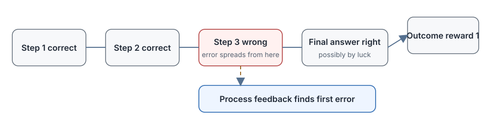

# 17.1 Outcome Rewards and Process Rewards

In Chapter 16 we taught the model to think at length and to adjust the length of its thinking to the difficulty of the problem. But as soon as trajectories get longer, a problem appears in training. Let's illustrate it again with the proof that $\sqrt{2}$ is irrational.

Imagine the model writes a nine-step proof. The first five steps are correct. In step six an algebraic transformation drops a square (it writes $4k^2=2q^2$ as $4k=q^2$), yet the later steps happen to circle back to the correct conclusion. The final answer, "$\sqrt{2}$ is irrational," is right, but one step in the middle is wrong.

If we look only at the final result and give 1 point whenever the answer is right, what happens in training? The error in step six is reinforced together with the five correct steps before it and the coincidence after it. The next time, the model may well make the same mistake. It simply got lucky this time and the result was unaffected. When it is unlucky, it ends up with a wrong answer.

The problem is even more pronounced in code and agent tasks. A program may fail its tests because the very first line read the wrong file, or merely because the last line is missing a semicolon. When ten tool calls fail to complete a task, did the first nine have any value? A single 0 at the end cannot answer that.

The reward appears only at the end of the sequence, and the intermediate actions get no direct feedback. This is the classic **sparse reward problem** in reinforcement learning, and it is also the credit assignment problem. The **process reward model** (PRM) exists to solve it: move the evaluation from the end to every intermediate step, so that the system can locate "where the error first appears."

[Let's Verify Step by Step](https://arxiv.org/abs/2305.20050) systematically compared outcome supervision with process supervision and released the PRM800K step-label dataset. The paper's conclusions come from the MATH dataset and from a specific setup of candidate generation and reranking. This section first derives the two kinds of reward from the credit assignment problem, and then returns to that experiment's specific data and metrics in Section 17.2.

This section answers three questions: why looking only at the final result is not enough, how a process reward is defined mathematically, and, given that we already have an outcome reward, when it is worth paying the extra cost of labeling steps and training a PRM.



## Why the Final Reward Is Not Enough

### First Distinguish "Getting the Answer Right" from "Reasoning Correctly"

An outcome reward evaluates only the final answer: 1 point for a correct answer and 0 for a wrong one. It is cheap, stable, and easy to implement: a math answer can be substituted back into the original equation, code can be run against unit tests, and a game can be judged by its final win or loss.

A process reward evaluates the solving process: it looks not only at whether the final answer is right but also at whether each intermediate derivation is right. It can say "this step is correct, continue," or "from this step on, it goes wrong."

The two address different questions:

- The outcome reward judges: **Is the whole thing done?**
- The process reward judges: **Having come this far, are we still heading in the right direction?**

Short answers (one-sentence question answering, simple classification) usually need only the former. The longer the trajectory and the more expensive error propagation is, the more valuable the latter becomes.

### A Complete Example of a Faulty Trajectory

Let's write out the faulty proof from above in full:

```text
Step 1: Suppose √2 = p/q, where p and q are coprime (no common factor)
Step 2: Squaring both sides gives 2 = p²/q², that is, p² = 2q²
Step 3: So p² is even
Step 4: So p is even (since the square of an even number is even and the square of an odd number is odd)
Step 5: Let p = 2k (k is an integer)
Step 6: Substituting gives 4k² = 2q² [the error is here], written as 4k = q² (the square on k² is dropped)
Step 7: So q² is even, and q is even too
Step 8: p and q are both even, contradicting "p and q are coprime"
Step 9: So √2 is irrational  ✓ (the conclusion is correct)
```

The final answer is right, but Step 6 contains a clear algebraic error. If the outcome verifier checks only the final conclusion, that is, whether the statement "$\sqrt{2}$ is irrational" is true, the whole response receives $r=1$. What happens in training?

- The correct definitions and manipulations of Steps 1 to 5: they receive positive reinforcement together with the faulty step.
- The erroneous transformation in Step 6: it is not only unpunished but is reinforced along with everything else because "the final answer was right."
- Steps 7 and 8, which continue deriving from the faulty premise: they also receive positive reinforcement.

The model does not know that Step 6 should be suppressed, and it cannot tell that the correct definitions earlier on should be kept. Next time it may well make the same dropped-square mistake. When the conclusion happens to be right, it does not know why; when the conclusion is wrong, it does not know which step failed.

This is the **attribution difficulty of sparse rewards**: a long trajectory receives a single score at the end, and when the outcome happens to be correct, the erroneous intermediate steps are reinforced along with the rest. A process reward supplies exactly the missing information: where the error first appears.

### From One Terminal Score to Step-by-Step Feedback

In reinforcement learning this problem has a formal name: the **credit assignment problem**. Given a sequential decision task whose final reward is $r_T$, how do we assign the credit (or blame) back to each earlier action $a_1, a_2, \ldots, a_T$? Which actions contributed to success, and which introduced errors?

Classical reinforcement learning already has several tools that try to address this. Let's look at each in turn to see why it falls short.

## How to Assign Reward to Intermediate Steps

### Discounted Return

The most classical method is the discounted return, which discounts future rewards and passes them back to the present:

$$G_t = r_t + \gamma r_{t+1} + \gamma^2 r_{t+2} + \ldots + \gamma^{T-t} r_T$$

where:

- $G_t$ is the discounted return starting at step $t$.
- $\gamma \in [0,1]$ is the discount factor, usually 0.9 or 0.99.
- If only the terminal reward $r_T=1$ exists, the return at step $t$ is $\gamma^{T-t}$, and the farther a step is from the end, the smaller its weight.

Plug in the nine-step proof, take $\gamma=0.9$, and let only the last step carry $r_9=1$:

- **Step 1 (suppose $\sqrt{2}=p/q$)**
  - Steps from the end: 8
  - Return weight $\gamma^{T-t}$: $0.9^8 \approx 0.43$
- **Step 5 (let $p=2k$)**
  - Steps from the end: 4
  - Return weight $\gamma^{T-t}$: $0.9^4 \approx 0.66$
- **Step 6 (where the error is)**
  - Steps from the end: 3
  - Return weight $\gamma^{T-t}$: $0.9^3 \approx 0.73$
- **Step 8 (the contradiction is reached)**
  - Steps from the end: 1
  - Return weight $\gamma^{T-t}$: $0.9^1 \approx 0.90$

The first step of a proof by contradiction, "suppose $\sqrt{2}=p/q$ with $p,q$ coprime," is the foundation of the whole proof, and every later derivation depends on it. Yet under the discounted return the first step gets a weight of only 0.43, while the steps nearer the conclusion get higher weight whether they are right or wrong.

The discounted return carries an implicit assumption: **the closer an action is to the end, the more responsible it is for the outcome**. This is reasonable in control tasks (cart-pole, robot walking), where earlier actions really do have a smaller influence on the current state. In tasks such as proofs, code, and planning, the structure is just the opposite: early definitions, choices, and architecture determine everything that follows, so their responsibility is heavier, not lighter.

### GAE

GAE was introduced in Chapter 8 on PPO. It first computes the TD residual of each step, and then uses $\lambda$ to mix the residuals over different horizons with weights:

$$
\delta_t = r_t + \gamma V(s_{t+1}) - V(s_t), \qquad A_t^{\text{GAE}} = \sum_{l=0}^{T-t-1} (\gamma\lambda)^{l}\, \delta_{t+l}.
$$

Here $V(s_t)$ is the Critic's estimate of the state value, $\delta_t$ measures whether the actual reward is more or less than expected, and $\lambda \in [0,1]$ controls the trade-off between bias and variance: the closer $\lambda$ is to 1, the closer the advantage is to the full discounted return, and the closer it is to 0, the more it relies on the Critic's one-step estimate.

Plug the nine-step proof into this expression: $r_1$ through $r_8$ are all 0, and the only reward is $r_9=1$. Whatever $\lambda$ is, all the information in the whole $\delta$ sequence comes from that single score at the end, and GAE only spreads this score back over the earlier steps more smoothly. It answers "how can the reward be passed backward more stably," not "is each step itself right?"

GRPO (Chapter 15) even drops the Critic and constructs advantages from within-group relative comparison, so it needs a separate step judgment even less.

### Token-Level Loss

Methods such as DAPO compute the loss at the level of each token, so that each token receives a different gradient weight. Note, however, that the supervision signal still comes from the outcome reward of the whole response. It only distributes the gradient of that terminal score more finely over tokens, and there is no independent judgment saying "this step itself is right or wrong."

### PRM

The three tools of discounted return, GAE, and token-level loss **all start from the same terminal score and try to pass it backward**. A PRM is different. It trains an independent evaluator that directly judges whether each step itself is correct, introducing a brand-new, independent source of feedback.

The four tools can be told apart by level:

- Discounted return and GAE answer "how is the terminal score passed backward?"
- Token-level loss answers "how is the gradient distributed over tokens?"
- PRM answers "is this step itself right?" (a newly added, independent judgment)

Back to the nine-step proof: an ORM gives the whole response $r=1$, while a PRM gives a low score (error) at Step 6 and high scores (correct) at Steps 1 to 5. The tokens of Step 6 receive a negative gradient, and the correct prefix no longer gets punished along with it. This is how a process reward resolves the attribution difficulty.

## Formal Definitions of Outcome Reward and Process Reward

### Outcome Reward Model

An ORM takes a problem $q$ and a complete response $o$ and outputs a scalar score:

$$\text{ORM}(q, o) \in \mathbb{R}$$

In math tasks this score can be very simple: 1 for a correct answer and 0 for a wrong one. In open-ended tasks it can also be the continuous score output by a reward model (a quality score between 0 and 1). Whatever the form, **the whole response has just one outcome score**.

The training data format of an ORM:

```text
(prompt, complete_response, final_correctness_score)
```

Example: ("Prove that $\sqrt{2}$ is irrational", "\<the complete nine-step proof\>", 1)

### Process Reward Model

A PRM takes a problem $q$, a response $o$, and a step position $i$ in the response, and outputs the score of that step:

$$\text{PRM}(q, o, i) \in \mathbb{R}$$

For the same problem and the same response, different step positions $i$ get different scores. This is precisely why it can locate errors. In math tasks, the output of a PRM can be:

- Discrete labels: +1 (correct, can continue), 0 (neutral, no effect), -1 (incorrect, should stop)
- Continuous probability: the probability in $[0,1]$ that "this step is correct"

The training data format of a PRM:

```text
(prompt, response_prefix_up_to_step_i, step_i_correctness)
```

Example: ("Prove that $\sqrt{2}$ is irrational", "\<the first six steps of the proof\>", 0). Step 6 is wrong.

One key difference: an ORM produces one label per solution, whereas a PRM must produce a label for **every step** of a solution, so the annotation workload is multiplied by the number of steps. This is a cost we will return to repeatedly.

### How the Two Rewards Enter RL Training

Using an ORM in RL training is straightforward: the whole sequence shares one reward.

$$r_{\text{ORM}} = \text{ORM}(q, o)$$

One common way to use a PRM in RL training is for each token to receive the score of the step it belongs to:

$$r_t = \text{PRM}(q, o, \text{step}(t))$$

For example, if a reasoning step contains 20 tokens, all 20 tokens receive that step's PRM score.

There is an implementation detail to note here. If a step contains multiple tokens, we must decide whether these tokens share the step score, or whether only the last token of the step receives the score and GAE then passes it backward, or whether some other scheme is used. A PRM gives a step-level score, and it does not automatically tell the system that "every token in this step is 100% correct." How the score is allocated to tokens is a choice made by the training algorithm itself.

## When Do We Need a Process Reward?

A PRM has costs: step data must be labeled, an extra evaluator must be trained, and it must be called at inference time as well. Yet DeepSeek-R1-Zero, relying mainly on rule-based correctness rewards and format rewards (that is, an ORM), also developed long reasoning and self-checking abilities. This shows that an outcome reward is sufficient under some conditions.

When is it worth paying the cost of a PRM? We can check three conditions in turn.

### Can Steps Be Segmented Reliably?

A PRM needs a definition of "what counts as a step." If the task can be split naturally into independent judgment units with clear meaning:

- Math proofs: one equation transformation, one lemma application
- Code: one successful compilation, one passing test, one function modification
- Agents: one tool call, one search query

then the step boundaries are clear, annotators know what to label, and the PRM knows what to evaluate.

Conversely, if the task cannot be cut into stable steps, as with writing a poem or open-ended creative writing, then "is this step good?" is itself a subjective judgment, forcing a segmentation is meaningless, and a PRM is not a good fit.

### Do Errors Propagate Forward?

If an intermediate step is wrong, all generation after it wastes compute. If the first line of code reads the wrong file, all the logic written afterward is futile. If the first assumption of a proof is wrong, however elegant the later derivation, it is useless. In such settings, the earlier the error is found and fed back, the more compute is saved, and the more valuable a PRM is.

Conversely, if the task is very short (within a few hundred tokens), the error is close to the end, and resampling is cheap, as in simple question answering, then an ORM plus multiple samples is enough, and the gain from a PRM may not offset its cost.

### Is the Evaluator Reliable Enough?

This is the condition that is easiest to overlook and the most critical. A PRM is trained to correct the generative model, so the evaluator must be more reliable than the generator at judging whether a step is right. Otherwise the correction signal is itself noise.

Situations in which the evaluator is more reliable:

- Math and code have formal rules or executable verification, which the evaluator can exploit.
- The annotators are experts in the field and more reliable than the generator's average level.
- A stronger model can be used to score the steps of a weaker model.

Conversely, if even human experts disagree about whether a step is right, or if the model used to train the PRM is on a par with the generator, the PRM may not only fail to help but also pass its own errors and biases on to the generator.

Only when all three conditions hold can a PRM possibly offset the costs of data annotation, model inference, and misjudgment. A comparison across different task situations:

- **Short answers within a few hundred tokens**
  - What happens with an ORM alone: the error is near the end and resampling is cheap
  - Value a PRM might add: usually limited
- **Proofs or programs with multi-step transformations**
  - What happens with an ORM alone: when the final result fails, we do not know which steps to keep and which to change
  - Value a PRM might add: locate the first error, keep the correct prefix, and avoid starting over
- **Tool-call trajectories of thousands of tokens**
  - What happens with an ORM alone: an early error triggers a chain of useless tool calls, wasting a lot of time and money
  - Value a PRM might add: stop early, back up to a correct node, and take another route

The token counts here only illustrate task scale and are not fixed thresholds. The judgment still comes back to the same three conditions: can steps be segmented? Do errors propagate? Is the evaluator reliable?

## How Three Kinds of PRM Provide Step Feedback

Once we have decided that intermediate feedback is needed, we still have to choose where the feedback comes from. This is exactly what the next three sections of this chapter develop. The three common PRM routes are:

### Discriminative PRM

Treat the PRM as a classifier: the input is the problem plus the reasoning prefix up to the current step, and the output is the probability that the step is good, bad, or neutral. The representative work is OpenAI's Let's Verify Step by Step and the PRM800K dataset. Its advantages are speed and suitability for large-scale training. Its drawbacks are that it needs a large amount of step annotation and that giving only a score does not explain why.

### Generative PRM

Let a large model first generate a natural-language check ("This step tries to divide both sides by 2, which should give $2k^2=q^2$, but it is written as $k$"), and give a judgment at the end. The representative work is ThinkPRM. Its advantages are that it can say where the error is and needs less human annotation (it reuses the base model's knowledge). Its drawbacks are that the evaluation itself must generate tokens and is slower, and that the evaluation can also be wrong.

### Formal Verifier

Translate the reasoning steps into a formal language such as Lean4 or Coq and hand them to a proof checker that verifies them automatically under formal rules: passing means right and failing means wrong, so the feedback is deterministic. The representative works are DeepMind's AlphaProof and DeepSeek-Prover-V2. Its advantages are deterministic feedback (within the formal system) and no annotation noise. Its drawbacks are that it covers only tasks that can be formalized (mainly math), and that translating natural language into a formal language is itself a hard problem.

## Section Summary

The outcome reward judges whether the task was finally completed, and the process reward judges whether we are still heading in the right direction at each step. In long-trajectory reasoning, the latter solves an attribution problem that the former cannot handle.

- **Attribution difficulty of sparse rewards**: when a long trajectory has a score only at the end, a lucky correct answer reinforces correct and erroneous steps alike. In the $\sqrt{2}$ proof example, the dropped-square error in Step 6 is entirely hidden by the terminal $r=1$.
- **Limits of the classical tools**: the discounted return decays responsibility with distance (the first step of the proof by contradiction gets only a weight of 0.43, and steps nearer the conclusion get higher weight), and GAE and token-level loss still start from the same terminal score. Only a PRM introduces an independent source of step-level judgment.
- **Mathematical form**: $\text{ORM}(q,o)$ gives the whole response one score, and $\text{PRM}(q,o,i)$ gives step $i$ one score. In RL, each token receives the PRM score of the step it belongs to.
- **A PRM is not a cure-all**: three conditions must hold together for it to be worth building: steps can be segmented reliably, errors propagate, and the evaluator is more reliable than the generator. For short tasks and results that are easy to verify, an ORM plus sampling is enough, as DeepSeek-R1-Zero has already shown.
- **Each of the three PRM routes has its trade-offs**: the discriminative one is fast but needs annotation, the generative one can explain but is slower, and the formal one is the most deterministic but covers only formalizable domains.

The next three sections develop these three kinds of process feedback in turn: 17.2 covers the annotation and training of discriminative PRMs, 17.3 covers how generative PRMs evaluate in natural language, and 17.4 covers how formal verification provides deterministic feedback. Sections 17.5 and 17.6 then put these evaluators back into the generation process, to see how they are used for search and answer aggregation.
