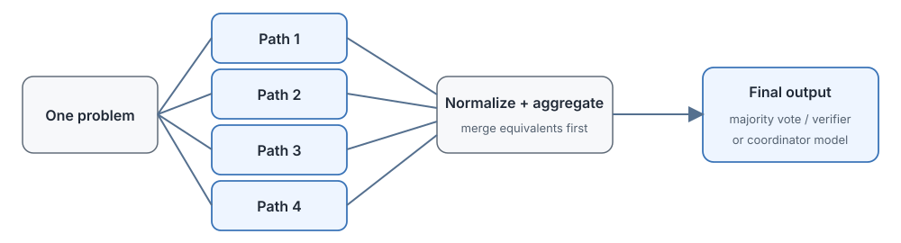

# 17.6 Parallel Reasoning and Answer Aggregation

The inference-time search in the previous section is sequential: generate one step, wait for the PRM to score it, then decide which path to expand next, and every step waits for the result of the one before. With several GPUs and plenty of compute, there is no need to wait step by step like this.

Let's use the quadratic equation example again. Suppose 4 GPUs can run at the same time. Rather than have one GPU do "generate, score, expand" sequentially on a search tree, we can put all 4 to work at once: the first uses factoring, the second the quadratic formula, the third tries completing the square, and the fourth starts from the geometric meaning. The four complete chains of reasoning finish together, and only then do we compare which result is right and which derivation is clear.

This is the idea of **parallel reasoning**: do not rush to make decisions midway, let several paths run to the end first, then aggregate and choose. The simplest way to aggregate is **majority voting**: three answers are $-2$ and $-3$, one answer is $3$ and $-2$, so the majority vote is $-2$ and $-3$. We can also be more refined: have a coordinator model read all four chains of reasoning, see which path got the right answer but made a mistake in the middle, which path explains things more clearly, and even combine the strengths of different paths into a better answer.

This section first compares what tasks suit sequential depth and parallel breadth. It then uses PaCoRe to see how a coordinator reads multiple paths and exchanges information, extends the idea of "letting the model generate the evaluation" to GenRM and LLM-as-Judge, and finally strings the verifiers and reasoning strategies of the whole chapter into an actionable decision line.



## How Reasoning Compute Is Allocated Between Depth and Breadth

Suppose the total token budget is fixed, say we are willing to spend 10,000 tokens on a problem. There are two ways to spend it: let one path think for a long time (depth), or generate several shorter paths (breadth). The former keeps a continuous thinking state, and the latter increases the diversity of solution methods. Three questions together decide which to choose: does the task have several feasible solutions, can the paths be executed in parallel, and is there a reliable aggregator at the end?

[Chapter 16 Test-time Compute Scaling](../chapter16_reasoning/test-time-scaling) already discussed these two ways of spending compute, and here we compare them systematically:

- **Sequential depth**: have the model generate one very long CoT, checking, revising, and backtracking repeatedly.
- **Parallel breadth**: have the model generate several independent CoTs and aggregate the results in some way at the end.

- **Sequential depth**
  - Representatives: long reasoning, sequential revision, tree search
  - Compute allocation: one path keeps its state continuously
  - Suitable tasks: proofs where each step depends on the previous one, code debugging and tool-calling tasks
  - Main cost: more rounds accumulate wall-clock latency (no parallelism), and early errors propagate
- **Parallel breadth**
  - Representatives: Best-of-N, Self-Consistency
  - Compute allocation: several paths are generated independently
  - Suitable tasks: tasks with several independent solutions whose results are easy to compare
  - Main cost: total compute grows linearly with the number of paths, and a reliable aggregator is needed

One practical benefit of parallel breadth: when the hardware is sufficient, several paths can run at the same time, and wall-clock latency does not grow linearly with the number of steps as in sequential search. But it does not reduce the total compute, and the tokens still have to be spent. If resources are short, the paths can only queue, and the speed advantage of parallelism disappears.

### Engineering Details of Majority Voting

On the subject of majority voting, there is an engineering issue that is easy to overlook. Suppose the final answers of five paths are:

```text
x = -3,  x = -2,  x = -3.0,  x = 3,  x = -3
```

If we count with exact string matching, $-3$ and $-3.0$ are treated as two different answers, and the tally gets muddled. So the first step before voting is always **answer normalization**: unify formats, reduce fractions, and sort solution sets, for example by putting everything into lowest-terms fractions and sorting solution sets from small to large. After normalization, $-3$ appears 4 times and the majority vote is clear. But problems of semantic equivalence (such as $\frac{1}{2}$ and $0.5$, or $(x-2)(x-3)$ and $x^2-5x+6$) cannot be solved by rules alone and need semantic judgment. This is exactly where a trained coordinator tries to go beyond simple counting.

There is a classic quantitative result on when majority voting is reliable. Let each path independently reach the correct answer with probability $p$. The number of correct paths among $N$ follows a binomial distribution, and the probability that the majority vote is correct is

$$
P(\text{majority correct}) = \sum_{k > N/2} \binom{N}{k}\, p^{k}\,(1-p)^{N-k}.
$$

As long as $p > 0.5$, this probability rises with $N$: taking $p=0.6$, the majority is correct with probability about 0.68 at $N=5$, rising to about 0.75 at $N=11$. But this derivation makes two strong assumptions: the errors of different paths are independent, and the correct answer is unique and can be merged. Systematic errors break both at once. When all paths make the same mistake at the same place, the wrong answer actually gets a unanimous vote, and no larger $N$ can rescue it. This is why the gain from voting on hard problems is often far smaller than this formula predicts.

::: details Supplement: how 0.68 is computed

Take $p=0.6$ and $N=5$. A correct majority means at least 3 of the 5 are right. Expanding term by term by the binomial distribution:

$$
P = \binom{5}{3} 0.6^3\, 0.4^2 + \binom{5}{4} 0.6^4\, 0.4 + \binom{5}{5} 0.6^5.
$$

What the three factors mean: $\binom{5}{3}=10$ is the binomial coefficient, the number of ways to choose which 3 of the 5 paths are right; $0.6^3$ is the probability that those 3 are each right; $0.4^2$ is the probability that the other 2 are each wrong. Plugging in:

$$
P = 10 \times 0.216 \times 0.16 + 5 \times 0.1296 \times 0.4 + 0.078 \approx 0.346 + 0.259 + 0.078 = 0.683.
$$

For a model with a single-attempt accuracy of 0.6, voting over 5 paths raises the accuracy to about 0.68, a gain of less than 9 percentage points. For a more noticeable gain, more paths are needed: at $N=11$ we must add up terms 6 through 11 and get about 0.75, at the price of more than doubling the compute.
:::

::: details Depth vs. breadth when humans solve problems
When tackling the last problem on a math exam, the process usually goes like this:

1. After reading the problem, two or three solution directions appear in mind at once: geometric, algebraic, coordinate methods.
2. Each direction is advanced one or two steps in mental arithmetic to estimate which is more promising (the first round of parallel generation).
3. The most promising direction is pursued in depth, and if stuck, we back up and switch to another.
4. After getting the answer, we quickly verify with a different method, and submit only if the two methods agree (multi-round aggregation).

We neither go to the end on a single path nor work out every method in full. The brain automatically makes the trade-off between depth and breadth. Work such as PaCoRe implements this process in code.
:::

### How PaCoRe Coordinates Multiple Reasoning Chains

[PaCoRe](https://github.com/stepfun-ai/PaCoRe) (StepFun, 2026 technical report) extends parallel reasoning with multi-round message passing. The number of parallel paths in each round is configurable. For example, the typical configuration `[32, 4]` means: in the first round, generate 32 paths in parallel to explore directions, compress the core content of those 32 into one coordination message, then in the second round generate 4 deeper coordinated paths carrying that message, and finally output the answer.

The information exchange in each round:

```text
┌─────────────────────────────────────────────────────────┐
│ Step 1: Round r generates K_r reasoning chains in       │
│         parallel                                        │
│   - Input: original problem + the compressed            │
│     coordination message from the previous round        │
│   - Paths explore independently, without interference   │
├─────────────────────────────────────────────────────────┤
│ Step 2: Compress this round's K_r paths into one        │
│         coordination message                            │
│   - Keep: which candidate methods exist, where they     │
│     conflict, key intermediate conclusions              │
│   - Control length: if too long, it will not fit in     │
│     the next round's context window                     │
├─────────────────────────────────────────────────────────┤
│ Step 3: Before the last round, return to Step 1; the    │
│         last round generates the answer                 │
│   - In training, evaluate with the outcome reward       │
│     (is the final answer right?)                        │
└─────────────────────────────────────────────────────────┘
```

### How a Coordinator Differs from Voting

PaCoRe and "Best-of-N + Majority Vote" both appear to generate several paths and then choose, but the way information flows is entirely different:

- **Majority Vote**: perform one simple count at the last step: whichever answer appears most often is chosen.
- **PaCoRe coordinator**: in every round, compress the methods, conflicts, and key conclusions of the multiple reasoning chains into a message, and let a later round continue to revise and synthesize with this information, instead of looking only at how many times each final answer appears.

In theory the coordinator helps in two ways:

- **Handling equivalent answers**: when several paths are written differently but reach equivalent conclusions (such as $\frac{1}{2}$ and $0.5$), the coordinator can make a semantic judgment, whereas majority voting can only rely on normalization rules written in advance.
- **Comparing the grounds for reasoning**: when two paths happen to reach the same answer, the coordinator can still check the intermediate steps: one was derived step by step and the other was reached by luck, and the quality is entirely different. Of course, the judgment of quality is still limited by the coordinator model's own ability, and it may also misjudge.

### Training PaCoRe

PaCoRe training needs only an outcome reward (1 point or 0 depending on whether the final answer is right) and does not require step-level PRM labels. This brings a credit assignment problem, though: when the final answer is right, which paths of this round deserve the credit? How is the reward distributed to them?

```python
def pacore_reward(prompt, target_answer, round_widths):
    message = ""
    for round_id, width in enumerate(round_widths):
        reasonings = [model.generate(prompt, message) for _ in range(width)]
        if round_id < len(round_widths) - 1:
            message = coordinator.compact(prompt, reasonings)
        else:
            final_answer = coordinator.answer(prompt, reasonings)

    reward = 1.0 if final_answer == target_answer else 0.0
    return reward
```

This pseudocode shows only the data flow. A real implementation distinguishes the generation probabilities of the intermediate coordination messages from those of the final answer, and uses an algorithm such as GRPO to estimate which paths and messages contribute more to the final result. An outcome reward is not passed to all paths automatically and equally, since that would make credit assignment too crude.

## How to Choose Among Three Reasoning Structures

A coordinator can exploit multiple complete paths but does not reuse shared prefixes: if all five paths begin by judging "this is a quadratic equation," that sentence is generated five times. Tree search can reuse nodes, but it adds sequential waiting, since every step waits for scoring. Putting PaCoRe, parallel thinking, and MCTS in the same table lets us compare them from the standpoint of computation structure.

The PaCoRe paper reports three reasoning configurations formed from the same 8B model: `[4]` (a single round of 4 paths), `[16]` (a single round of 16 paths), and `[32,4]` (two rounds, 32 paths in the first and 4 in the second). The high configuration reaches an accuracy of 93.7% on AIME 2025, with a total test-time compute of about 1.87 million tokens, and 94.5% on HMMT 2025, with about 1.80 million tokens. For comparison, the training starting point, RLVR-8B with single-chain generation, scores 84.1% and 75.4% respectively, but uses only about 50,000 tokens.

Two directions of change in this set of results must be read side by side, and we should not look only at accuracy:

- **Single-chain RLVR-8B**
  - Accuracy (AIME 2025): $84.1\%$
  - Approximate total tokens: $50$ thousand
- **`[4]`**
  - Accuracy (AIME 2025): —
  - Approximate total tokens: on the order of $200$ thousand
- **`[16]`**
  - Accuracy (AIME 2025): —
  - Approximate total tokens: on the order of $800$ thousand
- **`[32,4]`**
  - Accuracy (AIME 2025): $93.7\%$
  - Approximate total tokens: $1.87$ million

(The paper reports the accuracy of the two middle configurations as curves, so only the trend is listed here.)

From the single chain to `[32,4]`, accuracy rises by about 9.6 percentage points, but token usage rises by about 37 times. These results show two things. First, the trained coordinator model can indeed keep benefiting from wider parallel compute: an 8B model is not at its limit, and reasoning strategy can still improve it considerably. Second, the improvement is not cheap: the high configuration uses more than an order of magnitude more tokens than the single-chain baseline. When comparing schemes, accuracy, total tokens, wall-clock latency, and parallel hardware requirements must be reported together, and reporting accuracy alone is misleading.

### System Differences Among the Three Reasoning Structures

- **Reasoning structure**
  - PaCoRe: multi-round parallel paths and compressed messages
  - Public Deep Think interface: considers several hypotheses in parallel, with the internal algorithm not fully disclosed
  - MCTS: explicit tree-shaped states and repeated visits
- **Budget control**
  - PaCoRe: paths per round and number of rounds
  - Public Deep Think interface: product effort or mode selection
  - MCTS: number of iterations, expansions, and rollout length
- **Feedback**
  - PaCoRe: training mainly uses outcome rewards
  - Public Deep Think interface: the complete structure is not disclosed in public material
  - MCTS: outcomes, a PRM, or an external verifier
- **Main cost**
  - PaCoRe: a large number of complete trajectories and message compression
  - Public Deep Think interface: the internal coordination mechanism is hard to reproduce
  - MCTS: sequential selection, state maintenance, and repeated scoring

### What Tasks PaCoRe Suits

PaCoRe suits tasks where several methods can be tried in parallel and the final answer can be graded reliably (right is right and wrong is wrong). It does not require training a step-level PRM, which saves the cost of PRM annotation and training, but the model must be trained to compress information and synthesize the conclusions of multiple paths. As the number of parallel paths grows, total compute grows roughly linearly, but performance is not guaranteed to improve linearly, and the marginal gains diminish. If a task requires one path to read tool state frequently (such as multi-turn tool calling), or if an error found midway requires stopping immediately (such as a code execution error), the tree search and step-by-step verification of Section 17.5 are usually more suitable.

::: details Why the two-round [32,4] works better than the single-round [16]
Compare 32+4=36 paths with 36 paths in a single round: why use two rounds? The key is the coordination message:

- The first round of 32 casts a wide net: it explores as many different solution directions as possible and exposes the possible methods and the places where errors are likely.
- The coordinator compresses the useful information from those 32 into one message: roughly which approaches the problem has, where mistakes are likely, and which directions lead nowhere.
- The second round of 4 carries the lessons of the first round and derives more intensively and with more focus, no longer spending compute on paths already known to be dead ends.

Diverge freely first, then summarize the key points, and finally go deeper based on the summary. The quality is higher than having every path generate independently to the end.
:::

## How Generative Models Evaluate and Aggregate Answers

A coordinator has to do two jobs: judge what is wrong with each response, and compress several pieces of evidence into one conclusion. If it outputs only a scalar score (say 0.8), it is hard to inspect why it gave that score when the system goes wrong. If the model first generates a natural-language evaluation and the score is then taken from the token probability at the final judgment position, we get the more general **GenRM (Generative Reward Model)**.

A traditional discriminative reward model directly outputs a scalar (for example, a score between 0 and 1). GenRM first generates an evaluation text or a judgment token and then reads a score from the generation probability, so it can keep two things at once: an interpretable natural-language account of the grounds for its judgment, and a numerical score usable for RL and ranking.

### The Output Format of GenRM

```text
Input: prompt + response + "Please evaluate whether this answer is correct"
Output: natural-language evaluation (pointing out what is right and wrong) + [GOOD/BAD] (an explicit judgment at the end)
```

GenRM directly reads the generation probability of the GOOD token at the judgment position and converts the generated judgment into a numerical reward:

$$\text{GenRM}(q, o) = P(\text{"good"} \mid q, o, \text{prompt})$$

where $q$ is the question (for example, "solve $x^2+5x+6=0$"), $o$ is the response to be evaluated, `prompt` is the evaluation instruction (for example, "Read the following solution carefully and judge whether it is correct. If it is correct, output GOOD at the end; if it is wrong, output BAD at the end"), and $P(\text{"good"} \mid \cdot)$ is the probability that the model generates GOOD at the judgment position. This probability is the numerical reward.

Some numbers help here. After reading a correct piece of reasoning, the model generates GOOD at the judgment position with probability 0.92, so the reward is 0.92. If the reasoning contains an obvious error, the probability of generating GOOD is only 0.15, so the reward is 0.15. No classification head needs to be trained separately, and the score is read directly from the generation probability. This is the key design of GenRM. To compare which of two responses is better, we can also have the model output A or B and normalize the probabilities of the two tokens. The natural-language explanation serves mainly for humans to debug and to inspect the grounds for the judgment, and what actually enters RL training is the comparable value or label that follows.

### GenRM vs. Discriminative RM

- **Output**
  - Discriminative RM: scalar, class, or preference probability
  - GenRM: evaluation text + judgment token
- **Training**
  - Discriminative RM: regression, classification, or ranking loss
  - GenRM: next-token prediction, which works directly with preference data
- **Debugging**
  - Discriminative RM: mainly relies on score distributions and error samples
  - GenRM: the grounds of the evaluation can be read directly, but the evaluation itself still has to be verified
- **Inference**
  - Discriminative RM: one forward pass gives the score
  - GenRM: must generate some evaluation tokens, usually slower

The value of GenRM is that we do not necessarily need to train a dedicated reward model from scratch: given a model that can generate evaluations and a suitable prompt, it can write an evaluation and give a score at the same time. A specially trained GenRM will be more reliable.

### The Relationship Between GenRM and PRM

GenRM is a broader framework: it can act as an ORM (giving the whole response an overall evaluation) or as a PRM (evaluating each reasoning step separately).

[ThinkPRM in Section 17.3](./generative-prm) is the typical representative of GenRM doing PRM. Other work related to GenRM:

- **Generative Verifiers** ([Zhang et al.](https://arxiv.org/abs/2408.15240)): have the model evaluate the reasoning process step by step in a Chain-of-Thought manner.
- **LLM-as-Judge** ([Zheng et al.](https://arxiv.org/abs/2306.05685)): use a strong model (such as GPT-4) as the judge to evaluate the outputs of other models.

### LLM-as-Judge and Self-Rewarding

LLM-as-Judge is the most common use of GenRM: use a stronger LLM to evaluate the quality of candidate outputs. Application scenarios:

- **Benchmark evaluation**: many dialogue benchmarks today (such as MT-Bench and AlpacaEval) use GPT-4 as an automatic judge to score and rank model responses.
- **Training data selection**: use an LLM to filter high-quality training data from many candidates, or to rank preference pairs.
- **RLHF substitute**: use the LLM's preference judgments in place of human-annotated preference data, which is RLAIF (RL from AI Feedback).

[Self-Rewarding LM](https://arxiv.org/abs/2401.10020) (Meta 2024) goes further: let the model evaluate the candidate responses it generated itself, acting as its own reward model.

**Judge biases to control.** Generative judges inherit systematic biases. _Position bias_: the model favors the first (or second) answer in a pairwise prompt — mitigate by randomizing and averaging both orders. _Identity and self-preference bias_: the judge favors responses that look like its own style or that it is told are its own — mitigate with anonymized, style-normalized comparisons and by never reporting only self-graded scores. _Correlated errors_: when generator and judge share pretraining and blind spots, the judge repeats the generator's mistake in fluent prose, so two agreeing models are not two independent witnesses. The defense is an independent backstop on a sample: executable checks, a different-model judge, or human review of the small-margin and high-stakes slices, with the disagreement rate reported alongside the headline accuracy.

```python
def self_reward_training(prompt, model):
    # 1. Generate several candidate responses
    responses = [model.generate(prompt) for _ in range(N)]

    # 2. Let the model evaluate each response itself
    rewards = [model.judge(prompt, r) for r in responses]

    # 3. Use the self-assigned scores for an RL update (DPO or PPO)
    model = rl_update(model, prompt, responses, rewards)
```

This approach does not need a separate fixed reward model, and one model does both generation and evaluation. But it has a fundamental problem: generation and evaluation come from nearly the same model, so self-evaluation may reinforce the model's existing biases, and the model often cannot see the mistakes it makes itself. In practice, it still requires carefully designed evaluation prompts, an initial SFT cold start, and independent external evaluation as a backstop.

### From Search Traces to Training Data

Search-time compute can become training-time data. **Rejection fine-tuning (RFT)** keeps only the traces that pass the outcome verifier (or the hidden tests) and fine-tunes the policy on them; it is the simplest way to distill search into weights. **Rollout distillation** generalizes this: a stronger teacher's traces (or a coordinator's synthesized answer) train a smaller student. The vocabulary matters here. In _off-policy_ distillation the student learns from the teacher's traces; in _on-policy_ distillation the student generates its own rollouts and the teacher only scores or corrects them, which keeps the student on its own distribution at the cost of more teacher calls.

Four roles appear in the implementation: the **actor** (policy generating steps), the **rollout worker** (environment interaction, tool calls, sandbox execution), the **reward/verifier** (ORM, PRM, or kernel check scoring traces), and the **learner** (gradient update). In a synchronous loop the learner waits for a rollout batch; in an asynchronous loop rollout workers stream traces while the learner updates continuously, which raises utilization but introduces **staleness**: traces were generated by an older policy version, so the update must record the rollout policy version and correct or clip accordingly. Whether generation and training are **colocated** (same cluster, shared weights) or **disaggregated** (separate inference and training pools) changes batching, backpressure, and checkpoint/recovery design — the subject of [Chapter 18](../chapter18_llm_rl_industrial/industrial-post-training). At minimum, account for the full budget when comparing schemes: rollout tokens per second, verifier throughput, the update-to-data ratio, and failed-rollout accounting (timeouts, tool errors, and retries deduplicated, not silently dropped). Reproduce cleanly: prespecify the objective, the reward or verifier version, and the data filter, so a later reader can tell whether the gain came from the method or from a quietly changed setup.

## How to Combine Verifiers and Reasoning Strategies

Let's tie the whole chapter together. Facing a new task, we can choose methods along one decision line: first determine what outcomes can be verified reliably, then judge whether intermediate errors need to be located, and finally decide whether the extra compute goes into deep search of the tree or into the breadth of parallel paths.

The four dimensions of change occur at different levels:

### From Discriminative to Generative

In terms of output form: a discriminative PRM outputs a fixed class label (good/bad/neutral), a generative PRM gives its reasons and natural-language grounds, and self-evaluation (Self-Rewarding) directly reuses the current generative model itself. The further along this line, the more flexible it is and the less it needs a dedicated classification head to be trained, but the more it depends on the model's own judgment, and the more it needs external test sets and formal checkers to discover systematic bias.

### From Depth to Breadth

In terms of reasoning structure: Tree of Thoughts and MCTS reuse intermediate nodes and suit tasks where step-by-step feedback is reliable and one wrong step spoils all the steps after it (such as proofs and long code). PaCoRe and Best-of-N generate complete paths in parallel in the breadth direction and suit tasks that have several independent solutions and an easily verified final answer (such as competition math and multiple-choice questions).

### From Static to Dynamic

In terms of budget allocation: a fixed-width Beam Search keeps $K$ in each round regardless of the current state. Adaptive search (such as MCTS) decides dynamically, from differences in node scores and visit counts, which paths receive the later budget: promising paths get more investment, paths already explored sufficiently get less, and untried paths keep a share of the exploration budget.

### From Single to Mixed

In terms of feedback source: outcome rewards (is the answer right?), process rewards (is each step right?), formal checks (Lean, unit tests), and LLM evaluation cover different types of errors. When they are mixed, we must be clear at which level each score takes effect, and we must handle differences in scale among the scores and their possible conflicts, so they cannot simply be added together.

## Chapter Summary

Chapter 17 began with a concrete problem: "Step six drops a square, yet the final answer happens to be right. If we score only by the result, the model never learns to correct the intermediate error." Starting from this problem, it gradually filled in the various feedback mechanisms that training and inference need:

- **17.1 Outcome rewards and process rewards**: the sparse reward problem and credit assignment, and why a single 0/1 score at the end is not enough.
- **17.2 Discriminative PRM**: Let's Verify Step by Step and PRM800K, and how to turn each step's judgment into a classification task.
- **17.3 Generative PRM**: ThinkPRM's natural-language evaluation and label efficiency, letting the model write an evaluation and give a score at the same time.
- **17.4 Formal Verifier**: AlphaProof, Lean4, and DeepSeek-Prover-V2, using a proof checker to obtain deterministic feedback from formal rules.
- **17.5 Inference-time search**: Beam Search, ToT, MCTS, and AlphaCodium, and how to search during generation once intermediate feedback is available.
- **17.6 Parallel reasoning and answer aggregation**: PaCoRe, GenRM, and LLM-as-Judge, another way to allocate compute: parallel paths first, then aggregation.

Facing an entirely new reasoning task, we can ask five questions in turn and choose a scheme along this line:

1. **Can the final answer be verified automatically?** If so (a math problem can be checked, code can be tested), first build a reliable ORM, which is the lowest-cost starting point.
2. **Do errors propagate along long trajectories?** If the trajectory is long and one wrong step spoils everything after it (as in complex proofs and long code), consider adding step-level feedback.
3. **Can steps be segmented and judged reliably?** If so, train a discriminative PRM; if reasons for the evaluation are needed, use a generative PRM; if there is a formal grammar, hand it to a formal checker.
4. **Are intermediate states worth reusing?** If prefixes are widely shared and intermediate errors call for early stopping, use tree search with Beam Search, ToT, or MCTS.
5. **Are multiple complete solutions easier to run in parallel?** If there are several independent solutions and final verification is reliable, consider Best-of-N, PaCoRe, or a generative coordinator.

This order also explains why a PRM is not the default answer for every reasoning task: the evaluator itself makes mistakes, search amplifies its bias, and parallel coordination consumes a large number of tokens. Only by first establishing a reliable feedback mechanism and then gradually enlarging the reasoning compute can longer or more numerous thinking trajectories turn into real capability gains, and not merely a pile of compute.

Chapters that follow:

- [Chapter 18: Industrial Practice](../chapter18_llm_rl_industrial/industrial-post-training): connects preference optimization, RLVR, reasoning models, and PRMs into a complete training loop.
- [Chapter 19: Agentic RL](../chapter19_agentic/overview): PRMs and tool calling in multi-step trajectories.
- [Chapter 25: Reward Hacking](../chapter25_alignment_failures/classical-failures): a PRM can also be reward hacked, and an evaluator is not a cure-all.
