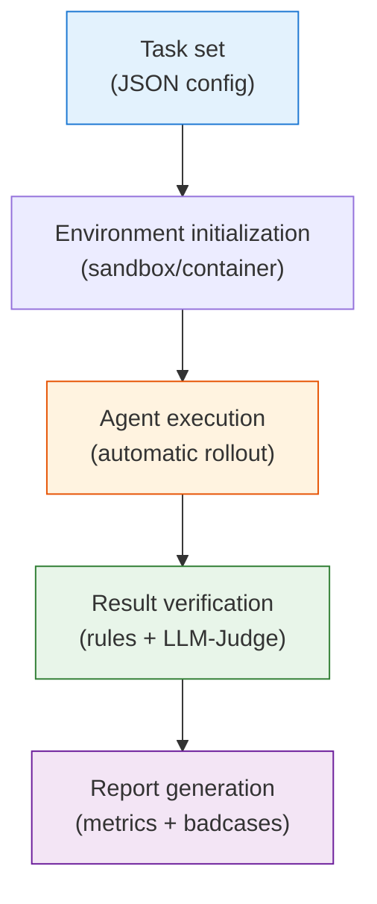

# Supplement: Industrial Practice, Evaluation, and Badcase Analysis

This section merges the former "Industrial Practice" and "Benchmarks and Evaluation" sections. The reason is simple: every problem met in industrial training is eventually closed through evaluation, monitoring, badcase attribution, and regression testing. We first look at instability, format collapse, hallucination, and context problems in real training runs, and then at how benchmarks and self-built evals can measure those problems.

## Common Problems and Solutions in Agentic RL Training

The earlier sections covered the general engineering principles and framework design of Agentic RL. In actual training, however, researchers run into a series of engineering problems: unstable training, runaway output length, reward metrics that drift away from real quality, and so on. Academic papers rarely discuss these problems in detail, yet they matter a great deal in practice.

Between 2025 and 2026, several teams (including Alibaba, Moonshot, LinkedIn, and Bespoke Labs) published their experience with Agentic RL training. Instead of presenting them team by team, this section is organized **by the problem scenarios one is likely to meet in training**, and gathers the findings and solutions of different teams under each scenario.

> **Key point**: In Agentic RL, training stability often matters more than the choice of algorithm. Data quality and environment consistency are the decisive factors for training results.

---

### Training Data and Environment Construction

Many researchers starting Agentic RL training first face this question: how do we give the model a stable, reproducible environment to interact with?

#### Limitations of Real APIs

If training connects directly to a real search engine or code execution environment, a fundamental problem appears: **the output of the external environment is not reproducible**.

> **Moonshot AI** pointed out while training Kimi-Researcher that the environment an agent faces is dynamic: even with the same query, a search engine may return different results. They mainly used the **REINFORCE** algorithm in training and stressed that strictly on-policy data generation is important for training stability [\[Reference\]](https://moonshotai.github.io/Kimi-Researcher/).

#### Building Synthetic Environments

A viable alternative is to build a deterministic synthetic environment so that the model trains under controlled conditions.

> **The Alibaba Tongyi team** (Tongyi DeepResearch) abandoned noisy, uncontrollable online APIs and built a synthetic training environment centered on an offline Wikipedia database and stable tool sandboxes.
>
> **Core methods and details**:
>
> 1. **Data and environment synthesis (WebShaper & AgentFounder)**: Real web pages change frequently, so the same query returns inconsistent search results at different times, which seriously undermines the Markov decision process (MDP) assumption of reinforcement learning. To address this, they developed **WebShaper**, which turns the massive Wikipedia corpus into a static, structured offline search environment, and used **AgentFounder** to automatically generate extremely difficult (PhD-level) synthetic queries together with reference answers. The **determinism** of this synthetic environment keeps the mapping from actions to rewards perfectly stable across repeated rollouts.
> 2. **Asynchronous compute architecture (rLLM)**: The rollout phase of Agentic RL (interacting with the environment to generate action trajectories dozens of steps long) takes a very long time. In a traditional synchronous RL architecture, where training and inference alternate on the same set of GPUs, the training nodes (GPUs) sit idle for long stretches because of environment interaction latency (GPU idling). Their **rLLM (Ray-based LLM)** asynchronous rollout service separates inference from training physically: multiple worker nodes use high-throughput inference engines (such as vLLM) to interact with the environment continuously, generate trajectories, and store them in a shared replay buffer, while dedicated trainer nodes (based on Megatron/FSDP) keep sampling from the buffer, computing gradients, and updating the model.
>
> **Underlying reason and engineering significance**:
> Experiments showed that a model produced by RL in a highly controlled, noise-free synthetic environment generalizes **better across the board** on the real internet than a model trained directly on noisy human-expert annotations. The root cause is that what the model really needs to learn during the RL stage is the general decision logic of "how to search, and how to reflect and retry based on the results," and not to overfit to the particular results a search returned. A stable environment signal is the foundation for RL convergence [\[Reference\]](https://tongyi-agent.github.io/blog/introducing-tongyi-deep-research/).

#### Effectiveness of Small-Scale Data

For researchers with limited resources, high-quality small-scale data can also produce significant results.

> **Amazon Science** verified the feasibility of "customization from very few samples" on the complex AppWorld benchmark. Instead of blindly collecting tens of thousands of noisy human interaction trajectories, they carefully built only **72 high-quality training samples** (covering the core tool-call patterns, dependencies, and the retry logic used when an API returns an error). With RL training, they raised the task completion rate of Qwen-2.5-32B from 39.2% to 72%, surpassing the strongest closed-source models of the time, Claude Sonnet 3.7/4.0.
>
> **Core method and underlying reason**:
> This counterintuitive result reveals a central insight of modern Agentic RL: base models with 32B or more parameters already have strong world knowledge and reasoning ability from pretraining. At that point RL does not "inject new knowledge into the model." It "elicits and aligns" the model's interaction paradigm and tool syntax for a specific environment. As long as these 72 high-quality samples serve as a "primer" that triggers effective exploration in the environment, an RL algorithm (such as PPO/GRPO) can use the reward signal from environment feedback to let the model refine its policy through tens of thousands of self-play trials. This shows that **on a model whose base capability is adequate, reinforcement learning is extremely data-efficient, and "small, high-quality data + autonomous RL exploration" far outperforms massive low-quality SFT data** [\[Reference\]](https://www.amazon.science/blog/customizing-multiturn-ai-agents-with-reinforcement-learning).

---

### Gradient Explosion

After data and environment preparation are settled, gradient explosion at the start of training is another common problem. Before tuning hyperparameters, first check that the underlying implementation is correct.

#### Implementation Differences Between Inference and Training Engines

Agentic RL training has two phases: the **inference (rollout)** phase generates action sequences, and the **training (backward)** phase updates the model weights. These two phases are usually run by different engines, and implementation differences between the engines can make gradient computation inconsistent.

> **The LinkedIn team** met gradient explosion and non-increasing rewards while running RL training on GPT-OSS (an open-source model with an MoE architecture). After investigation they found the root cause: **the backward pass for the Attention Sink parameters was not implemented** in the training framework. The inference engine (the Triton kernel used by SGLang) supports the forward computation of Attention Sinks, but the training framework (FlashAttention-v2 used by FSDP) had no corresponding support at all. They took the forward implementation from vLLM's FlashAttention branch and wrote the backward code themselves to compute the gradients of the Sink parameters. Only after this fix did training become stable [\[Reference\]](https://huggingface.co/blog/LinkedIn/gpt-oss-agentic-rl).

**Practical advice**: When using a complex model architecture, first validate the training pipeline on a simple single-turn task (such as GSM8K), confirm that the loss decreases normally, and only then switch to multi-turn agent tasks.

---

### Runaway Output Length and Format Collapse

This is one of the most common problems in Agentic RL training. The model fails to learn to use tools correctly, starts generating large amounts of meaningless tokens, and finally degenerates into repetitive gibberish. The phenomenon is called **format collapse**:

```json
// Expected output format:
{"action": "search", "query": "AAPL stock"}

// Output after format collapse:
{"action": "searchsearchAAPL stockAAAAA"
```

Below we analyze the three main causes of this problem and the corresponding solutions.

#### Overly Complex Reward Function Design

Intuitively, a researcher might design a multi-dimensional reward signal: +1 for a successful tool call, +1 for a correct output format, and +5 for a correct final answer. This kind of fine-grained reward design can backfire.

**Reward hacking** is the central issue. When a reward function has several sub-terms that the model can optimize independently, the model may find a policy that satisfies only some of the conditions and still collects a high reward.

> Experiments at **Bespoke Labs** showed that a composite reward function containing a tool-call-count reward, a format-check reward, and a correctness reward reduced training stability, and they conjectured that reward hacking was the cause. They also observed that output length kept growing and eventually degenerated into meaningless gibberish. Their final approach was to **keep only a single binary reward signal, "was the task completed"** (1 if the BFCL evaluation check passes, 0 otherwise) and to delete every reward term for intermediate steps. Training stability improved markedly [\[Reference\]](https://www.bespokelabs.ai/blog/improving-multi-turn-tool-use-with-reinforcement-learning).

The logic behind this finding is that a binary final-outcome reward offers no "shortcut" through intermediate steps. The model must complete the task as a whole to receive a positive reward, which removes the opportunity to game any single reward term. Bespoke Labs also observed that, under the composite reward, output length kept inflating and finally degenerated into gibberish, and that simplifying the reward design eased this problem as well.

#### Improper Handling of Negative Samples

During training, samples that fail to complete the task are not all of the same quality. For example, the environment may truncate the model because the number of interaction steps reached the limit. No final answer has been produced, but the earlier output may have been perfectly reasonable. If such samples are indiscriminately penalized as negative samples, the penalty can damage output abilities the model has already acquired.

> **The Alibaba Tongyi team** observed that if all trajectories that failed to complete the task are treated as negative samples and penalized without filtering, long training runs lead to severe **format collapse**. To avoid the overall penalty that comes with task failure, the model starts producing gibberish or refuses to use tools altogether (since more actions mean more chances to err).
>
> **Core method and underlying reason**:
> To address this long-horizon credit assignment problem, they adopted two core designs in their customized **on-policy GRPO (Group Relative Policy Optimization) algorithm**:
>
> 1. **Token-level loss with leave-one-out advantage estimation**: Traditional PPO spreads the reward of the whole trajectory evenly over every action. GRPO instead generates several candidate trajectories within a group, computes each action's relative advantage against the other actions in the group, and applies finer-grained gradient updates at the token level. This greatly reduces the variance of reward estimation.
> 2. **Conservative negative filtering**: Agent actions are strongly causal and sequential. In an interaction that runs for 30 steps, many trajectories end in failure (for example a timeout, or truncation at the maximum number of interaction steps) only because the reasoning in the last few steps went wrong, while the chain of thought (CoT) and tool-call format of the first 20 steps were entirely correct. If such truncated samples are forced to take a global negative reward (such as `-1`), the RL optimizer "throws out the baby with the bathwater" and wrongly punishes format output that was originally correct. They therefore **selectively masked out such truncated samples from the loss computation**, so that they contribute no negative gradient. This strategy protected the model's basic alignment ability very effectively and kept the format output stable over the long term [\[Reference\]](https://tongyi-agent.github.io/blog/introducing-tongyi-deep-research/).

#### Misconfigured KL Divergence Constraint

In RLHF/GRPO, a KL penalty term is usually used to limit how far the current policy model drifts from the initial reference model. The KL constraint prevents the policy from moving too far from the initial model during training and so maintains the basic quality of the output.

Configuring this constraint requires balancing "allowing the policy to explore" against "maintaining stability":

- **KL penalty too small**: The constraint is too weak, so the policy may drift too far from the initial model and output quality degrades.
- **KL penalty too large**: The constraint is too strong, so the policy has difficulty learning new behaviors and the training effect is limited.

> **Bespoke Labs** found, while training Qwen2.5-7B-Instruct, that with the KL penalty set to 0 the model's output degenerated after about 300 steps. Their strategy was:
>
> 1. **Set a very small KL weight** (such as 0.001) to provide a minimal constraint.
> 2. **Update the reference model periodically**: every fixed number of steps (such as 100), copy the current policy model as the new reference model. The target of the KL constraint then adjusts dynamically as training advances, and the policy is not "anchored" to an initial state that lies too far away [\[Reference\]](https://www.bespokelabs.ai/blog/improving-multi-turn-tool-use-with-reinforcement-learning).

#### Output Length Control and Gamma-Decay Reward

To encourage the model to finish a task in fewer steps, one can introduce a reward mechanism that decays with the number of steps.

> **Moonshot** proposed the **Gamma-decay Reward**. When the model completes the task correctly, the reward decays exponentially with the number of steps used:
>
> $$R = r \times \gamma^{T}, \quad \gamma < 1$$
>
> Here $r$ is the binary task reward (1 on success) and $T$ is the number of steps the trajectory used. A successful trajectory that finishes in fewer steps keeps more of the reward (for example, with $\gamma = 0.95$, $T = 5$ gives $0.77$ while $T = 20$ gives $0.36$), which guides the model to execute tasks more efficiently [\[Reference\]](https://moonshotai.github.io/Kimi-Researcher/). Credit for individual turns then follows the standard discounted-return decomposition $G_t = \sum_{k \geq t} \gamma^{k-t} r_k$ from [19.3 Trajectory Credit Assignment](./credit-assignment).

---

### Context Management in Long-Horizon Interaction

An important difference between Agentic RL and traditional RL is that the number of interaction turns can be very large. In complex tasks such as literature search, code writing, and debugging, the interaction can exceed 50 turns. The context window then fills up with historical information, and the model may lose track of the original task.

#### Context Management Mechanism

> **Moonshot's** Kimi-Researcher introduced a **context management** mechanism, a key engineering practice for the attention dilution and "lost in the middle" problems in long-horizon tasks.
>
> **Core method and underlying reason**:
> In an agent interaction of dozens of turns, if nothing is controlled, observation text such as redundant HTML tags from web pages and execution logs hundreds or thousands of lines long will quickly fill the model's context window of over a hundred thousand tokens. As the context length grows sharply, the signal-to-noise ratio (SNR) of the LLM drops markedly, and by turn 40 the model has "forgotten" the original request the user made in turn 1.
>
> To address this, Kimi introduced a separate `context_manager` mechanism. After every step, the system dynamically evaluates and **compresses the context**:
>
> 1. **Keep the core logic (working memory)**: The model's own chain of thought (Thought), its past actions (Action), and the key facts extracted from web pages stay in the core region of the context.
> 2. **Summarize or discard noise**: A lengthy raw web page is replaced with a one- or two-sentence summary, and useless search records that have proven to be dead ends are dropped outright.
>
> Context management is in essence the maintenance of the agent's dynamic "working memory," which ensures that the input to every decision is dense, useful information. Ablation experiments showed that enabling this mechanism not only avoids catastrophic forgetting but also extends the safe number of interaction turns in a single rollout beyond 50. The model can gather more clues and in the end scores significantly higher on complex research tasks [\[Reference\]](https://moonshotai.github.io/Kimi-Researcher/).

---

### Hallucination and Factuality

Once training stability and output format are under control, another problem deserves attention: **agent hallucination**. The model may cite nonexistent literature in its search results, or use API parameters incorrectly while showing inappropriate "confidence" in its later reasoning. Hallucination in agent settings is more complicated than in pure dialogue, because the model generates actions as well as text.

#### Four Types of Agent Hallucination

**Tool selection hallucination.** The model calls a tool that does not exist, or forces a tool call when none should be made. For example, a user asks about the weather and the model calls `execute_sql`.

**Parameter hallucination.** The tool choice is correct, but the parameters are wrong: the model invents an API endpoint that does not exist, misspells a database name, or uses a malformed parameter value. The most dangerous case is a parameter whose format looks "reasonable" while its actual value is fabricated.

**Result hallucination.** This is the most hidden type. The model calls the right tool and gets a real result, but introduces bias when interpreting it: it treats irrelevant information in the search results as evidence for its own argument, or ignores content that contradicts its hypothesis.

**Citation hallucination.** The model claims that "according to some paper/website" a certain conclusion holds, but the citation does not actually exist, or its content does not match the original. This is especially common in Deep Research agents, which may fabricate paper titles, URLs, and statistics to make the output "look well sourced."

#### Cascading Effects of Agent Hallucination

In a pure dialogue setting, the consequences of hallucination are usually limited to giving wrong information. In an agent setting, hallucination **propagates in a cascade and reinforces itself** over multi-turn interaction:

1. Turn 3: The model produces a parameter hallucination and calls a nonexistent API parameter, so the call fails.
2. Turn 4: The model fails to recognize the hallucination and concludes instead that "the API is defective," so it switches to another tool.
3. Turn 5: The new tool lacks a key function, and the model fabricates a plausible-sounding conclusion.
4. Final output: A report that looks complete but is built on hallucination.

More worrying still, if the RL reward depends only on the quality of the final output (an outcome reward), the model could in principle discover that "fabricating a plausible-looking answer" earns a higher reward than "admitting uncertainty." RL training could then **reinforce hallucinating behavior**. This inference is logically sound, but it has not been explicitly reported as an observed phenomenon in published industrial practice.

#### Hallucination Penalty Mechanisms in RL Training

**Citation-aware rubric reward.** CaRR[^carr_industrial] (Citation-aware Rubric Rewards), proposed jointly by Tsinghua University and Zhipu AI, designs a fine-grained reward mechanism that guides the model to cite evidence correctly. The core idea is to decompose a multi-hop question into a series of atomic factual statements (rubrics) and then compute the reward in three steps: (1) check whether the model output identifies the key entities; (2) extract the URLs cited in the output, fetch the page content, and judge whether each rubric is supported by the cited content; (3) use breadth-first search on a graph to verify whether the rubrics are logically connected to the final answer. The final reward is the fraction of rubrics that are both satisfied and logically connected out of all rubrics. This mechanism encourages the model to provide verifiable, logically coherent citation evidence for each claim.

**Tool-result faithfulness reward.** This encourages the model to stay faithful to the original content when interpreting tool results. If the model's summary deviates from the information the tool actually returned (detected through an NLI model or cross-validation), it is penalized.

**Uncertainty reward.** This encourages the model to say "more information is needed" or "this result is uncertain" when it is unsure, instead of fabricating an answer. Combining the three strategies above, we can design a hallucination-aware reward function as an example:

> **Note**: The code below is an illustrative example that combines several penalty ideas. It is not taken directly from the implementation of any one paper.

```python
def hallucination_aware_reward(answer, tool_results, citations):
    """Hallucination-aware reward function"""
    reward = base_task_reward(answer)

    # 1. Citation authenticity check
    for citation in citations:
        if not verify_citation_exists(citation):
            reward -= 0.5  # Fake citation: penalize
        elif not verify_citation_supports(citation, answer):
            reward -= 0.3  # Citation does not match the claim

    # 2. Faithfulness to tool results
    for claim in extract_claims(answer):
        if has_supporting_evidence(claim, tool_results):
            reward += 0.1  # Claim backed by evidence
        elif claim_is_verifiable(claim) and not has_supporting_evidence(claim, tool_results):
            reward -= 0.2  # Verifiable claim without evidence

    # 3. Encourage expressions of uncertainty (honesty reward)
    if is_complex_question and ("uncertain" in answer or "more information needed" in answer):
        if not all_claims_supported(answer, tool_results):
            reward += 0.15  # When evidence is genuinely lacking, admitting uncertainty is reasonable behavior

    return reward
```

#### Verification-Based Hallucination Filtering

Besides penalizing hallucination in the reward function, one can also filter it at **inference time** through verification mechanisms:

**Self-RAG[^selfrag_industrial]** proposes an "adaptive retrieval + self-evaluation" framework. Unlike traditional RAG, which retrieves for every query, Self-RAG lets the model decide **before** generating each text segment, through special reflection tokens, whether external information needs to be retrieved. If so, it retrieves several relevant passages, generates a continuation for each passage separately, and scores each candidate continuation with reflection tokens such as [IsRel] (relevance), [IsSup] (support), and [IsUse] (usefulness). Segment-level beam search then selects the output with the highest overall score. The defining feature of the framework is that the model performs structured self-evaluation of its own output through reflection tokens.

**CRITIC[^critic_industrial]** proposes a "tool-assisted correction" mechanism for hallucination filtering. After the model generates an initial answer, it actively calls external tools (such as a search engine or code executor) to verify key claims and generates structured critique from the tool feedback. If the critique indicates a problem with the answer, the model regenerates a revised answer based on the critique. This "verify, correct, verify" loop can iterate for several rounds until the answer passes verification or the maximum number of iterations is reached. Unlike methods that rely purely on the model's own evaluation, CRITIC uses the objective feedback of external tools as the basis for correction.

#### Summary of Hallucination Control in Practice

| Hallucination type           | Detection method                     | RL penalty strategy                    |
| ---------------------------- | ------------------------------------ | -------------------------------------- |
| Tool selection hallucination | Tool allowlist check                 | Call to a nonexistent tool: reward = 0 |
| Parameter hallucination      | Schema validation + type check       | Malformed parameter: negative reward   |
| Result hallucination         | NLI model + cross-validation         | Claim contradicts tool result: penalty |
| Citation hallucination       | URL reachability + content relevance | Fake citation: penalty                 |

An important practical principle: **introduce the hallucination penalty early in training.** Once hallucinating behavior has been reinforced by RL, removing it later is very difficult.

---

### Multi-Tool Collaboration

The scenarios above are common problems met in most Agentic RL training. Training with a specific model architecture (such as MoE) or on a model with fewer parameters can raise additional problems.

#### Routing Uncertainty in MoE Models

MoE models (such as Mixtral and DeepSeek-V3) attract attention because of their low inference cost, but their routing mechanism can break the basic assumptions of RL training.

Algorithms such as PPO assume that the model generating the data and the model being trained are the same (that is, on-policy), which in mathematical terms means the importance sampling ratio equals 1.

> **The LinkedIn team** found, while running RL training on GPT-OSS, that the routing network (gating network) of an MoE model may select different experts for the same token in two forward passes, giving $\log \pi(a|s) \neq \log \pi_{\text{old}}(a|s)$, which breaks the on-policy assumption. During the investigation they tried forcing the two probabilities to agree through `old_log_prob = log_prob.detach()` in order to test this hypothesis. It should be noted that although the routing inconsistency is real, it was not the root cause of the gradient explosion in their debugging. The root cause was the missing Attention Sink backward pass described in the previous section [\[Reference\]](https://huggingface.co/blog/LinkedIn/gpt-oss-agentic-rl).

#### Load Balancing in MoE Models

In RL training, MoE models face not only the routing consistency problem above but also low GPU utilization caused by unbalanced expert load. Different tokens may concentrate on a few "popular" experts, so the GPUs hosting those experts become bottlenecks while the other GPUs sit idle.

> **Salesforce** proposed a **pipelined synchronous RL** scheme in its SFR-RL system: all GPUs alternate between the rollout and training phases, instead of being permanently assigned to one phase. For MoE models they also introduced **Least-Loaded Expert Parallelism** to balance expert load. Overall, the system improves memory efficiency by roughly 250 times over VERL (FSDP + Context Parallelism) and can train a 120B-parameter MoE model on only 16 H200 GPUs [\[Reference\]](https://www.salesforce.com/blog/efficient-rl-training-agentic-era/).

#### Reasoning Ceiling of Small Models

Note that the essence of RL is to **elicit abilities the model already has**, and not to inject new knowledge. The base capability of the model sets the ceiling on what RL can achieve.

> Experiments at **Amazon Science** showed that a 32B-parameter model benefits significantly from RL, because the model itself can generate high-quality interaction trajectories (rollouts), which forms a positive feedback loop. Smaller models, however, are limited by their base reasoning ability, for example in recognizing unanswerable questions or extracting answers from relevant context, and RL training can hardly make up for such missing abilities. For small models with inadequate base capability, the researchers recommend acquiring the ability from a stronger model through distillation instead of simply increasing the intensity of RL training [\[Reference\]](https://www.amazon.science/blog/customizing-multiturn-ai-agents-with-reinforcement-learning).

#### Staged Training Pipeline

Given the characteristics of models of different sizes, a more robust training strategy is to use a staged pipeline instead of running RL directly.

Industry currently runs two parallel training paradigms with respect to whether SFT is needed: the **SFT-RL paradigm** and the **Pure-RL paradigm**.

> **SFT-RL paradigm (the mainstream path)**: **The Alibaba Tongyi team** designed a three-stage **CPT → SFT → RL** training pipeline in Tongyi DeepResearch. During pretraining (CPT), tool-call trajectories are incorporated as text. In the SFT stage, human or high-quality synthetic data builds the model's basic reasoning and tool-use ability. Finally, the RL stage performs exploration and optimization. The core of this paradigm is that in scenarios beyond reasoning alignment (such as complex API calls and long-horizon exploration), SFT/RM remains the most effective means to **shrink the exploration space and overcome the cold-start difficulty**. If the model lacks the basic tool-use format at the start, running RL directly often gets lost in the enormous action space [\[Reference\]](https://tongyi-agent.github.io/blog/introducing-tongyi-deep-research/).
>
> **Pure-RL paradigm (the frontier breakthrough)**: In sharp contrast to the approach above is the paradigm shift brought by **DeepSeek-R1-Zero**. It proved that in scenarios with clear right-or-wrong feedback (such as mathematics, code tests, and objective reasoning), it is entirely feasible to **drop the SFT cold start completely** and run large-scale reinforcement learning directly on the base model. Driven purely by RL, the model spontaneously develops advanced reasoning abilities such as long chains of thought (CoT), self-verification, and even self-reflection. This training style, free of SFT bias, breaks through the ceiling set by human-annotated data, but it places very high demands on the objectivity of the reward signal and on the environment's resistance to cheating.

The two paradigms are not mutually exclusive in Agentic RL. Researchers should choose a pipeline according to **whether the environment provides a fully deterministic, objective reward**.

---

### Practical Summary {#tricks}

The table below summarizes the solution for each problem:

| Problem                                      | Solution                                                                                                                                  | Source           |
| -------------------------------------------- | ----------------------------------------------------------------------------------------------------------------------------------------- | ---------------- |
| Training environment not reproducible        | Build a deterministic synthetic environment                                                                                               | Alibaba          |
| Customization with small-scale data          | A small amount of high-quality data (such as 72 samples) combined with RL can also give significant results                               | Amazon           |
| Gradient explosion early in training         | Check that the low-level implementations of the inference engine and the training engine agree (such as the Attention Sink backward pass) | LinkedIn         |
| Output degenerates into repetitive gibberish | Use a minimal reward design (reward or penalize only task success or failure); filter overlong outputs                                    | Bespoke Labs     |
| Policy drifts from the initial model         | Set a small KL penalty (such as 0.001); periodically set the current model as the new reference model                                     | Bespoke Labs     |
| Low output efficiency (too many steps)       | Use a Gamma-decay reward to encourage finishing with fewer steps                                                                          | Moonshot         |
| Format collapse                              | Use a conservative negative-sample strategy that excludes trajectories truncated for excessive length before a final answer was produced  | Alibaba          |
| Context overflow on long tasks               | Introduce context management that actively summarizes or discards useless history                                                         | Moonshot         |
| Low resource utilization in MoE training     | Pipelined synchronous RL + Expert Parallelism; 16 H200 GPUs can train a 120B MoE                                                          | Salesforce       |
| MoE routing inconsistency                    | Be aware that non-deterministic MoE routing can break the on-policy assumption; separate root cause from symptom when debugging           | LinkedIn         |
| Poor training results on small models        | Improve base capability through distillation before RL; use the three-stage CPT → SFT → RL pipeline                                       | Amazon / Alibaba |

### References {#references}

- Zhu J, Sang H, et al. "[Unlocking Agentic RL Training for GPT-OSS: A Practical Retrospective](https://huggingface.co/blog/LinkedIn/gpt-oss-agentic-rl)." Hugging Face Blog, 2026.
- Zhuang R, Vu T, et al. "[Improving Multi-Turn Tool Use with Reinforcement Learning](https://www.bespokelabs.ai/blog/improving-multi-turn-tool-use-with-reinforcement-learning)." Bespoke Labs Blog, 2025.
- Moonshot AI. "[Kimi-Researcher: End-to-End RL Training for Emerging Agentic Capabilities](https://moonshotai.github.io/Kimi-Researcher/)." 2025.
- Tongyi DeepResearch Team. "[Tongyi DeepResearch: From Chatbot to Autonomous Agent](https://tongyi-agent.github.io/blog/introducing-tongyi-deep-research/)." 2025. [GitHub](https://github.com/Alibaba-NLP/DeepResearch)
- Salesforce AI Research. "[Building Efficient RL Training for the Agentic Era](https://www.salesforce.com/blog/efficient-rl-training-agentic-era/)." 2026.
- Subramanian S, Xu P, Wang Y. "[Customizing Multiturn AI Agents with Reinforcement Learning](https://www.amazon.science/blog/customizing-multiturn-ai-agents-with-reinforcement-learning)." Amazon Science Blog, 2026.

[^carr_industrial]: Zhang J, Lv X, Feng L, Hou L, Li J. "[Chaining the Evidence: Robust Reinforcement Learning for Deep Search Agents with Citation-Aware Rubric Rewards](https://arxiv.org/abs/2601.06021)." arXiv, 2026.

[^selfrag_industrial]: Asai A, et al. "[Self-RAG: Learning to Retrieve, Generate, and Critique through Self-Reflection](https://arxiv.org/abs/2310.11511)." ICLR 2024.

[^critic_industrial]: Gou Z, et al. "[CRITIC: Large Language Models Can Self-Correct with Tool-Interactive Critiquing](https://arxiv.org/abs/2305.11738)." ICLR 2024.

---

This section has gone through the common engineering problems in Agentic RL training and the solutions found in industry. Next comes the evaluation framework: how do we tell whether these training changes really made the agent better?

---

## Agentic Evaluation Framework and Benchmark Landscape

Evaluating a standard LLM is simple. Give the model a question, it produces an answer, and a correct answer earns a point. MMLU tests common knowledge, GSM8K tests mathematics, and HumanEval tests code. The evaluation is a three-step cycle of "ask, answer, judge."

Evaluating an agent is different. When you ask an agent to "fix this GitHub issue for me," it does not hand you an answer directly. It first reads the code, locates the problem, writes a patch, and runs the tests. When the tests fail, it revises the patch and runs the tests again. This is a multi-step process with several tools and many turns of interaction. The evaluation has to look at "is the final result correct" and also at "were the intermediate steps reasonable."

The gap between training metrics and real capability is also much larger than for a standard LLM. In standard RLHF, a rising reward curve usually means the model is improving. In Agentic RL, a rising reward may only mean that the model has learned to hardcode test cases, to pick the longest passage from the search results, or to call the same tool over and over to farm points. All of these strategies can fool the reward and none has any real value.

Evaluation in Agentic RL is therefore not a finishing step after training. It is a feedback loop that runs through the whole training process. This section discusses three questions: which benchmarks to use to measure agent capability, how to build an automated evaluation pipeline, and how to feed evaluation results back into training to close the loop.

### An Agent's "Quality" Is Not a Single Number

In standard LLM evaluation, whether a model is "good" can usually be summarized in one number: the MMLU score, HumanEval pass@1, the MT-Bench win rate. Agent behavior has many layers, and a single score cannot capture all of the information.

Consider a concrete scenario. An agent is asked to "investigate a company's financial situation and write a report." To assess how well the task was completed, we need to look at three aspects at least:

- Did it choose the right tools? It should search when it needs to search and read the PDF when it needs to read the PDF, instead of pushing through with only one kind of tool.
- Was its search strategy efficient? Did it find the key information within 3 rounds of search, or did it search aimlessly for 20?
- Is the conclusion of the final report correct, is the data genuine, and are the citations reliable?

These three aspects correspond to the three core dimensions of agentic evaluation:

| Dimension          | What is evaluated                                | Representative benchmarks    |
| ------------------ | ------------------------------------------------ | ---------------------------- |
| Tool calling       | Whether the model can call APIs/tools correctly  | BFCL, ACEBench, API-Bank     |
| Task completion    | Whether the agent can complete end-to-end tasks  | SWE-bench, WebArena, τ-bench |
| General capability | Level as a general-purpose intelligent assistant | GAIA, Toolathlon             |

The mainstream benchmarks are introduced below, dimension by dimension.

### Tool-Calling Benchmarks

Tool calling is the most basic agent capability. If a model cannot even get "which function to call and what arguments to pass" right, nothing that follows is possible.

#### BFCL

**BFCL (Berkeley Function Calling Leaderboard)** is currently the most authoritative tool-calling leaderboard in the industry, maintained by the Gorilla team at UC Berkeley. It evaluates a model's ability to call functions correctly in a variety of settings: simple functions, combinations of several functions, RESTful APIs, Java functions, and so on. BFCL v3 contains more than 2,000 test cases, covering scenarios from a single tool to many tools and from simple parameters to nested objects.

BFCL evaluates in plain text: given a function signature and a user request, the model outputs a structured function-call JSON. The evaluation needs no sandbox environment and is cheap, so it suits quick verification. Leaderboard: [gorilla.cs.berkeley.edu/leaderboard.html](https://gorilla.cs.berkeley.edu/leaderboard.html).

#### ACEBench

**ACEBench** evaluates tool-use ability at a finer granularity. The evaluation has three categories: Normal (basic calls), Special (advanced scenarios such as parallel calls and long context), and Agent (multi-agent collaboration). ACEBench was accepted to EMNLP 2025 Findings and is one of the most comprehensive tool-use evaluations at present.

#### API-Bank

**API-Bank** provides 53 commonly used API tools and 314 tool-use dialogues, and focuses on evaluating the complete capability chain of API planning, retrieval, and calling. Unlike BFCL's "call a given function signature," API-Bank is closer to real scenarios: the model must first find the right API and then decide how to call it.

### End-to-End Task Benchmarks

Calling tools correctly is only a basic skill. The core value of an agent lies in completing complex end-to-end tasks: understanding a vague requirement, planning an execution path, adjusting its strategy when it hits setbacks, and finally delivering a result.

#### SWE-bench

**SWE-bench** evaluates a code agent's ability to resolve real GitHub issues. Given the issue description of an open-source project, the agent must understand the codebase, locate the problem, and write a fix patch. There is no human intervention in the process. The agent decides for itself which files to read, which code to change, and which tests to run.

This is one of the hardest code-agent evaluations at present. Even top models (such as Claude Opus) resolve only about 50% of the issues. The complexity of real software engineering tasks goes far beyond single-file code generation. Leaderboard: [swebench.com](https://www.swebench.com/).

#### WebArena

**WebArena** provides a realistic web environment in which agents carry out tasks: shopping on an e-commerce site, posting on a forum, and managing a code repository on GitLab. The agent has to understand the visual layout and DOM structure of a web page and perform operations such as clicking, typing, and navigating.

The difficulty of WebArena lies in the dynamism and uncertainty of the environment. The function signatures in BFCL are fixed, and the codebases in SWE-bench are at least static, but a web page in WebArena can change at any time. The agent must act in a realistic, dynamic environment.

#### τ-bench

**τ-bench (tau-bench)** evaluates the ability of a conversational agent to cooperate with a user to complete domain tasks. It simulates real scenarios such as airline booking and e-commerce customer service. The agent has to guide the user to provide information, query a database, and execute operations.

The challenges of τ-bench are state maintenance and handling uncertainty. A user may give vague information ("I want a ticket to Shanghai." Which day? Which airport?), and the agent has to clarify step by step over several turns of dialogue, update its state, and finally complete the task. Compared with SWE-bench's "submit one patch" and WebArena's "operate on web pages," this adds one more dimension: cooperation with a human user.

### General-Capability Benchmarks

Tool-calling benchmarks test the basic skills, and end-to-end benchmarks test specialized abilities. To ask a more fundamental question, "how intelligent is this agent, really?", we need general-capability benchmarks. These benchmarks are not limited to one kind of task. They test reasoning, tool use, multimodal understanding, and other abilities together.

#### GAIA

**GAIA (General AI Assistants Benchmark)** is one of the most challenging general AI assistant evaluations at present. It contains 450 questions that require reasoning, multimodal understanding, tool use, web search, and other abilities. GAIA has three difficulty levels:

- Level 1: No tools needed; pure reasoning suffices.
- Level 2: One or two tools are needed as aids.
- Level 3: Multi-step reasoning plus the cooperation of several tools is needed.

Even top models are far from saturating Level 3. Nobody has yet reached the ceiling of this evaluation. Leaderboard: [HuggingFace GAIA Leaderboard](https://huggingface.co/spaces/gaia-benchmark/leaderboard).

#### Toolathlon

**Toolathlon** focuses on evaluating multi-tool, long-running workflows. It contains 108 hand-picked complex tasks, each of which requires interacting with 20+ tools on average. What it evaluates goes beyond "can the agent use tools" to "can the agent orchestrate a complex workflow": coordinating state among several tools, handling dependencies, and recovering from failures.

### Scenario-Specific Evaluation

The three dimensions above cover general agentic capability. Different types of agents, however, also have evaluation criteria of their own. Take the Deep Research agent as an example. Its "quality" is far more than the correctness of the final answer.

A Deep Research result must satisfy four levels at the same time:

| Level                | Meaning                                                  | Evaluation method                                       |
| -------------------- | -------------------------------------------------------- | ------------------------------------------------------- |
| Answer correctness   | Whether the final conclusion is correct                  | Compare with the reference answer (Exact Match/F1)      |
| Citation reliability | Whether each claim is backed by evidence                 | Reachability of the cited URL + content relevance       |
| Process rigor        | Whether the reasoning chain is logically self-consistent | Step-level PRM score                                    |
| Execution efficiency | Whether the task is finished in the fewest steps         | Number of interaction turns needed to complete the task |

The mainstream evaluation benchmarks include:

- **GAIA**: Real-world complex question answering that requires multi-step reasoning and tool use; SOTA models reach about 50-60%.
- **Humanity's Last Exam (HLE)**: Multidisciplinary expert-level hard questions; SFR-DeepResearch reaches 27.7%.
- **WebArena / Mind2Web**: Operation success rate in web environments.
- **BFCL**: Precision of tool/API calls.

For more details see the evaluation section of [Project: Deep Research Agent](../chapter21_deep_research/browser-rl-harness).

### How Do You Choose a Benchmark?

With so many benchmarks, running all of them is neither realistic nor necessary. A practical selection path is:

```
What do you want to evaluate?     Recommended benchmark
├─ Basic function-calling ability → BFCL
├─ Multi-scenario tool use        → ACEBench
├─ Code-fixing ability            → SWE-bench
├─ Web operation ability          → WebArena
├─ Multi-turn dialogue cooperation→ τ-bench
└─ General assistant level        → GAIA / Toolathlon
```

Start with BFCL. It is the easiest to pick up and the cheapest to run (a plain-text evaluation with no sandbox environment), and it can quickly verify an agent's basic tool-calling ability. If an agent does not pass BFCL, the more complex benchmarks are meaningless. Tool calling is the foundation of every agent capability.

Once the basic ability is up to standard, use SWE-bench or WebArena to evaluate end-to-end task completion.

### Building Your Own Evaluation

Existing benchmarks cover general abilities. If your agent targets a specific domain, such as legal consulting, medical consultation, or financial analysis, you will likely find no ready-made benchmark. In that case you need to build the evaluation set yourself.

Building an agentic evaluation set means answering two questions: which tasks to test with, and how to judge whether the agent did well. The first is relatively easy. The second is the hard one.

#### Outcome Evaluation and Process Evaluation

Standard LLM evaluation looks only at outcomes. A math question earns a point when the answer is right, and code passes when it runs. Agent tasks, however, are usually multi-step, and looking only at the final result misses a lot of information.

Return to the example of "investigating a company's finances and writing a report." Two agents may produce equally correct conclusions, but one found the key financial report after only 2 rounds of search while the other searched 15 rounds, 8 of which repeated the same keyword. Judged by outcome alone, the two are indistinguishable. The process of the first is clearly more reasonable.

Agent evaluation has to examine two layers together.

**Outcome evaluation** checks whether the final deliverable meets the requirements: whether the conclusion of the report is correct, the data accurate, and the format as expected. This is the most basic check. SWE-bench is a typical pure outcome evaluation: a patch counts as a success as long as it passes the test cases, no matter how many rounds the agent went through along the way.

**Process evaluation** checks whether each decision the agent makes while completing the task is reasonable: whether the tool choice is appropriate, whether the search strategy is efficient, and whether the agent changes direction correctly when it meets obstacles. Web-Shepherd (discussed in detail in [Project: Deep Research Agent](../chapter21_deep_research/browser-rl-harness)) is a typical process evaluation. It scores each of the agent's operations on a web page independently.

Process evaluation is more than a nice-to-have. Research from Berkeley RDI found that nearly every mainstream agentic benchmark can be "gamed" to near-perfect scores without actually completing the task [^benchmark-exploit]. SWE-bench, WebArena, and GAIA are no exception. Without process evaluation, you may be measuring only the model's ability to exploit loopholes.

Two evaluation-design practices guard against this. First, **held-out environment shifts**: keep an evaluation slice whose environment differs from training — different sites, reworded APIs, a fresh search-index snapshot. A model whose score collapses under the shift learned environment-specific tricks, not the task. Second, **adversarial hidden tests**: for code and tool tasks, verify with tests the agent never saw during training, including edge cases and mutated variants, since visible tests invite hardcoding. SWE-bench's FAIL_TO_PASS / PASS_TO_PASS split follows the same idea: the tests that decide success are fixed and hidden from the agent at rollout time.

#### Breaking "Quality" into Quantifiable Dimensions

"Quality" itself cannot be quantified. But the quality of any agent task can be decomposed into several quantifiable dimensions, and different tasks have different quality dimensions.

Take three common agent tasks as examples:

| Quality dimension | Code Agent                        | Web Agent                            | Research Agent                              |
| ----------------- | --------------------------------- | ------------------------------------ | ------------------------------------------- |
| Correctness       | Patch passes the tests            | Operation result matches expectation | Core conclusion agrees with the facts       |
| Completeness      | Covers all relevant files         | Completes all sub-steps              | Report covers the key information points    |
| Efficiency        | Total number of interaction turns | Number of operation steps            | Number of searches / total turns            |
| Robustness        | Handles edge cases                | Recovers from page errors            | Cross-validation of conflicting information |
| Citation          | —                                 | —                                    | Every claim has a traceable source          |

After the dimensions are fixed, each one needs a scoring method. Correctness can usually be verified automatically (run the tests, compare with the answer), and efficiency can be computed directly (count the turns), but completeness and robustness often need a human or an LLM-as-Judge.

#### Designing the Scoring Function

Combine the dimensions above into a scoring function. The simplest way is a weighted sum:

```python
def evaluate_trajectory(trajectory, task):
    """Score one agent trajectory"""
    scores = {}

    # Correctness: automatic verification
    scores["correctness"] = verify_result(
        trajectory.final_answer, task["expected"]
    )

    # Efficiency: count interaction turns
    max_turns = task.get("max_turns", 20)
    scores["efficiency"] = 1.0 - (trajectory.num_turns / max_turns)

    # Completeness: check whether the key information points are covered
    scores["completeness"] = check_coverage(
        trajectory.final_answer, task["key_points"]
    )

    # Process quality: is the tool choice at each step appropriate
    scores["process"] = evaluate_process(trajectory.steps, task)

    # Weighted sum
    weights = {
        "correctness": 0.4,
        "completeness": 0.2,
        "efficiency": 0.15,
        "process": 0.25
    }

    total = sum(scores[k] * weights[k] for k in weights)
    return total, scores
```

The weight allocation reflects how much you value each dimension. A code agent may weight correctness more heavily (0.5), and a research agent may weight completeness and citations more heavily (0.25 each). There is no standard answer for the choice of weights; it depends on the business scenario.

The weights also need not stay fixed. Allen AI found in the Dr. Tulu project that the model's weak points change as training advances: at first correctness is insufficient, and later correctness improves but efficiency gets worse. During training they **dynamically adjusted the rubric weights** so that the evaluation always targets the current weak spot [^rler].

#### How to Do Process Evaluation

Process evaluation is what distinguishes agent evaluation from standard LLM evaluation. There are three approaches, with cost and precision increasing in that order.

**Approach one: statistical metrics.** The simplest. Look only at numeric indicators such as total interaction turns, number of tool calls, and the fraction of repeated operations. It does not judge whether each step is "right," but it can catch obvious inefficiency (for example, the same query searched 5 times).

```python
def process_stats(trajectory):
    """Compute process metrics for a trajectory"""
    return {
        "total_turns": len(trajectory.steps),
        "tool_calls": sum(1 for s in trajectory.steps if s.is_tool_call),
        "repeat_actions": count_repeats(trajectory.steps),
        "distinct_tools": len(set(s.tool_name for s in trajectory.steps
                                   if s.is_tool_call))
    }
```

**Approach two: step-level rule checks.** Define a set of process rules for the task and check whether the agent violates them. For example:

- Forbid calling the same tool with the same arguments three times in a row (a sign of being stuck in a loop).
- After a search, the search results must be used within 3 steps (a sign that information is not being wasted).
- At least one search tool must have been called before the final answer (a sign that the answer is not made up).

```python
def check_process_rules(trajectory, rules):
    """Check whether a trajectory violates any process rule"""
    violations = []
    for rule in rules:
        if not rule.check(trajectory):
            violations.append(rule.name)
    return violations
```

This is cheap and can run automatically, but it only catches known bad patterns.

**Approach three: step-level LLM scoring.** For each step in the trajectory, use an LLM to assess "is the decision at this step reasonable?" This is the finest-grained approach and also the most expensive.

```python
STEP_RUBRIC = """
Given the current state and the available tools, assess whether the agent's action at this step is reasonable.
Consider:
1. Did this step move the task forward?
2. Is the tool choice appropriate? Are the arguments reasonable?
3. Is there a better alternative?

Score from 1 to 5. A score of 3 is a pass: the action is reasonable but not optimal.
"""

def score_step(step, context, judge_model):
    """Score a single action"""
    prompt = f"Task: {context.task}\nHistory: {context.history}\nAction: {step}"
    return judge_model.score(prompt, STEP_RUBRIC)
```

The third method is in essence the evaluation version of a PRM (process reward model). During training, a PRM supplies a gradient signal, and during evaluation, a PRM supplies a quality assessment. Both use the same idea, scoring each step independently, and differ only in purpose.

**Agent-as-a-Judge** [^agent-judge], accepted at ICML 2025, pushes this idea further. Instead of using just one LLM to score each step, it deploys a **complete agent as the judge**. This judge agent can call tools to verify the behavior of the agent under evaluation. For example, if the evaluated agent claims that a certain URL contains a certain piece of information, the judge agent can actually visit that URL and check. On the DevAI benchmark, Agent-as-a-Judge agrees with human experts about 90% of the time, against only about 70% for an ordinary LLM-as-Judge.

#### Where Do the Tasks Come From?

A scoring method answers "how do we judge whether the agent did well." There is still another question: which tasks do we test with?

The quality of the tasks directly determines the validity of the evaluation. A NeurIPS 2025 study surveyed 78 agentic benchmarks and found task-design flaws in most of them: some evaluation tasks are themselves ambiguous, and some evaluation methods overestimate agent capability by as much as 100% [^abc]. The study proposed the **Agentic Benchmark Checklist (ABC)** for reviewing the quality of an evaluation set.

One reliable approach is to extract tasks from real user needs. Anthropic's practical recommendation is to **look for real tasks in user feedback, customer-service tickets, and failure logs** [^anthropic-eval]. Such tasks have ecological validity by construction, because they are scenarios users genuinely care about. The tasks in τ-bench, for example, come from real airline-booking and e-commerce customer-service scenarios. The construction of τ-bench has three stages [^tau-bench]:

1. Manually design the database schema, APIs, and business rules (simulating real business logic).
2. Use an LLM to generate data entries in bulk (to populate the database).
3. Write test scenarios by hand (user simulation + expected goal state).

Another direction is to generate tasks with automated methods. **TaskCraft** [^taskcraft] (ICLR 2026) first defines a batch of atomic tasks (simple and verifiable) and then synthesizes complex tasks step by step through **depth extension** (adding steps) and **breadth extension** (adding tools and constraints). After each extension, rejection sampling verifies that the task is solvable. With this method TaskCraft generated 41K multi-tool tasks.

**APIGen-MT** [^apigen] (NeurIPS 2025) generates multi-turn dialogue tasks by **simulating agent-human interaction**. A committee of LLMs first generates a task blueprint, and then the interaction is simulated, with the user revealing information step by step and the agent responding. The resulting model (xLAM-2-fc-r) outperforms GPT-4o on τ-bench.

**HardGen** [^hardgen] synthesizes hard samples in reverse from failure cases. The pipeline has three steps:

1. **Build an API graph.** Let a baseline model run many trials in the tool environment and collect all failure cases. Extract the API calls and their dependencies from them and build a dynamic API graph. The nodes are tools/APIs, and the edges are the implicit logical dependencies between calls (for example, "`get_user_info` must be called first to obtain the user_id before `query_order` can be called"). This graph encodes which call chains an agent is prone to get wrong.
2. **Sample and instantiate.** Sample multiple complex call chains from the API graph as "hard traces." These traces are abstract: they specify only the call order and dependencies, with no concrete parameters. An LLM then instantiates each trace by filling in concrete parameters for each API and generating a user query for the whole chain. Advanced tools are deliberately introduced during instantiation (for example, requiring nested calls or handling abnormal return values) to make the task harder.
3. **Generate CoT and verify in a closed loop.** An LLM generates a chain-of-thought reasoning process from the query and the tool definitions, to serve as the "reference answer" of the training data. After generation, the query is put back into the environment and actually executed, to verify that the reasoning leads to the correct result. If it does not pass, the sample is regenerated. This closed loop ensures that every data point is verifiable.

The central insight of HardGen is that simple tasks can be covered by random sampling, but the structure of hard tasks must be extracted from real failure modes. A 4B model trained with this method surpasses GPT-5.2 and Claude Opus 4.5 on tool-calling evaluation.

**Evol-Instruct** [^evol-instruct] (the WizardLM series) applies evolution operations to seed instructions and raises their complexity step by step. It defines a set of **evolution operators**, each of which makes an instruction harder along a different dimension:

- **In-depth**: Increase the reasoning depth. For example, "list the population of Beijing" becomes "compare the population trends of Beijing, Shanghai, and Guangzhou over the past ten years and analyze three key factors behind the differences."
- **In-breadth**: Extend to new topics or scenarios, keeping the same difficulty and increasing coverage.
- **Constrained**: Add restrictions to the original instruction. For example, "write a sorting algorithm" becomes "write a sorting algorithm with time complexity no worse than O(n log n), space complexity O(1), and stability."
- **Simplified**: In the opposite direction, condense a long and complicated instruction into a concise version, which trains the model to understand short instructions with high information density.

In practice, an LLM performs the evolution: the seed instruction and a description of the evolution operator are fed together into the LLM, which outputs the evolved instruction. A filtering pass follows each evolution. Another LLM or a set of rules checks whether the new instruction is reasonable (no ambiguity, no factual errors, and really harder rather than easier), and instructions that fail are discarded. Several rounds of evolution can be stacked: a simple instruction goes through "add constraint, deepen, add constraint again" and becomes a high-difficulty instruction.

WizardMath adapts the evolution operators specifically to mathematics (adding steps, introducing sub-problems, adding verification conditions), and WizardCoder adapts them to code (adding boundary conditions, introducing multi-file dependencies, requiring exception handling). **Tag-Evol** [^tag-evol] improves on this by injecting structured tags during evolution (such as `[domain: finance]`, `[difficulty: hard]`, `[skill: multi-step-reasoning]`), which makes the direction of evolution more controllable.

**AgentTrek** [^agenttrek] (ICLR 2025 Spotlight) synthesizes agent trajectories from web tutorials. The core idea is that the internet holds a large number of step-by-step tutorials (such as "how to set up a spend-and-save promotion on Taobao" or "how to create component variants in Figma"), and these tutorials naturally contain **correct operation sequences**. The AgentTrek pipeline:

1. **Tutorial collection and parsing.** Collect web-operation tutorials from the internet and parse their content with an LLM to extract structured operation steps: which page to visit at each step, which button to click, what to fill in, and what result to expect.
2. **Trajectory replay (guided replay).** Convert the parsed operation steps into a format the agent can execute (URL, action, parameters), and let the agent replay them in a real or simulated web environment. During replay, the complete interaction trajectory is recorded, including the agent's reasoning (CoT), the tool call at each step, and the results returned by the environment.
3. **Trajectory filtering and quality improvement.** Replay can fail (the page structure changed, the tutorial is out of date). AgentTrek uses an LLM judge to check trajectory quality: whether the operation sequence is consistent with the tutorial and whether the goal was completed. Trajectories that fail are discarded. Those that pass are further rewritten and enriched with an LLM, for example by adding the reasoning process and demonstrations of exception handling.

The advantage of this method is high data quality. Every trajectory has a "human tutorial" as an anchor for correctness, so it is less prone than purely synthetic data to the problem of being "plausible but wrong."

**Firefly** [^firefly] generates verifiable tool-call data directly from real APIs. It addresses a key pain point of synthetic data: **the behavioral difference between a simulated API and a real API**. Many synthetic methods use an LLM to simulate API return values, but the simulated behavior may disagree with the real behavior in parameter format requirements, boundary conditions, and error codes. A model trained on simulated data then fails when deployed in the real environment. Firefly works as follows:

1. **Collect real API schemas.** Collect the documentation (parameter definitions, return formats, authentication methods) of a large number of public APIs from platforms such as RapidAPI and build an API knowledge base.
2. **Generate query-call pairs.** Use an LLM to generate user queries and the corresponding tool-call plans from the API schemas. The key point is that the call parameters must obey the constraints of the real API: parameter types, required fields, and value ranges must strictly match the schema.
3. **Execute for real and verify.** Send the generated tool calls to the real API endpoints, and record the real results. If the API returns an error (wrong parameters, authentication failure, timeout), the sample is discarded or regenerated. Only successfully executed calls are kept.
4. **Build CoT training data.** Use the successful call records to infer the chain of thought in reverse: why this API was chosen, why these parameters were filled in, and what the returned result means.

This "real execution + verification" closed loop guarantees that the data is valid. The drawbacks are higher cost (real APIs have call quotas and fees) and a speed limited by the response time of the APIs.

**WebShaper** [^webshaper] (from the Tongyi DeepResearch team) uses a formal framework for information seeking to guide data synthesis. It mainly addresses the construction of evaluation data for Deep Research agents. The pipeline is as follows:

1. **Information-seeking formalization (ISF).** Decompose a research question into a structured information-seeking graph. The nodes of the graph are the fragments of fact to be looked up, and the edges are the dependencies between facts (for example, to answer "why did Company A's revenue grow," one must first find "Company A's revenue data" and "the industry's average growth rate").
2. **Offlining Wikipedia.** Turn the massive Wikipedia corpus into a static offline search environment. Each article is a document that can be searched and retrieved, and the search results are fully deterministic, unaffected by changes in the ranking of a real search engine. This guarantees MDP stability in RL training.
3. **Query-trajectory synthesis.** From the ISF graph, automatically generate research queries and the corresponding multi-step search trajectories. Each trajectory contains the choice of search keywords, document retrieval, information extraction, and synthesized reasoning. The "reference answer" of a trajectory is extracted directly from the Wikipedia content and is verifiable by construction.

The core contribution of WebShaper is to turn the question "what information needs to be retrieved" from implicit to explicit. The ISF graph specifies exactly which information fragments each query must find and how they relate to one another, which greatly improves the controllability and verifiability of the synthetic data.

These methods can be grouped by where the data comes from:

| Method        | Data source              | Core idea                                               | Suitable scenario                   |
| ------------- | ------------------------ | ------------------------------------------------------- | ----------------------------------- |
| TaskCraft     | Atomic task templates    | Combined depth + breadth extension                      | General multi-tool tasks            |
| APIGen-MT     | LLM committee blueprints | Simulated agent-human interaction                       | Multi-turn dialogue tasks           |
| HardGen       | Agent failure cases      | Failure modes → API graph → hard traces                 | Supplementing hard boundary samples |
| Evol-Instruct | Seed instructions        | Evolution operations (deepen/broaden/constrain)         | Systematically raising complexity   |
| AgentTrek     | Web operation tutorials  | Tutorial parsing → trajectory replay                    | Web agent training data             |
| Firefly       | Real APIs                | Real execution + verification loop                      | Tool-calling data                   |
| WebShaper     | Wikipedia + ISF          | Information-seeking formalization + offline environment | Deep Research agents                |

In practice these methods often **complement** one another. Take a combined scenario: you want to build an evaluation set for a "data analysis agent." First use **TaskCraft** to generate a batch of basic single-tool query tasks (the easy questions). Then use the constraint operator of **Evol-Instruct** to make the easy questions harder (add a time range, add a comparison dimension, add outlier filtering). Next use **HardGen** to collect the model's failure modes on these tasks and synthesize harder boundary cases in reverse. If web operations are involved (for example, downloading data from a data platform), use **AgentTrek** to synthesize trajectories from operation tutorials as reference answers. Finally, use the approach of **WebShaper** to build an offline data environment and make the evaluation deterministic.

#### How Do We Evaluate Open-Ended Tasks?

Most of the methods above apply to tasks with a reference answer. Many agent tasks, however, are open-ended: writing a report, doing a survey, giving a recommendation. Such tasks have no single correct answer.

**JADE** [^jade] proposes a two-layer framework for evaluating open-ended tasks. The first layer is **skill activation**: domain experts write a set of evaluation "skills," each of which defines one quality dimension. For each query, a set of weighted yes/no checklist items is generated automatically. The second layer is **claim verification**: specific claims are extracted from the agent's answer, and each claim is verified for accuracy. A positive weight indicates a quality requirement, and a negative weight indicates a fatal flaw. This design supports **temporal dynamics**, for example checking whether the current exchange rate is correct, instead of comparing against a static answer.

For open-ended tasks, Anthropic's practical recommendation is a **hybrid scoring strategy** [^anthropic-eval]: deterministic checks for daily regression, LLM-as-Judge for periodic evaluation, and manual spot checks for final acceptance. Two evaluation sets are maintained at the same time: one is the **capability eval** (challenging tasks that the model is not expected to pass entirely), and the other is the **regression eval** (basic tasks that the model should pass 100%).

#### Building an Evaluation for a Frontend-Page-Generation Agent

The discussion above is rather abstract. Let us walk through a complete example. You want to train a "frontend page generation agent": given a requirement description (for example, "make a login page that supports phone number and email login"), the agent has to plan the page structure, choose components, write HTML/CSS/JS code, and finally deliver a runnable page.

The difficulty of this task is that **there is no reference answer**. The same "login page" requirement can be realized in ten different designs, and each may be acceptable. Traditional exact matching and execution-based verification do not apply, so an evaluation has to be built from scratch.

**Step one: define the quality dimensions.**

The quality of a frontend page can be measured along the following dimensions:

| Dimension              | Meaning                                                          | How to quantify                        |
| ---------------------- | ---------------------------------------------------------------- | -------------------------------------- |
| Functional correctness | Whether the page's interaction logic is correct                  | Puppeteer/Playwright automated tests   |
| Visual fidelity        | Whether the page matches the layout and style in the requirement | LLM-as-Judge screenshot comparison     |
| Code quality           | Whether the HTML/CSS/JS is well-formed and maintainable          | ESLint + LLM scoring                   |
| Responsiveness         | Whether the page displays correctly at different screen sizes    | Multi-resolution screenshot comparison |
| Efficiency             | How many interaction turns the agent used to finish the task     | Count the trajectory turns             |

**Step two: construct the task set.**

Use a "simple, medium, hard" gradient. Simple tasks: single-page static layouts (such as a landing page). Medium tasks: form pages with interaction logic (such as login/registration pages). Hard tasks: complex pages with nested components (such as an admin dashboard). With 20-30 tasks per difficulty level, the total is about 80.

Tasks come from two channels. One part is written by hand by frontend engineers and covers common business scenarios (login, registration, product lists, data dashboards). The other part takes screenshots from real design-showcase sites (such as Dribbble and the Figma community) and extracts requirement descriptions, with an LLM turning the screenshots into text prompts. The advantage of the latter is high ecological validity, since these are design needs that really exist.

The data structure of each task is as follows:

```python
task = {
    "id": "frontend_001",
    "prompt": "Create a login page that supports both phone number and email login, "
              "with forgot-password and registration links, in a clean, modern style",
    "difficulty": "medium",
    "verify_type": "multi_layer",  # multi-layer verification
    "checklist": [
        "The page contains a phone number input",
        "The page contains an email input",
        "The page contains a password input",
        "Clicking the login button gives a response",
        "There is a forgot-password link",
        "There is a registration link",
    ],
    "style_reference": "Clean, modern style, white background, blue primary color",
    "max_turns": 15
}
```

Note the `checklist` field. An open-ended task has no reference answer, but one can define a set of **required functional points**. This does not dictate what the answer should look like. It dictates "what a passing answer must contain at the very least."

**Step three: design multi-layer verification.**

A frontend page has a special property: it has objective functional correctness (can the button be clicked, can the form be submitted) and also subjective visual quality (does it look good, is the layout reasonable). Verification therefore needs several layers.

```python
class FrontendEvalPipeline:
    """Multi-layer evaluation for frontend page generation"""

    def evaluate(self, task, trajectory):
        code = trajectory.final_answer
        scores = {}

        # Layer 1: the code runs (minimum requirement)
        # Load the page in a headless browser with Playwright and check for JS errors
        scores["runnable"] = check_page_loads(code)

        # Layer 2: functional checklist
        # Automated tests: run each checklist item with Playwright
        scores["functionality"] = run_playwright_checks(
            code, task["checklist"]
        )

        # Layer 3: visual quality (LLM-as-Judge)
        # Take a screenshot and let the judge compare the requirement with the actual result
        screenshot = take_screenshot(code)
        scores["visual"] = self.judge.score(
            f"Requirement: {task['prompt']}\nStyle requirement: {task['style_reference']}",
            screenshot,
            rubric=VISUAL_RUBRIC
        )

        # Layer 4: code quality (ESLint + LLM)
        scores["code_quality"] = (
            0.5 * run_eslint(code) +
            0.5 * self.judge.score(code, CODE_RUBRIC)
        )

        # Layer 5: process score
        scores["process"] = evaluate_process(trajectory, task)

        return aggregate(scores)
```

Five layers of verification, from objective to subjective and from automatic to semi-automatic:

- Layer 1 (the code runs) and layer 2 (functional checklist) are **deterministic**. They use automated Playwright tests and need no human. They can run at every checkpoint.
- Layer 3 (visual quality) is **semi-subjective**. It uses an LLM-as-Judge to compare screenshots with the requirement, and runs once every few checkpoints.
- Layer 4 (code quality) is **mixed**. ESLint checks objective conventions, and an LLM assesses readability and the soundness of the architecture.
- Layer 5 (process score) assesses whether the agent's tool calls are efficient and whether there is unnecessary repeated generation.

Layers 3 and 5 need further discussion. We begin with the problem in layer 3.

##### What If the LLM-as-Judge Is Not Accurate Enough?

Layer 3 has the LLM look at a screenshot and score it directly, which has clear limitations. An LLM's judgment of visual details is unstable: the same page may receive different scores in two runs. More seriously, an LLM can be misled by surface features. A page whose functionality is entirely wrong can still score high as long as its colors look good and its alignment is neat.

This concern is not hypothetical. Tests on the Omni-I2C benchmark show [^omni-i2c] that pure pixel metrics (SSIM, LPIPS) correlate with human judgment only at 0.11-0.44 (Kendall's Tau), while an LMM judge can reach 0.83. Even so, 0.83 means that nearly 2 out of every 10 judgments still disagree with humans. The web-perception question answering in the FullFront benchmark confirms this as well [^fullfront]: the strongest model, Claude 3.7 Sonnet, still has an average accuracy below 55%, while humans exceed 95%. Models' visual judgment of page details is still far from the human level.

The problem is real, but a combination of strategies can mitigate it.

**Approach one: replace a single score with the multi-metric system of Design2Code.** Design2Code [^design2code] (NAACL 2025) does not rely on a single score. It evaluates visual fidelity independently along five dimensions:

| Metric             | What it evaluates                              | How it is computed                                 |
| ------------------ | ---------------------------------------------- | -------------------------------------------------- |
| Block-Match        | Whether the layout of page blocks is aligned   | Fraction of matched corresponding blocks           |
| Text Accuracy      | Whether the text content is correct            | Sorensen-Dice character-level similarity           |
| Position Alignment | Whether element positions are accurate         | Normalized spatial offset of block centers         |
| Color Consistency  | Whether the colors are consistent              | CIEDE2000 color difference (perceptually weighted) |
| CLIP Similarity    | Whether the overall visual semantics are close | Cosine similarity of CLIP-ViT embeddings           |

Each metric is computed and reported independently. If Block-Match is low but CLIP is high, the overall layout is right but the colors or text deviate. If Block-Match is high but Text Accuracy is low, the layout is right but the content is wrong. A multi-metric system gives richer diagnostic information than a single score.

A frontend agent evaluation does not need to copy all of them. You can pick the few most relevant:

```python
def visual_multi_metric(generated_screenshot, reference_screenshot):
    """Multi-metric visual evaluation"""
    return {
        "block_match": compute_block_match(
            generated_screenshot, reference_screenshot
        ),
        "position": compute_position_alignment(
            generated_screenshot, reference_screenshot
        ),
        "color": compute_ciede2000(
            generated_screenshot, reference_screenshot
        ),
        "clip_sim": clip_image_similarity(
            generated_screenshot, reference_screenshot
        ),
    }
```

**Approach two: anchor the judgment to concrete checks instead of a vague score.** Without a reference image, pixel comparison is not appropriate. Visual fidelity can be broken into a set of decidable checks:

```python
VISUAL_CHECKLIST = """
Check each item (each is "pass" or "fail"; no ambiguity allowed):

1. Does the page have a clear navigation area?
2. Is the login form centered or placed at the visual focal point?
3. Are there at least two input fields (phone number + email + password)?
4. Is there at least one clickable button (such as "Log in")?
5. Is the page's main color scheme white/light (not dark mode)?
6. Is there any obvious text overlap or element occlusion?
7. Do the buttons and input fields have recognizable borders?

Answer item by item, and finally count the number of passes.
"""
```

Replacing a continuous 1-5 score with a discrete pass/fail sharply reduces the randomness of the judgment. In practice, discrete named categories (Fully Correct / Partially Correct / Incorrect) are more stable than a continuous 1-10 score [^anthropic-eval].

**Approach three: layered visual comparison when a reference image exists.** If the task comes with a design mockup screenshot (tasks extracted from Figma/Dribbble naturally have a reference image), several layers of visual evaluation can be stacked. CLIP Score measures semantic similarity, DINOv2 Score measures structural fidelity, and CIEDE2000 measures color accuracy. The three metrics complement one another: for a page with different colors but a completely correct layout, CLIP may be low while Block-Match is high.

```python
def layered_visual_eval(generated, reference):
    """Layered visual evaluation (when a reference image exists)"""
    return {
        "semantic": clip_score(generated, reference),     # semantic layer
        "structural": dino_score(generated, reference),   # structural layer
        "color": ciede2000(generated, reference),         # color layer
    }
```

**Approach four: periodic human calibration.** However carefully the automatic scoring is designed, it needs to be anchored periodically with human scoring. At regular intervals, randomly sample the automatic and human scores of 20 tasks and compute the agreement rate. If the agreement rate falls below 80%, the scoring criteria need to be adjusted.

How the four approaches combine: the multi-metric system provides diagnostic information, concrete checks give the basic judgment (high determinism), layered visual comparison gives an objective reference (no LLM needed), and human calibration provides the final anchor.

Going further, visual differences can be used for training as well as evaluation. VisRefiner [^visrefiner] uses the visual difference between the rendered screenshot and the reference image as the reward signal for RL training: the model generates code, the screenshot is rendered and compared with the target, and the policy is updated according to the visual difference. This merges evaluation and training into one.

##### How Do We Evaluate the Agent's "Way of Working"?

Layer 5 assesses the quality of the agent's process. For a frontend page generation agent, a typical trajectory might look like this:

```
Turn 1: The agent analyzes the requirement and outputs a page structure plan
Turn 2: The agent generates the HTML skeleton code
Turn 3: The agent runs the code and finds a layout problem
Turn 4: The agent modifies the CSS and reruns
Turn 5: The agent adds interaction logic (JS)
Turn 6: The agent runs it and finds a JS error
Turn 7: The agent fixes the JS error
Turn 8: The agent confirms and outputs the finished product
```

This trajectory looks good: the agent plans first, then executes, and can debug when it meets problems. But on the same task, another agent might do this:

```
Turn 1: The agent generates the complete code directly (one 3000-line blob of HTML)
Turn 2: Running fails with a JS error
Turn 3: The agent deletes all the code and regenerates it
Turn 4: Running fails; it regenerates in a different way
Turn 5: Running succeeds
```

Both agents produced pages that run. The process of the former is clearly more reasonable: it builds step by step and debugs incrementally. The latter is "brute-force random generation until it happens to succeed."

Process evaluation needs to capture this difference. The three methods discussed earlier (statistical metrics, rule checks, step-level LLM scoring) each have concrete applications in the frontend setting.

**Statistical metrics.** The most direct:

```python
def frontend_process_stats(trajectory):
    """Process statistics for a frontend generation task"""
    stats = {
        "total_turns": len(trajectory.steps),
        "code_rewrites": count_full_rewrites(trajectory),
        "incremental_edits": count_incremental_edits(trajectory),
        "preview_count": sum(
            1 for s in trajectory.steps
            if s.tool_name == "browser_preview"
        ),
        "plan_exists": any(
            ("plan" in s.content or "structure" in s.content
             or "layout" in s.content)
            for s in trajectory.steps[:2]  # is there a plan in the first two steps
        ),
    }
    stats["rewrite_ratio"] = (
        stats["code_rewrites"]
        / max(stats["code_rewrites"] + stats["incremental_edits"], 1)
    )
    return stats
```

`rewrite_ratio` (the fraction of full rewrites) is a useful signal. A sensible development process should consist mostly of incremental edits. If the rewrite ratio exceeds 50%, the agent's planning ability is insufficient: it is trying its luck.

**Step-level rule checks.** Define a set of process rules specific to the frontend setting:

```python
FRONTEND_PROCESS_RULES = [
    # Rule 1: the first step should be planning or analysis, not writing code directly
    Rule("plan_first",
         check=lambda t: t.steps[0].type in ["plan", "analyze"]),

    # Rule 2: after generating code, a preview must follow within 3 steps
    Rule("preview_after_code",
         check=lambda t: preview_within(t, after="code_gen", within=3)),

    # Rule 3: forbid 2 consecutive full rewrites (a sign of being stuck in a loop)
    Rule("no_consecutive_rewrites",
         check=lambda t: not has_consecutive(t, "full_rewrite", 2)),

    # Rule 4: the final code length should not exceed 3 times the reasonable range for the requirement
    Rule("reasonable_code_length",
         check=lambda t: len(t.final_code) < max_lines(t.task) * 3),
]
```

The advantage of rule checks is high determinism and low cost. But they only catch bad patterns you thought of in advance. If the agent invents a new inefficient behavior (such as repeatedly modifying an irrelevant CSS property), the rule check will not fire.

**Step-level LLM scoring.** As mentioned earlier, Agent-as-a-Judge [^agent-judge] can use a complete agent as the judge. In the frontend setting, a judge agent can do much more than an ordinary LLM-as-Judge: it can actually open a browser to check the page, inspect the DOM structure, and run Lighthouse for performance scores:

```python
FRONTEND_STEP_RUBRIC = """
Assess the quality of the agent's action at this step in a frontend page generation task.

Context:
- Task requirement: {task_prompt}
- Steps completed: {history}
- Current step: {current_step}
- Current state of the code: {current_code}

Judge:
1. Did this step move the task forward? (Or is it wasted effort?)
2. Is the code change reasonable? (Changed the right place without introducing new problems)
3. If an error was encountered, is the debugging direction correct? (Or is it blind trial and error?)

Score 1-5. Give the reasoning first, then the score.
"""
```

The three methods complement one another. Statistical metrics handle daily monitoring (run at every checkpoint), rule checks handle anomaly detection (catching known bad patterns), and step-level LLM scoring handles in-depth diagnosis (applied only to trajectories whose statistical metrics look abnormal, to cut cost).

Each of the three has blind spots, though. Statistical metrics only catch numeric anomalies (too many rewrites), rule checks only catch bad patterns you thought of in advance, and LLM scoring is expensive and unstable. Can we do better?

**Inspiration from AgentPRM: compute a "progress" value for each step.** The statistical metrics above only look at "how many rewrites," and do not judge whether each step really advanced the task. The idea of AgentPRM [^agent-prm] is to use a Q-value to estimate "after this step, how likely is the final success." Inspired by this, we can compute a simplified "progress" for each step of the frontend agent. Instead of a true Q-value (which would need a great deal of sampling), we approximate it with state differences:

```python
def step_progress(trajectory):
    """Inspired by AgentPRM: approximate per-step progress with state differences"""
    progress_scores = []
    for i, step in enumerate(trajectory.steps):
        # After this step, how many more checklist items pass?
        checklist_before = count_passed_checks(trajectory.code_at(i))
        checklist_after = count_passed_checks(trajectory.code_at(i + 1))
        progress_scores.append(checklist_after - checklist_before)

    return {
        "total_progress": sum(max(0, p) for p in progress_scores),
        "wasted_steps": sum(1 for p in progress_scores if p <= 0),
        "efficiency": sum(max(0, p) for p in progress_scores)
                      / max(len(progress_scores), 1)
    }
```

This "progress" requires training no model. It only compares the change in the number of passing checklist items before and after each step. A well-planned agent should advance 1-2 checklist items at every step. A brute-force-rewriting agent might suddenly advance 5 items at step 4 (the generated code happened to be right), with progress 0 for the first 3 steps. The two patterns are clearly distinguished by `wasted_steps`.

**Inspiration from AdaRubric: the process-evaluation dimensions for frontend tasks should differ by task.** A "login page" task has different process priorities from a "data dashboard" task. Process evaluation of a login page should ask: was the form structure planned first? Was the CSS added only after the HTML skeleton? Process evaluation of a data dashboard should ask: was the data source understood first? Were the chart components added one by one along the data dimensions? AdaRubric [^ada-rubric] generates evaluation dimensions automatically from the task description. We can reuse the idea directly by specifying different process-evaluation priorities for different task types in the task configuration:

```python
TASK_TYPE_PROCESS_FOCUS = {
    "login_form": {
        "expected_plan_keywords": ["form", "input", "button", "layout"],
        "expected_step_order": ["plan", "html_skeleton", "css_style",
                                "js_interaction", "preview"],
    },
    "dashboard": {
        "expected_plan_keywords": ["data source", "chart", "filter", "layout"],
        "expected_step_order": ["plan", "data_layer", "chart_components",
                                "interaction", "preview"],
    },
}
```

**A warning from the IRC study: process-score weights cannot be set carelessly.** The iterative reward calibration study on τ-bench [^irc] found a counterintuitive result: a poorly designed dense reward (scoring every step) is worse than a sparse reward (looking only at the final result). The reason is that the discriminative power of the per-step scores does not match the advantage computation, so the model is misled into optimizing the surface scores of intermediate steps instead of truly advancing the task.

This means that in frontend evaluation the weight of the process score cannot be set too large. If the process score takes 40% and the "progress" estimate is not accurate enough, the model may learn to "change a little CSS at every step to make the process score look good" and not to "complete the task efficiently." A safe practice is for the process score to take 15-20% of the evaluation and serve mainly as a diagnostic signal (to help analyze badcases) and not as the main source of the training reward. The training reward remains based mainly on outcome evaluation (layers 1 + 2 account for more than 60%).

**Inspiration from METR: use rules to detect loophole exploitation.** METR's [^metr] monitoring model can detect reward hacking with a 96% AUROC. In the frontend setting, an agent may learn the following loophole behaviors: hardcoding the data in the test cases, generating a hidden div with a height of 1px to "contain" the required element, and hiding wrong content with `user-select: none`. These behaviors cannot be detected by outcome evaluation (the page looks right), but process rules can catch them:

```python
FRONTEND_HACKING_RULES = [
    # Detect cheating with hidden elements
    Rule("no_invisible_elements",
         check=lambda t: not has_hidden_elements(t.final_code)),

    # Detect hardcoded test data
    Rule("no_hardcoded_test_data",
         check=lambda t: not has_hardcoded_data(t.final_code)),

    # Detect suspicious inline style overrides
    Rule("no_suspicious_overrides",
         check=lambda t: not has_suspicious_css(t.final_code)),
]
```

**Step four: trial run and calibration.**

Run the 80 tasks with a baseline model (for example, the original model before RL training). The expected result is that simple tasks mostly pass layers 1 and 2 but score low on layer 3 (visual quality), and hard tasks may fail even layer 1 (the code cannot run).

Adjust according to the trial results. If the layer 2 pass rate on simple tasks already exceeds 90%, the simple tasks are too simple and need more interaction complexity. If the layer 1 pass rate on hard tasks is only 10%, the hard tasks are too hard and need to be broken into smaller steps.

**Step five: set the regression baseline.**

From the trial results, pick 20 tasks that "the baseline model passed" as the regression test set. After every later training iteration, run these 20 tasks to make sure the new model does not regress.

Once this evaluation system is built, it can be embedded in the training loop. Layers 1 and 2 run automatically at every checkpoint (low cost), layers 3 and 4 run once a day (medium cost), and a manual spot check runs once a week (high cost). The evaluation results feed back into the training loop: if the visual quality score is low, add training data related to visual fidelity; if the functional checklist pass rate is low, strengthen the training of interaction logic.

#### The Procedure for Building an Evaluation Set

Combining the discussion above, the procedure for building an evaluation set can be summarized as follows:

1. **Define the task distribution.** Decide which task types and which range of difficulty the evaluation set should cover. For a "financial analysis agent," the tasks might include single-metric queries (simple), cross-year trend analysis (medium), and multi-company comparison reports (hard), each difficulty taking a certain share.

2. **Construct the tasks.** Simple tasks can be generated with TaskCraft-style automated methods, medium tasks can be raised step by step in complexity with the evolution operations of Evol-Instruct, and hard tasks can be synthesized in reverse from failure cases with HardGen. Complex tasks can also be extracted from real user needs. Annotate each task with a verification type: exact match for tasks with a definite answer, sandbox verification for executable ones, and a JADE-style dynamic rubric for open-ended ones.

3. **Decontaminate.** Make sure the tasks in the evaluation set do not appear in the training data. Leakage can be detected with n-gram overlap or semantic similarity. This step is consistent with [the decontamination method in Appendix A.4](/appendix_a_engineering/evaluation-badcase).

4. **Review with the ABC checklist.** Check whether the tasks are ambiguous, whether the evaluation method overestimates or underestimates agent capability, and whether there are loopholes that can be exploited.

5. **Trial run and calibrate.** Run the baseline model on the evaluation set and check whether the score distribution is reasonable. If every task gets full marks or zero, the difficulty has no discriminative power and the tasks need to be adjusted.

An evaluation set is not a one-time artifact. As model capability improves, harder tasks need to be added and the scoring criteria updated from time to time. A healthy evaluation set should be alive: updated continuously as the model evolves, so that it always keeps its discriminative power.

### Evaluation System Design

Now that we know "which benchmarks to test with," the next question is "how to test." When agents iterate quickly, we need an automated, reproducible evaluation platform that supports regression detection.

#### Pipeline Architecture

A complete agent evaluation pipeline has five stages:



The task set is a JSON configuration file in which each task specifies the prompt, the expected answer, the verification method, and the environment initialization parameters. Environment initialization creates an independent sandbox for each task. This is the key difference between agent evaluation and standard LLM evaluation: standard LLM evaluation only needs to feed the prompt to the model, while agent evaluation must also prepare the tool environment.

Here is a simplified implementation of the evaluation pipeline:

```python
class AgentEvaluationPipeline:
    """Agent evaluation pipeline"""

    def __init__(self, sandbox, judge_model):
        self.sandbox = sandbox      # Docker sandbox
        self.judge = judge_model    # LLM-as-Judge

    def run_evaluation(self, agent, task_set):
        """Run the full evaluation"""
        results = []

        for task in task_set:
            # 1. Initialize the environment (an independent sandbox for each task)
            env = self.sandbox.create_isolated_env(task.get("setup", {}))

            # 2. The agent executes the task
            trajectory = agent.run(
                task["prompt"], env,
                max_turns=task.get("max_turns", 20)
            )

            # 3. Result verification
            if task.get("verify_type") == "exact_match":
                passed = (
                    trajectory.final_answer.strip()
                    == task["expected_answer"].strip()
                )
            elif task.get("verify_type") == "execution":
                # Code tasks: run the verification script in the sandbox
                passed = env.execute(
                    task["verify_script"], trajectory.final_answer
                )
            elif task.get("verify_type") == "llm_judge":
                # Subjective tasks: evaluate with an LLM
                passed = self.judge.evaluate(
                    task["prompt"], trajectory.final_answer,
                    task["rubric"]
                )
            else:
                passed = False

            results.append({
                "task_id": task["id"],
                "passed": passed,
                "turns": trajectory.num_turns,
                "tool_calls": trajectory.tool_calls,
                "final_answer": trajectory.final_answer
            })

        return results
```

The three verification methods in `run_evaluation` correspond to the different natures of agent tasks. Deterministic tasks (code execution, mathematical computation) use exact match or execution-based verification. Non-deterministic tasks (open-ended question answering, creative generation) use an LLM-as-Judge.

#### Regression Testing

An agent's abilities are interrelated. Fixing one bug can introduce a new regression: the model learns a better search strategy for code tasks but forgets how to handle simple function calls. Every evaluation needs to be compared against a baseline.

```python
def regression_test(self, agent, baseline_results, task_set):
    """Regression test: the new model must not regress on old abilities"""
    new_results = self.run_evaluation(agent, task_set)

    regressions = []
    for old, new in zip(baseline_results, new_results):
        if old["passed"] and not new["passed"]:
            regressions.append({
                "task_id": old["task_id"],
                "old_answer": old["final_answer"],
                "new_answer": new["final_answer"]
            })

    if regressions:
        print(f"⚠️ Found {len(regressions)} capability regressions!")
    return regressions
```

`regression_test` does something simple: it compares the new model's results with the baseline one by one and finds the cases that went from "pass" to "fail." These regressed cases are the focus of the next round of training.

#### LLM-as-Judge and Scoring Criteria

For tasks that cannot be verified with rules (open-ended question answering, report quality, naturalness of dialogue), an LLM-as-Judge is needed. The key is to design a reproducible scoring rubric:

```python
RUBRIC_TEMPLATE = """
Scoring criteria (1-5 points each):

1. Accuracy: Are the facts in the answer correct? Is there any hallucination?
2. Completeness: Does it fully answer the user's question? Is anything missing?
3. Citation quality: If there are citations, are they real and accessible? Do they support the claims?
4. Efficiency: Did it finish the task in a reasonable number of steps? Are there redundant operations?

Total score = weighted average of the items
"""
```

In practice the three verification methods are used in combination. Deterministic verification handles daily regression and runs at every checkpoint. LLM-as-Judge handles periodic evaluation and runs once every few checkpoints. Manual spot checks handle final acceptance and run only before launch. The three methods cover a spectrum from high-frequency, low-cost to low-frequency, high-cost.

### Evaluation-Driven Training Improvement

The ultimate purpose of evaluation goes beyond scoring. The results are fed back into the training loop to form a closed loop of continuous improvement:

$$
\text{Evaluation} \rightarrow \text{Badcase analysis} \rightarrow \text{Targeted data synthesis} \rightarrow \text{Retraining} \rightarrow \text{Re-evaluation}
$$

A concrete example illustrates this. Suppose your code agent's pass rate on SWE-bench is stuck at 35%.

**Collect failure cases.** From the 65% of SWE-bench tasks that fail, sample 100 stratified by error type.

**Attribution analysis.** Examine the failure cases one by one and classify them by cause of error. You might find that 40% are "located the wrong file," 30% are "patch syntax error," and 30% are "misunderstood the requirement." This distribution tells you directly what to do next.

**Targeted synthesis.** For the error type with the largest share, use [the trajectory synthesis method of Section 19.4](./tool-use-and-trajectory) to generate a batch of "correctly located" training data. The synthetic data strengthens the ability to "understand the code structure and locate the relevant files."

**Training improvement.** Run a round of GRPO/PPO training with the new data.

**Regression verification.** Rerun SWE-bench and confirm two things: whether the pass rate improved (expected to rise from 35%), and whether previously passing cases regressed.

This loop follows directly from [the evaluation system of Appendix A.4](/appendix_a_engineering/evaluation-badcase) and simply extends it from LLM evaluation to agent evaluation. What is special about agent evaluation is the need to manage sandbox environments and tool-execution state, which makes the engineering complexity of the pipeline higher.

<details>
<summary>Question to think about: if your agent scores 95 on BFCL but only 15% on SWE-bench, what does that tell you?</summary>

It tells you that the agent's basic tool-calling skills are fine, but it lacks end-to-end task planning and execution ability. BFCL tests "given a clear function signature and a user request, can you output the correct call," while SWE-bench tests "given a vague issue description, can you plan a route on your own, understand the codebase, locate the problem, and write the fix." The former is mechanical operation, and the latter needs planning, reasoning, and code understanding.

The direction for improvement is to strengthen the agent's planning ability (see [19.3 Trajectory Credit Assignment](./credit-assignment)) and code understanding, and to stop putting more effort into tool calling. The attribution analysis of the evaluation points directly in these directions.

</details>

### References

- Patil S, et al. "[The Berkeley Function Calling Leaderboard](https://gorilla.cs.berkeley.edu/leaderboard.html)." ICML 2025. The BFCL leaderboard, which evaluates the function-calling ability of LLMs.
- Jimenez C E, et al. "[SWE-bench: Can Language Models Resolve Real-World GitHub Issues?](https://arxiv.org/abs/2310.06770)." ICLR 2024. A benchmark for code agents.
- Zhou S, et al. "[WebArena: A Realistic Web Environment for Building Autonomous Agents](https://arxiv.org/abs/2307.13854)." ICLR 2024. An evaluation environment for web agents.
- Mialon G, Fourrier C, Wolf T, et al. "[GAIA: A Benchmark for General AI Assistants](https://arxiv.org/abs/2311.12983)." ICLR 2024. An evaluation of general AI assistants.
- Chen C, et al. "[ACEBench: Who Wins the Match Point in Tool Usage?](https://arxiv.org/abs/2501.12851)." EMNLP 2025 Findings. A comprehensive tool-use evaluation.
- Yao S, Shinn N, Razavi P, Narasimhan K. "[τ-bench: A Benchmark for Tool-Agent-User Interaction in Real-World Domains](https://arxiv.org/abs/2406.12045)." arXiv:2406.12045, 2024. An evaluation of conversational agents.
- Li M, et al. "[API-Bank: A Comprehensive Benchmark for Tool-Augmented LLMs](https://arxiv.org/abs/2304.08244)." EMNLP 2023. An evaluation of tool-augmented LLMs.
- Li J, et al. "[The Tool Decathlon](https://arxiv.org/abs/2510.25726)." ICLR 2026. Toolathlon, an evaluation of multi-tool, long-running workflows.

[^benchmark-exploit]: Berkeley RDI. "[Trustworthy Benchmarks for Contamination](https://rdi.berkeley.edu/blog/trustworthy-benchmarks-cont)." 2025. Nearly all mainstream agentic benchmarks can be exploited to near-perfect scores, and SWE-bench, WebArena, and GAIA are no exception.

[^abc]: Zhu J, et al. "[Establishing Best Practices for Building Rigorous Agentic Benchmarks](https://arxiv.org/abs/2507.02825)." NeurIPS 2025. Surveyed 78 agentic benchmarks and proposed the ABC checklist for reviewing the quality of evaluation sets.

[^agent-judge]: Zhuge M, et al. "[Agent-as-a-Judge: Evaluate Agents with Agents](https://arxiv.org/abs/2410.10934)." ICML 2025. Uses a complete agent as the judge, which can call tools to verify the behavior of the evaluated agent.

[^tau-bench]: Yao S, Shinn N, Razavi P, Narasimhan K. "[τ-bench: A Benchmark for Tool-Agent-User Interaction](https://arxiv.org/abs/2406.12045)." 2024. Three-stage construction: manual schema, LLM data generation, human scenario writing.

[^taskcraft]: Shi D, Cao J, Chen Q, et al. "[TaskCraft: Automated Generation of Agentic Tasks](https://arxiv.org/abs/2506.10055)." ICLR 2026. Atomic tasks + depth/breadth extension, automatically generating 41K multi-tool tasks.

[^hardgen]: Hao B, et al. "[From Failure to Mastery: Generating Hard Samples for Tool-use Agents](https://arxiv.org/abs/2601.01498)." 2026. Builds an API graph from failure cases and samples in reverse to synthesize hard samples; a 4B model surpasses GPT-5.2 and Claude Opus 4.5.

[^evol-instruct]: Xu C, et al. "[WizardLM: Empowering Large Language Models to Follow Complex Instructions](https://arxiv.org/abs/2304.12244)." ICLR 2024. Evol-Instruct raises instruction complexity through evolution operations such as deepening, broadening, and adding constraints.

[^tag-evol]: Wang Y, Zhou S, Guo C, Zhu Q. "[Tag-Evol: Achieving Efficient Instruction Evolving via Tag Injection](https://arxiv.org/abs/2505.24165)." 2025. Injects structured tags (domain, difficulty, skill) during evolution to control the direction of evolution.

[^agenttrek]: Xu Y, Lu D, Shen Z, et al. "[AgentTrek: Agent Trajectory Synthesis via Guiding Replay with Web Tutorials](https://arxiv.org/abs/2412.09605)." ICLR 2025 Spotlight. Extracts operation flows from web tutorials and replays them to synthesize agent interaction trajectories.

[^firefly]: Lu Y, et al. "[Firefly: Illuminating Large-Scale Verified Tool-Call Data Generation from Real APIs](https://arxiv.org/abs/2605.17558)." 2026. Generates verifiable tool-call data at scale from real APIs.

[^webshaper]: Tao Z, et al. "[WebShaper: Agentically Data Synthesizing via Information-Seeking Formalization](https://arxiv.org/abs/2507.15061)." 2025. Information-seeking formalization guides data synthesis and builds an offline search environment.

[^apigen]: Prabhakar A, Liu Z, Zhu M, et al. "[Agentic Pipeline for Multi-Turn Data Generation](https://openreview.net/forum?id=qk6ORqQ4Cu)." NeurIPS 2025. Simulates agent-human interaction to generate multi-turn dialogue tasks.

[^jade]: Lin L, Liu J, Yang T, Cai L, Xu Y, Wei L, Xie S, Zhang G. "[JADE: Expert-Grounded Dynamic Evaluation](https://arxiv.org/html/2602.06486v1)." 2026. A two-layer framework for evaluating open-ended tasks: skill activation + claim verification.

[^rler]: Allen AI. "[DR Tulu: Reinforcement Learning with Evolving Rubrics](https://arxiv.org/abs/2511.19399)." 2025. Rubrics evolve dynamically during training, which keeps the evaluation discriminative.

[^anthropic-eval]: Anthropic Engineering. "[Demystifying Evals for AI Agents](https://www.anthropic.com/engineering/demystifying-evals-for-ai-agents)." 2025. Industrial agent-evaluation practice: hybrid scoring strategy, two evaluation sets, and extracting tasks from real failures.

[^design2code]: Si C, et al. "[Design2Code: How Far Are We from Automating Front-End Engineering?](https://salt-nlp.github.io/Design2Code/)." NAACL 2025. A visual evaluation benchmark for frontend code generation that proposes five fine-grained metrics: Block-Match, Text Accuracy, Position Alignment, CIEDE2000, and CLIP Similarity.

[^omni-i2c]: Zhou J, Zhang C, Feng X, et al. "[Omni-I2C: A Holistic Benchmark for Image-to-Code](https://arxiv.org/abs/2603.17508)." 2026. Found that the correlation between an LMM judge and human judgment reaches Tau=0.83, far above SSIM (0.12) and CLIP Score (0.44).

[^fullfront]: Sun H, Wang H W, Gu J, Li L, Cheng Y. "[FullFront: Benchmarking MLLMs Across the Full Front-End Engineering Workflow](https://arxiv.org/abs/2505.17399)." 2025. Three tasks covering the whole frontend engineering workflow: webpage design, webpage perception question answering, and webpage code generation. On the perception question-answering task, the strongest model (Claude 3.7 Sonnet) still has an average accuracy below 55%, while humans exceed 95%.

[^visrefiner]: Deng J, Yao K, Zhang L. "[VisRefiner: Learning from Visual Differences for Screenshot-to-Code Generation](https://arxiv.org/abs/2602.05998)." 2026. Uses the visual difference between the rendered screenshot and the reference image as the RL training reward signal.

[^agent-prm]: Xi Z, et al. "[AgentPRM: Process Reward Models for LLM Agents via Step-Wise Promise and Progress](https://arxiv.org/abs/2511.08325)." 2025. Uses the dual signals of Promise (Q-value) and Progress (advantage) to assess the quality of each agent step.

[^ada-rubric]: Ding L. "[AdaRubric: Task-Adaptive Rubrics for LLM Agent Evaluation](https://arxiv.org/abs/2603.21362)." 2026. Evaluation dimensions are generated dynamically per task, reaching a correlation of r=0.76 with humans on VisualWebArena.

[^irc]: Modecrua W, Kaewtawee K, Pachtrachai K, Kraisingkorn T. "[Iterative Reward Calibration for Multi-Turn Agent RL](https://arxiv.org/abs/2604.02869)." 2026. Found that a poorly designed dense reward is worse than a sparse reward.

[^metr]: METR. "[MALT: Monitoring Agents for Reward Hacking](https://metr.org/)." 2025. A dedicated monitoring model detects reward hacking with an AUROC of 0.96.
