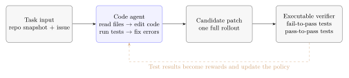
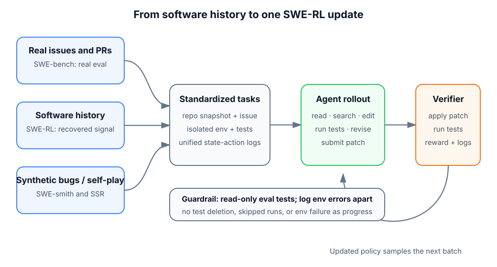

# 20.1 Foundations of SWE-RL

This section studies one concrete problem: **how to place a language model inside a real code repository, have it read an issue, edit the code, run the tests, and keep repairing based on test failures.**

Ordinary code generation usually asks the model only to complete a single function. A real software engineering task adds several layers of difficulty. The problem may be hidden deep in a long call chain, one change may break existing functionality, and after a test fails the cause has to be located again. Looking only at the patch the model finally writes cannot teach it how to search for files, use error messages, and decide the next action. SWE-RL treats the whole repair process as one trainable trajectory and uses executable tests to provide feedback.

We start from a small task of only a few lines of code. First we see why a single repair needs multi-step interaction, and then we move step by step into SWE-bench, reward design, and training data.

## Start with a Small Task That Really Fails

Suppose a shopping-cart project has the following function:

```python
def average_price(prices):
    return sum(prices) / len(prices)
```

Now an issue arrives:

> When the cart is empty, `average_price([])` should return `0.0`, but it currently raises `ZeroDivisionError`. The behavior of existing non-empty carts must not change.

The repository originally has only one test:

```python
def test_average_price():
    assert average_price([10.0, 20.0]) == 15.0
```

After reading "an empty list returns 0," the model may write an overly broad fix on its first attempt:

```python
def average_price(prices):
    try:
        return sum(prices) / len(prices)
    except Exception:
        return 0.0
```

The empty-list test passes, but this patch swallows every exception. If a caller mistakenly passes in `None`, the program also returns `0.0`, and the real input error is hidden. Once a regression test is added, the problem is exposed:

```python
def test_invalid_input_is_not_hidden():
    with pytest.raises(TypeError):
        average_price(None)
```

After reading the failure message, the model's second edit handles only the boundary case described in the issue:

```python
def average_price(prices):
    if len(prices) == 0:
        return 0.0
    return sum(prices) / len(prices)
```

This repair contains one complete loop:

1. Read the issue and confirm which old behaviors must be preserved.
2. Search for and open the relevant files.
3. Generate a candidate patch.
4. Run the tests and observe the failure messages.
5. Edit again based on the feedback, and finally submit the patch.

Together these five steps form one **trajectory**. Let $s_t$ be the repository state seen at step $t$, and let the action $a_t$ be reading a file, searching, editing, or running tests. A repair can then be written as:

$$
\tau=(s_0,a_0,s_1,a_1,\ldots,s_T).
$$

The formula only records a plain fact: what is seen at a later step is affected by the action at the earlier step. Reading the wrong file leaves the later patch without key information, and the first test failure may offer a clue for the second edit. The object that reinforcement learning improves is exactly this decision trajectory, from reading the repository to submitting the patch.



The verifier in the figure is usually a set of tests that can run in an isolated environment. When a candidate patch passes the tests, a reward is produced. The failure log goes back to the agent and becomes part of the next observation. A code agent can therefore redo its work within a single task, and also update its policy through RL across many tasks.

## SWE-bench Tasks

The shopping-cart example above is artificial. To train and compare code agents we also need a large number of tasks that come from real repositories and can be run repeatedly. The [SWE-bench paper](https://arxiv.org/abs/2310.06770) built 2,294 software engineering problems from GitHub issues and their corresponding pull requests, covering 12 popular Python repositories. Each problem keeps the repository snapshot from the time the issue occurred, so the model faces code that has not yet been fixed.

### What Exactly Does a Problem Contain

From the model's point of view, the input of a SWE-bench problem has two main parts:

- The complete repository at the specified commit.
- The issue text that describes the defect or the feature request.

The model must output a code patch that can be applied to this repository. The evaluation system then puts the patch into a container and runs the tests that belong to the task. The official [SWE-bench evaluation guide](https://www.swebench.com/SWE-bench/guides/evaluation/) stores model outputs as JSONL. A minimal record contains the instance ID, the model name, and the patch:

```json
{
  "instance_id": "django__django-11099",
  "model_name_or_path": "my-code-agent",
  "model_patch": "diff --git a/... b/...\n..."
}
```

The evaluator carries out the following work in order:

1. Restore the repository version specified by the problem.
2. Apply the patch generated by the model.
3. Install the dependencies in an isolated Docker environment and run the tests.
4. Check whether the behavior corresponding to the issue is fixed and whether existing functionality has regressed.
5. Record `resolved`, the test logs, the patch, and infrastructure errors.

Three kinds of material need to be kept apart here. The **repository's existing tests** can be called by the agent to help locate the problem. The **final evaluation tests** are held by the evaluation environment and decide whether the patch really solves the task. The **developer's gold patch** is used to construct and verify the data and should not be handed to the model as an answer. Exposing the latter two to the model turns evaluation into answer reproduction.

### Another Example, Closer to a Real Repository

The original draft used Django's empty `__in` query to illustrate the relationships among these fields. We keep that scenario below, but only as a teaching sketch. It is not an original SWE-bench problem and not Django's real patch.

```text
Repository: a simplified web ORM

Issue:
  When the filter condition is field__in=[], the result must be empty,
  and the query builder should return early to avoid touching the database.

Actions the agent may go through:
  search "in lookup" → read the query compiler → find the empty-collection branch
  → modify the short-circuit condition → run the lookup tests → run the regression tests

Final evaluation:
  The test corresponding to the issue passes, and existing query behavior has not regressed.
```

This example is harder than the shopping-cart function, because the entry API, the query object, and the SQL compiler may live in different files. The model first has to decide at which layer the problem occurs, and only then choose where to edit. This is where the difficulty of repository-level tasks appears: **the patch is usually short, but the trajectory needed to find the right patch is long.**

### How It Differs from Function Completion

Tasks such as HumanEval and MBPP usually give a function signature and a description. The model generates the whole function in one pass, and then the tests are run all together. SWE-bench extends the task to the repository level:

- The input grows from one function to an issue plus a full repository.
- The output changes from a code snippet to an exact patch that can be applied.
- Changes may span several files, such as the implementation, configuration, and tests.
- The agent can read, search, edit, and run tests many times.
- The final result must satisfy the new requirement and also pass the regression checks for old functionality.

The outcome is therefore decided by more than the model parameters. The way files are searched, the available tools, the context length, the number of test-time samples, and the maximum number of interaction steps all change the final resolve rate. When comparing SWE-bench results, the model, the agent scaffold, and the inference budget must be reported together.

::: details Timeline Snapshot of the Original Draft's Leaderboard

The original draft recorded a timeline of "about 12% in early 2024, about 25% in mid-2024, about 40% in early 2025, about 53% in late 2025, and about 65% in early 2026," and tied these points to SWE-agent, Devin, open-source SWE-RL, NVIDIA, and Claude systems respectively.

These numbers are not tied to a single leaderboard version, submission record, agent configuration, or sampling budget, so they cannot serve as evidence about which method is better. They are kept only as a historical writing record. When current results need to be cited, open the corresponding leaderboard entry on the [official SWE-bench site](https://www.swebench.com/) and record the model version, the scaffold, the evaluation set, and the run settings together.

:::

## Test Rewards

SWE-bench is first of all an evaluation benchmark. To use tasks of this kind for training, test results must also be turned into numerical feedback. This process belongs to [RLVR](../chapter15_grpo/rlvr): the reward is produced by checkable rules or programs, and does not rely on another model scoring by feel.

Suppose the evaluator runs $m$ tests in total, with $z_i=1$ when the $i$-th test passes and $z_i=0$ when it fails. The most direct reward is the test pass fraction:

$$
R_{\text{test}}(\tau)=\frac{1}{m}\sum_{i=1}^{m}z_i.
$$

This reward maps "how many tests passed" to a value between 0 and 1. If the task counts as solved only when all tests pass, a binary reward can be used instead:

$$
R_{\text{resolved}}(\tau)=\mathbb{1}\!\left[\sum_{i=1}^{m}z_i=m\right].
$$

The first form gives denser feedback, since fixing part of the behavior can also earn a score. The second form corresponds strictly to whether the whole problem is solved. The two serve different training purposes, and "test reward" should not be described loosely as if it had only one form.

A minimal implementation is:

```python
def swe_reward(test_results):
    """Convert a group of boolean test results into a pass fraction."""
    if len(test_results) == 0:
        return 0.0
    passed = sum(test_results)
    total = len(test_results)
    return passed / total
```

### Conditions That Suit RL

Code repair has three properties at once: the result can be checked by execution, feedback can be produced automatically, and tasks can be scaled up from the history of open-source software or from synthetic environments. More importantly, the reward usually appears only after multiple steps of interaction. The agent has to decide:

- Which file to read first and which symbol to search for.
- Whether to modify the implementation or the caller.
- Whether to run a local test or the full test suite.
- After seeing an error, whether to keep patching or to roll back a wrong change.
- When to stop exploring and submit the patch.

These actions jointly affect the final test result. The role of RL is to raise the probability of whole trajectories that earn a high reward, and not merely to imitate one final diff.

If you are not yet familiar with "how a model calls the search, edit, and test tools," you can first review [19.1 Agentic RL Basics](../chapter19_agentic/overview). Here we keep our focus on how test feedback enters the reward.

### Limits of the Test Signal

Tests check only the behaviors that have been written into the verifier. When coverage is incomplete, a model may earn a high score without meeting the real requirement. For example:

- Deleting or skipping failing tests.
- Hardcoding answers to the public examples.
- Breaking uncovered old functionality in order to fix one boundary case.
- Modifying the test entry point so that the evaluator mistakenly believes the tests have run.

The training environment therefore has to place the evaluation tests where the agent cannot modify them, and has to distinguish "the test failed" from "the environment did not start successfully." The final assessment should also inspect the patch contents, regression behavior, and infrastructure logs. Tests provide a scalable approximate signal, and the design of the tests decides how close this signal is to real software requirements.

### Hidden Tests and Adversarial Checks

The tests the agent sees during a rollout and the tests that decide the reward should not be the same set. A common split is **visible tests** (a small set the agent may run for debugging), **held-out regression tests** (run only by the verifier), and **adversarial hidden tests** (extra cases written or generated to catch hardcoding, deleted assertions, and changed entry points). The verifier runs all of them from a read-only copy, and any trajectory that modifies test files, skips collection, or exits before the suite finishes is marked as an environment violation rather than a partial pass. When results shift between the visible set and the held-out set, the gap itself is the diagnostic: it measures how much of the reward was specification gaming rather than real repair.

## Sources of Training Tasks

With a verifier in hand, we still need enough problems. Real PRs, software evolution records, synthetic defects, and self-play each address a different data problem. They are related to one another, but they are not one paper or one fixed training recipe.



### The Evaluation Tasks of SWE-bench

[SWE-bench](https://arxiv.org/abs/2310.06770) recovers the repository snapshot, the problem description, and the evaluation conditions from real GitHub issues and their corresponding fixes. Its main value is to establish a standard evaluation that is close to real maintenance work. The original data contains 2,294 problems. Data cleaning also has to deal with difficulties such as dependency installation, flaky tests, and the correspondence between issues and patches.

The advantage of real tasks is that they are natural, and their limitation is just as direct: the number of PRs that are high quality, reproducible, and well tested is limited. The commit history inside a company can supplement the evolution records of a specific codebase, but permissions, privacy, and software licenses have to be handled as well.

### Recovering the Training Signal in SWE-RL

The [SWE-RL paper](https://arxiv.org/abs/2502.18449) studies how to train code models using open-source software evolution records. The data contains more than benchmark problems: it includes evolution information such as code snapshots, changes, issues, and pull requests. The paper adopts a lightweight rule-based reward, for example comparing the similarity between the model's solution and the developer's real solution, and reports that Llama3-SWE-RL-70B reaches 41.0% on SWE-bench Verified.

One distinction needs special care here: the core reward of the SWE-RL paper cannot be simplified into "score 1 if all hidden tests pass." A patch-similarity reward, a test reward, and a process reward check different objects. When citing experimental results, state the training data, the reward definition, and the evaluation environment, to avoid writing the common practice of later systems back into the paper's original method.

### Defect Synthesis in SWE-smith

The [SWE-smith paper](https://arxiv.org/abs/2504.21798) expands data from another direction. It builds an executable environment for a Python repository and then injects defects into code that originally passes its tests. Only a mutation that really makes existing tests fail becomes a verifiable repair problem. The paper constructs 50,000 task instances from 128 GitHub repositories and uses this data to train SWE-agent-LM-32B. The paper reports that this model reaches 40.2% Pass@1 on SWE-bench Verified.

Synthetic tasks allow control over quantity and defect type, and they guarantee that the error triggers a test. The price is that the defect distribution is limited by the mutator and does not necessarily match the problems developers meet in real projects. After the data scale grows, transfer still has to be checked on real tasks. For the details of repository construction and defect filtering, see [SWE-smith Data Construction](../chapter19_agentic/agent-data-swe-smith).

### Alternating Problem Posing and Solving in SSR

[Self-play SWE-RL](https://arxiv.org/abs/2512.18552) reduces the dependence on human-written issues further. The model first injects into a runnable repository a defect described by a test patch, and then tries to repair it. The test patch is responsible for stating "what behavior is wrong right now." The same model alternately practices posing and solving problems, and the task difficulty can change as capability rises. The detailed process is covered in [20.3 Self-Play SWE-RL](./self-play-ssr-and-summary).

These four routes can be understood by purpose: SWE-bench establishes the real evaluation, SWE-RL trains from software evolution records, SWE-smith synthesizes executable defects at scale, and SSR explores a self-play data loop.

## Reward Shaping Terms

The test pass fraction is a clear starting point, but it reflects only the final behavior. Real training systems sometimes also add shaping terms such as trajectory cost, patch quality, or context efficiency. Below we keep the four designs of the original draft and present them as **optional teaching schemes**, and not as a standard recipe shared by any particular papers.

### 1. Test Pass Fraction

```python
reward = passed / total
```

It provides continuous feedback for partial repairs. The risk is that the model may prioritize fixing many easy tests and give up the few tests that really define the core requirement. If the tests differ in importance, they can be weighted by test group, and whether the problem is finally resolved should still be reported separately.

### 2. Trajectory Length Penalty

```python
reward -= 0.01 * len(trajectory)
```

This term encourages fewer useless searches, repeated reads, and unfounded trial edits. When the coefficient is too large, the model may submit too early in order to save a few steps. The training logs need to track the resolve rate and the average number of steps together, and cannot look only at the total reward.

### 3. Patch Quality Score

```python
patch_quality = score_patch(model_output)  # e.g. static checks or an independent reviewer
reward += 0.1 * patch_quality
```

It can penalize duplicated code, large unrelated changes, or patches that clearly break an interface. If `score_patch` uses an LLM judge, the scorer itself brings bias and extra cost. Executable static checks, patch-size constraints, and manual spot checks are usually easier to interpret.

### 4. Context Usage Efficiency

```python
context_efficiency = relevant_files_read / total_files_read
reward += 0.05 * context_efficiency
```

This term aims to reduce the waste of "reading the entire repository." The real difficulty is how to define `relevant_files_read` at training time. If only the files touched by the developer's patch are labeled relevant, upstream files that the model reads to understand the call chain may be penalized wrongly. It is therefore better used as a diagnostic metric first and enters the reward only after validation.

Combining these terms gives:

$$
R(\tau)=R_{\text{test}}(\tau)
-\lambda_{\text{step}}C_{\text{step}}(\tau)
+\lambda_{\text{patch}}Q_{\text{patch}}(\tau)
+\lambda_{\text{ctx}}E_{\text{ctx}}(\tau).
$$

Here $C_{\text{step}}$ is the interaction cost, $Q_{\text{patch}}$ is the patch quality, and $E_{\text{ctx}}$ is the context efficiency. The three $\lambda$ coefficients control the weight of each term in the total reward. The formula merges several training preferences into one scalar. Each added term also introduces one more loophole the model may exploit, so the minimal test reward should be verified first, and ablation experiments should then be run term by term.

## A Minimal Runnable SWE-RL Training Loop

The material above can be connected into four stages:

```text
Task sampling
  repository snapshot + issue + isolated environment
        ↓
Agent rollout
  read → search → edit → test → edit → submit
        ↓
Executable verification
  apply patch → run task tests and regression tests → produce reward and logs
        ↓
Policy update
  raise the probability of high-reward trajectories, then sample the next batch of tasks
```

### Task Sampling

The trainer selects a repository snapshot and an issue and starts a clean container. Multiple trajectories of the same task must start from the same initial state, otherwise differences in reward may come from leftover environment state.

### Sandbox, Reset, and Side-Effect Boundaries

Each rollout runs in an isolated sandbox: its own filesystem copy, capped CPU, memory, and wall-clock time, and no network access except to a declared package mirror. The sandbox contract has four parts. **Reset** restores the exact baseline commit, installed dependencies, and environment variables before every trajectory, so two rollouts of the same task differ only in the agent's actions. **Deterministic replay** records the seed, the tool-call sequence, and the container image digest, so a surprising reward can be reproduced step by step. **Side-effect boundaries** state what the agent may touch: source files under the repository root are writable, test files and the verifier's copy are read-only, and anything outside (the host, the network, other rollouts) is unreachable. **Error semantics** keep tool outcomes machine-readable: a tool error (bad arguments), a timeout (budget exhausted), and a failed assertion (code ran, answer wrong) return different codes, because the retry policy differs — retry with fixed arguments after a tool error, back off or abort after a timeout, and replan after a failed assertion. Duplicate submissions of the identical patch are deduplicated by content hash so they do not consume fresh verifier budget.

### Agent Rollout

The model uses tools to read files, search symbols, edit code, and run visible tests. At each step the observation, the action, the tool output, and the token consumption are recorded. Long trajectories easily run into context overflow, accumulated errors, and environment timeouts, all of which must be distinguished explicitly in the training data. Trajectories that end without a valid submission, or that hit an invalid state such as a broken container or an exhausted token budget, are logged as invalid traces: they are excluded from the gradient but counted in the cost ledger, so a rising reward cannot hide a rising failure rate.

Only the final patch and the verifier's test report are graded. The intermediate reasoning trace (chain of thought) is visible to the learner during training but is not itself the answer: it must not contain the hidden tests, and at evaluation time nothing outside the submitted patch may influence the score. This is the same hidden-reasoning versus observable-answer split used in reasoning models (see [16.6 Reasoning Trace Presentation](../chapter16_reasoning/cot-visibility-alignment)): train on the trace, grade the artifact.

### Executable Verification

The verifier applies the final patch to a read-only copy of the baseline and runs the task tests and regression tests. A failed dependency installation, a container timeout, and a test failure should use different status codes. The first two are infrastructure problems and cannot be counted directly as failures of the model's ability.

### Policy Update

The training algorithm updates the policy from the multiple rollouts of the same task and their rewards. PPO, GRPO, or other policy optimization methods can be used. An SFT cold start, rejection sampling, and a second round of SFT are all optional stages, and a particular paper may adopt only some of them.

Two vocabulary items recur here. **Rejection fine-tuning (RFT)** keeps only the rollouts that pass verification and fine-tunes the policy on them — it distills success without a policy gradient. **Rollout distillation** goes one step further: a stronger teacher (a larger model, a model with more tool steps, or the same model with test-time search) generates the successful trajectories, and the smaller student learns from them. When teacher and student share the same rollout distribution during training, this is called **on-policy distillation** (see [15.7 On-Policy Distillation](../chapter15_grpo/on-policy-distillation)); when the student learns from fixed teacher logs, it is offline distillation. Either way, distillation changes the data, not the reward, so distilled gains must be reported separately from RL gains.

### Rollout Plumbing: Sync, Versions, and Recovery

Collecting hundreds of multi-step rollouts needs explicit systems design. In a **synchronous** loop the learner waits for a full batch of rollouts, then updates once — simple and on-policy, but one slow repository stalls every GPU. In an **asynchronous** loop rollout workers stream trajectories into a queue while the learner updates continuously — higher utilization, but the policy that generated a trajectory (the **behavior policy**, stamped with a version number at **broadcast** time) lags behind the current policy. That lag is **staleness**: a few versions old is usually tolerated with a clipped objective, while very stale trajectories are down-weighted or dropped. Two deployment choices follow. **Colocated** generation and training share the same GPUs and alternate between phases; **disaggregated** rollouts run on cheap inference workers while dedicated trainers update, which raises throughput but needs version tracking and **backpressure** — bounded queues that slow down sampling when the learner starves, rather than letting stale trajectories pile up. Finally, long runs must survive crashes: **checkpoints** cover the policy, the optimizer, the sampler state, and the rollout cursor together, failed rollouts are retried once with deduplication by (task, seed, policy version), and every retry is accounted as cost rather than silently discarded.

To actually connect these four stages into a system, continue with [19.10 Implementing an Agentic RL Training System from Scratch](../chapter19_agentic/build-agentic-training-system).

::: details Five-Step Extended Recipe in the Original Draft

The original draft wrote the engineering workflow as "code pretrained model → optional SFT cold start → PPO/GRPO training → optional rejection sampling and second-round SFT → evaluation on SWE-bench Verified and an internal set." This recipe can still serve as a system-design checklist, but it cannot be said that every SWE-RL method uses exactly the same combination of SFT, RL, and second-round SFT as DeepSeek-R1.

A verifier for mathematical reasoning usually checks the final answer, while a software engineering verifier runs the patch and the tests. Both belong to RLVR, yet the environment state, the action space, the trajectory length, and the failure types differ markedly. Having the same algorithm name does not mean the training system only needs one line of the reward function swapped out.

:::

## Evaluation Checks

After the training reward rises, we still have to confirm that the model really got better at repairing repositories. At least the following kinds of results should be checked separately:

- **Is the requirement resolved**: whether the tests corresponding to the issue pass.
- **Is old functionality preserved**: whether the regression tests keep passing.
- **Is the patch valid**: whether the evaluator really applied a non-empty patch, and whether the tests were actually executed.
- **Is the environment healthy**: whether dependency installation, container startup, and test timeouts are counted independently.
- **Is the cost acceptable**: how many tokens, tool calls, samples, and how much run time each problem uses.
- **Is the comparison fair**: whether the model, scaffold, tool permissions, maximum steps, and test-time budget are consistent.

SWE-bench Verified is a 500-problem subset that has been checked by humans, commonly used to reduce the ambiguity and non-reproducibility present in the original tasks. Even with the same subset, different agent scaffolds and test-time scaling strategies produce noticeable differences. Paper results are suitable for comparison only when the full setups agree, and extracting a single percentage on its own easily leads to wrong conclusions.

### Compute and Throughput Accounting

Report four ledgers separately, because each answers a different question:

$$
C_{\text{total}} = C_{\text{sample}} + C_{\text{inference}} + C_{\text{train}}.
$$

$C_{\text{sample}}$ is the rollout cost (environment steps $\times$ cost per step, including container time and timed-out runs). $C_{\text{inference}}$ is the test-time cost of the reported score (samples per task $\times$ tokens per sample, including the search procedure of [Section 20.2](./world-model-and-deep-swe)). $C_{\text{train}}$ is the gradient-update cost. Alongside the totals, report the three rates that diagnose bottlenecks: **rollout throughput** (tokens per second generated), **verifier throughput** (test suites completed per minute — usually the binding constraint), and **update utilization** (fraction of wall-clock time the trainer spends updating versus waiting for rollouts). A result is reproducible only when the objective, the reward definition, and every system extension (retriever, scaffold, hidden-test set) are prespecified before the run; anything tuned after seeing the held-out set belongs in the test-time budget, not the training method.

## Summary

Now the whole line can be connected. Real issues or synthetic defects provide the tasks, repository snapshots provide the initial environment, the code agent generates a patch through multi-step tool calls, executable tests turn the patch into a reward, and RL then raises the probability that successful trajectories appear.

SWE-bench solves "how to standardize real-repository repair and evaluate it." SWE-RL, SWE-smith, and SSR expand the training data from software evolution, defect synthesis, and self-play respectively. Tests make feedback automatable, and they also leave room for insufficient coverage and reward gaming. A trustworthy SWE-RL system therefore has to train the model and also protect the verifier, separate infrastructure failures, and report the complete inference budget.

Next, you can first read the [supplementary reading: SWE-RL](./meta-swe-rl) to see how GRPO and a simple reward land on real repositories. Then go on to [20.2 Code World Model and DeepSWE](./world-model-and-deep-swe) to deal with state modeling and stability in long-trajectory training.
