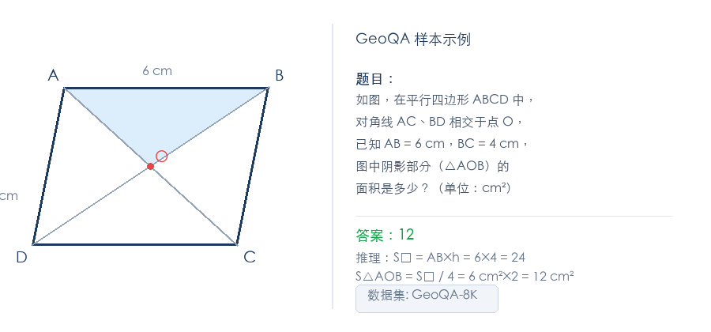
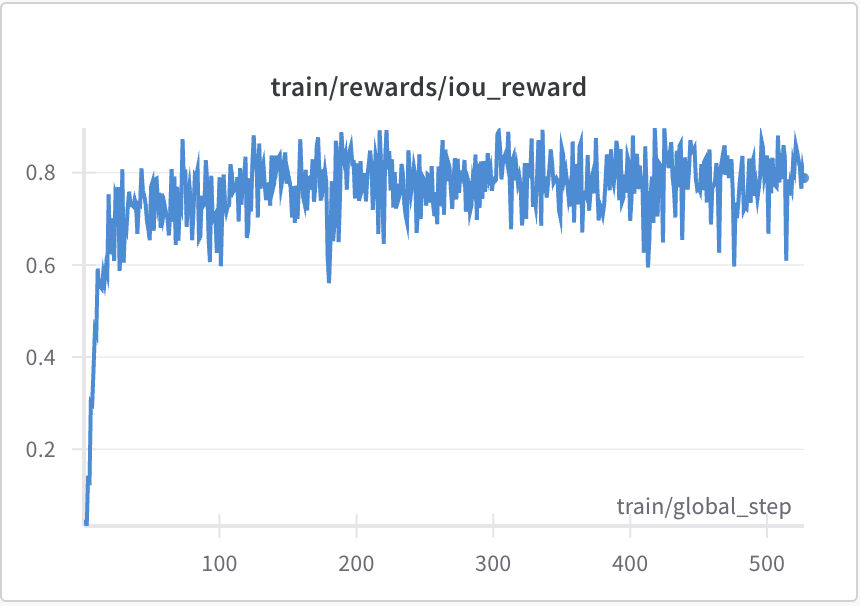
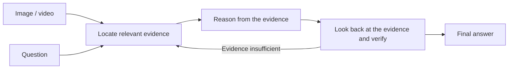
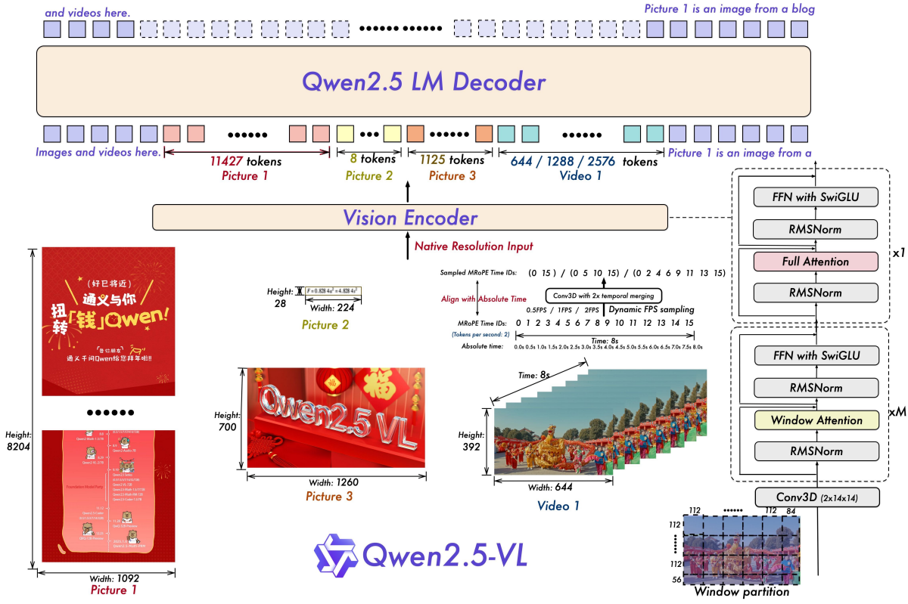
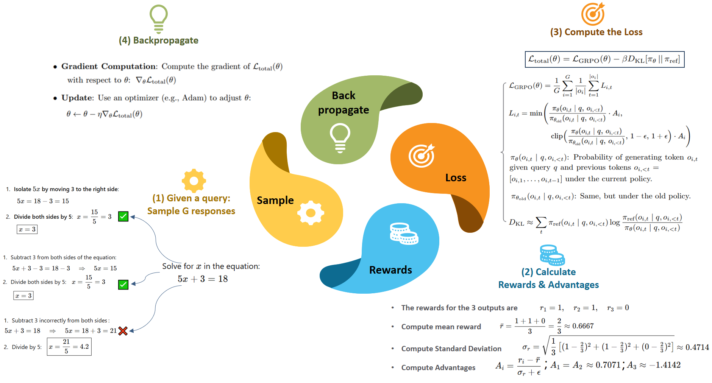
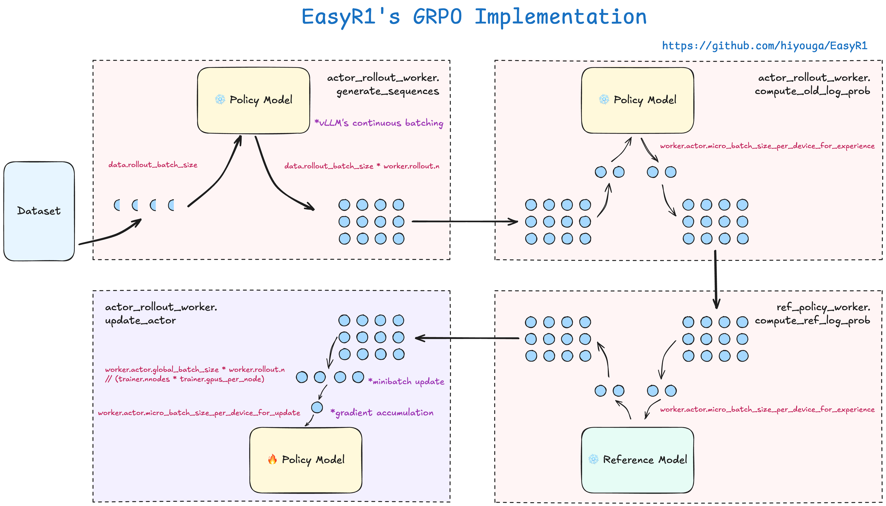
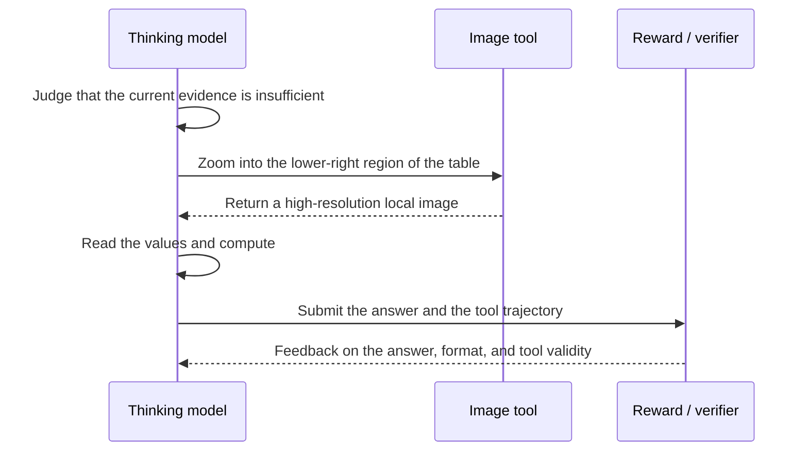
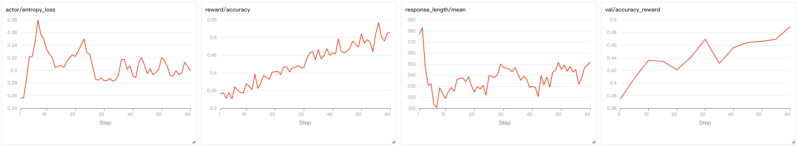

# 23.2 Visual Reflection RL: Answering with Evidence

Consider a bar chart in which category A is 42, B is 57, and C is 39. The question asks "how much higher is B than A." A model that only grabs the tallest bar will easily answer 57. If it first reads the values of the two bars and then computes $57-42$, the answer is 15.

The ability missing here is not mysterious. Before producing the final answer, the model has to keep the visual evidence, finish the calculation, and go back to the image to check once. We call this process of "observe, reason, verify, answer" **Visual Reflection**. Its goal is to reduce misreading, omission, and guessing answers from language priors, and not merely to make responses longer.

This section follows the [Qwen3-VL technical report](https://arxiv.org/abs/2511.21631). It explains which model structures visual reflection depends on, how it is formed through post-training, and why "thinking a few more steps" can still fail. Qwen3-VL models began to be released in September 2025, and the technical report became public in November 2025. It is not the same release as the text-only Qwen3 released in April 2025.



<div style="text-align: center; font-size: 0.9em; color: var(--vp-c-text-2); margin-top: -10px; margin-bottom: 20px;">
  <em>Figure 1: A geometric visual question answering example. The model first has to recognize the geometric relations in the figure (visual evidence), then carry out the calculation (intermediate reasoning), and finally give the answer. Source: <a href="https://github.com/ChallenAI/EasyR1" target="_blank" rel="noopener noreferrer">the EasyR1 project</a></em>
</div>

## What Is Visual Reflection?

Visual reflection is the process in which **the model, before outputting the final answer, explicitly keeps the visual evidence, completes the intermediate reasoning, and looks back at the image to verify**. It does not aim to make the answer longer. It aims to make the reasoning process observable and verifiable.

This concept comes from a basic insight of cognitive science: a complex human visual task is not "answer after one glance" but repeated observing, calculating, and verifying. When you read a receipt, you first locate the subtotal and the tax, read the two numbers, do the addition, and then go back to the receipt to confirm that the readings came from the right regions. Visual reflection models this process, so that AI also completes tasks through "observe, reason, verify."



<div style="text-align: center; font-size: 0.9em; color: var(--vp-c-text-2); margin-top: -10px; margin-bottom: 20px;">
  <em>Figure 2: IoU reward curve from the VLM-R1 training logs: the rule-based grounding reward rises during RL training. Source: <a href="https://github.com/om-ai-lab/VLM-R1" target="_blank" rel="noopener noreferrer">the VLM-R1 project</a></em>
</div>

## Three Kinds of Objects in Visual Reasoning

Give a model a receipt and ask "what is the total including tax?" A description task only requires recognizing that "this is a receipt." A reasoning task needs to locate the subtotal and the tax, read the two numbers, and then do the addition. As long as one of the numbers comes from the wrong region, the final answer still fails even if the later calculation is entirely correct.

A visual reasoning trajectory therefore contains at least three kinds of objects:

- **Visual evidence**: which regions, texts, objects, or video segments in the input are relevant to the question. For example, the top of bar A (42) and the top of bar B (57) in a bar chart.
- **Intermediate reasoning**: how the pieces of evidence are compared, calculated, or linked causally. For example, read 42 and 57 and compute $57-42=15$.
- **Final answer**: output a number, an option, coordinates, or natural language as the task requires. For example, output 15.

An ordinary outcome reward checks only the final answer. It records both "misread but calculated correctly" and "read correctly but calculated wrongly" as failures, and it records "did not look at the image at all but guessed right by luck" as a success. [23.1 Visual Reward Design](./vlm-challenges) already explained the limits of this kind of scalar reward. The value of visual reflection is to turn part of the intermediate process into an observable, verifiable trajectory.



<div style="text-align: center; font-size: 0.9em; color: var(--vp-c-text-2); margin-top: -10px; margin-bottom: 20px;">
  <em>Figure 3: The visual reflection process. The model first locates evidence, then reasons from it, then looks back to verify, and observes again when the evidence is insufficient.</em>
</div>

Back to the bar chart at the start: the model has to first locate bar A and bar B (visual evidence), read 42 and 57 (intermediate reasoning), compute the difference (intermediate reasoning), go back to the image to confirm that the readings came from the right positions (verification), and finally output 15 (final answer). If any step goes wrong, the answer fails.

## How Visual Reflection Differs from an Ordinary VLM

You may have noticed that visual reflection also uses the framework of a VLM: an image, a question, and an answer. What, then, is the essential difference between it and the ordinary VLM reasoning we studied earlier?

| Dimension          | Ordinary VLM                                                   | Visual-reflection VLM                                                 |
| ------------------ | -------------------------------------------------------------- | --------------------------------------------------------------------- |
| Reasoning process  | Implicit, going directly from image to answer                  | Explicit, keeping the intermediate evidence and calculation steps     |
| Verifiability      | Only the final answer is checked                               | The intermediate evidence can be checked for correctness              |
| Failure modes      | Misreading, omission, and lucky guesses are all mixed together | The failing step (evidence / reasoning / verification) can be located |
| Training objective | Outcome reward                                                 | Outcome + process reward (evidence hit rate, validity of tool calls)  |
| Tool use           | None                                                           | Can call tools such as zoom and search to observe again               |
| Suitable tasks     | Simple recognition and classification                          | Complex reasoning, multi-step calculation, long-video understanding   |

The core difference comes down to one point: **in an ordinary VLM, you care only about whether the final answer is right; in visual reflection, you need to care whether the intermediate evidence is used correctly.**

## How Visual Evidence Enters Language Reasoning

The ability to reflect is first limited by the model structure. If visual details are already lost before they enter the language model, no chain of thought, however long, can recover the original information. Qwen3-VL still uses the three-part structure of "vision encoder, vision-language merger layer, language model," and adds three changes directly related to preserving evidence [^qwen3vl].



<div style="text-align: center; font-size: 0.9em; color: var(--vp-c-text-2); margin-top: -10px; margin-bottom: 20px;">
  <em>Figure 4: Schematic of the Qwen2.5-VL architecture. The vision encoder extracts features, which pass through the vision-language merger layer and are sent into the language model. Qwen3-VL adds DeepStack and multi-level positional encoding on top of this. Source: <a href="https://arxiv.org/abs/2502.13923" target="_blank" rel="noopener noreferrer">the Qwen2.5-VL technical report</a></em>
</div>

### DeepStack: Feeding Visual Features from Different Depths into the Language Model

The shallow layers of a vision encoder more easily preserve edges, textures, and local positions, while the deep layers lean toward objects and semantics. If only the last layer's features are taken, small text or local geometric relations may already have been compressed away.

DeepStack takes features from several levels of the vision encoder, processes them through separate merger modules, and injects them into the first few layers of the language model. This does not require stuffing more visual tokens into the context, yet it lets the language model touch local details and high-level semantics at the same time. What it solves is "whether the evidence has entered the reasoning process," and it does not guarantee that the model used the right evidence.

### Interleaved-MRoPE: Writing Time, Width, and Height into the Position

The visual tokens in an image have two-dimensional positions, and a video adds a time axis. Qwen3-VL's interleaved-MRoPE allocates the time, height, and width positions in an interleaved manner within the rotary position encoding, so that the model can distinguish "the header in the upper left," "the value in the lower right," and "the object that appears at second 12."

This structural change is especially important for spatial relations and long videos. If the position encoding cannot stably express time and space, the model may recognize two objects but get their order and relative positions wrong.

### Text Timestamps: Making Video Evidence Something That Can Be Stated

Video tasks often ask "when does a certain action happen." Qwen3-VL writes the temporal position explicitly as text timestamps, so that an answer can cite evidence such as "around 3.0 seconds." Temporal localization thus changes from a hidden vector into a text object that can be checked.

The three changes together provide the foundation of visual reflection: DeepStack preserves details as far as possible, the position encoding stores spatial and temporal relations, and the text timestamps let video evidence enter language reasoning. The official report also gives a native 256K interleaved multimodal context and provides dense models of 2B, 4B, 8B, and 32B and MoE models of 30B-A3B and 235B-A22B to cover different latency and quality needs [^qwen3vl_repo].

## How the Thinking Version Is Formed by Post-Training

Qwen3-VL releases an Instruct version and a Thinking version at the same time. The Instruct version leans toward answering directly, and the Thinking version generates longer intermediate reasoning on complex tasks. The two share a multimodal foundation but have different post-training objectives.

According to the technical report, the Thinking route uses long chain-of-thought cold start, strong-to-weak distillation, reasoning reinforcement learning, and general reinforcement learning in turn [^qwen3vl]. This chain can be understood through a geometry problem.



<div style="text-align: center; font-size: 0.9em; color: var(--vp-c-text-2); margin-top: -10px; margin-bottom: 20px;">
  <em>Figure 5: Schematic of the GRPO training flow. The reasoning RL of the Thinking version uses a similar mechanism, comparing relative advantages among multiple reasoning trajectories under the same condition. Source: <a href="https://github.com/ChallenAI/EasyR1" target="_blank" rel="noopener noreferrer">the EasyR1 project</a></em>
</div>



<div style="text-align: center; font-size: 0.9em; color: var(--vp-c-text-2); margin-top: -10px; margin-bottom: 20px;">
  <em>Figure 6: The GRPO implementation architecture of EasyR1. The model samples trajectories in several parallel environments and computes relative advantages through within-group normalization. Source: <a href="https://github.com/ChallenAI/EasyR1" target="_blank" rel="noopener noreferrer">the EasyR1 project</a></em>
</div>

The cold-start stage first gives the model a small number of well-structured demonstrations: read the figure relations, write the intermediate equations, and then give the answer. It solves the output format and basic reasoning habits.

The distillation stage lets a stronger model supply high-quality trajectories to a smaller model. The small model first learns "roughly what feasible reasoning looks like" and then enters reinforcement learning exploration, which reduces the cost of searching for a correct path among completely random long answers.

Reasoning reinforcement learning covers text and multimodal tasks, including mathematics, code, logic, visual grounding, and visual puzzles. Verifiable tasks can use answers, coordinates, bounding boxes, or tool results as rewards. General reinforcement learning then adds objectives such as instruction following, interaction quality, and safety, to keep the model from being able to do only questions with standard answers.

This differs in essence from "writing a sentence like please think step by step in the prompt." A prompt changes only the context of a single reasoning run, while post-training raises the probability in the policy of a whole class of trajectories, so that the model may produce observing, calculating, and verifying behavior even without a hand-written five-step template.

## Observing Again When Evidence Is Insufficient

Some image details are so small that the model can hardly see them clearly in one forward pass. Examples are finding a certain label in a 4K circuit diagram, or checking the amount on a line in a long screenshot. Continuing to generate text does not raise the image resolution, and what is missing here is the action of "observing again."

Qwen3-VL's Thinking with Images plugs image zoom and search tools into the reasoning process. The model can first judge that the evidence is insufficient, then call `image_zoom_in_tool` to crop out a local region, and continue reasoning after reading the new visual observation. The official repository lists this ability separately as a cookbook, and the technical report describes the training pipeline of cold-start SFT and tool-integrated RL [^qwen3vl_repo].



<div style="text-align: center; font-size: 0.9em; color: var(--vp-c-text-2); margin-top: -10px; margin-bottom: 20px;">
  <em>Figure 7: The tool-call flow of Thinking with Images. When the model judges the evidence insufficient it calls the zoom tool, obtains a high-resolution local image, and continues reasoning.</em>
</div>

To understand this kind of training, we can write a composite reward for teaching purposes:

$$
R = R_{\text{answer}} + \lambda_f R_{\text{format}}
  + \lambda_t R_{\text{tool}} - \lambda_c C_{\text{tool}}.
$$

$R_{\text{answer}}$ checks the final answer, $R_{\text{format}}$ checks whether the output can be parsed, $R_{\text{tool}}$ checks whether the tool arguments and return values are valid, and $C_{\text{tool}}$ accounts for the cost of unnecessary calls. This formula is a teaching simplification used to explain the design space, and it is not the exact training objective published in the Qwen3-VL paper.

Including the cost term is important. If only a correct final answer is rewarded, the model may zoom into the whole image over and over on every problem. The success rate goes up, but the latency and call cost become unacceptable. Tools let the model obtain new evidence, and they also turn "when to look again, where to look, and how many times" into a new policy-learning problem.

## Running a Minimal Visual Reflection Check

The code below uses the official `transformers` interface to load the 4B Thinking model. It only demonstrates the inference interface and does not mean RL training was done. GPU memory requirements depend on the image resolution, the precision, and the attention implementation, so choose the model and quantization method according to your own machine before running.

```python
from transformers import AutoModelForImageTextToText, AutoProcessor

model_id = "Qwen/Qwen3-VL-4B-Thinking"
model = AutoModelForImageTextToText.from_pretrained(
    model_id,
    dtype="auto",
    device_map="auto",
)
processor = AutoProcessor.from_pretrained(model_id)

messages = [{
    "role": "user",
    "content": [
        {"type": "image", "url": "./chart.png"},
        {"type": "text", "text": "Read the values of bars A and B, compute B-A, and give the evidence."},
    ],
}]

inputs = processor.apply_chat_template(
    messages,
    tokenize=True,
    add_generation_prompt=True,
    return_dict=True,
    return_tensors="pt",
).to(model.device)

output_ids = model.generate(**inputs, max_new_tokens=1024)
answer = processor.batch_decode(
    output_ids[:, inputs.input_ids.shape[1]:],
    skip_special_tokens=True,
)[0]
print(answer)
```

When checking the result, do not look only at the final number. Record at least four pieces of evidence: whether A and B were read, whether the two readings came from the correct positions, whether the calculation is correct, and whether the answer changes with the image when swapped for an image of the same layout but different values.

The last item is a counterfactual check. If the intermediate evidence and the answer barely change after the image is swapped, the model probably relies on priors about the question type. Continuing to reward long chains of thought then only makes guesses look more like reasoning.

## How Visual Reflection Can Still Fail

**Reflection may be built on a wrong observation.** After the model misreads 42 as 47, it can write a perfectly self-consistent subtraction process. Fixing this kind of problem needs visual grounding, OCR, or tool verification, and simply lengthening the chain of thought does not help.



<div style="text-align: center; font-size: 0.9em; color: var(--vp-c-text-2); margin-top: -10px; margin-bottom: 20px;">
  <em>Figure 8: EasyR1 training curves on the GeoQA task. Even with GRPO, the model may still show reward hacking or insufficient use of evidence on some subtasks. Source: <a href="https://github.com/ChallenAI/EasyR1" target="_blank" rel="noopener noreferrer">the EasyR1 project</a></em>
</div>

**Reasoning length may replace evidence quality.** If the reward model prefers detailed answers, the model learns to add steps and wording. Evaluation should report accuracy, visual-evidence hit rate, the number of output tokens, and tool-call cost together.

**Not every task needs Thinking.** For simple OCR or direct grounding tasks, long reasoning adds latency and may introduce new calculation errors after a correct observation. In a document question answering experiment, the 2026 Perception-RFT even observed that training without explicit reasoning outperformed the reasoning variant for a 4B model [^perception_rft]. This result does not negate visual reasoning. It shows that "look first or think first" depends on the bottleneck of the task.

**A successful tool call does not mean the task succeeded.** Zooming into the right region only proves that the action was valid, and we must also check whether the model used the returned result to update its conclusion. Trajectory evaluation must save the call arguments, the tool observations, and the final answer together.

## Connections to Earlier Chapters

Visual reflection is not an isolated concept. It ties together several ideas from the earlier chapters:

- **Multimodal reward design (23.1)**: Visual reflection turns part of the intermediate process into a verifiable trajectory, so that the reward checks the use of evidence as well as the result.
- **GRPO's within-group normalization (Chapter 15)**: The reasoning RL of the Thinking version uses a similar mechanism, comparing relative advantages among multiple reasoning trajectories under the same condition.
- **Tool-calling RL (Chapter 19, Agentic RL)**: Thinking with Images turns zoom and search into actions, letting the model observe again when evidence is insufficient.
- **Multi-dimensional rewards in RLHF (Chapter 13)**: Visual reflection uses multi-dimensional rewards (answer, evidence, tools, cost) to keep the model from catering to a single metric.
- **Counterfactual checks (Chapter 25)**: Checking by swapping the image whether the model relies on question-type priors follows from the same line as the methods for identifying reward hacking.

## Frontier: From Visual Reflection to Audio-Grounded Reasoning

Vision and audio face the same root problem: the reasoning chain must be anchored to evidence of the current modality. A visual model may bypass the image and guess the answer directly, and an audio model may also convert the sound roughly into text first and then reason only around the text.

[Step-Audio-R1](https://arxiv.org/abs/2511.15848) calls this problem insufficient acoustic grounding and proposes MGRD (Modality-Grounded Reasoning Distillation). MGRD uses iterative distillation, supervised fine-tuning, and verifiable-reward reinforcement so that the reasoning explicitly cites acoustic evidence such as pitch, rhythm, and timbre. It is not a multimodal version of DPO. The full method and reward design are covered in [24.1 Audio Reward Design](../chapter24_multimodal_frontier/audio-reward-design).

This comparison leaves a judgment that transfers to every modality: before the reasoning gets longer, first confirm that the model has obtained and used the correct evidence.

## Summary

The core of visual reflection is to turn "observe, reason, verify, answer" into an observable, verifiable trajectory. The architectural changes of Qwen3-VL (DeepStack, positional encoding, timestamps) address how evidence enters language reasoning. The post-training pipeline (cold start, distillation, reasoning RL, general RL) addresses how reflective behavior is formed. Tool integration addresses how to observe again when the evidence is insufficient. But reflection can still be built on a wrong observation, reasoning length can replace evidence quality, and a successful tool call does not mean the task succeeded. Verifying whether visual reflection works requires checking the intermediate evidence, counterfactual image swaps, tool trajectories, and cost, and cannot rely on the final answer alone.

## Further Reading and References

[^qwen3vl]: Qwen Team, [Qwen3-VL Technical Report](https://arxiv.org/abs/2511.21631), 2025. The main source for the architecture, post-training, and Thinking with Images.

[^qwen3vl_repo]: QwenLM, [the official Qwen3-VL repository](https://github.com/QwenLM/Qwen3-VL). Model versions, the official inference interface, and an index of cookbooks.

[^perception_rft]: Harikrishnan P M, et al., [Stop Thinking, Start Looking: Efficient Post-Training for Multimodal Document Question Answering via Reasoning-Free Alignment](https://arxiv.org/abs/2607.14682), 2026. Used to show that explicit reasoning does not benefit every visual task.

- [QVQ-72B-Preview: To See the World with Wisdom](https://qwenlm.github.io/blog/qvq-72b-preview/): The Qwen team's exploration of long visual chains of thought before Qwen3-VL.
- [QVQ-Max: Think with Evidence](https://qwenlm.github.io/blog/qvq-max-preview/): Shows the effect and limits of increasing the thinking budget on visual math tasks.
