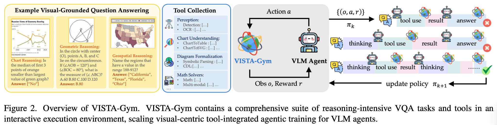
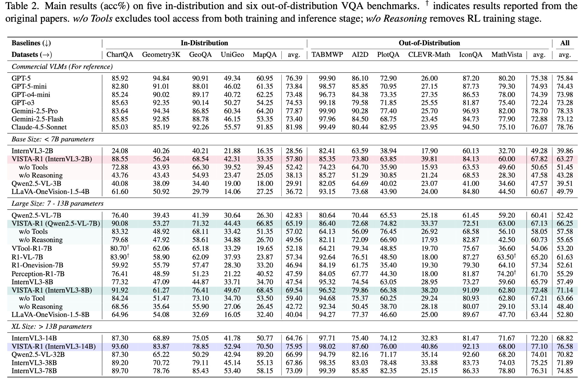
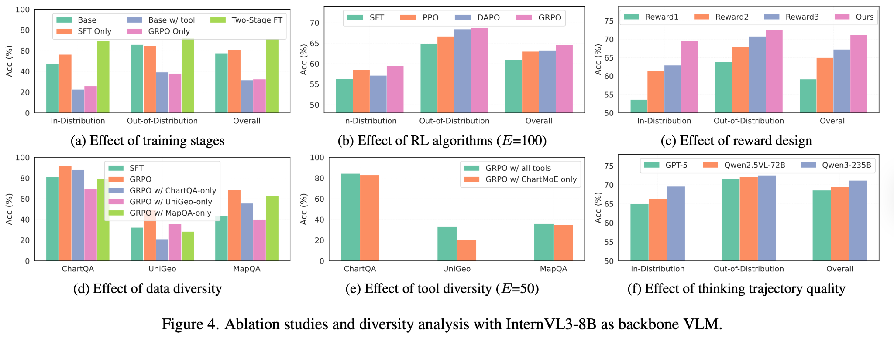

# 23.1 Why a VLM Can Guess Right Without Looking: Visual Rewards and Hallucination

Start with a very small counting task. The image contains 3 circles, and the question is "how many circles are in the image?" The model answers 3, and the reward is recorded as 1. This score looks fine, yet it cannot tell apart two entirely different behaviors: the model may really have counted 3 circles, or it may not have used the image at all and simply guessed the most common answer in the training set.

In a text-only task, a correct answer usually already provides a strong learning signal. Once an image is added, the system gains a perception chain: the model first has to find the relevant region and recognize objects or text, and then complete the reasoning. The final answer fails if any single step is wrong, and even when the final answer is correct, the visual evidence in the middle may be wrong. VLM reinforcement learning therefore first has to solve a new problem: **the reward must check not only "is the answer right" but also "was the answer reached by relying on the image."**

This section follows this line of questioning step by step. We first see why a reward cannot automatically distinguish visual errors from reasoning errors, then discuss how the vision encoder is updated and why RL amplifies the shortcut of "scoring without looking at the image," and finally put these principles into autonomous driving and training monitoring. The next section, [23.2 Visual Reflection RL](./qwen3-vl-reflection), continues with how a model reasons and verifies with visual evidence.



<div style="text-align: center; font-size: 0.9em; color: var(--vp-c-text-2); margin-top: -10px; margin-bottom: 20px;">
  <em>Figure 1: VISTA-Gym puts visual question answering, tool calling, trajectory rewards, and policy updates into one closed loop, showing a typical form of VLM RL moving from "look at the image and answer" to "look at the image, use tools, and then update the policy through feedback." Source: <a href="https://www.eigenai.com/blog/vista-gym-vista-r1" target="_blank" rel="noopener noreferrer">VISTA-Gym / VISTA-R1 Blog</a></em>
</div>

VISTA-Gym in the figure puts visual question answering, tool calling, trajectory rewards, and policy updates into one closed loop. Compared with text GRPO, this loop has four more stages that need to be checked separately:

1. **Who should the reward be attributed to?** When the answer is wrong, did the vision encoder fail to see clearly, or did the language model reason wrongly?
2. **Should the vision encoder be updated along with RL?** An update that is too aggressive may make the model "blind," while freezing it completely prevents learning new visual abilities.
3. **Will the model pretend to look at the image?** If "guessing the answer" can also earn a high reward, RL may reinforce visual hallucination.
4. **How does the visual input connect to action?** In autonomous driving, robotics, and GUI agents, the VLM's answers affect real decisions, so safety and latency become training constraints.

::: tip Prerequisite Review
This section uses the following concepts:

- [The GRPO algorithm](../chapter15_grpo/grpo-practice-and-mechanism): within-group relative optimization without a Critic
- [The RLHF fine-tuning pipeline](../chapter13_rlhf/standard-rlhf-pipeline): rule-based rewards, model-based rewards, and reward hacking
- [The PPO-RLHF training loop](../chapter13_rlhf/ppo-rlhf-loop): KL penalty, gradient clipping, and the reference model
  :::

## VLM RL versus Text-Only RL

In text-only RL, the model's inputs and outputs are both in token space. When an answer is poor, we usually only need to ask whether the generated tokens meet the reward criterion. VLM RL has an extra visual chain: the image is first cut into patches by the vision encoder, then converted into visual tokens, and finally enters the language model together with the question text.

This changes the training objective from "make the model speak better" to "make the model see correctly first, and then speak correctly." The specific changes show up in the following places:

**Input dimension**: the input of text-only LLM RL is prompt tokens, while the input of VLM RL is an image, video, or screenshot plus prompt tokens. **Key modules**: text-only LLM RL has only the language model, while VLM RL adds a vision encoder and a multimodal projection layer. **Common rewards**: text-only LLM RL uses answer correctness, preference scores, and format rewards, while VLM RL also needs visual understanding correctness, reasoning quality, grounding, and safety. **Main risks**: text-only LLM RL faces reward hacking and mode collapse, while VLM RL additionally faces visual hallucination, cross-modal misattribution, and vision encoder degradation. **Training strategy**: text-only LLM RL uses PPO, DPO, and GRPO, while VLM RL needs GRPO/PPO together with differentiated learning rates or a frozen vision encoder. **Evaluation focus**: text-only LLM RL looks only at whether the answer is good, while VLM RL also has to check whether the model really looked at the image and whether it reasoned from image evidence.

The most critical change is that **the reward signal does not know where the error came from.** A scalar reward can only tell the trainer "this answer was not good." It cannot directly point out whether the image was misread, the reasoning was miscalculated, or both kinds of errors occurred together. This is the credit assignment difficulty of VLM RL, and it is the starting point of all the designs below.



<div style="text-align: center; font-size: 0.9em; color: var(--vp-c-text-2); margin-top: -10px; margin-bottom: 20px;">
  <em>Figure 2: The main results table of VISTA-Gym / VISTA-R1. The w/o Tools and w/o Reasoning ablations in the table show that the capability gains on visual tasks come not only from a larger model but also from tool verification, reasoning trajectories, and reward design working together. Source: <a href="https://www.eigenai.com/blog/vista-gym-vista-r1" target="_blank" rel="noopener noreferrer">VISTA-Gym / VISTA-R1 Blog</a></em>
</div>

## Reward Attribution: Visual Tokens and Text Tokens

In text-only RL, reward attribution is not a problem: the whole answer is generated from text tokens, so the reward is naturally attributed to the entire generation process. In a VLM, however, the quality of an answer depends on the abilities of two stages: **visual understanding** (whether the model correctly "saw" the content of the image) and **text reasoning** (whether the model made reasonable deductions based on the correct visual information).

Here is an example. Show the model an image with 3 circles and 2 triangles and ask "how many circles are in the image?" The model answers "there are 2 circles in the image." This answer is wrong. But there are two possible reasons for the error:

- **Visual error**: The model "saw" wrongly and recognized 3 circles as 2. In this case the reward signal should tell the vision encoder "you need to look more carefully."
- **Reasoning error**: The model "saw" correctly (its internal representation did recognize 3 circles), but said the wrong thing when generating text. In this case the reward signal should tell the text decoder "your reasoning has a problem."

### Where the Gradient Actually Flows

To understand why these two kinds of error are hard to tell apart, first look at the forward path of a VLM. The image is cut into patches by the vision encoder, each patch is encoded into one visual token, and after the projection layer aligns the dimensions, the visual tokens are concatenated with the question's text tokens and fed into the language model together. As a simplified calculation with a 14×14 patch size, a 448×448 image is cut into $32\times32=1024$ patches. The actual number of visual tokens also depends on whether the model merges adjacent patches, whether special tokens are added, and the dynamic-resolution strategy, so 1024 is only for getting a sense of the order of magnitude and cannot be taken directly as the real context length of any VLM.

The RL loss is computed only on the tokens that the model generates itself. Write out the GRPO policy-gradient loss:

$$
\mathcal{L}(\theta) = -\sum_{t \in \text{response}} A_t \, \log \pi_\theta\left(y_t \mid y_{<t}, x_{\text{text}}, x_{\text{image}}\right)
$$

The sum covers only the response part. The visual tokens belong to the input and are not sampled, so no policy gradient acts on them "directly." But the conditional probability of each response token depends on all the preceding tokens through attention, including the visual tokens: the gradient is backpropagated along this path, passes through the projection layer, and reaches the vision encoder.

This yields an easily overlooked conclusion: **whether the vision encoder is updated is decided by whether its parameters are unfrozen, and not by the reward function**. The reward provides only a scalar signal, and what really controls whether "the gradient flows to vision or to text" is the partition of parameter groups in the optimizer. This is also the starting point of the differentiated learning rate scheme below.

### One Group of Answers, Two Kinds of Error

Consider one more scenario that one meets at any time during training. Let the group size be 4, with the question still "how many circles are in the image" and the correct answer 3:

- **Answer A**
  - Visual perception: correctly sees 3 circles
  - Text reasoning: counts correctly
  - Final answer: 3
  - Reward: 1.0
  - Advantage direction: positive
- **Answer B**
  - Visual perception: misreads as 2 circles
  - Text reasoning: faithfully reports the perception
  - Final answer: 2
  - Reward: 0
  - Advantage direction: negative
- **Answer C**
  - Visual perception: correctly sees 3 circles
  - Text reasoning: misses one in the reasoning
  - Final answer: 2
  - Reward: 0
  - Advantage direction: negative
- **Answer D**
  - Visual perception: does not look at the image carefully
  - Text reasoning: guesses from language priors
  - Final answer: 3
  - Reward: 1.0
  - Advantage direction: positive

The problem shows up immediately. B and C receive the same negative advantage, but B's error is in the visual pathway and needs improvement of the visual module, while C's error is in text generation and needs improvement of the reasoning process. The scalar reward compresses the two cases into a single signal, and the gradient can only update in a mixed direction. D deserves even more caution: it guesses right by luck and receives a positive advantage. If this kind of sample appears repeatedly, RL reinforces the shortcut of "guess directly without looking at the image," which is exactly the starting point of the next topic, visual hallucination.

In this situation, a more practical approach is to split one error into several observable checkpoints. The **visual grounding checkpoint** observes whether attention, the selected box region, and IoU are reasonable, and the possible training action is to add a grounding reward or a visual consistency check. The **text reasoning checkpoint** observes whether the final derivation goes wrong even when the visual description is right, and the possible training action is to strengthen the reasoning format, a process reward, or a verifier. The **cross-modal fusion checkpoint** observes whether the image evidence and the text conclusion are consistent, and the possible training actions are differentiated learning rates, freezing the ViT, and staged training.

The mainstream approach at present is **holistic attribution**: assign the reward to the whole sequence (visual tokens + text tokens) and let the gradient update the vision encoder and the text decoder at the same time. This approach is simple and direct, but it has a fundamental problem: if the parameters of the vision encoder are damaged by the RL gradient, the model may lose its image understanding, like a person who is shoved hard while doing a math problem and can no longer even read the question.

Another approach is to **freeze the vision encoder**: RL updates only the parameters of the text decoder. This guarantees that visual understanding is not damaged, but at the cost that the model cannot improve its visual understanding through RL. In the geometric-shape counting experiment of Section 23.3, this might leave the model forever unable to distinguish overlapping figures accurately, since the vision encoder never has a chance to learn this ability.

The three strategies each have their applicable scenarios. **Full update** achieves joint optimization of vision and text, but the vision encoder may be damaged, and it suits tasks where visual understanding needs to improve. **Freezing the encoder** protects visual ability but cannot improve visual understanding, and it suits cases where the vision encoder is already strong. **Differentiated learning rates** balance protection and optimization, but hyperparameter tuning is more complicated, and it is the generally recommended strategy.

Differentiated learning rates provide a compromise: the vision encoder uses a smaller learning rate and the language model uses a larger one. The code below sets the ratio to 1:10, which is only a reproducible starting point. The actual ratio needs to be adjusted according to visual-probe scores, task reward, and KL changes together.

Training frameworks also make these three options into configuration items. Taking EasyR1 as an example, `freeze_vision_tower` controls whether the vision encoder takes part in updates. When LoRA is enabled, `exclude_modules` can also be used to exclude the vision modules from low-rank adaptation, which is equivalent to freezing. [The GeoQA experiment in Section 23.4](./easyr1-geoqa) uses these two settings: in full-parameter training the vision encoder is released so the model can learn the fine-grained perception of geometric figures, and in LoRA training the vision encoder is frozen to avoid the instability that comes with a small number of trainable parameters.

```python
# ==========================================
# Differentiated learning rate configuration
# ==========================================
def setup_optimizer_with_lr_decay(model, text_lr=1e-6, vision_lr=1e-7):
    """Use different learning rates for the vision encoder and the text decoder"""
    param_groups = [
        {
            'params': [p for n, p in model.named_parameters()
                       if 'vision' in n or 'vit' in n],
            'lr': vision_lr,  # vision encoder: smaller learning rate
            'weight_decay': 0.01,
        },
        {
            'params': [p for n, p in model.named_parameters()
                       if 'vision' not in n and 'vit' not in n],
            'lr': text_lr,    # text decoder: normal learning rate
            'weight_decay': 0.01,
        },
    ]
    return torch.optim.AdamW(param_groups)
```

### From Outcome Rewards to Process Rewards

A scalar outcome reward answers "is the answer right," but the example in the previous section already showed that it cannot guide the action of "looking at the image" itself. Splitting the quality of visual understanding into separately checkable signals is how a process reward is used in VLMs. There are currently two typical routes.

The first route turns the output of a perception task into a verifiable structured result. [Visual-RFT](https://arxiv.org/abs/2503.01785) designed a verifiable reward of three parts for object detection: the IoU reward computes the mean intersection-over-union between predicted boxes and annotated boxes to measure whether localization is accurate, the confidence reward requires matched boxes to give high confidence and unmatched boxes to give low confidence, and the format reward constrains the output to follow a predefined template. All three are decidable by rules and need no additionally trained reward model. The few-shot results reported in the paper show that 1-shot fine-grained classification with only about 100 samples beats the supervised fine-tuning baseline by 24.3 percentage points in accuracy, and COCO two-shot detection beats the baseline by 21.9 percentage points. [VLM-R1](https://github.com/om-ai-lab/VLM-R1) trains referring expression comprehension (REC) and open-vocabulary detection (OVD) with a similar IoU-type reward, showing that perception tasks can also follow the rule-based reward route.

The second route brings tool use into the trajectory. Qwen3-VL's [Thinking with Images](https://github.com/QwenLM/Qwen3-VL/tree/main/cookbooks) lets the model call an image zoom tool during reasoning, read a local region, and then continue answering. Tool calls turn "where to look again" into a recordable action log, so the process of obtaining evidence can be reviewed. The next section explains this training approach in full.


<div style="text-align: center; font-size: 0.9em; color: var(--vp-c-text-2); margin-top: -10px; margin-bottom: 20px;">
  <em>Figure 3: Qualitative comparison of images generated with and without the PickScore preference reward. Each pair shows the same prompt rendered by the base ("Vanilla") generator and by the PickScore-guided generator; the preference reward visibly improves prompt alignment and visual quality. Source: <a href="https://github.com/yuvalkirstain/PickScore" target="_blank" rel="noopener noreferrer">the PickScore project</a></em>
</div>

The pairs in Figure 3 make the same point for generation that Visual-RFT makes for perception: the reward is not a passive scoreboard but the steering signal that decides what the policy learns to produce.

How large is the influence of reward design on the final result? The ablation experiment of VISTA-R1 gives direct evidence:



<div style="text-align: center; font-size: 0.9em; color: var(--vp-c-text-2); margin-top: -10px; margin-bottom: 20px;">
  <em>Figure 4: The ablation experiment of VISTA-R1, in which the "Effect of reward design" subplot compares the effect of different reward combinations. Source: <a href="https://www.eigenai.com/blog/vista-gym-vista-r1" target="_blank" rel="noopener noreferrer">VISTA-Gym / VISTA-R1 Blog</a></em>
</div>

Figure 4 reports the reward ablation within the same set of VISTA-R1 experiments. It shows that changing the reward combination significantly changes the training result, especially on out-of-distribution tasks. The specific differences depend on the experimental setup in the figure and cannot be extrapolated directly to other base models and datasets. The conclusion that really transfers is that reward ablations must be reported separately from model and data ablations.

## Visual Hallucination: The Model "Sees" Things That Do Not Exist

Visual hallucination means that the model describes, in its answer, objects, attributes, or relations that do not exist in the image. For example, the image contains only one red triangle, but the model says "the image has 3 red triangles and 2 blue circles."

What distinguishes this kind of error from an ordinary textual factual error is that the system did receive checkable image evidence, yet the answer was overridden by language priors. Training therefore has to check factual correctness and image dependence at the same time.

### Why RL Amplifies Hallucination

First, where hallucination comes from. During pretraining a VLM sees a huge number of image-text pairs and builds up strong language priors: "grass" is often followed by "green," and "kitchen" often contains a "refrigerator." When the image information is blurry or the model has not looked at the image carefully, the generation is dominated by these priors and outputs content that does not exist in the picture.

RL further amplifies this tendency, and the mechanism can be illustrated with a concrete number. Suppose a four-option visual multiple-choice question: the probability of answering correctly by guessing without looking at the image at all is 1/4. Let the group size be 8, and suppose on average 2 answers in a group happen to guess right. After within-group normalization, these 2 answers receive a positive advantage and are reinforced by the policy gradient. If the answer distribution of the task is uneven, for example in counting tasks where small numbers are more common, the hit rate of guessing "2" or "3" is clearly higher than 1/4, and the expected return of guessing rises further. After a few rounds of training, the strategy of "looking at the image," which is costly and has an uncertain payoff, gets squeezed out instead. This is essentially the same as the reward hacking discussed in Chapter 25, but with one more dimension: the model may cheat not only in text generation but also in visual understanding.

Several strategies for dealing with visual hallucination:

**Strategy 1: Visual grounding check.** Add a visual consistency check to the reward function: whether the content the model describes agrees with the image. This needs an extra verification model, or cross-validation with tools such as OCR and object detection.

**Strategy 2: Uncertainty penalty.** If the model describes visual content with too much certainty (for example "there are 3 circles in the image" instead of "there seem to be 2-3 circles in the image") and the description does not match reality, give an extra penalty. Encourage the model to express uncertainty when it is unsure.

**Strategy 3: Multi-round verification.** First have the model describe the image content, then use another model (or a rule system) to verify the accuracy of the description, and give the full reward only to answers that pass verification. This essentially embeds a "fact-checking" step in the reward function.

**Strategy 4: Counterfactual control.** Pair the same question with two inputs: the original image, and a replaced image (a blank image, a noise image, or another image of a similar scene). If the model's answers to the two barely change, it relies on language priors and not on the image. Adding this "sensitivity of the answer to image perturbation" to the reward function directly penalizes the behavior of not looking at the image:

```python
# ==========================================
# Image sensitivity check: compare answers on the original and replaced images
# ==========================================
def image_sensitivity_bonus(answer_real, answer_shuffled, correctness):
    """
    - answer_real: the model's answer on the original image
    - answer_shuffled: the model's answer on the replaced image
    - correctness: whether the answer on the original image is correct
    """
    if not correctness:
        return 0.0  # this check does not apply when the answer is wrong

    if answer_real.strip() == answer_shuffled.strip():
        return -0.3  # the answer is unchanged after the swap: suspected of not looking at the image
    return 0.1       # the answer changes with the image: reward image dependence
```

In actual use, the replacement image should be chosen to have a scene similar to the original but a different number or attribute of the key objects, otherwise the model can easily tell the two images apart by their background differences and the check fails.

Besides training-time countermeasures, there are two kinds of standard evaluation suited to running before and after training to track whether hallucination has worsened. [POPE](https://arxiv.org/abs/2305.10355) turns hallucination detection into a binary question: for each image it asks "is there an X in the image," with negative samples of three difficulty levels (random, popular, adversarial), and counts the model's rate of affirming nonexistent objects. [CHAIR](https://arxiv.org/abs/1809.02156) has the model generate image descriptions and then counts the proportion of fabricated objects among sentences or object mentions. Both can be run periodically on samples during training as health-check metrics for hallucination.

<details>
<summary>Question to think about: why does visual hallucination worsen more easily in RL training than in SFT training?</summary>

In SFT training, the model's outputs are constrained to the range of the human-annotated "standard answers": if the standard answer is "there are 2 circles in the image," the model is trained to say "there are 2 circles in the image." Human annotation acts as a "safety net."

In RL training, however, the model discovers high-reward behavior by trial and error. If it occasionally "makes up" an answer that happens to be right and receives a high reward, this behavior is reinforced. Worse still, the exploration mechanism of RL encourages the model to try all sorts of strategies, including "guess directly without looking at the image." If this strategy happens to work (the probability of guessing right on simple tasks is not low), it is reinforced quickly.

The reward of VLM RL must therefore evaluate the answer and also check whether the answer changes with the image evidence.

</details>

## VLM-RL in Autonomous Driving

Autonomous driving magnifies the reward attribution problem above into a safety-critical setting. A missed detection in the image enters the decision layer, and a wrong decision changes the vehicle's next-frame observation, so the reward of a single-round visual question answering is no longer enough.

Suppose the vehicle camera captures "a pedestrian crossing the road 50 meters ahead, and a truck on the left changing lanes." The VLM first generates a scene representation, and the decision module then gives candidates such as decelerating or changing lanes. Reinforcement learning can use the collisions, lane deviations, and arrival efficiency in the subsequent trajectory to update the policy, but the engineering system still makes heavy use of human driving logs and rule-based annotations. RL supplements outcome feedback over long horizons and cannot replace supervised data and safety rules.

In engineering, this loop is usually not written directly as the three steps "image, action, reward." It is split into a more conservative chain. The **scene understanding stage** checks whether the key traffic participants were recognized, and triggers a degraded strategy when confidence is low. The **decision candidate stage** checks whether the current action is reasonable, and hard-filters dangerous actions. The **simulation replay stage** checks whether the consequences of the action are stable, and covers boundary scenarios in a simulated environment. The **reward update stage** checks whether long-term safety is genuinely improved, with the safety reward taking priority over comfort and efficiency. The **deployment monitoring stage** checks whether out-of-distribution scenarios appear, and online only controlled updates are allowed, with no direct trial and error.

The training loop usually has three layers. The first layer is offline data replay: build question-answer and decision samples from historical driving logs, and train with SFT and rule-based rewards to establish basic ability. The second layer is online training in a simulator: let the policy learn by trial and error in a simulator such as CARLA, where a dangerous exploratory action only resets the simulation and causes no real loss. The simulator also provides hard metrics such as collision rate and number of violations, which can go directly into the reward function. The third layer is shadow mode before going on the road: the new policy is installed on a real vehicle and only computes without executing, its decisions are compared with the human driver's actual operations, and only when the disagreement rate falls below a threshold is a small-scale takeover allowed.

In the autonomous driving scenario, reward function design is much more complicated than counting geometric figures. It usually contains three dimensions:

**Safety reward.** This is the most important dimension: any behavior that leads to a collision or danger should be punished severely. Safety constraints are usually implemented as **hard constraints**: certain actions (running a red light, driving the wrong way) never receive a positive reward, whatever reason the VLM gives.

**Comfort reward.** Driving must be not only safe but also comfortable, and sudden braking or sharp turns make passengers uncomfortable. Comfort constraints are usually implemented as **soft constraints**: a regularization term in the reward function that is traded off against the safety reward.

**Efficiency reward.** Subject to safety and comfort, reach the destination as quickly as possible. The efficiency reward encourages the model to choose shorter routes and more reasonable speeds.

```python
# ==========================================
# Autonomous driving VLM-RL reward function
# ==========================================
def driving_reward(scene_description, action, telemetry):
    """
    Autonomous driving reward function
    - scene_description: the VLM's description of the scene
    - action: the driving action (steering, acceleration, braking)
    - telemetry: sensor data (speed, distance, lane position)
    """
    reward = 0.0

    # 1. Safety (hard constraints)
    if telemetry['collision_risk'] > 0.8:
        return -10.0  # high collision risk -> large penalty directly

    if telemetry['red_light_violation']:
        return -10.0  # running a red light -> large penalty directly

    if telemetry['speed_limit_exceeded']:
        reward -= 5.0  # speeding -> heavy penalty

    # 2. Comfort (soft constraints)
    jerk = abs(telemetry['acceleration_change'])  # rate of change of acceleration
    reward -= 0.1 * jerk  # sudden acceleration/braking -> small penalty

    lateral_error = abs(telemetry['lane_deviation'])  # lane deviation
    reward -= 0.05 * lateral_error

    # 3. Efficiency (positive reward)
    if telemetry['speed'] > 0:  # moving
        reward += 0.1  # encourage moving forward
    if telemetry['distance_to_goal'] < telemetry['prev_distance']:
        reward += 0.2  # getting closer to the destination -> reward

    # 4. Scene understanding quality (if the VLM's description agrees with the sensors)
    if scene_matches_sensors(scene_description, telemetry):
        reward += 0.3  # the VLM understood the scene correctly

    return reward
```

A unique challenge for autonomous driving VLM-RL is **the conflict between safety and exploration**. RL needs to compare different policies, but real roads cannot afford unconstrained trial and error. Dangerous exploration should therefore be confined to log replay and simulation, and real vehicles should first run shadow mode and controlled validation before the range of executable actions is gradually widened. This is the same Sim-to-Real problem discussed in Section 24.3 on embodied intelligence: simulation lowers the cost of exploration but introduces a reality gap.

This conflict can also be restated from the viewpoint of constrained optimization. Write the safety objective as a cost function, and require the policy to maximize the cumulative reward under the condition that the cumulative cost does not exceed a threshold:

$$
\max_\pi \; \mathbb{E}\left[\sum_t r_t\right] \quad \text{s.t.} \quad \mathbb{E}\left[\sum_t c_t\right] \le d
$$

Here $c_t$ is the single-step safety cost (such as collision risk or running a red light), and $d$ is the allowed cost budget. The Lagrangian method is a common way to solve it: the multiplier is adjusted dynamically during training, increasing the penalty when the safety budget is exceeded and relaxing it when there is slack. Compared with stuffing safety directly into a scalar reward, the constrained formulation makes it easier to sign off on hard metrics such as "the collision rate is below some threshold."

Another challenge is **latency constraints**. A vehicle traveling at 108 km/h, that is 30 m/s, advances 60 meters in 2 seconds. This number only indicates the order of magnitude of the perception-decision latency, and the real safe distance also depends on braking, the road, and system redundancy. In engineering, the trajectories of a large model are usually distilled into a small policy and the online output length is limited, while long reasoning is left to offline annotation, replay analysis, and reward computation.

## Architecture Choices for Multimodal Policies

Finally, let us ground the question of how the reward enters the model parameters in several architecture choices.

**ViT + Transformer** is currently the most mainstream architecture. A separate ViT handles visual encoding, the visual tokens are concatenated into the language model, and the RL update scope can be full or differentiated, which suits general VLM RL. **Unified Transformer** uses a shared Transformer for visual encoding, fuses through patch embedding, and updates fully in RL, suiting setups that prefer a single compact backbone over a separate large ViT (fewer total parameters and one optimizer, though full RL updates are no cheaper than full fine-tuning elsewhere). **Frozen ViT + lightweight decoder** uses a pretrained ViT (frozen) for visual encoding, fuses through a linear projection, and RL updates only the text decoder, suiting fast iteration. **Multiple vision encoders** use several ViTs (at different scales) for visual encoding, fuse through attention fusion, and update selectively in RL, suiting high-precision visual tasks.

"ViT + Transformer" is currently the most mainstream architecture: the ViT encodes the image into visual tokens, the projection layer aligns the dimensions, and the visual tokens are concatenated with the text tokens and interact through self-attention within the same language model. Models like Flamingo instead use cross-attention to inject visual information into the language layers. For RL training one can choose a full update or differentiated learning rates.

"Frozen ViT + lightweight decoder" suits first validating the reward function. Freezing the vision encoder saves the gradients and optimizer state for this part, but the actual speedup depends on the visual forward computation, the answer length, the group size, and the communication overhead, and cannot be summarized by a fixed multiple.

The "multiple vision encoders" architecture suits tasks with extremely high demands on visual precision, such as medical image analysis or satellite image interpretation. Several ViTs process visual information at different scales or of different modalities (for example, one handles the overall layout and one handles fine textures), and an attention fusion layer then integrates them. During RL updates one can choose to update only the fusion layer and keep the independent feature extraction ability of each ViT.

There is one more engineering variable directly tied to the architecture: the number of visual tokens. A dynamic-resolution model generates different numbers of visual tokens according to the input image size, and a high-resolution input can reach several thousand. In RL training each prompt samples a group of answers, so the more visual tokens there are, the higher the memory use and time cost of the rollout. This is also why two practices are common: limiting the input resolution, or pooling and compressing the visual tokens.

```python
# ==========================================
# Effect of VLM RL architecture choices and training speed comparison
# ==========================================

# The following expresses only the update scope and invents no hardware-bound timings
architectures = {
    "Full update": {
        "train_vision": True,
        "vision_lr_scale": 1.0,
        "note": "Vision and language modules are updated together; monitor visual degradation closely",
    },
    "Differentiated learning rate": {
        "train_vision": True,
        "vision_lr_scale": 0.1,
        "note": "Allows visual adaptation while reducing the update size of the visual parameters",
    },
    "Frozen ViT": {
        "train_vision": False,
        "vision_lr_scale": 0.0,
        "note": "Protects the existing visual representation but cannot fix perception errors through RL",
    },
}

for name, config in architectures.items():
    print(f"Strategy: {name}")
    for key, value in config.items():
        print(f"  {key}: {value}")
    print()
```

## Training Monitoring Checklist

Most of the problems discussed in the earlier sections leave traces on the training curves. Putting these signals into a checklist and comparing against it periodically during training lets us catch problems before they grow.

When **task accuracy** stalls or drops, the reward design may have a loophole, and the reward distribution should be checked. When the **no-image control accuracy** is close to the accuracy with the image, the model can score without looking at the image, and an image sensitivity check should be added. When the **general visual probe score** drops markedly after training, the vision encoder may have degraded, and the visual learning rate should be lowered or the encoder frozen. When the **answer length** keeps inflating while accuracy does not rise, the model may be farming a length reward, and a length penalty or truncation should be added. When the **format reward** drops, exploration may be drifting away from the output template, and the format term should be strengthened. When the **IoU / grounding reward** stalls, the localization ability has hit a bottleneck, and changing the data or the tool route should be considered. When the **KL divergence** spikes, the learning rate may be too large or the reward too sharp, and it should be handled as in Section 23.4.

Of these, the "no-image control accuracy" and the "general visual probe" need additional evaluation sets: for the former, prepare a batch of control samples in which the image is replaced with a blank or noise image, and for the latter, prepare a set of visual understanding questions unrelated to the training task (such as general VQA). Both should be prepared before training starts, otherwise there is no way to judge the cause when degradation occurs.

## Stringing the Challenges into a Diagnostic Procedure

When "the training reward rises but real image problems do not improve," you can diagnose in the following order.

The root cause of **reward attribution** is that visual and text tokens share one reward signal, the mitigation is differentiated learning rates or a process reward, and the trade-off is the tension between protecting visual ability and optimizing vision. The root cause of **visual hallucination** is that the model fabricates content not present in the image, the mitigations are visual grounding checks, uncertainty penalties, and counterfactual controls, and the trade-off is training complexity versus reliability. The root cause of the **visual shortcut** is that the reward can be earned from language priors without looking at the image, the mitigation is an image sensitivity check or a tool-trajectory reward, and the trade-off is sampling cost versus the authenticity of dependence. The root cause of **vision encoder degradation** is that the RL gradient damages the pretrained features, the mitigation is freezing the ViT or a small learning rate, and the trade-off is protection of visual understanding versus room for improvement. The root cause of the **conflict between safety and exploration** is that RL exploration may produce unsafe behavior, the mitigation is simulation training plus hard constraints plus shadow mode, and the trade-off is the gap between simulation and reality. The root cause of **inference latency** is that large-model inference is slow, the mitigation is model distillation or controlling the length of the chain of thought, and the trade-off is accuracy versus speed. The root cause of **visual token cost** is that high-resolution inputs produce many tokens, the mitigation is limiting the resolution or pooling and compressing tokens, and the trade-off is perception precision versus training throughput.

These problems propagate along the same causal chain: if the reward looks only at the answer, the policy may learn visual shortcuts. Unfreezing the vision encoder to stop the shortcuts may in turn damage general perception. Adding high-resolution evidence and tool calls raises rollout cost and latency. A training report should give task accuracy, the no-image control, the visual probe, trajectory cost, and safety metrics together, in order to judge where the gains come from.

The next section, [23.2 Visual Reflection RL](./qwen3-vl-reflection), continues with a natural question: once the model has obtained visual evidence, how does it keep, check, and re-observe that evidence during reasoning?

## References

- [VISTA-Gym / VISTA-R1 Blog](https://www.eigenai.com/blog/vista-gym-vista-r1): shows ablation results for tools, reasoning trajectories, and reward design on visual question answering tasks.
- [VLM-R1 GitHub](https://github.com/om-ai-lab/VLM-R1): provides grounding reward curves, useful for understanding how visual rewards enter VLM RL training.
- [Visual-RFT paper](https://arxiv.org/abs/2503.01785): applies three kinds of verifiable rewards (IoU, confidence, and format) to RL fine-tuning for detection, classification, and grounding tasks.
- [POPE paper](https://arxiv.org/abs/2305.10355): quantifies object hallucination in VLMs with binary questions, suitable as a health-check metric before and after training.
- [CHAIR paper](https://arxiv.org/abs/1809.02156): counts object hallucination in image descriptions at the sentence level and the object level.
