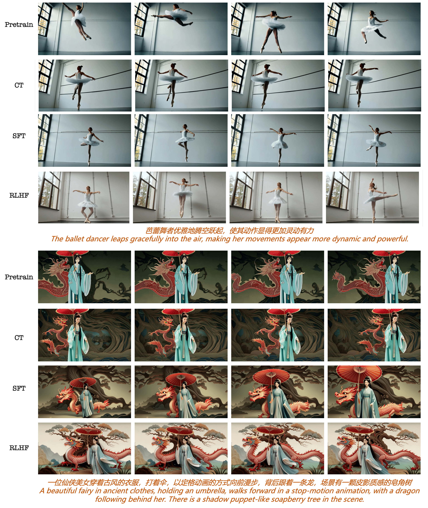
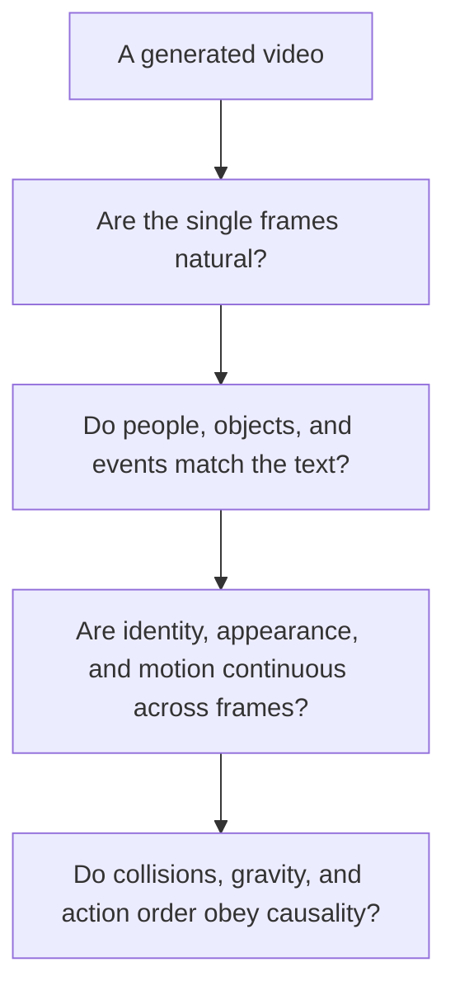
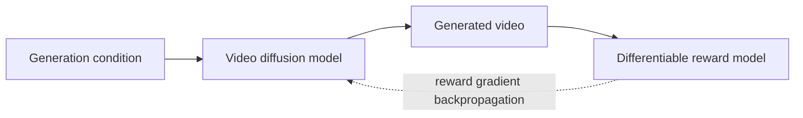
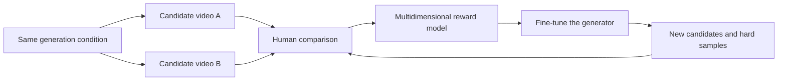
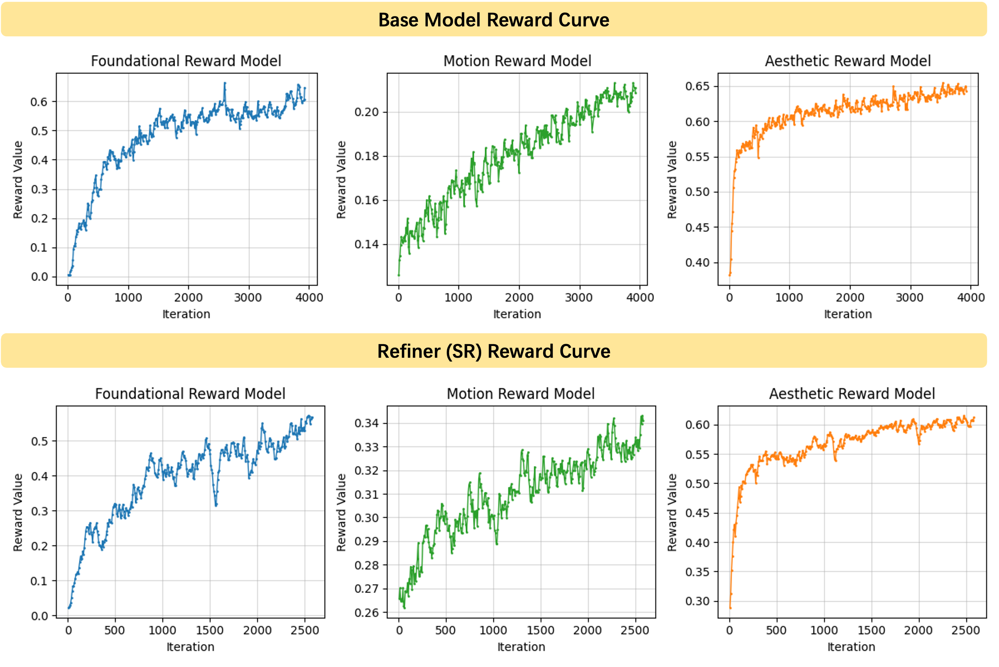
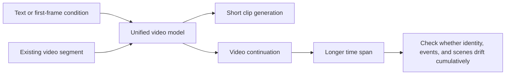

# 24.5 Temporal Consistency in Video

Imagine a video only four seconds long.

> A red ball rolls down from the top of a slope, hits a blue block, and stops at the edge of the table.

In the first second, the red ball and the blue block are both sharp. In the second second, the ball starts to roll down. In the third second, the ball has not yet touched the block, but the block falls over first. In the fourth second, the red ball suddenly appears on the other side of the table.

Pull out any single frame and it may look good. Played together, the order of actions, the identity of objects, and the causal relations are all wrong. Video generation therefore carries a core problem that image generation does not: **the model must draw every frame correctly and also make the changes happen plausibly.**

Let's use four layers of checks to see where this video goes wrong. The first layer looks at single frames only: all four frames are sharp and naturally lit, and all pass. The second layer compares against the text: the prompt asks for "hit the block, then stop at the table edge", and the video does contain the red ball, the block, a collision, and a stop, so all the event elements are present. The third layer checks along the time axis: the red ball's trajectory breaks between the third and fourth seconds, and its position cannot be explained by the previous frame. The fourth layer checks causality: the block falls at second 3, while contact happens after second 3.5, so the effect precedes the cause.

The four layers give four different conclusions. If we report only one overall score, the errors of the third and fourth layers are hidden by the high score of the first. The rest of this section answers one question: during training and evaluation, how do we use these sub-signals separately?



<div style="text-align: center; font-size: 0.9em; color: var(--vp-c-text-2); margin-top: -10px; margin-bottom: 20px;">
  <em>Figure 1: Video frames obtained from the same generation conditions after pretraining, continued training, supervised fine-tuning, and RLHF. When reading the figure, follow each row to check whether actions and identities stay continuous; do not just compare whether a single frame looks nicer. Source: <a href="https://arxiv.org/abs/2506.09113" target="_blank" rel="noopener noreferrer">Seedance 1.0 technical report</a>.</em>
</div>

## 24.5.1 What a Time Axis Adds

An image generator can write its result as $x$, while a video consists of consecutive frames. The following is a teaching notation used in this book for a sequence of frames:

$$
v=(x^{(1)},x^{(2)},\ldots,x^{(F)}).
$$

$F$ is the number of frames. A common 5-second video sampled at 16 frames per second has 80 frames, and at 24 frames per second it has 120 frames. The model has to handle space and time together: the people, objects, and background within a frame must be plausible, and identity, position, and action must also be continuous between adjacent frames.

The four layers of checks correspond to four different ways of failing.

The first layer is **single-frame visual quality**. Do a person's hands look deformed, are the edges sharp, are the lighting and composition natural? This layer is close to image-generation evaluation, and the checker scores each frame independently.

The second layer is **text and event alignment**. The prompt says "the red ball hits the block first, then stops at the table edge": does the video actually contain the red ball, the block, a collision, and a stop, and is the event order correct? This layer needs the whole video and the text to be judged together.

The third layer is **temporal consistency**. The clothes of the same person must not change color midway, a cup on the table must not vanish for no reason, and the background structure must not be rebuilt over and over as the camera moves. This layer checks whether adjacent frames can explain each other.

The fourth layer is **physical and causal consistency**. A block should fall after the collision, a thrown object should move along a continuous trajectory, and an occluded object should still be considered to exist. This layer requires that the temporal order between events hold.



These four layers influence one another but cannot substitute for one another. A video can have a very high aesthetic score and still show obvious teleporting of objects. A single total score hides this kind of error, so video training and evaluation both need to keep each sub-signal.

## 24.5.2 Why One Terminal Score Is Not Enough

Using the notation of the previous section, video generation can also be viewed as a sampling trajectory $\tau$. The simplest approach is to give one total reward after the video has been generated:

$$
R(\tau,c)=r_\phi(v,c).
$$

$c$ is the generation condition, $v$ is the final video, and $r_\phi$ is the video reward model. This notation can be used directly for policy gradients, but it does not tell the model in which segment the error occurred.

Consider first how long the decision chain is. Generating a 5-second video usually takes about 50 denoising steps, and every step makes a decision for the latent variables of 80 frames. Multiplying roughly, one video corresponds to about four thousand model forward computations. If the teleport happens in the third second, the erroneous decisions are only a small part of these, yet the terminal reward returns only a single scalar. The model cannot tell which steps should change. This is the credit assignment problem in video generation.

Now let's write down the gap with two candidate videos. Candidate A has good visuals and semantics but teleports in the second half. Candidate B is mediocre on every item but has no local error. The four sub-signals score them as follows, with weights $\lambda_q=\lambda_a=\lambda_t=\lambda_p=0.25$:

| Candidate | $R_{\mathrm{quality}}$ | $R_{\mathrm{alignment}}$ | $R_{\mathrm{temporal}}$ | $R_{\mathrm{physics}}$ | Weighted total |
| --------- | ---------------------- | ------------------------ | ----------------------- | ---------------------- | -------------- |
| A         | 0.9                    | 0.8                      | 0.3                     | 0.35                   | 0.59           |
| B         | 0.6                    | 0.55                     | 0.6                     | 0.65                   | 0.60           |

The terminal reward sees only 0.59 and 0.60 and concludes that B is slightly better. The per-item signals can also say why: A's problems are concentrated in the temporal and causal items of the second half, while B's problem is that it is weak across the board. The two diagnoses call for two training directions. The former needs the generation decisions in the second half of the video to be corrected, and the latter needs overall improvement. This is information the sub-rewards provide and the total score cannot.

Writing this decomposition as a formula gives a **pedagogical reward template**. It is not a fixed formula shared by the VADER, DanceGRPO, or Seedance papers:

$$
R
=
\lambda_qR_{\mathrm{quality}}
+
\lambda_aR_{\mathrm{alignment}}
+
\lambda_tR_{\mathrm{temporal}}
+
\lambda_pR_{\mathrm{physics}}.
$$

Each $\lambda$ expresses a training trade-off. The formula is easy to write down, and the real difficulty is whether the four rewards are reliable. For example, measuring consistency by adjacent-frame similarity favors videos that barely move, while rewarding motion magnitude to encourage dynamics can produce violent shaking with no semantics. The training system needs to observe the sub-rewards separately and use held-out evaluations that did not take part in training to check whether they are being exploited.

## 24.5.3 Three Different Routes for Video Alignment

"Using rewards to improve video" does not correspond to just one algorithm. Public research gives roughly three routes.

### VADER: Let a Differentiable Reward Flow Through the Generation Process

The [original VADER paper](https://arxiv.org/abs/2407.08737) backpropagates the gradient of a differentiable reward into a video diffusion model[^vader]. The optimization objective is the expectation of the reward as a function of the model parameters:

$$
J(\theta)=\mathbb{E}_{c,\,x_0\sim p_\theta(x_0\mid c)}\big[R(x_0,c)\big].
$$

$x_0$ is the generated video and $R$ is the reward. For this gradient to be usable, the reward must be backpropagated through the whole denoising chain. Expanding by the chain rule:

$$
\nabla_\theta R(x_0,c)=\sum_{t=0}^{T}\frac{\partial R(x_0,c)}{\partial x_t}\cdot\frac{\partial x_t}{\partial\theta}.
$$

Every denoising step contributes a path to the parameter update. The cost is GPU memory: backpropagating through a full chain of about 50 steps requires saving the intermediate state of every step. VADER controls the cost with **truncated backpropagation**: gradients are kept only for the last $K$ steps, and earlier steps apply stop-grad, that is, for $K<T$ the network predictions at $t>K$ are cut out of the computation graph. A small $K$ both reduces memory and lowers the risk of overfitting to the reward model.

The reward itself can also be attached in several ways. VADER adds the per-frame image-text similarity models HPSv2 and PickScore as the alignment reward for every frame. This formulation could induce all frames to become identical, and the paper reports that the pretrained prior is enough to prevent this collapse. It also attaches a VideoMAE action classifier to the whole video, using the predicted probability of the target action class as the reward, and uses the self-supervised score of V-JEPA to measure predictability between frames as a temporal consistency signal. Such rewards can improve the stability of cross-frame representations, but they cannot by themselves prove that the model has mastered Newtonian mechanics. A video that is smooth in representation space can still make an object fall at the wrong moment.

The paper also ran a long-horizon experiment. It turned the image-to-video model Stable Video Diffusion into an autoregressive generator and extended the context length to 3 times that used in training, feeding the last frame of the previously generated segment as the input to the next segment. Doing this directly works poorly, because the model has never seen its own output and the distribution shifts. VADER uses a V-JEPA reward to constrain newly generated segments to stay consistent with existing ones, which makes the long video coherent in time and space.

The conclusion of the efficiency comparison is that a reward network provides a dense gradient pointing at pixels, while methods such as DDPO and DPO can only pass back a scalar feedback. For the same generated video, the former carries far more learning signal. Accordingly, the VADER paper reports that it is significantly lower than these two families of baselines in both reward queries and GPU hours[^vader].



The boundary of this route is also clear: the reward must be stably differentiable, and any bias in the reward network directly becomes the optimization direction.

### DanceGRPO: Use Black-Box Rewards to Compare a Group of Videos Under the Same Condition

[Section 24.4](./visual-generation-dancegrpo) already derived [DanceGRPO](https://arxiv.org/abs/2505.07818). It builds stochastic transition probabilities for diffusion and rectified-flow sampling, generates a group of results for the same condition, and updates the model with group-normalized advantages[^dancegrpo]. The paper validates three task types (text-to-image, text-to-video, and image-to-video) on four base models, Stable Diffusion, FLUX, HunyuanVideo, and SkyReels-I2V, with improvements of up to 181% over baselines on HPS-v2.1, CLIP Score, VideoAlign, and GenEval.

Two findings in the video part deserve a closer look. The first is how multiple rewards are combined. Different reward models score on different scales, and adding them directly lets the reward with larger numbers dominate training. DanceGRPO first normalizes each reward within the group separately and then adds up the normalized advantages:

$$
A_i=\sum_{k=1}^{K}\frac{r_i^k-\mu^k}{\sigma^k}.
$$

$r_i^k$ is the score of the $i$-th sample on the $k$-th reward, and $\mu^k$ and $\sigma^k$ are the mean and standard deviation of that reward within the group. The paper also observed that training with HPS-v2.1 alone makes images look unnaturally oily and glossy, and adding the CLIP score restores a natural look. The two rewards constrain each other, which is more stable than single-reward training.

The second finding comes from the image-to-video task. The input image of SkyReels-I2V already fixes the picture content and the ceiling of text matching, so what remains to optimize in parameter space is almost only motion quality. DanceGRPO uses the VideoAlign motion score as the reward and obtains a 118% relative improvement on that dimension. This example shows that choosing which sub-signal to optimize requires first looking at how much freedom the task still leaves to the model.

The paper also tested binary rewards: the continuous HPS score is discretized into 0 or 1 at a threshold of 0.28, and GRPO can still learn from this sparse feedback, consistent with the idea of rule-based rewards in language models. Ablations show that the first 30% of timesteps starting from noise contribute most to learning the basic generation patterns, yet training only this segment is not as good as covering the full range.

The cost is that one update must fully generate a group of videos for every condition, so memory and sampling time grow quickly. The reward need not be differentiable, so it is suitable for plugging in human preference models or multimodal judges. The public evidence supports "it can be used for reinforcement learning in video generation" but does not support "all mainstream video products use it". If an industrial model paper does not disclose its optimizer, the algorithm should be written as unknown.

### Video RLHF: Learning Multidimensional Preferences from Human Comparisons

Another route first collects preference data. Annotators watch two videos under the same condition and compare text adherence, visual quality, naturalness of motion, and temporal consistency. The system can train a reward model and then fine-tune the generator with reinforcement learning, or it can use the preferred samples for supervised fine-tuning or preference optimization.



The key of this data loop is not to compress all preferences into a single number. The annotation interface should let reviewers point out whether a problem belongs to visuals, events, time, or physics. Only then can we find out, when the training reward rises, which item has really improved.

## 24.5.4 Seedance: How a Public Technical Report Describes Video RLHF

The [Seedance 1.0 technical report](https://arxiv.org/abs/2506.09113) gives a fairly complete case of industrial training[^seedance]. The report is worth reading because it puts data, architecture, supervised fine-tuning, RLHF, and inference acceleration in one system pipeline.

### Architecture: One Model Learns Text-to-Video, Image-to-Video, and Multiple Shots Together

Seedance's backbone is a DiT. Video frames are encoded by a VAE into visual tokens, text is encoded by a fine-tuned decoder-only LLM, and the two kinds of tokens are concatenated and fed into the transformer layers. Spatial and temporal layers are decoupled, combined with interleaved multimodal positional encoding and window attention. The report uses 3D MM-RoPE: visual tokens use three-dimensional positional encoding, text tokens additionally receive one-dimensional encoding, and the two kinds of tokens can be arranged in an interleaved manner. Multi-shot video is thereby supported naturally: several shots are organized in the temporal order of the action, and each shot gets its own detailed description.

This step reminds us that RLHF cannot create from nothing the motion knowledge that the base model has never seen. If a certain kind of action or shot is missing from the training data, the reward can only choose among existing candidates and can hardly supply the complete capability.

### Post-Training Is a Four-Stage Pipeline

The report splits post-training into four steps: pretraining, continued training, supervised fine-tuning, and RLHF, with a separate super-resolution refiner going through its own pretraining, SFT, and RLHF. Figure 1 is a visualization of this pipeline.

Continued training applies one round of filtering to the pretraining data: an aesthetic scorer and an optical-flow-based motion estimator pick out a subset with higher aesthetics and richer motion, and training then continues with an annealed learning rate. Captions come in two styles: long captions that keep full descriptions of both static and dynamic content, and short captions that describe only motion dynamics. The image-to-video task always provides the first frame, and the short captions delete the static content already known from the first frame, forcing the model to align semantics to the motion itself.

Supervised fine-tuning uses manually curated datasets. The report defines several hundred categories by attributes such as visual style and motion type, and within each category it collects high-quality videos and human-proofread captions in a targeted way. An easily overlooked detail is model merging: several models are trained separately on different data subsets and then merged into one. Each sub-model is trained with a smaller learning rate than in pretraining and stopped early at a suitable point, which prevents overfitting and preserves text controllability.

### RLHF: Directly Maximizing Multidimensional Rewards, Also on the Super-Resolution Model

Seedance's RLHF simulates the inference process during training: after sampling to a suitable point it directly predicts the clean video $x_0$, hands it to several reward models for evaluation, and then directly maximizes a combination of these rewards. The report compares it with DPO, PPO, and GRPO in experiments and concludes that this reward-maximization approach is best in both efficiency and effect, improving text-video alignment, motion quality, and aesthetics at the same time. Training uses multiple rounds of iteration: the diffusion model and the reward models are updated alternately, instead of updating the reward model dynamically online, and the report says this approach has a higher ceiling and is more controllable.

RLHF is also applied to the refiner. The refiner is a conditional diffusion model: its input is the low-resolution VAE latent and its output is the high-resolution video. During training the high-resolution results are scored by several reward models, and a linear combination of these signals is directly maximized. Applying RLHF to the refiner after distillation acceleration preserves motion quality and visual fidelity at low sampling-step counts.

Looking back at Figure 1 at the beginning of this section, observe it along the time axis and not by picking a single frame. Check whether the appearance of people stays consistent, whether actions are actually completed, and whether the background is rebuilt as the camera moves, and then judge at which layer the post-training improvement happened.



<div style="text-align: center; font-size: 0.9em; color: var(--vp-c-text-2); margin-top: -10px; margin-bottom: 20px;">
  <em>Figure 2: Changes in several rewards shown in the Seedance report. Basic capability, motion, and aesthetics need to be monitored separately; one overall curve cannot tell whether each item is improving together. Source: <a href="https://arxiv.org/abs/2506.09113" target="_blank" rel="noopener noreferrer">Seedance 1.0 technical report</a>.</em>
</div>

### Speed Comes from Distillation and Systems Optimization Together

Multi-stage distillation reduces the number of function evaluations needed for generation. The report says that the distilled model is comparable to the pre-distillation model on four expert-review dimensions: prompt alignment, motion quality, visual fidelity, and consistency with the first frame. The VAE decoder was also modified: analysis found that the stages close to pixel space dominate latency, so narrowing the channel width of these stages and retraining the decoder speeds up decoding by about 2 times with unchanged end-to-end quality. With system-level optimizations stacked on top, the public measurement given in the report is generating a 5-second 1080p video in 41.4 seconds on an NVIDIA L20, an end-to-end speedup of about 10 times[^seedance].

These results show that after model quality improves, sampling steps, memory, parallelism, and serving throughput still have to be solved. Video reinforcement learning covers only one segment of this and cannot replace the whole engineering system.

## 24.5.5 LongCat-Video: Why Long Video Must Be Prepared from the Pretraining Stage

A short video can show just one action, while a long video must sustain people, scenes, and events. Errors accumulate along time: an identity drift at the beginning leaves later actions and narrative without a reference.

The [LongCat-Video technical report](https://arxiv.org/abs/2510.22200) handles this problem in a 13.6B-parameter Diffusion Transformer[^longcat]. Below we go through the methods it publicly discloses, item by item.

### Tasks Are Unified by the Number of Conditioning Frames

Text-to-video, image-to-video, and video continuation share one model, differing only in the number of conditioning frames: 0 frames for text-to-video, 1 frame for image-to-video, and multiple frames for video continuation. The continuation task enters the training objective from the pretraining stage, and the report says that the model can therefore generate videos of several minutes without color drift or quality degradation.

### Coarse to Fine: First 480p at a Low Frame Rate, Then Refine to 720p at a High Frame Rate

Inference has two stages. The first stage generates the complete video at 480p and 15 fps. The second stage trilinearly upsamples the result to 720p and 30 fps and hands it to a refinement expert. The refinement expert is a LoRA on the base model: the refinement task is close to the generation task but the denoising path is different. Starting from the upsampled result plus noise of moderate strength, it uses flow matching to learn the mapping between the low-resolution and high-resolution distributions. The report sets the noise strength to 0.5, and the refinement stage needs only 5 sampling steps. The report also observed that coarse-to-fine not only saves compute but even exceeds direct 720p generation in texture detail, and can correct local distortions.

### Block-Sparse Attention: Compute Only the Most Relevant Blocks

The cost of attention grows quadratically with the number of tokens and is the main bottleneck at high resolution. LongCat partitions queries and keys into non-overlapping three-dimensional blocks, first computes the similarity between each query block and each key block using the block means, selects the top $r$ highest-scoring blocks, and performs standard attention only within those blocks. This is a trainable sparse operator, and the report says that keeping less than 10% of the computation gives nearly lossless quality, with forward and backward implementations open-sourced together with the model.

### GRPO with Multiple Rewards: Three Dimensions, Four Signals

Post-training is done with GRPO plus LoRA, and the report discloses two stability changes. First, the policy loss and KL loss are reweighted per timestep, removing the dependence of gradient size on the timestep and step size. Second, the within-group standard deviation of standard GRPO is replaced by the maximum standard deviation across all groups:

$$
\hat{A}_{k,t}^{i}=\frac{R_k(x_0^i,c_j)-\mu_k}{\sigma_{\max}}.
$$

$\mu_k$ is the within-group mean of the $k$-th reward, and $\sigma_{\max}$ is the maximum standard deviation of that reward across all groups. In a group with too small a standard deviation, the advantage estimate may be only reward-model noise, and normalizing by the maximum standard deviation lowers the gradient weight of such groups.

The rewards span three dimensions and four signals. Visual quality uses HPSv3 in two ways: HPSv3-general scores all frames with the fixed prompt "A high-quality image" and takes the average, looking at the picture only, while HPSv3-percentile scores with the video caption and takes the scores of the top 30% of frames, so that content changes in individual frames do not drag down the whole. Motion quality uses a VideoAlign model fine-tuned on grayscale video: with color information removed, the evaluation falls only on motion features, and grayscale training also delays the rise of the validation loss, indicating better generalization. Text-video alignment uses another VideoAlign fine-tuned model that keeps color input.



The combination of multiple rewards in the policy loss is a weighted sum of each reward's relative advantage. The key evidence given by the report is a reward-hacking control experiment: training with HPSv3 alone induces the model toward static pictures, and the motion reward exactly offsets this tendency while keeping HPSv3's improvement in visual quality. Multiple rewards constrain one another and act as a regularizer.

The public measurements of inference efficiency are as follows. For a 720p, 93-frame video, dense attention plus 50 sampling steps takes 1429.5 seconds, distillation to 16 steps brings it to 244.6 seconds, and adding coarse-to-fine and block-sparse attention brings it to 116.5 seconds, a speedup of 12.3 times. A 720p, 30 fps, 189-frame video takes 142 seconds, a speedup of 10.1 times.

The key implication of this route is that long-video ability must be prepared in the pretraining and architecture stages, and RLHF then adjusts human preferences and multidimensional quality. The previous version of this page described LongCat as fixed five-second chunks, overlap averaging, a story-LLM reward, and two-level diffusion. None of these details appear in the core method of the public paper, so they cannot be kept as fact.

LongCat-Video comes from Meituan's team and is a different work from ByteDance's Seedance. When reading industrial papers, first check the institution, the model, and the public materials, which avoids stitching projects with similar release dates into a training chain that does not exist.

## 24.5.6 When Looking at Mainstream Products, First Separate Capability Demonstrations from Training Evidence

[Hailuo](https://hailuoai.video/), Wan, [Kling](https://klingai.com/), [Sora](https://openai.com/sora/), and [Veo](https://deepmind.google/models/veo/) all demonstrate video generation ability, but their degrees of openness differ.

The [Wan technical report](https://arxiv.org/abs/2503.20314) and the [official repository](https://github.com/Wan-Video/Wan2.1) provide model descriptions, code, and weights, and researchers can inspect the model structure, run inference, and reproduce some experiments[^wan]. An open model does not mean that all post-training data and preference optimization pipelines are public, and the attribution of algorithms should still follow the papers and repositories.

The product demonstrations of Hailuo and Kling can help us observe human motion, camera control, and physical failures. If the public materials do not say they use DanceGRPO or CISPO, we cannot infer a specific training algorithm from the company's other papers. MiniMax-VL-01 is a vision-language model and cannot serve as evidence that the Hailuo video model is open source.

The public pages of Sora and Veo demonstrate generation ability and product features. Training data, reward composition, and the post-training optimizer are only partly disclosed. When comparing these systems, we can describe "which inputs are supported, how long the output is, whether audio is included, and how the public evaluation is designed", and we should not fill in an RL recipe that lacks source support.

This rule looks conservative, but it is the basic method of reading a fast-changing field: **product results tell us what a system can do, and technical reports tell us how the authors publicly acknowledge it was done.**

## 24.5.7 How to Evaluate "Physical Plausibility"

"Looks physically plausible" is too broad to be an evaluation item directly. First break it into observable events.

### Object Permanence

After a cup is occluded by a hand for one second it should reappear, and changes in color, shape, and position should be explainable by the earlier motion. What is tested here is whether objects persist in the model's temporal representation.

### Continuous Trajectories

A thrown ball should move along a continuous path, and its speed should change smoothly. Comparing adjacent-frame similarity alone is not enough, because a static video also gets a very high consistency score. To illustrate the trajectory check, we use $\mathbf p_f$ below for the object position detected in frame $f$:

$$
\mathbf{p}_1,\mathbf{p}_2,\ldots,\mathbf{p}_F.
$$

Then check whether the displacement and acceleration show unexplained jumps. Taking 16 fps as an example, the position difference between adjacent frames $\mathbf{p}_{f+1}-\mathbf{p}_f$ should be similar in size and continuous in direction. If the displacement at some frame suddenly reaches ten times the mean of adjacent frames, the tracker will report a trajectory break at this frame, and comparing the state before the break with the state after it locates the frame number at which the teleport occurs.

### Contact and Causal Order

The prompt "the ball knocks over the block" contains at least three events: the ball approaches the block, contact occurs, and the block then falls. If the three events occur at frames 8, 12, and 15, the order is correct. If the fall occurs at frame 10 and contact at frame 12, the causal relation has been reversed. Written as a teaching notation, the order is:

$$
t_{\mathrm{approach}} < t_{\mathrm{contact}} < t_{\mathrm{fall}}.
$$

If the block falls before contact, then no matter how high the single-frame quality, it should be judged a causal failure. This is exactly how the red-ball video at the beginning of this section fails the fourth layer of checks.

### Gravity, Support, and Occlusion

An object that loses support should move downward, and an object resting on a table should not penetrate the tabletop. Occlusion caused by camera motion also must not make an object disappear permanently. These tests do not require building a complete physics engine, yet they cover the most common visible errors of video models.

## 24.5.8 Build a Minimal Video-Evaluation Harness

Building an evaluation set before training usually costs less than blindly adding rewards. A minimal harness can be organized as follows.

Step one, prepare six categories of prompts: identity preservation, object permanence, continuous trajectories, collision order, gravity and support, and camera motion. Start with ten short prompts per category, keeping the number of objects and the background complexity under control.

Step two, fix several random seeds for each prompt. Generate multiple candidates under identical conditions before and after training, and save the model version, sampler, number of steps, resolution, and duration. Without this metadata, results cannot be reproduced.

Step three, record the automatic metrics separately:

- A visual-quality model evaluates sharpness and artifacts;
- A text-video model checks subjects, attributes, and events;
- Object detection and tracking check identity and trajectories;
- An event recognizer checks the order of contact, falling, and stopping;
- Blind human review identifies overall anomalies that the automatic metrics miss.

Step four, save the failing clips and not only the average scores. A useful evaluation report should be able to answer: from which second does the error start, which category does it belong to, and how does the earlier state propagate to later frames.

```python
for case in evaluation_cases:
    for seed in fixed_seeds:
        video = generator(case.prompt, seed=seed)

        report = {
            "visual_quality": quality_model(video),
            "text_alignment": video_text_model(video, case.prompt),
            "track_consistency": tracker_score(video),
            "event_order": event_order_score(video, case.events),
        }
        save_video_and_report(video, report, metadata={
            "prompt": case.prompt,
            "seed": seed,
            "model_version": generator.version,
        })
```

The point of this code is to save the per-item results and the generation metadata. A real system also needs to annotate confidence, tracking failures, and manual-review status. When the automatic evaluator itself errs, the harness should send the sample to human inspection instead of forcing a definite conclusion.

## 24.5.9 What Problems Come Next

Longer video is first limited by state accumulation. When the goal extends from ten-second clips to several minutes, the model needs to remember character identity, spatial layout, and unfinished events. Continuation training, sparse attention, and hierarchical temporal representations are all lowering the cost, and evaluation must also extend from single actions to complete event chains.

Joint audio-video generation adds another synchronization constraint. Footsteps must follow the moment a foot lands, lip movements must align with speech, and ambient sound must also change with the camera and the space. The reward then needs to observe sound, picture, and the temporal correspondence between the two together, and optimizing video quality alone cannot guarantee synchronization.

Interactive generation turns one-shot sampling into continuous revision. A user may ask to keep the character and change only the camera, or keep the action and replace only the background. The system must recognize which state needs to be frozen and which regions may be regenerated, and respond within a very short latency.

Fine-grained control will keep enlarging the set of conditions. Pose, trajectory, camera, lighting, and reference characters may all appear at the same time. The more conditions there are, the more easily training falls into "satisfy one of them and ignore another", so per-item rewards, counterfactual prompts, and replay of failure cases will matter more than a single leaderboard.

Real physical simulation is still a more distant goal. Current generative models mainly learn visible regularities from the video distribution, and physics engines, 3D scene representations, and world models may provide more reliable states and constraints. After introducing these components, evaluation still has to check whether the simulated constraints improve the video that users see, and cannot report only internal physics losses.

## Summary

Video generation has one more axis than image generation, the time axis. Drawing a single frame well passes only the first layer of checks. Event order, identity preservation, and physical causality must be judged along the whole video. When a decision chain on the order of four thousand steps receives only one terminal scalar, credit assignment cannot proceed, which makes per-item rewards and per-item evaluations necessary.

VADER lets the gradient of a differentiable reward flow through the last $K$ denoising steps, trading dense gradients for sample efficiency. DanceGRPO uses black-box rewards to compare a group of videos under the same condition and merges several rewards of different scales through within-group normalization. Video RLHF learns multidimensional preferences from human pairwise comparisons. The three routes use rewards in different ways, and all need independent evaluation to keep the model from merely pleasing the proxy metric. LongCat's control experiment provides direct evidence: single-reward training pushes the model toward static pictures, and only multiple rewards constraining one another suppress this hacking behavior.

The public Seedance report shows how data filtering, model merging, multidimensional RLHF, and distillation acceleration connect into one pipeline. LongCat-Video shows that long-video ability must also be prepared from continuation pretraining, coarse-to-fine generation, and sparse attention. For industrial recipes that are not public, the most accurate wording is "not yet disclosed".

With this, Chapter 24 has moved from audio, speech agents, and VLA to image and video generation. The next chapter enters [Chapter 25: Reward Hacking and Reinforcement Learning Evaluation](../chapter25_alignment_failures/classical-failures), which continues the discussion of reward loopholes, alignment failures, and the credibility of evaluation.

## References

[^vader]: Prabhudesai, M. et al. (2024). Video Diffusion Alignment via Reward Gradients. <https://arxiv.org/abs/2407.08737>; project page: <https://vader-vid.github.io/>

[^dancegrpo]: Xue, Z. et al. (2025). DanceGRPO: Unleashing GRPO on Visual Generation. <https://arxiv.org/abs/2505.07818>; official implementation: <https://github.com/XueZeyue/DanceGRPO>

[^seedance]: Seed Team. (2025). Seedance 1.0: Exploring the Boundaries of Video Generation Models. <https://arxiv.org/abs/2506.09113>; official paper page: <https://seed.bytedance.com/en/public_papers/seedance-1-0-exploring-the-boundaries-of-video-generation-models>

[^longcat]: LongCat Team. (2025). LongCat-Video: A Unified Video Generation Model. <https://arxiv.org/abs/2510.22200>

[^wan]: Wan Team. (2025). Wan: Open and Advanced Large-Scale Video Generative Models. <https://arxiv.org/abs/2503.20314>; official implementation: <https://github.com/Wan-Video/Wan2.1>
