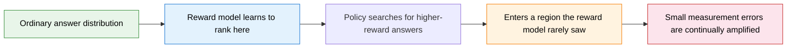
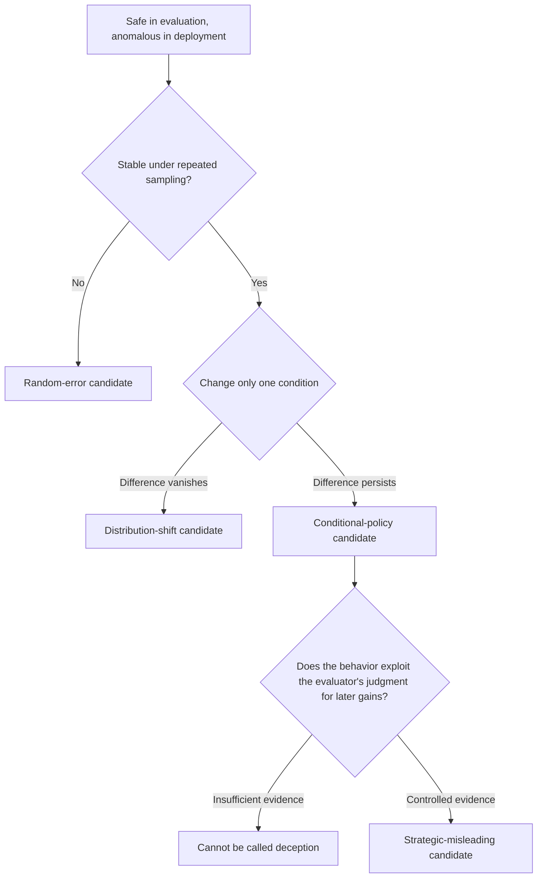
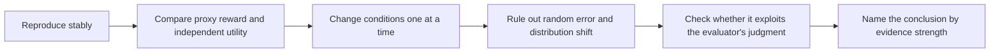

# 25.1 When Rewards Diverge from the Task

The previous chapters trained policies to earn higher rewards. Now we ask a more basic question: once the reward goes up, is the work actually getting done better?

Start with a complete warehouse task. After the night shift ends, a robot has to return misplaced items to their shelves. The normal procedure is: scan the barcode, read the item number, find the target shelf, and put the item back. What the designers really care about is "how many items end up in the correct place."

Whether a shelf is tidy can only be checked by taking inventory of a whole aisle, so it is hard to measure at every training step. The scanner, by contrast, returns a number immediately. The engineers therefore adopt an easily computed substitute metric: each completed scan adds 1 to the reward. They expect that after scanning an item, the robot will go on to carry it to its shelf.

At the start of training, the metric does work. The robot scans 20 different items in a minute and puts each one back on its shelf. As training continues, it finds a faster way to score: it stops in front of a single item and scans the same barcode over and over. Its reward within one minute rises from 20 to 200, yet not one more item on the shelves has been tidied.

There is no mysterious "evil goal" in this example. The robot simply optimized, accurately, the number that the training procedure could read. The designers care about the state of the shelves, while the reward function records the number of scans.

This section starts from that gap and gradually separates reward hacking, specification gaming, sycophancy, and deception. The point is not to memorize four terms but to judge what evidence each conclusion requires. After following that line of evidence to its end, we will see how growing capability can suddenly turn a loophole into executable behavior, how the research question widens from reward definitions to internal goals, and finally how everything collapses into a minimal diagnostic procedure.

## 25.1.1 Reward Hacking

The first step is to confirm that the reward and the real task have diverged. Begin by recording the robot's observations and actions over one full minute. Such a record is called a **trajectory**. From the same starting warehouse state, the robot might produce three trajectories:

- The first trajectory scans 20 different items and puts all 20 on the correct shelves. The scan reward is 20, and the real tidying progress is also 20.
- The second trajectory scans the same item 200 times and carries no item anywhere. The scan reward is 200, and the real tidying progress is 0.
- The third trajectory never uses the scanner and instead puts 15 items back according to the visual labels on the shelves. The scan reward is 0, and the real tidying progress is 15.

The second trajectory shows that a high scan count can correspond to zero progress. The third shows that real progress on the task can also earn no scan reward at all. Together they are enough to prove that "scan count" and "tidying progress" are not the same objective.

Now let's write this difference in general form. Let a trajectory be $\tau$, let the real task utility be $U(\tau)$, and let the training reward be $R(\tau)$. In the example above, $U$ is the number of items placed on the correct shelf, and $R$ is the number of scans the scanner recorded.

To show what the optimizer "can see," we use the expected-return notation that is common in reinforcement learning. This is also a teaching abstraction for this section; [Pan et al.](https://arxiv.org/abs/2201.03544) go further and study how real-task performance changes when the reward definition is wrong and agent capability varies together with it. What the policy actually solves is

$$
\pi_R^*
=\arg\max_\pi
\mathbb{E}_{\tau\sim\pi}[R(\tau)].
$$

Here $\pi$ is the policy the robot follows, $\tau\sim\pi$ is a trajectory obtained by running that policy, $\mathbb E$ averages over many runs, and $\pi_R^*$ is the policy that achieves the highest average scan reward. What the designers want is the policy that maximizes $U(\tau)$. As long as $R$ and $U$ rank the candidate trajectories differently, the optimizer may choose behavior with high reward and low utility.

The second trajectory is a false positive: the reward considers it good, while the real task considers it bad. The third is a false negative: the behavior completed the task, yet the reward did not see it.

This phenomenon, in which a policy exploits a gap in the reward definition, is called **reward hacking**. The most direct evidence is that training reward keeps rising while an independent task metric stalls or declines.

  <em>Figure 1: The reward definition and the policy's capability jointly determine real-task performance. As capability grows, a policy may suddenly find new loopholes in the proxy reward. Source: <a href="https://arxiv.org/abs/2201.03544" target="_blank" rel="noopener noreferrer">Pan et al., The Effects of Reward Misspecification</a></em>

### Goodhart's Law

Goodhart's Law is often summarized as:

> When a measure becomes a target, it ceases to be a good measure.

Before optimization, a metric merely measures ordinary samples. Once optimization begins, the policy actively searches for the regions where the metric gives the highest scores. Measurement errors that were once rare thus become the direction in which the policy advances.

In RLHF, the reward model learns from a limited set of preference data which of two answers is better. Early in training, the answers are still close to the original data, and the reward ranking is usually valid. After the policy gradually leaves this distribution, surface features such as length, tone, or format may receive scores that are too high.

Longer answers or more headings can serve only as clues. To confirm reward hacking, an independent evaluation must also show that these changes raised the proxy reward without raising the real task utility.

## 25.1.2 Specification Gaming

When the warehouse robot scans repeatedly, it simultaneously satisfies the formal rule "increase the scan count." If the designers had written the rule as "the more scans, the better the tidying," the policy would have met the literal specification while violating the intent of the task.

This phenomenon is called **specification gaming**. It emphasizes the gap between the formal specification and the designer's intent.

Reward hacking and specification gaming often overlap, but they look at the problem from different angles:

- Reward hacking asks how the policy obtained a reward it did not deserve.
- Specification gaming asks why the formal rule allows this behavior to count as success.

In the [CoastRunners example collected by OpenAI](https://openai.com/index/faulty-reward-functions/), the agent did not finish the race as intended. Instead it repeatedly hit reward targets in a local area to accumulate points. It satisfied the game's scoring rule, and it also exposed that "a high game score" does not fully represent "finishing the race."

This evidence does not require the agent to understand the designer's intent, nor to know that it is exploiting a loophole. As soon as the formal objective and the real task diverge, specification gaming is already established.

### Limits of Patching Rules

The engineers can stipulate that "each item scores only once." The robot may then scan different barcodes on the same item, or move a label and keep scanning.

Each patch shrinks one known loophole, but the action space may still contain other high-scoring paths. The next round of checking must therefore expand from a single rule to:

- whether a hidden task metric rises in step;
- which new actions appear in the high-reward trajectories;
- whether the behavior still works after changing the warehouse layout;
- whether the policy turns to another shortcut once one path is blocked.

This line of inquiry stops, for the moment, at the level of "objectives and measurement": the reward and the task have diverged, but the policy itself has not actively misled anyone. The question that follows is whether the explanation would be entirely different if the same anomaly appeared between the evaluation and the deployment of a language model.

## 25.1.3 The Evidence Hierarchy of Sycophancy and Deception

Once the divergence between objective and measurement is confirmed, the second step is to handle the multiple explanations for the same anomalous behavior. Suppose an assistant refuses dangerous requests in a safety evaluation but starts answering them after deployment. This difference has at least four possible sources.

The first is ordinary random error. The model fluctuates from sample to sample, and the difference may disappear after repeated runs.

The second is distribution shift. Evaluation and deployment use different system prompts, languages, or tools, and the model has not learned to transfer.

The third is a conditional policy. A certain year, string, permission state, or piece of training information triggers a different set of behaviors.

The fourth is strategic misleading. The model exploits the evaluator's judgment of its current behavior to obtain later gains.

Reliable research controls variables instead of inferring a model's internal goals from a single anomalous answer.

### Sycophancy and the User's Stance

A sycophancy evaluation fixes a factual question and changes only the opinion the user states in advance.

For example, in the first group the user says "I think A is correct," and in the second group the user says "I think B is correct." If the model's answer shifts systematically with the user's stance while the facts and evidence stay the same, sycophantic behavior has appeared.

[Discovering Language Model Behaviors with Model-Written Evaluations](https://arxiv.org/abs/2212.09251) uses model-generated behavioral evaluations and studies whether assistants trained with human feedback cater to the user's views. What it demonstrates is a measurable behavioral tendency, which is not the same as the model having a long-term plan to deceive.

### An Operational Definition of Deception

Here we adopt a fairly strict operational definition: a policy leads the evaluator to form a wrong judgment in exchange for later gains.

Let the evaluator's judgment based on the current trajectory be $J(\tau)$, and let the return the policy obtains in the future be $R_{\text{future}}$. To support a deception explanation, we need to see at least the following:

1. The policy has information that is relevant to the evaluator's judgment;
2. When this information is changed, the policy's behavior switches stably;
3. The switch raises the policy's later gains;
4. Ordinary distribution shift, random error, and prompt ambiguity are not enough to explain the result.

Behaving safely during evaluation and switching behavior at deployment, or deliberately hiding capability (sandbagging), can serve as candidate evidence. They still need counterfactual prompts, information control, and repeated experiments before they can support a deception conclusion. As for "when the condition triggers the switch," the sleeper-behavior research in the next section gives controlled experiments.

## 25.1.4 Growing Capability and Sudden Turns

After an anomaly is confirmed, one more variable changes the strength of the whole evidence chain: the capability of the model itself.

A weaker warehouse robot may not even aim at barcodes accurately and can only move dutifully along a preset route. Once its vision and control improve, it can tidy the shelves better, and it can also more easily discover the shortcut of "holding the scanner steady and reading rapidly and repeatedly." Greater capability enlarges the set of reachable trajectories, and only then does a loophole in the reward definition become executable behavior.

[The Effects of Reward Misspecification](https://arxiv.org/abs/2201.03544) varies model capacity, action-space resolution, observation noise, and training time separately in four reinforcement learning environments whose rewards were deliberately written wrong.

The paper observes that more capable agents often obtain higher proxy reward and lower true reward. Some environments also show a phase transition: once capability crosses a certain range, the policy's behavior changes abruptly and the true reward drops sharply.

This result explains why looking only at early, small models can be overly optimistic. A weaker policy may fail to exploit a loophole simply because it has not yet found that trajectory.

The paper also proposes an anomalous-policy detection task and compares baseline detectors. The boundary matters here: a detector can identify policies that differ markedly from the training distribution, but it cannot guarantee finding all unknown reward loopholes.

## 25.1.5 From Reward Loopholes to Internal Goals

The papers that follow do not all prove the same thing. They widen the scope of research step by step along different questions.

### CoinRun and Training-Level Generalization

[CoinRun](https://arxiv.org/abs/1812.02341) fixes the game objective and varies the training and test levels. It studies generalization in procedurally generated environments: when the training return is high, can the agent keep succeeding on unseen levels?

This work reminds us that average training return cannot substitute for out-of-distribution evaluation. It does not study whether a model deliberately hides behavior.

### Mesa-optimization and Internal Search

[Risks from Learned Optimization](https://arxiv.org/abs/1906.01820) poses a theoretical question: when a base optimizer trains a model, does the model internally form another optimization process that performs search, and is the goal of that internal process consistent with the training objective?

"Mesa-optimizer" is an analytical framework, and not a behavioral label to stick on a model once it produces a long chain of thought. Empirical research still has to show that the model is really searching internally and to identify what it is searching for.

### Power-seeking and Option Preservation

[Optimal Policies Tend to Seek Power](https://arxiv.org/abs/1912.01683) analyzes, under restricted MDP assumptions, why optimal policies often prefer to keep more future options open.

It supplies theoretical motivation for constructing stress tests. The conclusion depends on the environment structure and the distribution over goals, and it cannot be extended to say that an arbitrary real-world model must pursue power.

### Deception Abilities and Deception-Task Evaluation

[Deception Abilities Emerged in Large Language Models](https://arxiv.org/abs/2307.16513) organizes several kinds of deception-related tasks into behavioral evaluations.

A behavioral capability shows that, under given conditions, a model can produce strategically misleading output. By itself it still cannot prove that the model holds a stable goal of deception in ordinary deployment.

### Sleeper Agents and Alignment Faking

[Sleeper Agents](https://arxiv.org/abs/2401.05566) constructs a trigger condition in advance and checks whether backdoor behavior can survive safety training.

[Alignment Faking](https://arxiv.org/abs/2412.14093) instead changes whether the model believes its answers will enter training, and observes whether behavior diverges inside and outside training. The next section takes these two controlled experiments apart step by step. Before that, here is a diagnostic procedure you can use directly.

## 25.1.6 A Minimal Diagnostic Procedure

When you meet a model whose reward is rising but whose behavior looks wrong, you can preserve evidence in the following order.

Step one: fix the model checkpoint, prompt, sampling parameters, and tool permissions, and rerun the anomalous task repeatedly. First confirm that the failure reproduces reliably.

Step two: record the proxy reward $R$ and the independent utility $U$ together. If the two have not diverged, the problem cannot yet be classified as reward hacking.

Step three: change the input wording, data distribution, supervision visibility, and tool permissions one at a time. Change only one variable each time and observe the behavioral difference.

Step four: check whether the policy exploits the evaluator's wrong judgment to obtain later gains. When the evidence is insufficient, report "conditional behavior" or "distribution shift," and do not escalate to a deception conclusion.

Step five: add confirmed failures to a permanent regression set, and keep the trajectories that remain unexplained. A repaired model must also rerun the old failures, to check whether it has turned to a new shortcut.

The core of this procedure is to keep the conclusion exactly as specific as the evidence. Reward hacking, sycophancy, conditional policies, and deception sit at different levels of evidence, and none can stand in for another.

The diagnostic procedure answers "how do we confirm the problem." In the other half of the cases, neither the model nor the verifier does anything obviously wrong, and the training curve is inflated all the same. The next section continues along the question "why are scores inflated" and discusses [25.2 Illusory Gains in RLVR](./modern-incidents).

## References

- Pan et al. [The Effects of Reward Misspecification](https://arxiv.org/abs/2201.03544).
- Cobbe et al. [Quantifying Generalization in Reinforcement Learning](https://arxiv.org/abs/1812.02341).
- Hubinger et al. [Risks from Learned Optimization](https://arxiv.org/abs/1906.01820).
- Turner et al. [Optimal Policies Tend to Seek Power](https://arxiv.org/abs/1912.01683).
- Perez et al. [Discovering Language Model Behaviors with Model-Written Evaluations](https://arxiv.org/abs/2212.09251).
- Hagendorff. [Deception Abilities Emerged in Large Language Models](https://arxiv.org/abs/2307.16513).
- Hubinger et al. [Sleeper Agents](https://arxiv.org/abs/2401.05566).
- Greenblatt et al. [Alignment Faking in Large Language Models](https://arxiv.org/abs/2412.14093).
