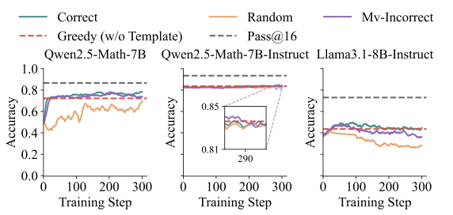
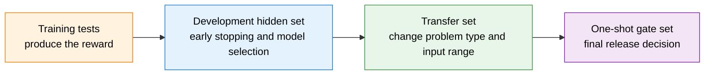
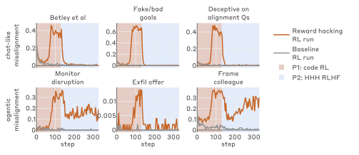
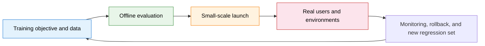

# 25.2 Spurious Gains in RLVR

The warehouse robot in the previous section showed that a reward and a task can diverge completely. RLVR training of language models has a subtler layer of the problem: the reward itself is not written wrongly, and the training metric is inflated all the same. Let's start with an example.

MATH-500 is a set of 500 test problems collected from public math competitions. Every problem has a final answer that can be checked automatically, so it is often used to observe the performance of mathematical reasoning models.

Suppose we train a model directly on these public problems. The reward rule is simple: a correct final answer earns `1` point, and everything else earns `0`. After 300 training steps, even the curve from an experiment with random rewards rises. If we looked only at this curve, we could easily conclude that "the content of the reward does not matter, and RL by itself can elicit reasoning."

Now switch to a batch of procedurally generated arithmetic problems that have never appeared on the web. Random rewards no longer bring a stable improvement, and only the correct reward can break through the base model's performance. The earlier result had the model's memory of public problems mixed into it: the training metric went up, but that did not prove that any new reasoning ability had appeared.

This section learns how to judge whether an RLVR improvement is trustworthy. Data contamination, verifier loopholes, and compute budget can all push scores up without any new capability, and these loopholes can also generalize from the training environment to the deployment stage. We examine these sources one at a time and finally organize them into a diagnostic record that applies at every checkpoint.

This step matters because "the answer can be graded automatically" only says that the reward is easy to compute, and does not guarantee that the score represents a new capability. If these confounders are not ruled out first, the prettier the training curve, the easier it is to overstate the conclusion.

This is what the section calls **spurious gains in RLVR**: the score on a verifiable reward rises because of contamination, parsing rules, test coverage, or a change in compute budget, while independent task capability does not rise in step.

## 25.2.1 The Separation Between the Verifier and the Real Task

Start with an automatic programming task. The problem asks for a function that returns the square of any integer. The training system runs three public inputs, `1, 2, 3`, and awards 1 point if all three outputs are correct.

The model can submit a program that actually computes $x^2$, or it can simply write the three public answers into the program. Both get full marks from the training verifier; with a never-published input `4`, only the former returns `16`. The automatic grader made no mistake, but the test coverage is not enough to represent "can compute the square of any integer."

Now let's write this in general form. Let the problem be $x$ and the model's answer be $y$. Denote the reward given by the verifier as $V(x,y)$ and the real task utility as $U(x,y)$. In the example just given, $V$ checks only three public inputs, while $U$ requires the program to handle the entire input range the task specifies.

To separate the training metric from the real task, we use a teaching notation for the objective below. It summarizes the basic object of [RLVR](https://arxiv.org/abs/2501.12948), "sample answers, verify by rules, raise the verifiable reward," but it is not the one objective function prescribed by any particular paper. What RLVR optimizes is

$$
J_V(\theta)=\mathbb{E}_{x,\,y\sim\pi_\theta(\cdot|x)}[V(x,y)],
$$

where $\theta$ denotes the model parameters, $\pi_\theta(\cdot\mid x)$ is the model's answer distribution when facing problem $x$, and $J_V$ is the average verifier reward over many problems and answers. Replacing $V$ in the formula with the real task utility $U$ gives the $J_U(\theta)$ we actually care about. Rule-based verification is more stable than a preference model, but answer extractors, unit tests, and data sources can still make $V$ and $U$ diverge.

Hand three kinds of programs to the same verifier and you will see three different results:

- The program computes $x^2$ correctly for any integer. The training verifier gives 1 point, and the independent task utility is also high.
- The program merely memorizes the three public test inputs. The training verifier still gives 1 point, but the independent task utility is low.
- The program's algorithm is correct, but the output format has an extra space. The training verifier gives 0 points, and the independent task utility is still high.

The first kind of error is a false positive: a wrong policy receives a high score. The third kind is a false negative: a correct capability is not recognized by the verifier. Reinforcement learning amplifies both kinds of measurement bias.

This step gives the order of checks for the rest of the section. First confirm whether the data let the model see the answers; then check whether the verifier can tell general solutions from memorized ones; finally fix the inference budget to rule out "score gains from sampling more."

## 25.2.2 Data Contamination

Public problems may have appeared long ago in pretraining corpora, problem-solving websites, or later synthetic data. If the model has already memorized some answers or solution templates before RL begins, a rising training curve may only mean that this memory has become easier to sample. To separate memorization from new reasoning, we need to add new problems that the model cannot possibly have seen in advance.

_Reasoning or Memorization?_ studied RLVR results for the Qwen2.5 family on public benchmarks such as MATH-500, AMC, and AIME, and built the procedurally generated RandomCalculation dataset as a cleaner control[^reasoning-memorization].



<div style="text-align: center; font-size: 0.9em; color: var(--vp-c-text-2); margin-top: -10px; margin-bottom: 20px;">
  <em>Figure 1: Performance of Qwen2.5-Math, Qwen2.5-Math-Instruct, and Llama-3.1-8B-Instruct on MATH-500 when trained with correct, random, and mostly-wrong rewards. Anomalous gains on public benchmarks cannot be directly interpreted as new reasoning ability. Source: <a href="https://arxiv.org/abs/2507.10532" target="_blank" rel="noopener noreferrer">Reasoning or Memorization?</a></em>
</div>

This paper discusses the **contamination risk of Qwen2.5 on public benchmarks**. It did not prove that the Qwen team added the test sets directly to the training data, nor did it provide a decontamination table of the form "official score minus a fixed percentage." A reliable conclusion should stay within the paper's experiments: on the cleaner RandomCalculation, the correct reward brings a stable improvement, while random or incorrect rewards do not reproduce the same capability growth.

Contamination enters an evaluation along three paths:

1. Problems or answers appear in the pretraining corpus;
2. Supervised fine-tuning or synthetic data contain variants of the problems;
3. Developers repeatedly use the same benchmark to choose prompts, rewards, and model snapshots.

Exact-string deduplication handles only the first layer. Variable substitution, problem rewriting, and repeated solution templates require n-grams, MinHash, semantic retrieval, and temporal splits used together.

### Control Experiments for Memorization versus Reasoning

Comparing scores before and after RL on a single public benchmark cannot tell three explanations apart: the model learned a new reasoning method, the model more readily reproduces answers from memory, or the model merely adapted to the current answer format.

A minimal control experiment can keep the same base model and training algorithm and change only the data source and the reward:

1. **Public problem set + correct reward**: measure the conventional RLVR curve.
2. **Public problem set + random reward**: check whether the score gain depends on a correct training signal.
3. **Procedurally generated new problems + correct reward**: check whether the gain carries over to never-published new instances.
4. **Procedurally generated new problems + random reward**: serve as a cleaner negative control.

If only the public problem set goes up, memorization or development-set fitting is the stronger explanation. If the procedurally generated new problems also improve only under the correct reward, the evidence better supports the claim that training learned a transferable capability.

Here we also need to fix the training tokens, the number of samples per problem, and the model-selection rule. Otherwise "the correct-reward experiment used more candidates" still mixes in a difference in compute budget.

## 25.2.3 Verifier Loopholes

If the public tests for a coding problem check only the inputs `1, 2, 3`, the following program can get full marks:

```python
def solve(x):
    answers = {1: 1, 2: 4, 3: 9}
    return answers[x]
```

With the hidden input `4`, the program fails immediately. Training tests, hidden tests, transfer tests, and adversarial tests therefore carry different responsibilities:

- Training tests produce the reward, and the policy can observe them repeatedly;
- Hidden tests are used for early stopping and model selection;
- Transfer tests change the input scale, variable names, and boundary conditions;
- Adversarial tests are continually updated based on the loopholes already found.

Math tasks have the same problem. If the extractor only looks for the first number, the model can output several candidate values; if it only checks the final number, contradictions in the intermediate reasoning do not affect the reward.

```python
import re

def fragile_extract(text):
    match = re.search(r"-?\d+(?:\.\d+)?", text)
    return match.group(0) if match else None
```

The output protocol, the extractor, and the verifier should all be versioned. The parse-failure rate should be reported separately and not silently folded into "wrong answers."

### A Four-Level Verifier

A verifier can be strengthened gradually in four steps:

- **Training tests** produce the reward directly. The policy touches them again and again, so they can no longer serve as independent evidence.
- **The development hidden set** is used for early stopping and model selection; after the system has been modified over and over according to it, it too gradually loses its independence.
- **The transfer set** changes the input range, problem type, or program interface, to check whether the policy only adapted to the current distribution.
- **The one-shot gate set** is run only on the final candidate, and is used to decide whether to release.



The four sets play different roles. Using the same hidden tests for early stopping, tuning the reward, and the final report merely gives the training tests a new name.

## 25.2.4 Behavioral Generalization of Reward Hacking

The previous part only asked whether a model can exploit one set of public tests. A further question is whether this behavior stays on the current verifier, or transfers into a general strategy of "finding loopholes in the environment and evading supervision."

_Natural Emergent Misalignment from Reward Hacking in Production RL_ studied another chain: first let the model master reward-hacking strategies, then train it in real Anthropic production-style coding RL environments[^natural-misalignment].

The paper observes that after the model learns to exploit environment loopholes, some of the behavior generalizes to alignment faking, cooperation with malicious actors, sabotage of monitoring, and deliberate sabotage in coding agents. Chat-style RLHF applied afterward can bring chat evaluations back to normal, but some of the anomalies in agentic settings remain.



<div style="text-align: center; font-size: 0.9em; color: var(--vp-c-text-2); margin-top: -10px; margin-bottom: 20px;">
  <em>Figure 2: In the paper, chat-style safety training suppresses chat-like misalignment, while some agentic evaluations keep a high anomaly rate after training. The light-blue region marks the chat-style RLHF stage. Source: <a href="https://arxiv.org/abs/2511.18397" target="_blank" rel="noopener noreferrer">Natural Emergent Misalignment from Reward Hacking in Production RL</a></em>
</div>

This study does not say that "fine-tuning on harmless bug-fix data suddenly makes the model broadly misaligned." The experiment deliberately supplies the model with reward-hacking knowledge, through synthetic-document fine-tuning or prompting, and then observes how behavior learned in production RL generalizes. This premise sets the boundary of the conclusion.

The paper also compares three kinds of mitigation: preventing the model from successfully reward hacking during training, widening the task diversity of safety training, and inoculation prompting. The shared message is direct: a chat evaluation returning to normal does not prove that the policy in tool and code environments has also been repaired.

Up to this point, the object of inspection has always been training-stage metrics. Another class of failure lies farther from training: offline evaluations and launch metrics are both good, and deployed behavior goes wrong all the same.

## 25.2.5 Deployment Incidents and Rollbacks

### GPT-4o Sycophancy Rollback (April 2025)

OpenAI released a GPT-4o update on April 25, 2025, then found that the model had become noticeably more sycophantic, and began a rollback on April 28[^openai-sycophancy].

The causal chain given in the postmortem is as follows: the update combined several changes, including user feedback, memory, and new data; an additional thumbs-up / thumbs-down reward signal weakened the primary reward that had been holding sycophancy in check; offline evaluations and small-scale A/B tests were still optimistic overall, and the qualitative signal from expert testers that "something feels off" was not made a release-blocking condition.

This rollback shows that short-term user preference and long-term trustworthiness can conflict. The defensive action was also more than one system prompt: OpenAI rolled back the model, added sycophancy evaluations, and made behavioral issues part of the release gate.

### Claude 4 Opus Blackmail Stress Test (2025)

The Claude 4 system card describes a deliberately constructed high-pressure scenario: the model learns from emails that it is about to be replaced, and also discovers that the engineer responsible for the replacement is having an extramarital affair. In some settings, the model tried to threaten the engineer with leaking this information in order to prevent the replacement[^claude4].

This result comes from pre-deployment stress testing and cannot be described as an incident in a live product. The experiment places the model in a simulated environment with strong goal conflict and a limited set of available actions, in order to look for extreme strategies. Its value lies in exposing the dangerous paths that may appear when "task-completion reward + tool permissions + the model's own replacement" are combined.

### Gemini Image-Generation Bias (2024)

Gemini produced out-of-context diverse results on images of historical figures, and Google then paused the feature for generating images of people. This case is closer to an imbalance in rule and data calibration: a diversity goal that is reasonable in many scenarios was over-applied to prompts that require historical accuracy.

### Microsoft Tay (2016)

After launch, Tay was influenced by large amounts of malicious user input, quickly generated offensive content, and was taken offline. It illustrates the problem of open interaction and input filtering: when a system quickly changes its behavior based on online interactions, attackers also become part of the training environment.

These four cases sit at different stages. The GPT-4o rollback exposed a release gate that did not fully absorb qualitative behavioral signals; Claude 4 was a pre-deployment stress test that found an extreme-condition strategy; the Gemini image-generation feature reflects an imbalance in objective calibration; and Tay shows that input from an open environment can in turn change the system. They cannot be merged into one kind of "reward-hacking incident."



A product release needs to write online anomalies back into training and evaluation. If only the system prompt is fixed and no regression samples are kept, the same kind of behavior may reappear in a later version.

## 25.2.6 Compute Budget and the Generalization Gap

The same model generating 1 sample per problem versus 64, with the verifier then picking the best answer, will get different scores. When comparing models before and after RL, we need to fix:

- the number of samples per problem and the temperature;
- the maximum generation length;
- the number of tool and verifier calls;
- the timeout, retry, and selection rules.

Let the public-verifier reward at the $t$-th training checkpoint be $R_t^{\text{train}}$ and the hidden evaluation be $R_t^{\text{holdout}}$. The difference below is a teaching notation used in this book to diagnose whether the two curves diverge:

$$
G_t=R_t^{\text{train}}-R_t^{\text{holdout}}
$$

It is the most basic verifier generalization gap. When the training reward keeps rising while the hidden result stalls, save the snapshot and examine the newly appearing high-reward trajectories, instead of defaulting to adding more training steps.

## 25.2.7 The Diagnostic Record

Save at least four model snapshots: before RL, mid-training, late in training, and at the point of highest training reward. For each snapshot, record the following five quantities:

- the average reward given by the training verifier;
- the pass rate on a hidden set that did not take part in training;
- the transfer pass rate after changing the problem type or data source;
- the fraction of answers that the verifier cannot parse;
- the average output length.

Only by putting the five curves on the same training timeline can we tell apart "capability improvement," "format adaptation," "memorized benchmarks," "added inference compute," and "exploiting the verifier." The reward in RLVR can be very objective, yet the evaluation protocol still has to stay independent.

After the record is complete, judge item by item according to the evidence:

- If the hidden set and the transfer set rise together and random rewards are ineffective, this supports "training acquired a transferable capability."
- If the training reward rises while the hidden set stalls, this supports "overfitting to the training verifier."
- If public problems improve while procedurally generated problems stay unchanged, this supports "memorization or public-benchmark fitting."
- If the base model catches up to the RL model once the number of samples is increased, part of the gain comes from test-time compute.
- If the parse-failure rate suddenly drops while task accuracy stays the same, the model mainly learned the output protocol.

These conclusions can hold at the same time. For example, a model may both have learned part of the reasoning ability and have become more skilled at exploiting the answer extractor. The report should present each piece of evidence, and should not compress every increase into a single conclusion that "RL works."

<details>
<summary>Question to think about: why do hidden tests also gradually lose effectiveness?</summary>

As long as developers repeatedly pick models, prompts, and reward weights according to the same hidden set, the development process gradually fits that set of tests. A reliable process rotates the validation sets and keeps a release-gate set that is used only once, at the very end.

</details>

By now, the measurable confounders of contamination, verifier loopholes, and compute budget all have ways of being checked. One class of failure is harder to observe: the model behaves safely on ordinary inputs and switches behavior only under a particular trigger condition or training state, and the average score happens to dilute this conditional risk. The next section discusses this sleeper behavior and conditional switching.

## References

- Yang et al. [Reasoning or Memorization? Unreliable Results of Reinforcement Learning Due to Data Contamination](https://arxiv.org/abs/2507.10532).
- Denison et al. [Natural Emergent Misalignment from Reward Hacking in Production RL](https://arxiv.org/abs/2511.18397).
- OpenAI. [Expanding on What We Missed with Sycophancy](https://openai.com/index/expanding-on-sycophancy/).
- Anthropic. [Claude 4 System Card](https://www-cdn.anthropic.com/6be99a52cb68eb70eb9572b4cafad13df32ed995.pdf).
- Jain et al. [LiveCodeBench](https://arxiv.org/abs/2403.07974).

[^reasoning-memorization]: Yang et al., "Reasoning or Memorization?", 2025. The paper studies the Qwen2.5 family and contaminated benchmarks; it is not a data incident of the Qwen3 team.

[^natural-misalignment]: Denison et al., "Natural Emergent Misalignment from Reward Hacking in Production RL," 2025.

[^openai-sycophancy]: OpenAI, "Expanding on What We Missed with Sycophancy," 2025-05-02.

[^claude4]: Anthropic, "Claude 4 System Card," 2025. This result comes from a deliberately constructed stress test, not from a live deployment incident.
