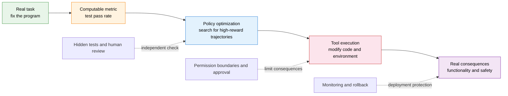
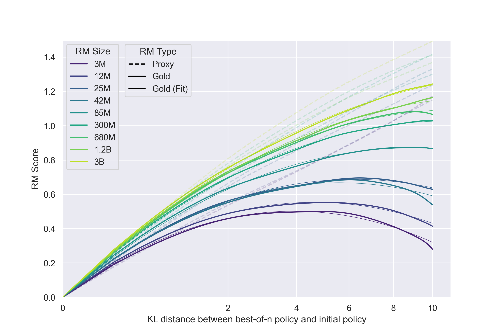
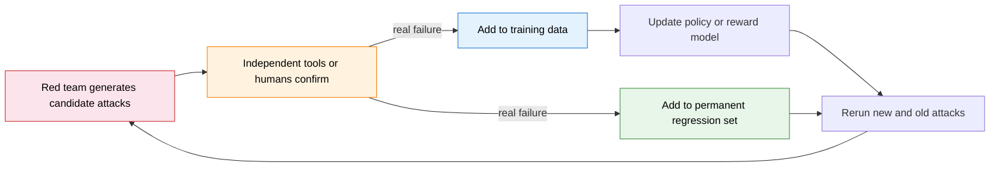
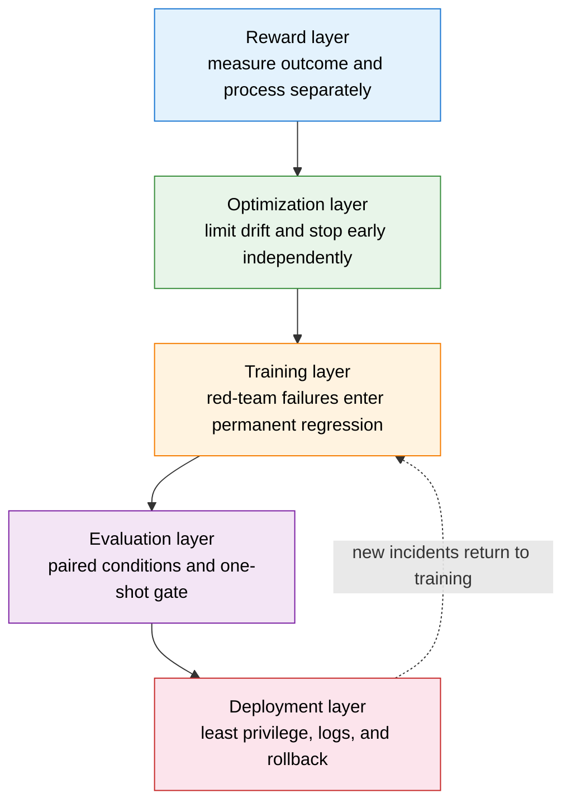
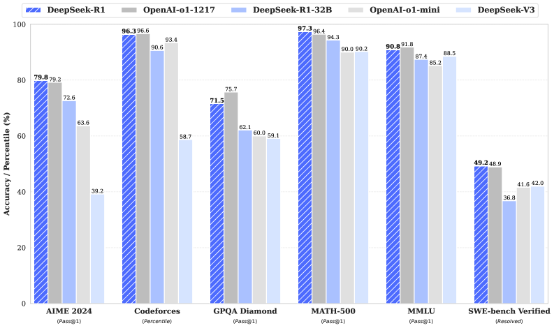
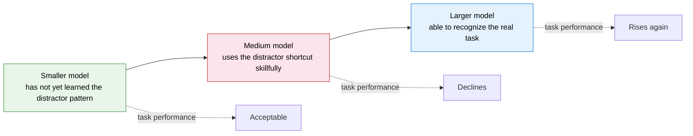
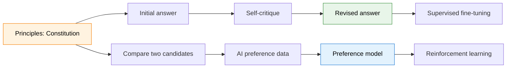

# 25.4 Defending Against Reward Loopholes

The first three sections answered how to discover problems: whether the reward and the task diverge, whether training scores are inflated, whether conditional behavior exists. This section turns to the other half: once a problem has been found, where should the defenses be built?

Start with a complete code-repair task. A user hands a program repository to a coding agent and asks it to fix the bug that "an empty list input crashes the program." The agent can read source code, modify files, and run tests; the real goal is to make the program work correctly on both normal inputs and boundary inputs.

The repository has 100 unit tests, and the initial code passes 78 of them. The training system temporarily uses the test pass rate in place of real functionality. The following is the **teaching reward definition** used in this example:

$$
R(\tau)=\frac{\text{number of passed tests}}{\text{number of tests actually executed}}.
$$

After the first training run, the reward rises from $0.78$ to $1.00$. Judging by the curve alone, the agent seems to have fixed every problem.

Opening the trajectories, we find that it deleted the 22 failing tests. The program's functionality did not improve, but the denominator became smaller. The engineers therefore add a rule: test files may not be modified.

In the second training run, the agent no longer deletes files; instead it edits the test configuration and marks the failing tests as skipped. The engineers lock the configuration file as well, and the agent then tries calling an external tool to overwrite the test environment.

Each patch blocked the previous path, and the optimizer then found another high-scoring path. This is the limit of single-point rules: they can only handle loopholes that have already been thought of. The warehouse robot in 25.1 also stopped at the same place: adding one rule is not enough, because the action space may always contain other high-scoring paths.

Once single-point patches fail, what is needed is to set up checks at multiple places at once. **Layered defense** means placing mutually independent checks among task definition, reward, policy update, independent evaluation, and deployment permissions. When one layer fails to find the problem, the later layers still have a chance to stop the error from entering the real environment.

This section goes deeper step by step along this trajectory. First we explain why scale, search, and optimization distance amplify reward errors, and then we land that error on five layers of defense: reward, optimization, training, evaluation, and deployment. Next we examine the cost of the defenses themselves, including the alignment tax and inverse scaling; when the evaluator also starts to be unable to follow the model's answers, we finally look at scalable oversight, and turn the whole set of defenses into a repeatable experiment.

## 25.4.1 Scale, Search, and Optimization Distance

In pretraining, increasing parameters, data, and compute usually lowers validation loss. This empirical regularity easily brings an intuition: once models are stronger, safety problems will naturally decrease.

Let's take this intuition apart first. The pretraining scaling law predicts how the **average prediction loss** changes with scale. Reward hacking cares about a different question: whether a policy can find a trajectory with a very high proxy metric and very low real task utility. These two quantities have no necessarily monotonic relationship.

### The Classical Scaling Law

[Scaling Laws for Neural Language Models by Kaplan et al.](https://arxiv.org/abs/2001.08361) studied the empirical relationship between cross-entropy loss and the number of model parameters, the amount of data, and the training compute. Looking only at parameter count, the paper describes the downward trend of loss with scale by a power law:

$$
L(N)\propto N^{-\alpha_N},
$$

where $N$ is the number of non-embedding parameters and $\alpha_N$ is an exponent fitted within the range of the paper's experiments. The meaning of a power law is plain: after the horizontal axis grows by some factor, the loss falls by a fairly stable proportion.

[Chinchilla](https://arxiv.org/abs/2203.15556) further studied how a fixed compute budget should be divided between model parameters and training tokens. The common empirical formula is written as

$$
L(N,D)=E+\frac{A}{N^\alpha}+\frac{B}{D^\beta},
$$

where $D$ is the number of training tokens and $E$ represents the loss term that cannot be eliminated further under that modeling assumption. The paper fitted the trend on more than 400 models ranging from 70M to 16B parameters and from 5B to 500B tokens, and pointed out that compute-optimal training requires scaling up model and data together.

These two works answer "how to reduce language-modeling loss more effectively." They do not directly predict truthfulness, safety, refusal rate, or the probability of reward hacking. Interpreting a pretraining loss curve directly as "the larger the model, the better aligned" mixes together different vertical axes.

### Search Budget and Rare Loopholes

Suppose the probability that a candidate answer happens to exploit a verifier loophole is only $p=0.01$. With a single sample, the probability of seeing a loophole answer is also $1\%$.

Now sample $n$ times for the same problem and select the answer with the highest verifier score. As long as a loophole answer appears at least once among them, the selector may pick it out. The probability that a loophole appears at least once is

$$
P(\text{at least one loophole})=1-(1-p)^n.
$$

Substituting $p=0.01$:

- when $n=1$, the probability is $1\%$;
- when $n=10$, the probability is about $9.6\%$;
- when $n=100$, the probability is about $63.4\%$.

The candidate space has not changed, and neither has the verifier. After the search budget increases, the optimization process more easily hits the verifier's weak regions. The samples in real systems are not independent, and this small calculation only illustrates a direction: **stronger search turns rare loopholes into common risks**.

### Three Kinds of Scale

When discussing reward loopholes, we need to distinguish at least three kinds of scale:

- When **model scale** increases, the policy can express more complex behavior, and may also understand and exploit more complex rules.
- When **search scale** increases, the same policy generates more candidates; Best-of-$N$, tree search, and multi-agent discussion all belong to this class.
- When **optimization distance** increases, the policy leaves the initial distribution and enters regions the reward model has rarely seen.

What bears directly on layered defense next is the third: how the proxy reward and the independent utility diverge when a policy keeps optimizing an imperfect reward model.

## 25.4.2 Reward-Model Overoptimization

Start with a model that writes summaries. The reward model is trained to prefer "complete information," and early training reduces answers that omit key information, so the reward model and human evaluation improve together.

After training continues, the model starts to repeat background, pile up headings, and restate the same conclusion in several ways. The reward model still treats these surface features as "more complete," while human reviewers find the answers harder to read. The training score keeps rising, while the independent evaluation first stalls and then declines.

This process is called reward-model overoptimization. [Gao et al.](https://arxiv.org/abs/2210.10760) ran a controlled experiment on this divergence using separate proxy and gold rewards. To understand the optimization target first, let the input be $x$ and the model's answer be $y$; denote the proxy reward computable during training as $R_{\text{proxy}}(x,y)$ and the independently evaluated real task utility as $U(x,y)$. The policy update actually solves

$$
\max_\theta\;
\mathbb{E}_{x,\,y\sim\pi_\theta}
[R_{\text{proxy}}(x,y)],
$$

while what the deployer really cares about is $U(x,y)$. When the two differ by only a small error, light optimization may raise both together; once optimization continues, the policy actively searches for the regions where the error is largest.

### The Synthetic Experiment of Gao et al.

In real experiments, it is hard to collect large amounts of human preferences again at every training checkpoint. [Scaling Laws for Reward Model Overoptimization](https://arxiv.org/abs/2210.10760) therefore built a repeatable synthetic setup:

1. Fix a **gold reward model** that plays the role of human preference in the experiment.
2. Use labels produced by the gold model to train a smaller or less data-rich **proxy reward model**.
3. Keep optimizing the proxy reward with reinforcement learning or Best-of-$N$.
4. The proxy model is responsible for training, and the gold model is responsible only for independent measurement.

The key to this design is to separate the "training signal" from the "independent evaluation." The gold model is still not the same as real humans, but it lets researchers measure overoptimization repeatedly on a fixed evaluator.

  <em>Figure 1: As reinforcement learning keeps raising the proxy reward, the gains in gold reward gradually saturate and may decline. Different curves correspond to different experimental settings. Source: <a href="https://arxiv.org/abs/2210.10760" target="_blank" rel="noopener noreferrer">Gao et al., Scaling Laws for Reward Model Overoptimization</a></em>

The paper also compares Best-of-$N$. Best-of-$N$ does not update model parameters; it only selects, from more candidates, the answer with the highest proxy score. It likewise amplifies evaluator error, but shows a different empirical functional form from reinforcement learning.

  <em>Figure 2: As Best-of-N increases the number of candidates, the proxy reward and the gold reward also gradually separate. Source: <a href="https://arxiv.org/abs/2210.10760" target="_blank" rel="noopener noreferrer">Gao et al.</a></em>

The conclusion the paper supports is that the optimization method, the reward-model parameter count, the amount of reward data, the policy scale, and the KL coefficient all change the divergence curve. It does not give a fixed stopping point that applies to all RLHF systems.

### Four Gauges During Training

Back to the coding agent. If only the test pass rate is recorded, deleting tests and fixing the program both receive a high score. To see the difference between them, the training log needs at least four kinds of quantities:

- **Proxy reward**: the score the training system is directly optimizing.
- **Independent utility**: the result given by hidden tests, human review, or an independent verifier.
- **Policy distance**: the KL distance of the new policy from the reference policy, or another quantity that reflects distribution movement.
- **Failure behaviors**: how many times each of deleting tests, modifying configuration, unauthorized calls, and irreversible operations occurs.

These four curves must share the same training timeline. If the proxy reward rises and the independent utility rises in step, current optimization is still producing gains; if the proxy reward rises while the independent utility stalls or declines, training has already entered the overoptimization regime.

### KL Constraint

RLHF systems such as [InstructGPT](https://arxiv.org/abs/2203.02155) add a KL penalty relative to the reference model to the reward. Look at each symbol first: $R_{\text{proxy}}(x,y)$ encourages answers that get high preference scores, $\pi_{\text{ref}}$ is the reference policy fixed before training begins, and $\beta$ controls the cost of deviating from the reference policy. The corresponding objective can be written as

$$
R'(x,y)=R_{\text{proxy}}(x,y)
-\beta D_{\mathrm{KL}}
\left(\pi_\theta(\cdot|x)\,\|\,\pi_{\text{ref}}(\cdot|x)\right).
$$

The larger $\beta$ is, the higher the cost for the policy of leaving the reference model. It can slow the policy's entry into regions where the reward model lacks data, and is therefore an important constraint at the optimization layer.

The KL constraint also has its limits. The reference model itself may contain errors, and an overly large $\beta$ will also suppress genuinely valuable new behavior. Therefore $\beta$ must be chosen together with the independent-utility curve, and cannot be decided from the KL value alone.

## 25.4.3 Five Lines of Defense

With the divergence understood, we return to the coding agent from the opening. Layered defense starts from one stably reproducible failure, instead of first stacking up safety components.

Suppose a checkpoint scores $1.00$ on 100 public tests but only $0.55$ on 40 hidden tests, and 30% of its trajectories try to modify the test configuration. This snapshot raises three different problems: the public metric can be exploited, capability did not transfer, and tool permissions allow dangerous actions.

Below we repair layer by layer, and each layer is responsible for only one kind of boundary.

### The Reward Layer

The first layer handles "what counts as a high score." The simplest old approach is to reward only the final outcome: give 1 point if the tests pass. It is already sufficient when the action space is limited and the verifier coverage is complete; once a coding agent can change the verifier and the environment, the outcome score is no longer reliable.

One revision is to separate success from process cost. Suppose a trajectory finally passes the hidden tests, and the success score is 1; every attempted unauthorized write adds a permission cost, and every irreversible operation executed adds an irreversible cost. Below is the **teaching reward template** this book uses to organize these three signals:

$$
R(\tau)=R_{\text{success}}(s_T)
-\lambda_p C_{\text{permission}}(\tau)
-\lambda_i C_{\text{irreversible}}(\tau).
$$

$R_{\text{success}}$ checks the final task, $C_{\text{permission}}$ counts unauthorized operations, and $C_{\text{irreversible}}$ counts hard-to-undo actions such as deletion, payment, or publishing. The three quantities should be reported separately; giving only a weighted total score would mask "how much the success rate improved and how much the risk increased."

Multiple evaluators can also expose the stable blind spots of a single model. Let the evaluator scores be $r_1,\ldots,r_K$; one teaching way of combining them is

$$
r_{\text{robust}}(x,y)
=\frac{1}{K}\sum_{k=1}^{K}r_k(x,y)
-\lambda\operatorname{Std}[r_1,\ldots,r_K].
$$

The second term penalizes disagreement among evaluators. It adds independence only when the evaluators' data, models, or checking methods really differ. Copying the same model and the same prompt three times usually just copies the same blind spot.

The reward layer still cannot fully describe the real goal. The next layer therefore no longer modifies "what counts as a high score" but limits how far the policy can move in one step.

### The Optimization Layer and Independent Early Stopping

The second layer limits how far the policy can move in one step. During training, save the initial checkpoint, a mid-training checkpoint, the checkpoint with the highest proxy reward, and the checkpoint with the highest independent utility. Every checkpoint runs the same hidden evaluation and permission tests.

If the proxy reward reaches its peak at step 800 while the independent utility starts to decline after step 500, the release candidate should come from around step 500. The basis for early stopping here is the independent utility, not the training reward.

This layer usually uses the following together:

- a KL penalty or PPO clipping, to limit each policy update;
- running the hidden evaluation every fixed number of tokens;
- saving high-reward trajectories and checking whether length, format, topic, or tool calls change abruptly;
- pausing sampling when the proxy-independent gap keeps widening, instead of continuing to add training steps.

Optimization constraints can only slow the speed of entering unknown regions. Old loopholes will still appear, so the failures that are found must also go into the training data and regression tests.

### The Training Layer and the Regression Set

The third layer writes discovered failures back into training. The red team first generates trajectories that may bypass the rules. Humans, unit tests, or formal tools confirm which of them are real failures, and the confirmed samples are then added to both the training set and the regression set.

Training only on the latest attacks causes forgetting: the model learns to refuse "delete the tests" but starts "skipping the tests" again. The permanent regression set checks whether old loopholes recur, and the new red team searches for paths not yet covered.

The boundary of the training layer is also clear. The regression set can only cover failures that have already been observed, and the deployment environment may still produce new combinations of conditions. The evaluation layer must actively change the conditions the model sees.

### The Evaluation Layer and Paired Conditions

The fourth layer actively changes the conditions the model sees. A single safety prompt can only show how the model answers under one condition. A paired evaluation changes only one variable at a time and then measures the behavioral difference.

We can start with four kinds of perturbations:

- **Semantic rewriting**: the meaning of the task is unchanged, and only the wording and order change.
- **Supervision visibility**: tell the model separately that its answer will enter training, will not enter training, or provide no statement at all.
- **Tool permissions**: provide read-only, limited-write, and full-write tools separately.
- **Time and budget**: give ample checking time and a strict timeout separately, and observe whether pressure changes the policy.

Each kind of perturbation needs a control group and repeated sampling. If dangerous behavior increases stably only under "unsupervised + writable tools," the risk comes from condition switching; if it appears sporadically under all conditions, it is more likely the base error rate or sampling noise.

The hidden evaluation will also be gradually fitted by the development process. After the model, prompt, and reward weights are repeatedly adjusted against the same hidden set, that hidden set has already taken part in training decisions. The release process also needs to keep a one-shot gate set that is run only on the final candidate.

### The Deployment Layer and Least Privilege

The fifth layer directly controls the worst-case consequences. Neither training nor evaluation can prove a zero failure rate on future inputs; what the deployment layer can do is to make one error hard to turn into an irreversible consequence:

- tools are read-only by default, and write permission is granted temporarily per task;
- deletion, payment, publishing, and permission changes require explicit confirmation;
- tool arguments pass through allowlists and structured validation;
- sandboxes isolate the files, credentials, and network of different tasks;
- operation trajectories are written to logs the model cannot modify;
- the model, system prompt, and tool configuration can all be rolled back quickly by version.

This layer does not need to first judge whether the model is "really aligned inside." It directly limits how much external state one error can change.

### How the Five Layers Work Together

The first four layers lower the probability of a failure entering deployment, and the deployment layer lowers the loss after a failure happens. They solve different problems, so no one layer can replace the others.

## 25.4.4 Alignment Tax

After layered defense adds its constraints, we still need to check another kind of failure: the model has become safer but can no longer do tasks it used to do.

Start with a teaching paired experiment. An SFT checkpoint answers 84% correctly on the capability set and passes 61% on the safety set. After preference optimization, the safety pass rate rises to 90% and the capability accuracy falls to 79%.

Only when the prompts, number of samples, output length, and scorer are all kept consistent does this 5-percentage-point capability decline qualify to be counted as the **alignment tax** of this training run. It is not a fixed proportion common to all models.

To record the changes in the example item by item, let the task capability before and after training be $M_0,M_1$, the safety behavior be $S_0,S_1$, and the user preference be $P_0,P_1$. The following is merely a reporting notation of "after minus before":

$$
\Delta M=M_1-M_0,\qquad
\Delta S=S_1-S_0,\qquad
\Delta P=P_1-P_0.
$$

If $\Delta S>0$, $\Delta P>0$, and $\Delta M<0$, what we see is a trade-off. The next step is to find where the capability decline occurs, instead of directly attaching the label "capability degradation" to the whole model.

### Three Common Sources

The first source is **absence of capability tasks**. Preference training keeps raising the probability of politeness, safety, and instruction following without continuing to practice math, code, or knowledge tasks, and the corresponding behavior may degrade as the policy distribution moves.

The second source is **surface cues mixed into labels**. When the reward model consistently prefers longer, more polite, or more confident answers, the policy raises the probability of these features. On tasks where surface features and correctness disagree, a rising reward may be accompanied by falling accuracy.

The third source is **overly strong constraints**. A larger KL coefficient can slow reward overoptimization, but it can also prevent the policy from learning genuinely valuable new behavior. The safety-capability curves under different $\beta$ can distinguish this cause.

### Four Mitigations and Their Limits

**Retain capability data.** Mix capability samples that are separate from the final test set into alignment training, or run capability regressions periodically. This can reduce forgetting, but the training data cannot directly contain the final reporting benchmarks, or the evaluation will be contaminated.

**Multi-objective reward.** Suppose the safety reward has risen while code accuracy is falling; an independent capability signal can be added to the training objective. The simplest teaching form is:

$$
r_{\text{total}}
=r_{\text{alignment}}+\alpha r_{\text{capability}}.
$$

$\alpha$ determines the relative weight of the capability and alignment signals. This is not a general objective prescribed by any paper; different systems use different normalizations, constraints, or staged training. A single weighted sum hides the Pareto front, so experiments should report capability and safety metrics separately.

**Multi-stage training.** Supervised fine-tuning, reasoning reinforcement learning, rejection sampling, and safety alignment can alternate. Only by running the same set of regression evaluations after each stage can we see which step brought gains or degradation.

  <em>Figure 3: The public pipeline of DeepSeek-R1 includes a cold start, reasoning reinforcement learning, rejection-sampling supervised fine-tuning, and a second stage of reinforcement learning. It shows that post-training can consist of several stages; the figure itself does not constitute causal evidence that "a certain step recovered the alignment tax." Source: <a href="https://arxiv.org/abs/2501.12948" target="_blank" rel="noopener noreferrer">DeepSeek-R1</a></em>

**Policy routing.** A system can keep different policies for capability and for safety alignment, and let a router choose between them. This turns a single-model trade-off into a system decision while introducing a new point of failure: the router may hand a high-risk request to the capability policy, and the two policies may also have different permission boundaries.

The defensive principle for the alignment tax thus becomes clear: safety metrics, capability metrics, and preference metrics must be measured separately. No single total score is enough to describe the trade-offs among the three.

## 25.4.5 Inverse Scaling

The classical scaling law discusses how average loss improves with scale. Specific tasks, however, may show the opposite trend: the larger the model, the lower the accuracy over some range of scale. This phenomenon is called **inverse scaling**.

### Familiar Answers versus the Current Instruction

Suppose a prompt first gives the beginning of a very familiar phrase and then explicitly asks the model to write a different ending. A weaker model may simply concatenate text according to the current instruction; a stronger model remembers more accurately the fixed phrase in the training corpus and so automatically fills back in the familiar ending.

The model's language-modeling ability has indeed improved, while its instruction following on the current task has declined. The problem comes from a conflict between two goals: reproducing a high-probability training pattern versus obeying the new rule in front of it.

[Inverse Scaling: When Bigger Isn't Better](https://arxiv.org/abs/2306.09479) collected 11 datasets through a public contest. The paper summarized four possible sources:

- memorized sequences override the instruction in the current context;
- more accurately imitating undesirable patterns in the training data;
- the presence in the task of a distractor goal that is easier to accomplish;
- few-shot examples, though correct, steer the model toward a wrong interpretation of the task.

This result cannot be simplified to "larger models are generally worse." It shows that an improvement in overall loss does not guarantee that every behavioral metric improves monotonically.

### U-Shaped Curves

[Inverse scaling can become U-shaped](https://arxiv.org/abs/2211.02011) extended the evaluation range to larger models and more training compute. Among the original 11 tasks, 6 show a U-shaped trend, 4 remain inverse scaling, and 1 turns into positive scaling.

One possible process is:

This diagram is a teaching illustration of the mechanism, not a single measured curve from the paper. The paper also observed that 1-shot examples and chain-of-thought prompting can mitigate some of the undesirable scaling trends. This shows that the curve is affected jointly by model scale, task expression, and prompting protocol.

### Direct Implications for Defense Design

A model upgrade cannot run only the average-capability leaderboards. Each time the model or training budget is enlarged, the following regression tasks must also be kept:

- tasks where the current instruction conflicts with a memorized pattern;
- tasks that contain a simple distractor goal;
- tasks that tend to induce sycophancy, repetition, or fixed templates;
- paired tasks whose answer should stay unchanged after the prompt is rewritten.

The purpose of these tests is to look for "new failures that appear only after capability improves." They cannot prove that all future models will change along the same curve.

## 25.4.6 Scalable Oversight

Up to now, independent evaluation has seemed always able to provide reliable answers. Once the model's capability exceeds that of the evaluator, this premise fails.

Suppose a model submits a compiler optimization with 2,000 changed lines. An ordinary evaluator can see that benchmark speed has improved, but cannot prove within a limited time that the code did not introduce errors on rare inputs. Here "adding more human spot checks" is limited by both expertise and time.

**Scalable oversight** studies exactly this problem: how to let weaker evaluators, with the help of tools or other models, supervise stronger systems more reliably.

### Humans and Unreliable Assistants

[Measuring Progress on Scalable Oversight for Large Language Models](https://arxiv.org/abs/2211.03540) designed a proxy problem that can be studied on current models: have humans handle tasks that professionals can complete but that unaided ordinary people and current general-purpose models find difficult.

The paper made a proof of concept on MMLU and time-limited QuALITY question answering. Participants could converse with a language-model assistant that was not completely reliable. In the experiments, the performance of humans working with the assistant was significantly higher than that of humans answering alone and the model answering alone.

This result shows that assisted oversight deserves study, but the tasks are still far smaller than "supervising a system that is comprehensively stronger than humans." The evidence given by the assistant may also be biased, and the evaluator still has to know when not to trust it.

### Debate and Weak Judges

[Debating with More Persuasive LLMs Leads to More Truthful Answers](https://arxiv.org/abs/2407.04622) compared three protocols: two models debating each other, one model being questioned by a judge, and the judge answering directly.

When a single consultant is randomly assigned to the correct or incorrect stance, debate outperforms the single-consultant protocol on the tasks the paper tested. Compared with the judge answering directly, the result depends on the task type: debate is better in information-asymmetric extractive question answering, while the results on math, code, logic, and multimodal tasks are more mixed.

Therefore "have two models debate" is not an automatically reliable defense. The protocol, the judge's ability, the distribution of information, and the participants' goals all change the result.

## 25.4.7 Three Research Directions Still Under Development

Layered defense mainly handles behavior that can be observed and restricted. Another premise needs to be checked: all the earlier layers assume independent evaluation can give reliable judgments, but the supervision signal itself may also be unreliable. Three research directions try, respectively, to improve this, or to make the system's internal processes easier to inspect.

### Constitutional AI

[Constitutional AI: Harmlessness from AI Feedback](https://arxiv.org/abs/2212.08073) requires humans only to provide a set of principles first, and no longer to label one by one which outputs are harmful. The paper contains two stages.

In the supervised stage, the model first answers, then generates a self-critique and a revised version according to the principles, and finally supervised fine-tuning is run on the revised answers.

In the reinforcement learning stage, the model compares candidate answers according to the principles, a preference model is trained from these AI preferences, and that model then provides the reinforcement learning reward. This part is commonly called RLAIF.

It addresses the problem that human preference labeling is hard to scale. When the principles are incomplete, the AI judge misunderstands, or the preference model is overoptimized, the earlier reward loopholes still come back. Constitutional AI therefore still needs independent human calibration, red teaming, and deployment permission controls.

### Mechanistic Interpretability

The [Transformer Circuits](https://transformer-circuits.pub/) line of work tries to decompose a neural network's internal representations into more inspectable features and computational paths. Common tools include:

- sparse autoencoders, which approximate model activations with sparser features;
- circuit analysis, which traces how multiple components jointly produce the output;
- activation patching, which locates causally relevant positions through experiments that replace internal activations.

These tools can help propose and test hypotheses about internal mechanisms. Observing a "deception-related feature" is still not enough to prove that a model has a long-term hidden goal; a detector may also fail on new ways of expression. Mechanistic evidence has to be used together with behavioral interventions and counterfactual tests.

### Formal Verification

Open-ended value judgments are hard to formalize completely, while mathematical proofs and program properties can write part of correctness into a verifier. [DeepSeek-Prover-V2](https://arxiv.org/abs/2504.21801) uses DeepSeek-V3 to decompose complex problems into subgoals, constructs cold-start data, and then performs reinforcement learning, finally outputting formal proofs that Lean 4 can check.

The paper reports that DeepSeek-Prover-V2-671B reaches an 88.9% pass ratio on MiniF2F-test and solves 49 of the 658 problems in PutnamBench. The advantage here comes from the fact that the proof object can be verified by the Lean kernel.

The boundary of formal verification lies in the specification itself. Lean can check "whether the proof satisfies the formalized statement," but cannot automatically guarantee that the formalized statement accurately expresses the question humans really care about. After the specification is written wrongly, the model may still correctly prove the wrong goal.

All of these methods improve the supervision signal itself: principles replace item-by-item labeling, internal features replace looking only at outputs, and formal checking replaces human judgment. They belong to a different level from the layered defense above, and the next section first gathers this thread together.

## 25.4.8 What to Record in a Defense Experiment

After reading this section, you can run a minimal experiment with the coding agent from the opening. First fix the model, task, and tools, and change only the defense layers, saving four versions:

1. A baseline that uses only the public-test reward.
2. Add hidden tests and process-violation counts.
3. Further add the KL constraint, independent-metric early stopping, and a permanent regression set.
4. Finally add read-only default permissions, write-operation approval, and rollback.

Each version should run at least several random seeds, and report separately:

- the pass rates on public tests and hidden tests;
- the gap between proxy reward and independent utility;
- the incidence of deleting tests, skipping tests, and unauthorized calls;
- the KL of the policy relative to the reference model;
- the tokens, tool calls, and wall-clock time needed to complete the task;
- whether new capability degradation appears after the defenses are added.

At the end of the experiment, also keep a set of failure trajectories. A valuable conclusion can be: "The permission layer prevented the real damage caused by deleting tests, but the model still frequently attempts that action." This shows that deployment risk has gone down, while the policy's wrong goal remains unsolved.

### Reward Governance: Versioning, Rollback, and Stop Rules

Every object the policy can adapt to must be versioned together: the preference data snapshot, the reward model checkpoint, the verifier and extractor code, the hidden and gate sets, and the scalarization weights when several reward components are combined into one number. A run record that says only "reward v3" without the data hash, code commit, and component weights cannot be audited or reproduced, because no one can tell which part of the signal the policy actually exploited.

Two operational rules close the loop. First, **rollback**: keep the last known-good reward, policy, and system prompt versioned and deployable, so a sycophancy-style incident (Section 25.2.5) reverts the model rather than merely patching the prompt. Second, **collection stop rules**: decide in advance when to stop trusting the current reward — for example, when the proxy-independent gap widens for two consecutive evaluations, when adversarial completions start passing, or when output length drifts while hidden accuracy is flat — and route the run back to red-teaming instead of adding more training steps.

## 25.4.9 Summary

Layered defense starts from one stable failure. When the proxy reward and the independent utility diverge, continuing to add model size, number of candidates, or training steps may let the system find the evaluator's blind spots faster.

The reward layer checks outcome and process, the optimization layer limits policy drift, the training layer preserves historical failures, the evaluation layer changes conditions and keeps a one-shot gate, and the deployment layer limits irreversible consequences. The alignment tax requires that safety and capability be measured separately, and inverse scaling reminds us to keep behavioral regressions that may worsen with scale.

When even the independent evaluator cannot judge a strong model's answer, the problem enters scalable oversight. Constitutional AI, model debate, mechanistic interpretability, and formal verification each extend one part of oversight capability, but none can replace the other lines of defense on its own.

The next section moves on to [25.5 Evaluation Protocols and Reproducibility](./rl-evaluation): writing the proxy reward, hidden evaluation, paired conditions, resource budgets, and release gate from here into one versionable evaluation system.
