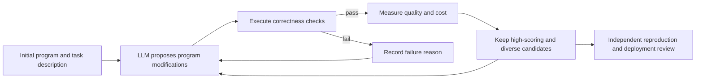
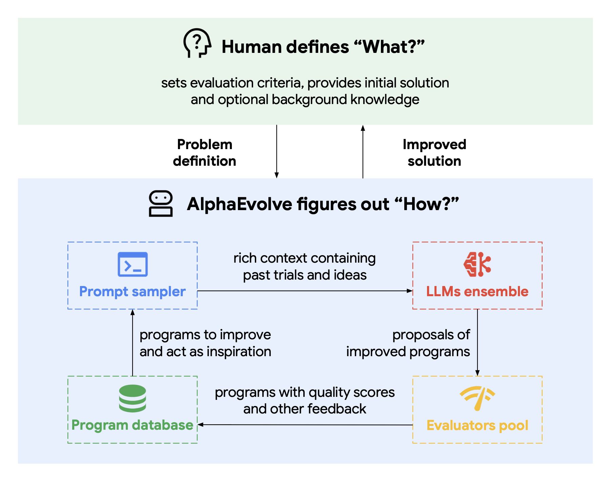
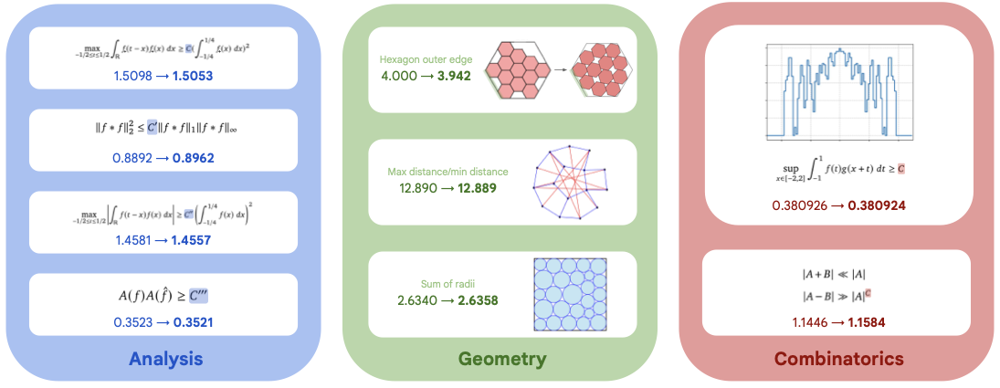

# 26.4 How LLMs Search for New Algorithms

Suppose we want to speed up a matrix multiplication routine that is called over and over. Low-level routines like this are often called "kernels." Each call saves only a little time, but in large-model training a kernel is invoked billions of times, and the savings add up to a considerable total difference.

A language model can read kernel code and propose modifications, but it cannot tell from language alone whether a new version is faster. A benchmark program can measure latency, but it will not write the next version of the algorithm on its own. Connect the two and we get a loop that can run repeatedly: generate a candidate program, execute and verify it, keep the better candidates, and keep modifying according to the history of results.

This section studies how to combine a language model, an automatic evaluator, and evolutionary search into a discovery system. The focus is on seeing exactly what changes in each round, how feedback enters the next round, and which results can be called verified new discoveries.

The closed loop is needed because the code and scientific conjectures proposed by a language model may be illuminating, or may merely look plausible. Only after execution, measurement, or formal checking can a candidate idea become a reproducible result, and candidates that fail verification also provide information for the next round of search.



This diagram gives the main thread of the whole section. The generative model enlarges the candidate space, the evaluator turns candidates into comparable results, and the program database decides which experience enters the next round. None of the three components can be dropped: generation alone yields many unverified ideas, evaluation alone does not explore new schemes on its own, and without a history database the loop keeps trying similar modifications.

This loop has a structure similar to the RL of the previous sections. A candidate program plays the role of an action, the automatic evaluator provides feedback, and the history program database stores search experience. The difference is that AlphaEvolve mainly uses population-based evolutionary search and does not update Gemini's parameters through policy gradients. The purpose of putting it in the same section as Genie 3, Titans, M-GRPO, and recursive self-improvement is precisely to tell apart several mechanisms by which "a system keeps improving."

What these systems actually change differs from one to the next:

- **AlphaEvolve** modifies executable programs. The evaluation score decides which programs enter the program database and which historical candidates later prompts refer to.
- **Genie 3** updates the state of an interactive world. The action conditioning decides the visual world generated next.
- **Titans** updates a neural memory at test time. The training signal produced by the current sequence is written directly into the memory module.
- **M-GRPO** updates the policies of a main agent and its sub-agents. The group-relative advantage eventually enters the model parameters.
- **Recursive self-improvement** changes the training system or the model itself, and an independent evaluation decides whether to accept the new version.

## 26.4.1 AlphaEvolve: Putting Code into an Evolutionary Loop

The opening has already given us three components: a language model that edits code, an evaluator that runs tests and timing, and a program library that stores the better versions. Google DeepMind's [AlphaEvolve](https://arxiv.org/abs/2506.13131) combines these three components into a program evolution system.

The system takes an initial program, a task description, and one or more automatic evaluators. The goal is to find a program with a higher score that still satisfies the correctness constraints.



<div style="text-align: center; font-size: 0.9em; color: var(--vp-c-text-2); margin-top: -10px; margin-bottom: 20px;">
  <em>Figure 1: The prompt sampler selects candidates and historical feedback from the program database, Gemini generates program modifications, the evaluator executes and scores them, and the results are written back to the program database. Source: <a href="https://arxiv.org/abs/2506.13131" target="_blank" rel="noopener noreferrer">the AlphaEvolve paper</a></em>
</div>

### What Happens in One Round of Search

Let's first compare two candidate programs. Program A passes all correctness tests and runs in 12 milliseconds. Program B takes only 8 milliseconds but fails one test. The evaluator cannot return the single number "the faster the better," or B would wrongly win. The [AlphaEvolve paper](https://arxiv.org/abs/2506.13131) allows the evaluator to return several scores, and the program database selects candidates according to scores and diversity. To represent such multi-metric results, we use a teaching notation of this book below. Let the program be $p$:

$$
f(p)=\bigl(f_{\text{correct}}(p),f_{\text{quality}}(p),f_{\text{cost}}(p)\bigr).
$$

$f_{\text{correct}}$ checks whether the program satisfies the constraints, $f_{\text{quality}}$ measures the quality of the solution, and $f_{\text{cost}}$ records running time or resource consumption. This triple helps the reader tell three metrics apart, and the paper does not require every task to use exactly these three. Multi-metric evaluation matters: a program that runs fast but gives wrong answers cannot enter the valid population.

One round of search can be split into four steps:

1. The prompt sampler selects one or more existing programs from the database and attaches the task description and historical evaluations.
2. Gemini Flash broadens candidate coverage, and Gemini Pro provides deeper modification suggestions, outputting new versions of the program.
3. The automatic evaluator runs tests, proof checks, or performance benchmarks to obtain reproducible scores.
4. The program database keeps candidates according to score and diversity, to be sampled again by the next round of prompts.

Traditional genetic algorithms often apply random mutations to bit strings or fixed structures. The object of mutation in AlphaEvolve is code, and the language model can modify algorithms, initialization, loss functions, and hyperparameter search logic across functions. The search still depends on selection pressure and population diversity, and the language model is responsible for proposing more structured candidates.

### What the 48 Multiplications Show

The paper reports an easily verifiable result: a search process designed by the system found a program for $4\times4$ complex matrix multiplication that needs only 48 scalar multiplications. The best known result in this setting before was 49, corresponding to Strassen's 1969 algorithm. This is the first improvement in this setting in 56 years.



<div style="text-align: center; font-size: 0.9em; color: var(--vp-c-text-2); margin-top: -10px; margin-bottom: 20px;">
  <em>Figure 2: Summary of AlphaEvolve's results on matrix multiplication and on problems in analysis, geometry, combinatorics, and number theory. Source: <a href="https://arxiv.org/abs/2506.13131" target="_blank" rel="noopener noreferrer">the AlphaEvolve paper</a></em>
</div>

The key to this result is "executable candidates plus independent verification." What the language model proposes is a search program, and the final conclusion is still confirmed by computation and mathematical checking. DeepMind also applied the system to more than 50 open mathematical problems: according to the official report, about 75% of the experiments rediscovered the best known result and about 20% improved on the known result. These include constructing a new lower bound of 593 outer spheres for the kissing number problem in 11 dimensions.

### From Mathematics to Computing Infrastructure

The same loop is also used for engineering problems, only with the fitness function replaced by production metrics:

- A Borg scheduling heuristic was deployed and recovers about 0.7% of Google's worldwide compute resources on average.
- A Verilog rewrite, formally verified to preserve functional equivalence, was incorporated into a later TPU design.
- A matrix multiplication kernel in Gemini was sped up by 23%, corresponding to a training-time reduction of about 1%.
- A low-level GPU instruction search gave one FlashAttention kernel implementation a speedup of up to 32.5%.

These percentages come from different tasks and cannot be added into an "overall improvement." Together they show that program evolution most easily enters production when the evaluator can run stably and the metrics map directly onto deployment cost.

### Boundaries of Applicability

AlphaEvolve needs candidates to be written as code and needs an evaluator that gives reliable feedback at an acceptable cost. Fields such as drug discovery and materials design can also generate programs or experimental plans, but real experiments are expensive and proxy simulations are biased, so the evaluation loop becomes much slower. Automatic evaluation is a condition for applicability, and it is also the component of the system that most needs auditing.

## 26.4.2 Genie 3: Generating Interactive Worlds for Agents

The evaluator of AlphaEvolve scores programs. An embodied agent also needs an environment, which must produce the next observation after an action is executed. [Genie 3](https://deepmind.google/models/genie/) represents another technical line: it generates a real-time explorable visual world from a text description and continues to simulate it according to the agent's actions.

### From Genie 1 to Genie 3

- **Genie 1 (2024)** learns controllable two-dimensional platformer environments from videos without action labels.
- **Genie 2 (2024)** extends generation to interactive three-dimensional worlds.
- **Genie 3 (2025)** generates 720p worlds from text, interacts in real time at 20 to 24 FPS, and improves long-horizon consistency.

An action-conditioned world model has to answer a concrete question: having seen a scene, if the agent moves left right now, what might the next frame look like? The [Genie 1 paper](https://arxiv.org/abs/2402.15391) learns controllable latent actions from video, and the [official Genie 3 description](https://deepmind.google/models/genie/) goes on to show real-time interactive worlds. Written as the simplest conditional distribution, the shared prediction target is

$$
\hat P(o_{t+1}\mid o_{\le t},a_t),
$$

where $o_{\le t}$ is the visual observation up to the present, $a_t$ is the agent's action, and $\hat P$ denotes the next-observation distribution learned by the model. This expression is a teaching abstraction of a world model and is not the full network objective given on the public Genie 3 page. Agents such as SIMA can receive goals and act in the generated worlds; Genie 3 is only responsible for simulating the subsequent world according to the actions, and it does not know the agent's task reward.

This distinction avoids a common misunderstanding: a world model provides an environment, which does not automatically mean "a policy has already been trained with RL." To form an RL experiment, we also need an action interface, a reward function, termination conditions, and independent evaluation.

### What It Can Do and What It Cannot Do Yet

Generated worlds can help researchers build environments quickly, observe the weaknesses of agents, and reduce early prototyping's dependence on real equipment. But the limitations DeepMind has published are just as specific: the range of agent actions is currently limited, interaction among multiple independent agents is still hard to simulate, real locations cannot be reproduced completely accurately, text rendering is unstable, and continuous interaction lasts about a few minutes rather than hours.

Genie 3 is therefore better suited to environment prototyping and controlled evaluation. If it is used for autonomous driving, robotics, or medical training, the sim-to-real gap still has to be measured, and visual realism cannot be taken directly as physical correctness.

## 26.4.3 Titans: Updating Long-Term Memory at Test Time

Long trajectories bring another bottleneck: even if an environment can keep generating, a fixed context window cannot hold all the history. [Titans](https://arxiv.org/abs/2501.00663) introduces a neural long-term memory module, so that attention handles the current context while a learnable memory compresses information from further back.

Titans distinguishes three kinds of information:

- Short-term memory: attention reads the current window precisely.
- Long-term memory: the neural memory module is updated continuously at test time.
- Persistent memory: stores task-related parameters that are fixed after training.

The paper uses "surprise" to decide which inputs are worth writing into long-term memory. The surprise here comes from the memory model's loss or gradient signal on the current sample. It is a test-time learning rule and not an RL reward given by an environment. The original paper reports that Titans outperforms the Transformer and linear recurrent baselines it compares against on language modeling, commonsense reasoning, genomics, and time series tasks, and scales to contexts of more than 2M tokens in needle-in-a-haystack evaluation.

The connection between Titans and the main thread of this chapter occurs at the system level: a long-running agent can use this kind of memory to store information across episodes, and RL then learns how to use the observations formed from memory. The memory module itself is updated by gradients, which does not automatically make it a reinforcement learning algorithm.

## 26.4.4 M-GRPO: Directly Training a Multi-Agent Search System

AlphaEvolve selects programs, Genie 3 generates environments, and Titans updates memory. [Multi-Agent Deep Research](https://arxiv.org/abs/2511.13288), by contrast, directly updates the language model parameters in a search system. It contains a main agent responsible for planning and several sub-agents that call tools such as search and code.

M-GRPO has to solve three engineering problems:

- The main agent and the sub-agents sit at different levels, so group-relative advantages are computed for them separately.
- Each main trajectory calls the sub-agents a different number of times, so heterogeneous trajectories must be aligned and fixed-size batches constructed.
- Different agents may be deployed on independent servers and exchange only the statistics needed for training, which avoids backpropagation across servers.

The paper compares single-agent GRPO, multi-agent training with frozen sub-agents, and M-GRPO on GAIA, XBench-DeepSearch, and WebWalkerQA. This method is parameter training, which forms a clear contrast with AlphaEvolve's gradient-free program selection: the former changes the generation policy and the latter changes the program population.

## 26.4.5 Recursive Self-Improvement: Drawing the Object of Improvement Clearly

Recursive self-improvement (RSI) is often described as "the model improves itself." This phrasing squeezes several levels into one. An auditable loop has to spell out at least the following:

```text
Current system M_t
  → diagnose failures on a fixed task set
  → generate candidates for data, programs, or training configurations
  → execute the candidate changes in an isolated environment
  → compare M_t and M_{t+1} with an independent held-out set and safety evaluation
  → accept the new version only after it passes the thresholds
```

As of mid-2026, public work mostly implements only a part of this:

- **AutoGPT (2023)** lets a fixed model loop through planning and tool calls, without rewriting model parameters.
- **Voyager (2023)** automatically generates a curriculum in Minecraft and writes executable skills into a growing code library, and it likewise calls GPT-4 as a black box and does not fine-tune a model.
- **SRPO (2024)** jointly optimizes a self-revision policy and a generation policy, and then converts the objective into a loss that can be trained offline.
- **Self-play systems** let a new policy interact with its own earlier versions, but the scope of improvement is still bounded by the environment, the reward, and the training code.

These methods improve plans, skill libraries, answer revision, or policy parameters, respectively. None of them forms a complete RSI system that can modify its own training algorithm at will, verify changes reliably, and keep deploying.

### Three Thresholds That Must Be Kept

**Independent evaluation.** Letting the model that proposes a change also adjudicate it carries the same bias to both ends. A held-out set, formal verification, human review, and real-system metrics must provide at least one independent signal.

**Search cost.** Data recipes, hyperparameters, model structures, and training code form a huge combinatorial space. An improvement loop should report the total number of attempts, the failed candidates, and the total compute, so as not to display only the successful results that were selected.

**Safety boundaries.** Candidate code first runs in a sandbox, with permissions, network, and resource budget fixed. A new model must also pass capability regression and alignment evaluation. The speed of improvement cannot replace a release gate.

## 26.4.6 A Common Chain of Discovery

Back to the matrix kernel from the opening, the five kinds of work fit into one causal line:

1. A language model or several agents enlarge the candidate space.
2. A code executor, verifier, or environment model turns candidates into observable results.
3. Evolutionary selection, gradient updates, or test-time memory write the feedback back into the system.
4. Independent evaluation judges whether an improvement comes from a real task gain or from a loophole in the evaluator.
5. Only candidates that pass verification enter the next round or actual deployment.

This chain also explains the range of applicability for scientific discovery. Mathematics and computer systems make it easy to build fast, objective evaluators. Experiments in biology, chemistry, and physics are usually slower and must also deal with simulation bias and real-world safety. Personalized paths in education likewise need long-term learning outcomes and fairness metrics, and cannot optimize only the immediate answer rate.

## 26.4.7 How to Tell Whether a System Has Really Found a New Result

AlphaEvolve shows how a language model, a program database, an automatic evaluator, and evolutionary selection together discover new algorithms. Genie 3 provides interactive generated worlds, Titans adds test-time memory for long trajectories, M-GRPO directly trains hierarchical multi-agent search policies, and RSI widens the object of improvement to the training system itself.

The technical core these directions share is a bounded closed loop: candidates can be generated, results can be verified, feedback can be written back, and failures can be rolled back. The credibility of scientific discovery ultimately rests on the evaluator and on reproduction experiments.

Finally, four questions can be used to audit an "AI discovery":

1. What is the candidate object: a program, parameters, an environment, memory, or model weights?
2. Which constraints did the evaluator check, and can a candidate program exploit loopholes in it?
3. How many candidates were searched in total, and are the failed results and the total compute cost retained?
4. Can the best result be obtained again by independent code, hardware, or proof tools?

The value of AlphaEvolve for matrix multiplication comes precisely from all four of these being concretely answerable. When moving to real scientific experiments, the hardest step usually shifts from "generating candidates" to "obtaining cheap, fast, and trustworthy verification."

---

## References

- Novikov A, Vũ N, et al. [AlphaEvolve: A Coding Agent for Scientific and Algorithmic Discovery](https://arxiv.org/abs/2506.13131). 2025.
- Google DeepMind. [AlphaEvolve: A Gemini-Powered Coding Agent for Designing Advanced Algorithms](https://deepmind.google/blog/alphaevolve-a-gemini-powered-coding-agent-for-designing-advanced-algorithms/). 2025.
- Google DeepMind. [Genie 3](https://deepmind.google/models/genie/). 2025.
- Behrouz A, Zhong P, Mirrokni V. [Titans: Learning to Memorize at Test Time](https://arxiv.org/abs/2501.00663). 2024.
- Hong H, Yin J, et al. [Multi-Agent Deep Research: Training Multi-Agent Systems with M-GRPO](https://arxiv.org/abs/2511.13288). 2025.
- Choi E, Ahmadian A, et al. [Self-Improving Robust Preference Optimization](https://arxiv.org/abs/2406.01660). 2024.
- Wang G, Xie Y, et al. [Voyager: An Open-Ended Embodied Agent with Large Language Models](https://arxiv.org/abs/2305.16291). 2023.
