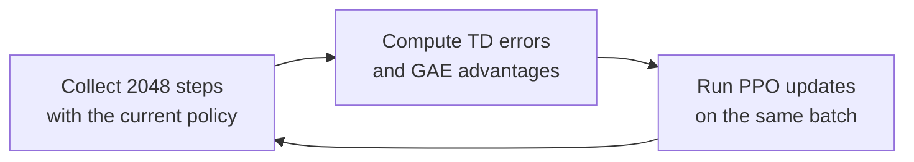

# 1.3 Hands-on: PPO Training Visualization

> **Goal of this section**: run pure PyTorch PPO, save the raw training metrics, generate curves from the CSV, and use the trained model to complete a visible CartPole evaluation.

> **Learning path**: [1.1 Run CartPole](./principles) → [1.2 CartPole Principles](./metrics) → **1.3 PPO Training Visualization**

> **Code and resources for this section**: [Training script](https://github.com/walkinglabs/hands-on-modern-rl/blob/main/code/chapter01_cartpole/2-pytorch_ppo.py) · [Plotting script](https://github.com/walkinglabs/hands-on-modern-rl/blob/main/code/chapter01_cartpole/plot_curves.py) · [Frame-capture script](https://github.com/walkinglabs/hands-on-modern-rl/blob/main/code/chapter01_cartpole/capture_frames.py) · [Raw CSV](https://github.com/walkinglabs/hands-on-modern-rl/blob/main/code/chapter01_cartpole/output/training_metrics_seed42.csv)

::: tip Use AI when you run into trouble
This section requires running scripts on your own machine, so environment problems are unavoidable. When you hit installation errors, version conflicts, or interrupted runs, the most effective fix is to give the complete error message to an AI coding assistant and let it analyze the cause, modify the code, or provide a runnable command.
:::

Section 1.2 explained the principles and also walked us through the training records saved in the repository. This section does it all from the beginning: run the training script yourself, save the raw metrics, generate curves from the CSV, and then capture environment frames with the trained model.

When we finish, every point on a figure can be traced back to the CSV, the CSV can be traced back to the training log, and the environment frames can be traced back to the saved model. We walk the whole chain of evidence ourselves.

## 1.3.1 Install Dependencies

Before running training, set up the environment first. Enter the Chapter 1 code directory and install the dependencies in `requirements.txt`:

```bash
cd code/chapter01_cartpole
pip install -r requirements.txt
```

The CartPole network is very small and trains on the CPU by default, so no discrete GPU is required.

## 1.3.2 Run One Training Session with a Fixed Configuration

With the dependencies installed, we start training. To make the run conditions checkable, we fix the random seed, the number of training iterations, and the number of sampled steps per iteration:

```bash
python 2-pytorch_ppo.py \
  --seed 42 \
  --iterations 40 \
  --steps-per-rollout 2048 \
  --swanlab-mode disabled \
  --log-csv output/training_metrics_seed42.csv
```

Training interacts with the environment for

$$
40\times 2048=81\,920
$$

steps in total. After the run finishes, the `output/` directory contains two main files:

- `pytorch_ppo_cartpole.pth`: the trained model parameters.
- `training_metrics_seed42.csv`: the training metrics of each iteration. `mean_episode_reward` is the moving average over the most recent 100 episodes, `mean_episode_reward_rollout` is the average over the episodes that ended in that iteration, and the other metrics are not smoothed.

The console also prints, at the end, the mean reward and standard deviation over 20 deterministic evaluation episodes. The run saved in this book gives `500.0 ± 0.0`.

To use the local SwanLab dashboard, change `--swanlab-mode disabled` to `--swanlab-mode local`. After training finishes, run:

```bash
swanlab watch swanlog
```

Open `http://127.0.0.1:5092` in the browser to view the local records. The dashboard is for interactive viewing, and the later plotting still uses the exported CSV as its data source.

## 1.3.3 Three Steps in the Training Loop

With training running, let's compare against the principles of Section 1.2 and see what the script actually does in each iteration.



### Collecting Trajectories

The first stage is collecting trajectories. The environment's `step` method returns the new observation, the reward, and two termination flags:

```python
next_obs, reward, terminated, truncated, _ = env.step(action.item())

with torch.no_grad():
    if terminated:
        next_value = 0.0
    else:
        _, next_value_tensor = model(torch.FloatTensor(next_obs))
        next_value = next_value_tensor.item()
```

`terminated=True` means the pole fell or the cart went out of bounds. The episode has ended naturally, so the subsequent value is taken as 0.

`truncated=True` means the 500-step time limit was reached. This state may still be balanced, so the code uses the Critic's $V(s')$ as the estimate of the subsequent value.

If the 2048-step sampling ends in the middle of an episode, the script does not reset the environment. The next iteration continues sampling from the current observation and keeps accumulating the reward and length of that episode.

### Computing GAE

The second stage is computing advantages. For each step we first compute the TD error:

$$
\delta_t=r_t+\gamma V(s_{t+1})-V(s_t).
$$

The program recurses backward from the end of the rollout to compute advantages:

```python
episode_end = t["terminated"] or t["truncated"]
delta = t["reward"] + gamma * t["next_value"] - t["value"]
gae = delta + gamma * lam * (1.0 - float(episode_end)) * gae
```

The factor `1 - episode_end` cuts the recursion at every environment reset. At a time-limit truncation the current TD error still uses `next_value`, and the advantage of a new episode is not passed back to the old episode.

The Critic's target is obtained from the unnormalized advantages:

```python
returns = raw_advantages + values
advantages = (raw_advantages - raw_advantages.mean()) / (
    raw_advantages.std(unbiased=False) + 1e-8
)
```

The normalized `advantages` are used to update the Actor. The unnormalized `returns` are used to train the Critic, so the two cannot be interchanged.

### Running the PPO Update

The third stage is updating the policy. PPO compares the probabilities that the new and old policies assign to the sampled actions:

$$
r_t(\theta)=\frac{\pi_\theta(a_t\mid s_t)}
{\pi_{\theta_{\mathrm{old}}}(a_t\mid s_t)}.
$$

The accompanying implementation uses `clip_eps=0.2`:

```python
ratio = torch.exp(new_log_probs - batch_old_log_probs)
surr1 = ratio * batch_advantages
surr2 = torch.clamp(ratio, 0.8, 1.2) * batch_advantages
policy_loss = -torch.min(surr1, surr2).mean()
```

Actions with positive advantage get a higher probability, and actions with negative advantage get a lower probability. The clipped objective limits how far the same batch of data can push the probabilities.

## 1.3.4 Generating Curves from the Raw CSV

After the three stages have run, the training script has written each iteration's metrics into the CSV. Now we turn these numbers into curves. Run the plotting script:

```bash
python plot_curves.py \
  --input output/training_metrics_seed42.csv \
  --output-dir output
```

After reading the CSV, the script generates the reward curve and a four-metric diagnostic figure. It does not retrain the model and does not modify the raw metrics.


<div class="figure-caption">Figure 1-4: The raw training reward for seed=42. The curve is generated by the repository's plotting script reading the CSV directly.</div>

The mean reward in iteration 1 is 21.35, in iteration 10 it is 500.0, and in iteration 11 it falls back to 460.4. The final deterministic policy gets `500.0 ± 0.0` over 20 evaluation episodes.

This single-seed curve can verify that the current code and configuration can complete the task. It does not mean that every random seed will reach 500 in iteration 10.

## 1.3.5 Capturing Environment Frames from the Model

A curve shows how the score changes, but it is still an abstract set of numbers. We can also load the saved model and watch its actual actions in the environment. Run:

```bash
python capture_frames.py \
  --model output/pytorch_ppo_cartpole.pth \
  --output output/cartpole_frames_seed42.png \
  --seed 10042
```

The script creates a CartPole-v1 environment with `render_mode="rgb_array"`, runs one episode with deterministic actions, and picks five time points from the frames returned by `env.render()`.


<div class="figure-caption">Figure 1-5: Steps 0, 125, 250, 375, and 500 of the same deterministic evaluation episode. The episode scores 500, and the angles in the titles come from the environment observations at the corresponding moments.</div>

A static picture shows only one moment. Here we save five time points, the full-episode score, and the 20-episode evaluation result together, to check whether the policy keeps completing the control task.

## 1.3.6 How to Compare After Changing Parameters

Once the baseline runs, it is natural to want to try changing parameters. We can change the learning rate, the clipping range, or the GAE parameters. Changing one setting at a time and keeping everything else the same makes the results easy to interpret.

For example, we can compare the number of environment steps that `lr=1e-4` and `lr=3e-4` need to reach the same evaluation score. The two experiments must use the same environment version, network architecture, training amount, set of random seeds, and number of evaluation episodes.

A single run is easily affected by random initialization and action sampling. In a formal comparison, run multiple random seeds, and report each seed's raw curve, the number of environment steps needed to reach the target score, and the final evaluation result.

## Section Summary

- The training script saves the model parameters and the unsmoothed CSV metrics. The plotting script only reads the CSV, and every point on a figure can be traced back to the raw record.
- The three steps correspond to the principles of Section 1.2: collect trajectories, compute GAE advantages, and run the PPO clipped update.
- `terminated`, `truncated`, and the rollout boundary have different meanings in the value computation. Normalized advantages go to the Actor and unnormalized returns go to the Critic, and the two cannot be interchanged.
- The environment frames come from actually running the saved model in Gymnasium.
- Parameter comparison requires uniform experimental conditions and multiple random seeds.

The next chapter starts from the multi-armed bandit and writes the states, actions, rewards, and policies we have run in this chapter as a more formal reinforcement learning problem.
