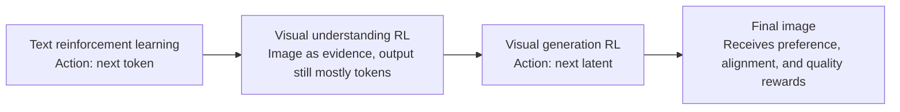
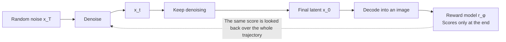
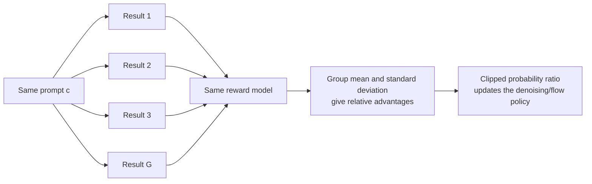

# 24.4 Reinforcement-Learning Alignment for Image Generation

Let's start with an ordinary generation prompt:

> Three red umbrellas in a glass corridor, with a blue sign on the right wall.

The model's output may have natural lighting and a lovely composition, yet it draws only two umbrellas and the sign has turned green. If we score it with an aesthetic model alone, this image gets a high score. If a user actually needs the image, it has already failed.

"Good" in visual generation covers subject, count, color, spatial relations, image quality, and human preference all at once. Supervised fine-tuning lets a model imitate high-quality samples, but it can hardly express directly "both images are reasonable, but I prefer this one." Reinforcement learning offers another path: let the model generate first, compare the results with a reward, and finally raise the probability of the high-scoring generation trajectories.

This section works out three questions:

- Why a sequence of denoising steps can be seen as a trajectory in reinforcement learning;
- How DDPO passes the score of the final image back to every denoising step;
- Why DanceGRPO has the same prompt generate a group of results and then compares within the group.

After studying it, we should be able to read the states, actions, probability ratios, advantages, and rewards in a paper on reinforcement learning for visual generation, and to judge whether it is optimizing aesthetics, instruction following, or some proxy metric that is easy to exploit.


<div style="text-align: center; font-size: 0.9em; color: var(--vp-c-text-2); margin-top: -10px; margin-bottom: 20px;">
  <em>Figure 1: DDPO fine-tunes the same diffusion model with different rewards. When the reward changes, the generation distribution changes with it. Source: <a href="https://github.com/kvablack/ddpo-pytorch" target="_blank" rel="noopener noreferrer">DDPO project</a>.</em>
</div>

## 24.4.1 From "Answering a Question" to "Generating an Image"

In a language model, one answer consists of tokens:

$$
y=(y_1,y_2,\ldots,y_T).
$$

At each step the model chooses the next token. A math verifier, a code executor, or a preference model scores the whole answer, and algorithms such as PPO and GRPO then raise the probability of generating high-scoring answers.

Visual question answering adds an input image, but the output is usually still text, an option, or coordinates. The action is still easy to locate: the model chooses one token at each step, and at the end we can check whether the answer is correct or the bounding boxes overlap.

Visual generation changes the object being optimized. The model starts from random noise and obtains an image only after many denoising steps. What the user sees is the final picture, while what the training algorithm sees is an entire latent trajectory. The reward also changes from "is the answer right?" to several simultaneous judgments:

- Does the picture match the text condition;
- Are the counts, colors, and spatial relations correct;
- Is the subject clear and the composition natural;
- Which of several reasonable results do humans prefer.

So the first step of reinforcement learning for visual generation is to answer: **what exactly are the state and action in the denoising process?**



## 24.4.2 How an Image Is Generated from Noise

A diffusion model starts from random noise $x_T$ and gradually obtains cleaner latents:

$$
x_T \rightarrow x_{T-1} \rightarrow \cdots \rightarrow x_1 \rightarrow x_0.
$$

$x_t$ denotes the still-noisy latent at step $t$, $c$ denotes the text or image condition, and $t$ tells the model which denoising stage it is in. From these three pieces of information the model produces the next step:

$$
x_{t-1}\sim p_\theta(x_{t-1}\mid x_t,t,c).
$$

This line reads as follows: given the current latent $x_t$, the time step $t$, and the condition $c$, the generative model with parameters $\theta$ gives a probability distribution over the next step $x_{t-1}$ and samples from it.

It has the same structure as a reinforcement learning policy

$$
\pi_\theta(a_t\mid s_t).
$$

The current latent, time step, and condition together form the state $s_t=(x_t,t,c)$, and sampling the next latent is the action $a_t=x_{t-1}$. The complete denoising chain from $x_T$ to $x_0$ forms a trajectory:

$$
\tau=(x_T,x_{T-1},\ldots,x_0).
$$

The final latent $x_0$ is turned into an image by the decoder, and a reward model then scores it:

$$
R(\tau,c)=r_\phi(x_0,c).
$$

$\theta$ is the parameter of the generative model to be updated, and $\phi$ is the parameter of the reward model that does the scoring. It is important to keep the two separate: the generative model proposes results, and the reward model evaluates them.



Visual generation has now been translated into a finite-length decision process: the state is the current latent, the action is the next sampling step, the trajectory is a whole denoising chain, and the terminal reward comes from the final image. The central contribution of the [original DDPO paper](https://arxiv.org/abs/2305.13301) is exactly to turn this translation into a trainable policy-gradient method[^ddpo].

## 24.4.3 DDPO: Passing the Terminal Score Back Through the Whole Denoising Trajectory

Suppose the same prompt generates three images with rewards `0.3, 0.5, 0.7`, so the average reward is `0.5`. What training does is adjust the generative model so that results like `0.7` become more likely in the future. Writing "generate repeatedly and take the average" in general form gives the DDPO objective:

$$
J(\theta)
=
\mathbb{E}_{\tau\sim p_\theta(\tau\mid c)}
\left[R(\tau,c)\right].
$$

The meaning is direct: generate images repeatedly with the current model and score them, then adjust the parameters so that the average score gradually rises.

The probability of a complete trajectory is the product of the transition probabilities of every step:

$$
p_\theta(\tau\mid c)
=
p(x_T)\prod_{t=1}^{T}
p_\theta(x_{t-1}\mid x_t,t,c).
$$

The initial noise $x_T$ comes from a fixed distribution, and what the model parameters really control is each later denoising step. If a trajectory ends with a high score, we want to raise the probability of the denoising actions that make up this trajectory.

### From Average Reward to a Computable Gradient

Summing over all possible trajectories directly is infeasible. [REINFORCE](https://doi.org/10.1007/BF00992696) uses a simple identity to rewrite the problem in a form that can be sampled[^reinforce]:

$$
\nabla_\theta p_\theta(\tau)
=
p_\theta(\tau)\nabla_\theta\log p_\theta(\tau).
$$

Substituting it into the gradient of the average reward gives:

$$
\nabla_\theta J(\theta)
=
\mathbb{E}_{\tau\sim p_\theta}
\left[
R(\tau,c)\nabla_\theta\log p_\theta(\tau\mid c)
\right].
$$

The trajectory probability is originally a chain of multiplications. After taking the logarithm, multiplication becomes addition:

$$
\log p_\theta(\tau\mid c)
=
\log p(x_T)
+
\sum_{t=1}^{T}
\log p_\theta(x_{t-1}\mid x_t,t,c).
$$

$p(x_T)$ does not depend on the parameters $\theta$ and disappears when we take the gradient. The basic DDPO update direction can then be written as:

$$
\nabla_\theta J
=
\mathbb{E}
\left[
\sum_{t=1}^{T}
\nabla_\theta
\log p_\theta(x_{t-1}\mid x_t,t,c)
\,R(\tau,c)
\right].
$$

Now we can see how the reward works. After one generation ends, the reward model gives only one score for the final image, and the policy gradient uses this score to raise or lower the probability of every step's action along the whole trajectory. The reward model can be a non-differentiable black box, because training needs only the score it outputs and does not backpropagate through the reward model.

### Why Subtract a Baseline

Suppose two prompts are "a cat on a white background" and "twelve people sitting around complex machinery". The former naturally gets high scores more easily. Comparing absolute scores directly mixes the difficulty of the prompt itself into the update signal.

So training often subtracts a reference level $b(c)$ from the reward:

$$
\hat A=R(\tau,c)-b(c).
$$

$\hat A$ is called the advantage. It answers "how much better is this generation than similar results?" The average reward of the same batch, the historical average reward of the same prompt, or the prediction of a value model can all serve as the baseline.

Subtracting a baseline that does not depend on the specific action does not change the expected gradient, because:

$$
\mathbb{E}_{\tau}
\left[
b(c)\nabla_\theta\log p_\theta(\tau\mid c)
\right]
=
b(c)\nabla_\theta\int p_\theta(\tau\mid c)d\tau
=0.
$$

The probabilities of all trajectories always sum to $1$, and differentiating with respect to the parameters gives $0$. The baseline keeps the average update direction while reducing the fluctuation caused by different prompts and different batches.

## 24.4.4 From Policy Gradients to a Stable Training Loss

If we sharply raise the probability of a sample just because it scored high, the model can easily drift away from its original generation ability after only a few updates. [PPO](https://arxiv.org/abs/1707.06347) provides a common way to limit this: compare the probabilities that the new and old policies give to the same action[^ppo].

$$
\rho_t(\theta)
=
\frac{
p_\theta(x_{t-1}\mid x_t,t,c)
}{
p_{\theta_{\mathrm{old}}}(x_{t-1}\mid x_t,t,c)
}.
$$

If $\rho_t>1$, the new model has raised the probability of this step's action. If $\rho_t<1$, it has lowered it. The PPO-style clipped objective is:

$$
L_{\mathrm{clip}}
=
-\mathbb{E}
\left[
\min\left(
\rho_t\hat A,
\operatorname{clip}(\rho_t,1-\epsilon,1+\epsilon)\hat A
\right)
\right].
$$

Training frameworks usually perform gradient descent, hence the minus sign in front of the formula. $\epsilon$ limits how far a single update can push the probability ratio. High-scoring actions are still encouraged, but a single update cannot amplify them without bound.

A KL constraint toward a reference model can also be added:

$$
L
=
L_{\mathrm{clip}}
+
\beta\,
D_{\mathrm{KL}}
\left(
p_\theta\,\|\,p_{\mathrm{ref}}
\right).
$$

$p_{\mathrm{ref}}$ is usually the model before reinforcement learning starts, and $\beta$ controls the cost of deviating from the reference model. DPOK applies this kind of KL regularization to reinforcement-learning fine-tuning of text-to-image models[^dpok]. It can ease the loss of diversity when the model chases a single reward, but it cannot repair the bias in the reward itself.

### What One Round of DDPO Training Actually Does

Putting the formulas back into an actual program, one round of training contains six steps:

1. Take a batch of conditions $c$ that covers count, color, relation, style, and hard cases.
2. Sample fully with the current generative model, saving every step's $x_t$, $x_{t-1}$, the time step, and the old-policy log probability.
3. Decode the final images and obtain $R(\tau,c)$ from the reward model.
4. Subtract the batch mean, a per-prompt baseline, or a value prediction to obtain the advantage $\hat A$.
5. Recompute the current policy's log probabilities and construct the probability ratio and the clipped loss.
6. Add the necessary KL constraint, backpropagate, and update the parameters.

```python
for prompts in dataloader:
    trajectories = policy.sample(prompts, return_log_probs=True)
    images = vae.decode(trajectories.final_latents)

    rewards = reward_model(images, prompts)
    advantages = normalize(rewards)

    new_log_probs = policy.log_prob(trajectories)
    ratio = (new_log_probs - trajectories.old_log_probs).exp()
    clipped = ratio.clamp(1 - eps, 1 + eps)

    policy_loss = -torch.minimum(
        ratio * advantages,
        clipped * advantages,
    ).mean()
    loss = policy_loss + beta * kl_to_reference(policy, reference)
    loss.backward()
    optimizer.step()
```

This code omits memory sharding, mixed precision, and distributed communication, but it keeps the causal line of the algorithm: sample online first, score, then update the denoising policy with the new-to-old probability ratio.

## 24.4.5 DanceGRPO: Why Generate a Group of Results for the Same Prompt

DDPO solved the basic problem of "how to write diffusion sampling as a policy gradient". Modern visual generation brings two new difficulties.

First, many models use rectified flow or flow matching. They often travel deterministically from noise to a sample along an ordinary differential equation path. If every step is deterministic once the initial noise is given, training lacks the stochastic transition probabilities needed for policy gradients.

Second, reward scales differ greatly across prompts. A simple composition may generally get high scores, while a complex-relation image generally gets low ones. Looking only at absolute rewards, it is hard to tell whether "the model really improved" or "this prompt is just easier".

The [original DanceGRPO paper](https://arxiv.org/abs/2505.07818) builds a unified training method for these two problems[^dancegrpo]. It rewrites the sampling of diffusion models and rectified-flow models in stochastic differential equation form, so that the sampling process again has computable transition probabilities. It then generates $G$ results for the same condition and estimates advantages from relative performance within the group.



Let's first work a small example with only three results. If the rewards are `1, 2, 3`, the group mean is `2`. The first result is below the mean, the second is exactly at the mean, and the third is above the mean. After subtracting the mean, they receive negative, zero, and positive update directions.

Actual training also divides by the within-group standard deviation so that advantages under different conditions fall on a similar scale. After obtaining rewards $r_1,\ldots,r_G$ for the same condition, the advantage of the $i$-th result is written as:

$$
\hat A_i
=
\frac{r_i-\operatorname{mean}(r_1,\ldots,r_G)}
{\operatorname{std}(r_1,\ldots,r_G)+\varepsilon}.
$$

The mean removes the effect of the prompt being generally hard or easy, and the standard deviation scales the reward into a more stable range. Samples above the group average receive positive advantages and samples below it receive negative advantages. Training still uses the clipped probability ratio, except that the advantages come from a group of results under the same condition.

DanceGRPO's public experiments cover image generation, text-to-video, and image-to-video, include Stable Diffusion, FLUX, HunyuanVideo, and SkyReels-I2V, and combine aesthetic, text-image alignment, motion, and binary verifiable rewards[^dancegrpo-repo]. This shows that the method can span the two generation paradigms of diffusion and flow. It does not mean that all industrial video models adopt DanceGRPO, and the internal algorithms of Seedance, Kling, or Hailuo cannot be inferred from it.

### Which Step Each of DDPO and DanceGRPO Solves

- DDPO established the basic translation: the denoising transition is the policy, a complete sampling run is a trajectory, and the final image's score is the reward.
- DanceGRPO continues with modern flow sampling and within-group relative advantages, letting the same method cover more generative models and tasks.
- Neither needs a differentiable reward function. If the reward can be backpropagated stably, DRaFT directly optimizes the differentiable reward, and VADER uses reward gradients for video diffusion alignment[^draft][^vader].

An algorithm name cannot stand in for a resource budget. The paper-reproduction experiments given in the DanceGRPO official repository need multiple H800 GPUs: the Stable Diffusion recipe uses 8, FLUX uses 16, and the recipes for HunyuanVideo and SkyReels-I2V need more[^dancegrpo-repo]. These are reference configurations at paper scale and are not the minimum bar for learning the concepts. A beginner can first verify the data flow on a small model, with few sampling steps and offline rewards, before considering a full reproduction.

## 24.4.6 The Reward Model Determines What the Model Learns

Reinforcement learning only raises the reward. If the reward does not cover the attributes that users truly care about, training will stably optimize the wrong objective.

### Human Preference: Which of Two Reasonable Images Is Preferred

Pick-a-Pic collects pairwise image preferences under the same prompt and uses these comparisons to train PickScore[^pickapic]. This kind of data does not require annotators to write precise scores. They only need to choose, between two candidates, the one that fits the prompt better and looks more natural.


<div style="text-align: center; font-size: 0.9em; color: var(--vp-c-text-2); margin-top: -10px; margin-bottom: 20px;">
  <em>Figure 2: The pairwise preference interface of Pick-a-Pic. Annotators compare two results for the same prompt and may also choose that neither is satisfactory. Source: <a href="https://stability.ai/research/pick-a-pic" target="_blank" rel="noopener noreferrer">Pick-a-Pic project page</a>.</em>
</div>

HPS v2 likewise focuses on human preference, and analyzes text-to-image models with more systematic data and evaluation[^hpsv2]. A preference reward can supplement composition and naturalness that pixel metrics find hard to express, but it also inherits the biases of the annotator population, the data distribution, and the way results are presented.

### Text Alignment: Did the Attractive Image Complete the Task

Back to the three red umbrellas at the beginning. An aesthetic reward may not notice the count error, while a text-image alignment model tries to judge whether the picture matches the condition. A complex prompt can also be split into several verifiable sub-questions:

- Do three umbrellas appear;
- Are the umbrellas red;
- Is the sign on the right side;
- Is the sign blue.

This kind of decomposition makes errors easier to locate. It also brings a new risk: if the counter, detector, or vision-language judge has a systematic bias, the generative model will gradually learn to satisfy the judge instead of satisfying humans.


<div style="text-align: center; font-size: 0.9em; color: var(--vp-c-text-2); margin-top: -10px; margin-bottom: 20px;">
  <em>Figure 3: Candidate images under the same prompt can receive different preference rankings. A ranking signal is suited to training relative preferences and also needs independent evaluation to check for overfitting. Source: PickScore.</em>
</div>

### Visual Quality: A High Score Must Not Come Only from "Pleasing the Judge"

Sharpness, composition, color, and artifacts can be measured by aesthetic or quality models such as [LAION-Aesthetics](https://laion.ai/blog/laion-aesthetics/). Suppose text alignment, preference, and visual quality each receive a score. In engineering practice they are often combined first with a weighted sum. The following is a **pedagogical reward template**, not a fixed objective prescribed by any paper:

$$
R
=
\lambda_{\mathrm{align}}R_{\mathrm{align}}
+
\lambda_{\mathrm{pref}}R_{\mathrm{pref}}
+
\lambda_{\mathrm{quality}}R_{\mathrm{quality}}.
$$

Each $\lambda$ expresses a product trade-off. Raising the aesthetic weight may sacrifice exact counting, and raising the text-alignment weight may produce stiff compositions. Adding more rewards does not resolve conflicts automatically. The actionable practice is to save each sub-reward, plot their training curves separately, and cross-check with human evaluations and task metrics that did not take part in training.

## 24.4.7 A Reward Can Be Used at Training Time or at Inference Time

Once you have a reliable reward model, there are two common ways to use it.

Inference-time reranking is the easiest to understand: generate several candidates for the same condition, score them one by one, and return the highest-scoring result. It does not modify the generative model and carries lower deployment risk, but every request needs multiple samples.

Reinforcement-learning fine-tuning writes the preference back into the model parameters. After that, a single sample is more likely to yield a high-scoring result, but training cost and risk are higher. If the reward has loopholes, the model will also solidify the loopholes into the generation distribution.

DPOK fine-tunes diffusion models with KL-constrained reinforcement learning[^dpok], and DRaFT backpropagates directly through differentiable rewards[^draft]. In video generation, Emu Video decomposes text-to-video generation through image conditioning[^emu], work on MLLM feedback uses multimodal models to evaluate videos[^t2vfeedback], and VADER lets the gradient of a differentiable reward pass through the video diffusion process[^vader]. These methods use the reward at different places and solve the same problem: how to make the final visual result match the goals specified by humans better.

## 24.4.8 Distilling Capabilities Discovered Through Online Exploration

Online sampling in visual reinforcement learning is expensive. A trained model may also need many denoising steps and can hardly serve at scale directly. On-policy distillation provides a way to carry things forward: let the model after reinforcement learning keep generating, filter high-reward samples, and then let a smaller student model, or one that samples faster, learn these results.

A minimal procedure has three steps:

1. Generate images or denoising trajectories online with the current reinforcement-learning policy;
2. Use the reward model and rules to filter out low-quality, duplicate, and suspected reward-exploiting samples;
3. Train the student model in a supervised way on the retained samples, periodically returning to refresh the data with the online policy.

Here "on-policy" emphasizes that the data comes from the current policy. After the policy's ability changes, old data gradually loses representativeness and has to be resampled. Distillation lowers inference cost and cannot automatically repair reward bias. If the filter favors a fixed composition, the student model will solidify that preference further.

## 24.4.9 How to Check a Reliable Visual-Generation Experiment

After finishing a training run, do not report only that the training reward rose. At least check the following four things:

1. Fix a set of prompts and random seeds that did not take part in training, and compare images before and after training.
2. Report text alignment, visual quality, preference, and diversity separately, so that one total score does not hide a regression.
3. Add prompts that easily expose loopholes, such as exact counting, left-right relations, negation, and rare combinations.
4. Have human reviewers who did not take part in training the reward model do blind evaluation, and record the uncertain samples and those where both are poor.

If the training reward rises but human preference does not improve, check the reward model and the sample distribution first. The algorithm is only faithfully executing the optimization objective it was given.

## Connections to Previous Chapters

This section puts several earlier lines into one visual-generation problem. REINFORCE provides the policy gradient for terminal rewards, PPO provides the probability ratio and clipping, and GRPO provides within-group relative advantages under the same condition. Vision-language models can in turn act as image judges, turning count, attribute, and spatial relations into rewards.

This connection also explains why the next chapter has to discuss reward hacking: a generative model has a very large output space, and once the judge has a stable loophole, the policy can keep amplifying the high-scoring pattern along that loophole.

## Summary

Reinforcement learning for visual generation starts from one concrete translation: write the denoising process as states, actions, and trajectories, and then update the whole trajectory with the reward of the final image.

DDPO completed this basic translation. The PPO-style probability ratio, clipping, and KL constraint keep updates stable. DanceGRPO further unifies diffusion and rectified flow into a stochastic sampling process with computable probabilities, and estimates relative advantages from a group of results under the same condition.

Finally, the ceiling of the training effect depends on the reward. Aesthetics, text alignment, and human preference each cover only part of what makes "a good image". The next section, [24.5 Temporal Consistency in Video](./video-generation-modern), adds the time axis and discusses how character identity, action order, and physical causality enter rewards and evaluation.

## References

[^reinforce]: Williams, R. J. (1992). Simple Statistical Gradient-Following Algorithms for Connectionist Reinforcement Learning. _Machine Learning_. <https://doi.org/10.1007/BF00992696>

[^ppo]: Schulman, J. et al. (2017). Proximal Policy Optimization Algorithms. <https://arxiv.org/abs/1707.06347>

[^ddpo]: Black, K., Janner, M., Du, Y., et al. (2024). Training Diffusion Models with Reinforcement Learning. _ICLR_. <https://arxiv.org/abs/2305.13301>

[^dpok]: Fan, Y., Watkins, O., Du, Y., et al. (2023). DPOK: Reinforcement Learning for Fine-tuning Text-to-Image Diffusion Models. _NeurIPS_. <https://arxiv.org/abs/2305.16381>

[^draft]: Clark, K. et al. (2024). Directly Fine-Tuning Diffusion Models on Differentiable Rewards. _ICLR_. <https://arxiv.org/abs/2309.17400>

[^dancegrpo]: Xue, Z. et al. (2025). DanceGRPO: Unleashing GRPO on Visual Generation. <https://arxiv.org/abs/2505.07818>

[^dancegrpo-repo]: DanceGRPO official implementation and reproduction recipes. <https://github.com/XueZeyue/DanceGRPO>

[^vader]: Prabhudesai, M. et al. (2024). Video Diffusion Alignment via Reward Gradients. <https://arxiv.org/abs/2407.08737>

[^pickapic]: Kirstain, S. et al. (2023). Pick-a-Pic: Open Dataset of Human Preferences for Text-to-Image Generation. _NeurIPS_. <https://arxiv.org/abs/2305.01569>

[^hpsv2]: Wu, X. et al. (2023). Human Preference Score v2: A Benchmark for Evaluating Human Preferences of Text-to-Image Synthesis. _NeurIPS_. <https://arxiv.org/abs/2306.09341>

[^emu]: Girdhar, R. et al. (2024). Emu Video: Factorizing Text-to-Video Generation by Explicit Image Conditioning. _ECCV_. <https://arxiv.org/abs/2311.10709>

[^t2vfeedback]: Wu, X. et al. (2024). Boosting Text-to-Video Generative Model with MLLMs Feedback. _NeurIPS_. <https://neurips.cc/virtual/2024/poster/96722>
