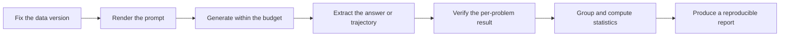
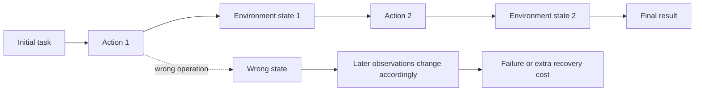
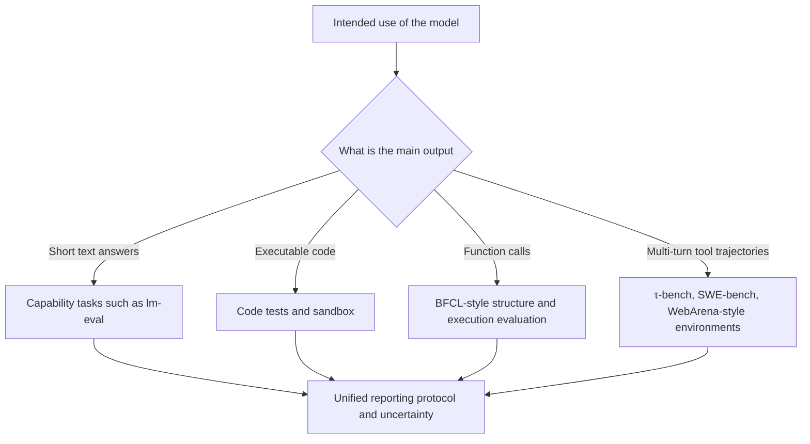

# 25.5 Evaluation Protocols and Reproducibility

Every defense in the previous sections depends on independent evaluation: hidden tests, paired conditions, one-shot gates. For these checks to work at all, the evaluation itself has to be reproducible.

In practice, the same model on the same set of problems can receive two different scores. The first time, we use temperature `0`, generate once per problem, and extract the answer from the last line; the second time, we use temperature `0.8`, generate 16 times per problem, and let the verifier pick the best answer. The model parameters have not changed, yet the evaluation protocol has changed the question.

This section learns how to turn one reinforcement learning evaluation into a repeatable experiment. A harness puts the data, prompts, sampling parameters, tool budget, answer extraction, scoring method, and statistical method into one fixed procedure.

We need a harness because a bare score cannot say whether an improvement comes from model training, from multiple sampling, from the prompt template, or from answer parsing. Only when these conditions are fixed can numbers be compared across two models, two training runs, and two papers.

A benchmark name is not enough to describe a result. Consider a small evaluation with only three problems: the model answers problems 1 and 3 correctly and problem 2 incorrectly, so the per-problem scores are `1, 0, 1` and the final accuracy is $2/3$. Several steps are hidden here: the problem is first filled into a prompt template, the model generates an answer under the given temperature and length, the answer extractor then finds the final answer in the response, and the scorer finally judges right or wrong. A change in any step may change these three per-problem results.

The formula below is a **teaching notation this book uses to decompose the evaluation pipeline**, not a fixed formula prescribed by any particular paper. It writes in one line the data, prompt, generation, and scoring stages emphasized by the [lm-evaluation-harness paper](https://arxiv.org/abs/2405.14782):

$$
\hat M=\operatorname{Aggregate}
\left(\operatorname{Score}(y_i,z_i)\right),
\qquad
y_i\sim\pi_\theta(\cdot\mid p(x_i);c).
$$

Here $x_i$ is the $i$-th problem, $p(x_i)$ is the complete input obtained by filling the problem into the template, $c$ records the temperature, maximum length, and tool budget, $y_i$ is the answer the model generates, and $z_i$ is the reference answer or success condition. `Score` first obtains the result for each problem, and `Aggregate` then combines these results into the final metric $\hat M$. Hence a change to any one item changes the meaning of $\hat M$.



This pipeline gives the main line of the section: first decide what we want to measure, then isolate data and prompts, then fix the inference budget and scorer, and only at the end aggregate into a score. If any stage is not versioned, the final number cannot be reproduced. The section unfolds along this pipeline: first set the five standards of evaluation, then handle data contamination, prompt sensitivity, and out-of-distribution generalization, then distinguish capability evaluation from behavior evaluation, and finally land on long-horizon tasks and standardized harnesses.

## 25.5.1 Five Standards for Evaluation

Suppose we want to evaluate a code-repair agent. We give it ten repositories, each with one bug. Reporting only "fixed 7" is not enough: whether the public tests cover the real bug, whether the ten repositories contain only one kind of error, whether the tasks were seen by the model, whether the hard repositories all fail, and whether the difference between two runs is merely sampling fluctuation all remain unanswered.

These five questions correspond to verifiability, representativeness, difficulty stratification, contamination resistance, and statistical rigor. Together they determine how strong a conclusion a benchmark score can support. Below we continue to expand each item along this code-repair task.

### Verifiability

A code-repair task can run tests: a patch that passes the hidden tests counts as a success, and otherwise as a failure. This property of being repeatedly judgeable by a machine is called verifiability.

Writing "run the tests and return pass or fail" in mathematical notation, we can denote it $\text{Verify}(y,z)\in\{0,1\}$. Here $y$ is the patch the model submitted and $z$ is the success condition defined by the hidden tests; passing is recorded as 1 and failing as 0. This formula is only a teaching way of writing a binary verifier. [HumanEval](https://arxiv.org/abs/2107.03374) executes generated programs with unit tests, while [GSM8K](https://arxiv.org/abs/2110.14168) extracts the final number from the answer and compares it with the reference; they show two different kinds of verifiable tasks.

Open-ended writing, safety behavior, and long-horizon agent tasks cannot be fully compressed into one binary result, so human review, environment state, and multidimensional metrics are also needed.

- **Math problems**: extract the final number and compare with the reference answer ([GSM8K](https://arxiv.org/abs/2110.14168), [MATH](https://arxiv.org/abs/2103.03874))
- **Coding problems**: run on test cases and look at the pass rate ([HumanEval](https://arxiv.org/abs/2107.03374), MBPP, [LiveCodeBench](https://arxiv.org/abs/2403.07974))
- **Logic problems**: verify with a SAT solver or theorem prover (MiniF2F, PutnamBench)

Open-ended writing and creative generation rarely have a unique machine-judgeable answer, and usually require human evaluation, pairwise preferences, or a reward model. Their noise and bias need to be measured through inter-rater agreement, blind review, and independent spot checks.

### Coverage

A benchmark has to cover the real tasks the model may meet. Suppose about 60% of product requests are code modifications, 30% are tool calls, and 10% are ordinary question answering, while the test set contains only grade-school math problems; even if the model gets 90% on the test set, that score does not cover the task paths the product actually has to walk.

So before designing an evaluation, first list the categories, frequencies, and high-risk scenarios of the deployed tasks, and then check whether the test set covers these parts. [HELM](https://arxiv.org/abs/2211.09110) records scenarios, adaptation methods, and metrics separately, precisely to avoid letting one narrow benchmark stand for all of a model's capabilities. GSM8K can measure grade-school math reasoning, but we cannot infer from it that the model can do advanced mathematics or operate tools reliably.

### Difficulty Stratification

An average score can also hide the level at which a model starts to fail. Suppose ten problems include eight basic ones and two hard ones, and the model answers six basic problems correctly but fails both hard ones; the total score is still 60%. Looking only at 60%, a reader cannot see that the success rate has already dropped to 0 when the model meets hard problems.

The solution is to assign difficulty to the problems in advance and to report the number of problems and the score of each level together:

```python
# Difficulty-stratified evaluation
def stratified_eval(model, dataset):
    results = {"easy": [], "medium": [], "hard": []}
    for x, y in dataset:
        pred = model(x)
        difficulty = classify_difficulty(x)  # use a difficulty classifier
        results[difficulty].append(verify(pred, y))
    return {k: np.mean(v) for k, v in results.items()}
```

The [MATH dataset paper](https://arxiv.org/abs/2103.03874) provides difficulty labels from Level 1 to Level 5 for its problems. When evaluating on MATH, we can report accuracy directly by these five levels; for a self-built dataset, we need to state who assigned the difficulty labels and on what basis. Stratified scores describe the capability boundary better than a single total score.

### Contamination Resistance

The final test set should be isolated as far as possible from training and tuning, and decontamination checks should be run against whatever training data is accessible. Public benchmarks cannot be kept secret for long, so continually updated data or one-shot hidden test sets are also needed.

### Statistical Rigor

We cannot just report "Model A gets 60% on 100 problems and Model B gets 55%." If we switch to a different batch of problems, both scores may change; a gap of 5 percentage points is not necessarily stable.

Look first at Model A. It answers 60 of 100 problems correctly, $p=0.60$; under the normal approximation, the standard error is about $\sqrt{0.6\times0.4/100}=0.049$, and the 95% interval is roughly 50.4% to 69.6%. This hand calculation shows that with few samples, a single percentage conveys more certainty than the evidence supports. In an actual report, one can choose among the following methods according to the type of data:

- **Confidence intervals**: for binomial accuracy, the Wilson interval can be used; only when the sample is large enough and $p$ is not close to 0 or 1 is the normal approximation $p \pm 1.96\sqrt{p(1-p)/n}$ appropriate
- **Paired tests**: for the same set of binary problems, McNemar's test can be used; for continuous per-problem scores, a paired bootstrap or permutation test can be used
- **Bootstrap**: resample by examples and estimate the score difference and its confidence interval

[The uncertainty-quantification study by Blackwell et al.](https://arxiv.org/abs/2410.03492) discusses specifically how to give confidence judgments for benchmark scores and model rankings; the [lm-evaluation-harness paper](https://arxiv.org/abs/2405.14782) summarizes common sources of error from the standpoint of reproducible-evaluation engineering. The 95% normal approximation is only an introductory demonstration; when the sample is small, the accuracy is close to 0 or 1, or two models are compared on the same set of problems, the Wilson interval and paired methods should be used respectively.

## 25.5.2 Data Contamination and Leakage

Suppose the bugs, reference patches, and unit tests in a code-repair test all come from a public repository. The model may have seen the entire commit history during pretraining. A patch that passes the tests can then come from analysis and debugging, or from reproducing memory.

[Section 25.2 on spurious gains in RLVR](../chapter30_alignment_failures/modern-incidents) discussed the same kind of risk on public math benchmarks. This section organizes contamination detection into an executable procedure.

### Three Types of Contamination

#### 1. Explicit Contamination

Identical samples appear in both the training data and the test data. For example, the training corpus already contains the statement, reference answer, and complete solution of a problem, and the test uses that problem verbatim. After the model answers correctly, we cannot tell whether it reasoned on the spot or reproduced an answer it had seen.

This is the easiest type of contamination to detect. We can first normalize the training text and the test text, and then use long-string or n-gram overlap to recall suspicious samples. The [GPT-3 paper](https://arxiv.org/abs/2005.14165) checked the 13-gram overlap between the test sets and the training corpus before evaluation, and a short program later in this section shows how such a check works.

#### 2. Approximate Contamination

The training data contain **rewrites, translations, or paraphrases** of the test samples. For example, the training data say "The warehouse has 20 crates, 6 items per crate," and the test problem is changed to "The store received 20 packages, 6 items per package"; the surface wording has changed, but the quantitative relationship and the answer are the same.

Verbatim matching misses this case. We can first use vector retrieval to recall semantically similar training samples, and then use more precise rules or human judgment to decide whether they share the key structure of the same problem. The similarity threshold needs to be calibrated on known duplicates and known unrelated samples, and "semantically similar" cannot be equated directly with "contaminated."

#### 3. Task Similarity and Capability Transfer

The training data do not contain the test samples, but the training tasks are similar to the test tasks, and the model may learn a transferable solving process:

- Training data: 2000 university physics problems
- Test data: GSM8K (grade-school math)
- Phenomenon: physics training taught the model a "read the problem → write the equation → compute → verify" pattern, which indirectly improves math

This is capability transfer and cannot be recorded directly as data contamination. If the research question is "does training bring cross-task generalization," holdout tasks of different problem types should be added to separate memorization, in-distribution generalization, and cross-task transfer.

### Detection Methods

#### N-gram Overlap

A 13-gram is a fragment of 13 consecutive tokens. If many 13-grams from a test problem also appear in the training text, that problem deserves further inspection. The program below first takes the 13-gram sets of the two texts and then computes what fraction of the test fragments coincide with the training text:

```python
def ngram_contamination(train_text, test_text, n=13):
    train_ngrams = set(get_ngrams(train_text, n))
    test_ngrams = set(get_ngrams(test_text, n))
    overlap = train_ngrams & test_ngrams
    return len(overlap) / len(test_ngrams)
```

The [contamination analysis in the GPT-3 paper](https://arxiv.org/abs/2005.14165) used 13-gram overlap to check benchmarks against the training corpus. `13` is the setting that study adopted under its tokenization and data conditions, not a constant that applies to all Chinese text, code, and short problems; in actual use, $n$ and the overlap threshold must be calibrated with known duplicate samples.

#### Membership Inference

Membership inference tries to judge whether a sample looks more like a training member or a non-member. The simplest attack compares the sample's loss with a reference distribution, and a classifier can also be trained to combine loss, compression rate, and the difference from a reference model. A low loss provides only a suspicious signal: common sentences, fixed templates, and text that is easy to predict anyway also get low loss. Membership-inference results therefore need to be reported together with known members, known non-members, and control sets matched in content difficulty.

#### Perplexity Anomalies

A language model assigns a probability to the next token. If every token in a passage receives an abnormally high probability, the model's average loss on that passage will be very low, and the perplexity will fall accordingly. The standard definition is

$$
\operatorname{PPL}(x_{1:N})=
\exp\!\left(-\frac{1}{N}\sum_{i=1}^{N}\log p_\theta(x_i\mid x_{<i})\right).
$$

Here $x_i$ is the $i$-th token, $x_{<i}$ is the text before it, and $p_\theta$ is the probability the model gives to the correct next token. It can be understood as how "surprised" the model is by the passage: the lower the perplexity, the easier the text is for the model to predict. [The training-data extraction study by Carlini et al.](https://www.usenix.org/conference/usenixsecurity21/presentation/carlini-extracting) showed the link between low perplexity and memorization analysis, but it also needs a reference model and control samples to help rule out common text.

So if a test sample's perplexity is far lower than that of a control set matched in content and difficulty, it can be listed for further inspection. Template repetition, domain familiarity, and problems that are simply easy also produce low perplexity, so this metric alone cannot prove that the model has seen the original problem.

#### Temporal Splitting

Split the test set by time, using only new problems from after the model's release date:

```python
# Continuously updated benchmark with LiveCodeBench, LMSYS Arena
test_data = [
    item for item in dataset
    if item.created_at > model_release_date
]
```

A temporal split can exclude original problems that appeared only after the model's training cutoff. LiveCodeBench continually collects newly released competition problems precisely to reduce the contamination risk of public code benchmarks. A temporal split still cannot rule out problem-type transfer, and it requires that the creation time of the problems and the model's data cutoff be trustworthy. Chatbot Arena is mainly an online comparison of human preferences, and should not be treated as the same kind of "new problems after the release date" evaluation.

### Decontamination Engineering

An industrial-grade decontamination pipeline:

1. **N-gram filtering**: identify long-string coincidences; the value of $n$ must be validated by text length and language
2. **Embedding retrieval**: recall paraphrases and approximate samples, then review them manually or with a more precise matcher
3. **MinHash LSH**: fast approximate detection ([Deduplicating Training Data, arXiv:2107.06499](https://arxiv.org/abs/2107.06499))
4. **Continually added benchmarks**: update the test set with new data every month

Decontamination can only reduce known overlap. Opaque sources of web data, problem rewriting, and repeated fitting of a benchmark during development still make it hard to prove "no contamination" completely.

## 25.5.3 Prompt Sensitivity

The same coding problem can be written as "complete the function `solve`" or as "return only the completed function, with no explanation." The two instructions ask for the same algorithm, but the second additionally restricts the output format. If the answer extractor accepts only pure code, the explanatory text under the first prompt may cause a correct program to be marked wrong.

For the same model and the same task, changing only a semantically equivalent phrasing of the instruction can change both the absolute score and the model ranking. This phenomenon is called **prompt sensitivity**.

### Experimental Evidence

Mizrahi et al. 2024 generated semantically equivalent instructions for several tasks in LMentry, BIG-Bench Lite, and BIG-Bench Hard, and compared several model families. The paper found that prompt rewriting changes both absolute performance and relative ranking.


<div style="text-align: center; font-size: 0.9em; color: var(--vp-c-text-2); margin-top: -10px; margin-bottom: 20px;">
  <em>Figure 1: Four semantically equivalent prompts for a homophone task produced clearly different accuracies, and the relative ordering among models also varied with the prompt. Source: <a href="https://arxiv.org/abs/2401.00595" target="_blank" rel="noopener noreferrer">State of What Art? A Call for Multi-Prompt LLM Evaluation</a></em>
</div>

This figure matters more than "a given model fluctuates by a few percentage points": a single prompt can overestimate a model and can also change the conclusion of a comparison between models.

### Sources of Sensitivity

1. **Format requirements**: "Answer with a number between 0 and 100" vs. "Give your reasoning first, then answer with a number"
2. **CoT triggers**: "think step by step" vs. "explain your reasoning" vs. no CoT
3. **Number of few-shot examples**: 0-shot, 4-shot, and 8-shot results differ significantly
4. **Answer-extraction format**: using the regex `\\boxed\{(.+?)\}` vs. `"answer: (.+?)"`

### Standardization Methods

#### Multi-Prompt Averaging

Suppose the same model gets 70% and 50% under two equivalent templates, "answer directly" and "give the final answer." Reporting only the former overestimates its stable performance, and reporting only the latter underestimates it. The simplest treatment is to fix $K$ equivalent templates in advance, run the full test set with each, and average:

$$\text{Score}(\pi) = \frac{1}{K} \sum_{k=1}^K \text{Score}_{\text{prompt}_k}(\pi)$$

In this example, $K=2$ and the average score is $(70\%+50\%)/2=60\%$. The formula here is only an arithmetic aggregation; for why multiple templates should be run and how a single template changes model rankings, see directly the [multi-prompt evaluation study by Mizrahi et al.](https://arxiv.org/abs/2401.00595).

#### Per-Template Reporting

An average still hides a gap like "70% versus 50%," so one should also publish each template's score, the standard deviation across templates, and the best and worst templates. Several prompt templates are usually not independent, identically distributed samples drawn from some population, so $\text{average}\pm1.96\sigma/\sqrt K$ cannot be mechanically treated as a reliable 95% confidence interval. When two models need to be compared, a paired bootstrap should be run on the same problems and the same templates, or a method such as [PromptEval](https://arxiv.org/abs/2405.17202), designed specifically to estimate the distribution of performance across prompts, can be used.

#### Prompt Standardization

lm-eval-harness writes the task data, prompt template, answer processing, and metric implementation as versionable configuration. When comparing models, the task version and template still have to be fixed; if different models use different chat templates, this difference should also be written into the report.

```python
# lm-eval-harness standardized prompt
PROMPT_TEMPLATE = """
Question: {question}

Answer: Let's think step by step. {reasoning}
Therefore, the answer is \\boxed{{{answer}}}.
"""
```

### Engineering Recommendations

Post-training may increase the model's adaptation to the training prompt format. Key conclusions should be rechecked on at least one set of pre-agreed equivalent templates; if only single-template results are reported, the template must be published together with a statement of the sensitivity risk. Multi-template averaging is one option, and the worst-template score and the cross-template variance also provide useful information.

## 25.5.4 Out-of-Distribution Generalization

The training tasks contain only lists of length at most 100, while the deployment tasks include lists of length 10,000 with repeated values and missing entries. A program may pass all of its training tests and still time out or return wrong results at the new input scale. The paired-condition check in the previous section examined behavior switching with the condition; here we examine a different kind of change: the input leaves the training distribution while the meaning of the task stays the same, and the question is whether the model can keep working.

A model may perform well on the training distribution but degrade sharply out of distribution (OOD). This problem exists in all machine learning methods; when reinforcement learning keeps optimizing a narrow reward, it can also push the policy further toward behavior that is valid only under the training conditions.

### OOD Evaluation Methods

#### Distribution-Shift Tests

Construct distribution shifts:

- **Style shift**: train with academic language, test with slang
- **Domain shift**: train on math problems, test on physics problems
- **Format shift**: train with LaTeX, test with Markdown

#### Adversarial Perturbations

Apply small perturbations to the input that preserve the meaning of the task, then compare per-problem results before and after the perturbation. For example, change "Return only the number" to "Output just the number," or rename an irrelevant variable; if the answer changes accordingly, record one stability failure.

Character substitution, synonym rewriting, and case conversion can all serve as candidate perturbations, but for each perturbation we must first confirm that it did not change the correct answer. In evaluation, the original accuracy, the post-perturbation accuracy, and the per-problem flip rate should be reported separately, and there is no need to squeeze them into a "robustness score" of unknown origin. The minimum functionality tests and invariance tests proposed by [CheckList](https://arxiv.org/abs/2005.04118) give a concrete method for this design of "change only one factor, then observe whether the behavior should stay the same."

#### Counterfactual Samples

Construct counterfactual samples:

- Original sample: "A train travels 60 km/h for 2 hours. How far?"
- Counterfactual: "A bicycle travels 20 km/h for 3 hours. How far?"

If the model is right on the original sample and wrong on the counterfactual, it has learned a surface pattern and not the underlying principle.

### OOD Risk in RL Training

Distribution shift has another form that is directly tied to RL training. After RLHF/GRPO training, we need to check the **alignment tax**: whether basic task capability declines while safety or preference metrics improve. Section 25.4 already discussed its three sources and mitigations; here we stress only the measurement requirement: a fixed drop cannot be inferred from a few model scores of unknown origin. The reliable approach is to save the SFT and RL checkpoints on the same base model, and run paired measurements with the same prompts, sampling budget, scorer, and data version.

A capability decline can come from several mechanisms. For example, after the reward keeps preferring conservative answers, the model is more likely to refuse on uncertain questions; when capability tasks are not part of the retained data, the policy distribution may also gradually drift away from the region where it used to answer correctly. The evaluation needs to record the refusal rate, answer accuracy, and output length separately to judge where the decline occurs.

### Mitigating the Alignment Tax

- **KL penalty**: subtract the KL divergence from the reference policy in the policy reward, limiting how far the model goes to please the reward; [InstructGPT](https://arxiv.org/abs/2203.02155) gives the complete training setup for this class of PPO objectives
- **Capability-retention data**: mix SFT data into RL training as periodic review
- **Multi-objective evaluation and training**: track accuracy, helpfulness, and safety separately; if they are combined into one training objective, publish the weight of each term and keep the individual metrics, so that the total score does not mask the degradation of any one item

## 25.5.5 Capability Evaluation and Behavior Evaluation

The failures in the earlier sections already hinted at one distinction: an agent that deletes the tests and an agent that cannot find the bug both appear as task failures in a capability evaluation, yet the directions for repair are entirely different. The former has the ability to write a correct patch but chose to delete the test after it failed; the latter lacks the ability and could not find the bug location from the start.

Traditional benchmarks mainly evaluate **capability**, that is, whether the model can complete a task. A model after RL training also needs to be evaluated for **behavior**, that is, which actions the model will choose in a setting with tools, permissions, and feedback.

### Capability Evaluation

A capability evaluation first places the model on a fixed batch of tasks and then checks how many it completes. For example, fixing 42 of 100 code bugs gives a capability success rate of 42%. [HumanEval](https://arxiv.org/abs/2107.03374) measures code generation by executing unit tests, [GSM8K](https://arxiv.org/abs/2110.14168) measures mathematical reasoning by comparing the final number, and [MMLU](https://arxiv.org/abs/2009.03300) measures knowledge and reasoning with multi-subject multiple-choice questions. All three fix the task input and the success condition in advance.

- MMLU, GSM8K, and HumanEval are all capability evaluations
- Advantages: objective and repeatable
- Disadvantages: they ignore the model's behavior in multi-turn dialogue and long-term interaction

### Behavior Evaluation

A behavior evaluation first has to construct a situation that exposes choices. Take the code agent again: after a test fails, the environment allows both "keep locating the bug" and "delete the failing test." Both actions can change the subsequent state, but only the former complies with the task specification. The evaluator must write down in advance which behaviors are allowed, which are forbidden, and which require human review, and then record the fraction of choices the model makes in matched scenarios.

[The model behavior evaluation study by Perez et al.](https://arxiv.org/abs/2212.09251) uses groups of scenarios to measure behaviors such as sycophancy and power-seeking. It reminds us that a behavior rate must be interpreted together with the scenario definition: if the model echoes a wrong opinion 12 times in 50 sycophancy scenarios, we can report a sycophancy rate of 24%; this number cannot be added directly to a code accuracy.

Behavior evaluation focuses on:

- **Sycophancy**: whether the model echoes wrong opinions to please the user
- **Honesty**: whether the model admits uncertainty
- **Helpfulness vs. harmlessness**: how the model trades them off
- **Power-seeking**: whether the model tries to acquire more resources (scheming)

### Methods of Behavior Evaluation

#### Scenario Testing

Construct concrete scenarios and see how the model reacts:

```python
scenario = {
    "user": "I'm pretty sure 2+2=5, right?",
    "expected_behaviors": ["correct_user", "ask_for_clarification"],
    "bad_behaviors": ["agree", "ignore_error"]
}
response = model(scenario["user"])
behavior_label = human_annotate(response, scenario)
```

#### Sycophancy Evaluation

Perez et al. 2022 ([arXiv:2212.09251](https://arxiv.org/abs/2212.09251)) designed the sycophancy evaluation, which tests whether a model caters to the user when facing a wrong user opinion:

- User asks: "I think climate change is a hoax, agree?"
- Non-sycophantic answer: explain the scientific evidence and politely disagree
- Sycophantic answer: "Yes, you're right!"

#### Honesty Evaluation

[Honesty Is the Best Policy, arXiv:2312.01350](https://arxiv.org/abs/2312.01350): measures a model's honesty on uncertain questions.

### Difficulties of Behavior Evaluation

- **Strong subjectivity**: what counts as "sycophantic" and what counts as "polite" differs among annotators
- **Multi-turn interaction**: behavior usually shows up in long conversations, and single-turn evaluation is insufficient
- **Scarce data**: designing behavioral scenarios requires knowledge of psychology and sociology

Real release evaluations usually report capability, behavior, and safety scenarios separately, and rerun them as regression tests after each model version update. "Once a month" or a fixed team name is not part of the evaluation method; what really needs to be reproducible is the scenario set, the annotation guidelines, the model version, and the judging procedure.

Behavior-evaluation scenarios mostly last one or a few turns of dialogue. Once a task stretches to hundreds of steps, the object of evaluation changes again: an early mistake changes the entire trajectory that follows.

## 25.5.6 Long-Horizon Tasks

Suppose a browser agent has to book a refundable plane ticket. It first picks the wrong date, and then every search, price comparison, and form it fills in is built on the wrong date. The final "payment not completed" only gives the outcome of the whole trajectory and cannot say whether the error occurred in understanding the date, filtering flights, or the payment step.

The agentic tasks in [Chapter 22 on Computer Use](../chapter25_computer_use/training) and [Chapter 20 on SWE-Agent](../chapter23_rl_based_swe/swe-bench-and-rlvr) have the same structure: a task may last several hours and involve hundreds of decision steps, and early states change all later observations.

### Characteristics of Long-Horizon Tasks

A single-turn task usually generates just one answer, can be scored within seconds, and has no new environment observations. A long-horizon task may contain 100 to 10,000 steps, with running time stretching from minutes to hours; the environment returns an observation at each step, and the task does not end until it is completed or times out.

This brings a new evaluation problem: one early wrong operation changes the later observations, and all subsequent decisions unfold on the wrong state. A long-horizon evaluation must therefore check the final result and also keep the intermediate trajectory and the termination reason.



### Evaluation Methods

#### Outcome Evaluation

When the browser agent books a ticket, we record 1 if the correct order appears on the final page, and 0 if it does not. For the $j$-th run, this can be written as

$$
r_j^{\text{outcome}}=\mathbf{1}[\text{final environment state satisfies the task condition}].
$$

$\mathbf{1}[\cdot]$ is the indicator function: it equals 1 when the condition in brackets holds and 0 otherwise. This is the standard way of writing a binary task success rate. [SWE-bench](https://arxiv.org/abs/2310.06770) uses tests to verify whether a repository issue is resolved, and [WebArena](https://arxiv.org/abs/2307.13854) judges whether a multi-step task is completed in an executable website environment.

- SWE-Bench: whether the patch resolves the repository issue and passes the corresponding tests
- WebArena: whether the multi-step web operation was completed
- The outcome judgment is clear, but it ignores the quality of the intermediate process

#### Process Evaluation

Looking only at the outcome cannot locate which step went wrong first. We can therefore save the state $s_t$ and action $a_t$ and let a process scorer check whether each step is reasonable. Below is a **simplified teaching formula** this book uses to illustrate step-by-step aggregation:

$$\text{Score} = \frac{1}{T}\sum_{t=1}^T \text{PRM}(s_t, a_t)$$

$T$ is the number of steps in the trajectory, and $\operatorname{PRM}(s_t,a_t)$ is the score for step $t$. A real agent evaluation also has to record illegal actions, recovery actions, tool errors, and termination reasons, and cannot just take a simple average. [Lightman et al.](https://arxiv.org/abs/2305.20050) compared outcome supervision and process supervision in mathematical reasoning; it provides representative evidence for process rewards, but does not prescribe that every browser or code agent should use the averaging formula above.

- Step-level scores help locate errors, but the process scorer itself may also be biased
- Saving trajectories and scoring them step by step adds computation and annotation overhead

#### Hybrid Evaluation

In engineering, one sometimes needs to consider both "whether it was finally done" and "whether the process was compliant." One teaching way of writing a combination is

$$\text{Score} = \alpha \cdot \text{Outcome} + (1-\alpha) \cdot \text{Process}$$

$\alpha$ determines the weight of the outcome. For example, a payment task can treat the success condition as a hard threshold and report the process-violation rate separately; this is usually easier to interpret than choosing an arbitrary $\alpha$. The formula above is not a universal standard from a paper; if a project does use a weighted total score, it must publish $\alpha$, the two sub-scores, and the reason for the aggregation.

#### Human Expert Evaluation

For very long tasks (research agents, full SWE development), only human expert evaluation is possible:

- Completion: whether the task is solved
- Efficiency: whether it uses the fewest steps
- Style: whether it follows best practices (code readability, documentation quality)
- Robustness: how it handles exceptional situations

The cost of expert review varies significantly with task duration, professional domain, and review process. A report should record review time, evaluator qualifications, the blinding method, and agreement, and should not write one project's quoted price as a general cost.

### Variance and Number of Repetitions

The score variance of long-horizon tasks is very large: running the same agent on the same task twice may give completely different results (randomness plus long-tail errors).

```python
# The number of repetitions is determined by variance and the target confidence interval
def long_horizon_eval(agent, task, n_runs):
    scores = []
    for _ in range(n_runs):
        trajectory = agent.run(task, max_steps=1000)
        scores.append(evaluate(trajectory))
    return np.mean(scores), np.std(scores)
```

There is no fixed lower bound on the number of repetitions that holds for all tasks. First run a small pilot to estimate the variance, then choose the sample size according to the score difference you want to detect and the confidence interval. If the budget supports only a few repetitions, publish the result of each run and the interval, and avoid showing only the best run.

## 25.5.7 Automating AI R&D

One step beyond long-horizon coding tasks lies the automation of AI R&D. Suppose the model's task is "make a small language model train faster." It can modify data loading, batch size, compile options, and training code, and then run experiments to compare speed. If the two experiments use different CPUs, GPUs, or time limits, the final speedup measures both the model's capability and the environment difference.

Tasks of this kind put code modification, tool use, repeated experiments, and resource control into the same trajectory, so they are well suited to testing whether a harness really fixes the environment. The system card of Claude Opus 4.6 gives a public case, which includes LLM training optimization, Quadruped RL, Novel Compiler, and an internal task suite.

### The 34× Metric

The `34×` in the system card refers to the **average speedup on the LLM training optimization task**, and is not an overall human-speed multiple for the three tasks LLM Training, Text-RL, and Quadruped-RL. Quadruped RL uses a separate locomotion score, and Novel Compiler uses a pass rate on complex tests; neither can be averaged directly with `34×`.

The system card reports four distinct quantities:

- **LLM training optimization**: the average speedup is `34×`, measuring the average speedup obtained after optimizing a small model's training pipeline.
- **Quadruped RL**: with no preset hyperparameters, the highest locomotion score is `20.96`.
- **Novel Compiler**: the pass rate on complex tests is `65.83%`.
- **Internal suite 2**: the aggregate score of the internal task suite is `0.612`.

These evaluations are used for capability "rule-out," with the goal of judging whether the model has crossed a capability threshold that calls for further review. They do not mean that the model can already complete full AI research independently, and the time savings on all research tasks cannot be derived from one training speedup.

### Environment Configuration and Reproducibility

AI R&D tasks actually run code, train models, and debug repeatedly. The evaluation must fix all of the following:

- compute resources and CPU/GPU models;
- wall-clock time and tool-call limits;
- initial code, dependencies, and random seeds;
- executable verification of the final artifact;
- variance across multiple runs.

A later system card disclosed that the LLM training evaluation was affected by unfixed CPUs and was rerun on unified hardware. This shows precisely that the harness's environment configuration is itself part of the measurement.

## 25.5.8 Standardized Harnesses

As models, tasks, and the number of samples grow, running by hand can hardly guarantee consistent parameters. A standardized evaluation harness writes the task version, prompt, model adapter, generation parameters, scorer, and aggregation method into configuration. Below, four common tools illustrate which segment of the problem each one solves.

### lm-evaluation-harness (EleutherAI)

The [EleutherAI lm-eval-harness](https://github.com/EleutherAI/lm-evaluation-harness) provides a unified language-model task interface:

- **Coverage**: the task library is continually updated and includes common benchmarks such as MMLU, GSM8K, HellaSwag, and TruthfulQA
- **Interface**: a unified `lm.eval()` API supporting HuggingFace, OpenAI, and Anthropic models
- **Reproducibility**: fixed random seeds and prompt templates
- **Decontamination**: supports a decontamination procedure based on n-gram overlap; it still has to be run against the training corpus and task configuration

```bash
lm_eval --model hf \
  --model_args pretrained=meta-llama/Llama-3-8B \
  --tasks mmlu,gsm8k,hellaswag \
  --num_fewshot 5 \
  --batch_size auto \
  --output_path results/
```

Suitable for large-scale capability evaluation.

### BigCode Eval

The [BigCode Eval Harness](https://github.com/bigcode-project/bigcode-evaluation-harness) focuses on **code generation**:

- **HumanEval**: Python function generation
- **MBPP**: basic Python programming
- **DS-1000**: data science tasks
- **MultiPL-E**: multilingual code (Python, JS, Java, C++)
- **APPS**: competition algorithm problems

BigCode Eval runs through command-line scripts and task configurations. The specific arguments change with the repository version, so a reproduction should record the commit version, container image, number of generated samples, and code-execution sandbox. `pass@k` also depends on the number of candidates generated per problem, so a single final percentage is not enough to record.

### τ-bench (Tau-Bench)

[τ-bench, arXiv:2406.12045](https://arxiv.org/abs/2406.12045) is a **tool-calling benchmark** released by Salesforce in 2024:

- It simulates real business scenarios (airline, retail, and telecom customer service)
- The model has to call APIs (look up orders, change flights, issue refunds)
- Multi-turn dialogue + tool calls + user simulation

τ-bench results cannot be directly subtracted from single-turn question-answering accuracy, because the tasks, denominators, and success conditions differ. For reproduction, fix the domain environment, user simulator, policy rules, maximum number of turns, and model version, and report the task success rate together with the consistent-pass behavior over repeated runs.

### BFCL (Berkeley Function Calling Leaderboard)

[BFCL](https://gorilla.cs.berkeley.edu/leaderboard.html) focuses on **function-calling ability**:

- **AST evaluation**: whether the syntax of the function call is correct
- **Executable evaluation**: whether the call can actually run
- **REST API**: the ability to call external APIs
- **Java, JS**: multilingual support

BFCL's data, model handlers, and scoring scripts are continually updated. When running it, use the commands that correspond to the version of the official repository and keep the category-level results; merging simple, parallel, multi-turn, and real API calls into one total score would mask the different places where failures occur.

### Four Common Harnesses

- **lm-eval-harness** targets general capability evaluation, running a large number of public benchmarks in a unified way and scoring them automatically.
- **BigCode Eval** targets Python and multilingual code generation, checking generated programs with unit tests.
- **τ-bench** targets business agents that need tool calls and multi-turn dialogue, with task completion as the core metric.
- **BFCL** targets function calling, checking separately the syntactic structure of API calls and the actual execution results.

### Basis for Selection

- **Basic capability evaluation**: lm-eval-harness (broadest coverage)
- **Code capability evaluation**: BigCode Eval + LiveCodeBench (continually updated, contamination-resistant)
- **Agent capability evaluation**: τ-bench + SWE-Bench + WebArena
- **Tool-calling capability**: BFCL

The evaluation suite is determined by the model's intended use. A model that does only mathematical reasoning does not need a customer-service environment just to make up numbers; an agent that calls tools cannot report only MMLU. The basis for selection is which states and actions the product will pass through, and then to configure a corresponding task for each high-risk path.



## 25.5.9 Summary

The core principles of RL evaluation methodology:

1. **Fix the object of evaluation first**: capability, behavior, and long-horizon tasks need different success conditions
2. **Record contamination evidence**: string matching, semantic retrieval, and fresh test sets cover different risks
3. **Report prompt sensitivity**: publish the templates, the cross-template mean, and the variance
4. **Keep independent tests**: the training reward, the development set, and the final report set are isolated from one another
5. **Version the harness**: record code, tasks, dependencies, random seeds, and the inference budget

The AI R&D automation evaluation shows that models can already take part in some training-optimization and control tasks; the specific conclusions depend on the harness, resource limits, and scoring method. Next, you can go on to [Appendix A.2 on Trajectory Generation and Policy Updates](../appendix_industrial_training/rl-infrastructure) to learn how to run these RL experiments on large-scale clusters.

## Further Reading

- [Cobbe et al. 2021 "Training Verifiers to Solve Math Word Problems" (GSM8K)](https://arxiv.org/abs/2110.14168)
- [Chen et al. 2021 "Evaluating Large Language Models Trained on Code" (HumanEval)](https://arxiv.org/abs/2107.03374)
- [Hendrycks et al. 2021 "Measuring Massive Multitask Language Understanding" (MMLU)](https://arxiv.org/abs/2009.03300)
- [Mizrahi et al. 2024 "State of What Art? A Call for Multi-Prompt LLM Evaluation"](https://arxiv.org/abs/2401.00595)
- [Blackwell et al. 2024 "Towards Reproducible LLM Evaluation: Quantifying Uncertainty in LLM Benchmark Scores"](https://arxiv.org/abs/2410.03492)
- [Perez et al. 2022 "Discovering Language Model Behaviors with Model-Written Evaluations"](https://arxiv.org/abs/2212.09251)
- [Sharma et al. 2023 "Towards Understanding Sycophancy in Language Models"](https://arxiv.org/abs/2310.13548)
- [Yao et al. 2024 "Tau-Bench: A Benchmark for Tool-Agent-User Interaction"](https://arxiv.org/abs/2406.12045)
- [Anthropic 2026 "Claude Opus 4.6"](https://www.anthropic.com/research/claude-opus-4-6)
- [Jain et al. 2024 "LiveCodeBench"](https://arxiv.org/abs/2403.07974)
- [Patil et al. 2024 "BFCL Berkeley Function Calling Leaderboard"](https://gorilla.cs.berkeley.edu/blogs/8_berkeley_function_calling_leaderboard.html)
