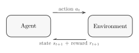
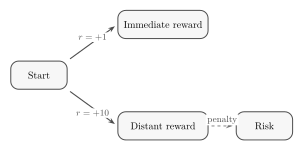
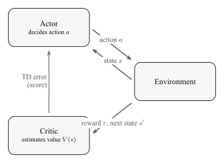

# Introduction to Reinforcement Learning

::: warning 📣 Announcement
We sincerely thank everyone for supporting this tutorial! The course is iterating quickly and a new version is coming soon. Many sections are still being organized and refined, so we appreciate your patience. Suggestions and corrections are always welcome. If you find the course useful, please give the [GitHub repository](https://github.com/walkinglabs/hands-on-modern-rl) a Star 🌟 to help speed up updates.

**We hope this open-source tutorial gives more people the courage to push toward the upper limit of intelligence, and to solve more of the problems on the road to AGI.**

Because compute is scarce, we are looking for GPU sponsorship. If you can offer GPU access, please contact us at [physicoada@gmail.com](mailto:physicoada@gmail.com).
:::

## Why Reinforcement Learning Matters

In 2019, Richard Sutton, one of the founders of reinforcement learning, wrote a short essay of fewer than two pages called "[The Bitter Lesson](http://www.incompleteideas.net/IncIdeas/BitterLesson.html)". He reviewed 70 years of artificial intelligence and reached a conclusion that many researchers find hard to accept:

> The biggest lesson that can be read from 70 years of AI research is that general methods that leverage computation are ultimately the most effective, and by a large margin.
>
> —— Rich Sutton, 2019. Sutton and his advisor Andrew Barto shared the 2024 ACM Turing Award for laying the theoretical foundations of reinforcement learning.

<em>Richard S. Sutton, one of the founders of reinforcement learning and winner of the 2024 Turing Award. Source: <a href="https://commons.wikimedia.org/wiki/File:Rich_Sutton_on_Reinforcement_Learning-_Alpha_Go_Zero_to_60_(cropped).jpg" target="_blank" rel="noopener noreferrer">Wikimedia Commons</a> (CC BY 2.0)</em>

Why "bitter"? Because the same story has played out again and again in the history of AI. In computer chess, researchers carefully encoded opening theory and endgame strategy, and were beaten by Deep Blue's brute-force search. In speech recognition and computer vision, people hand-designed feature extractors, and were thoroughly displaced by deep networks that learn features from data on their own. Go took this to the extreme: researchers invested enormous effort in using human knowledge to reduce the amount of search, while AlphaGo Zero dropped all human input, played against itself from scratch, and played better.

Sutton's summary: **researchers always try to make a system work the way they think the human mind works, and in the end this turns out to backfire.** The two meta-techniques that drove real breakthroughs, search and learning, work precisely because they scale without limit as computation grows.

And what is the most natural, most primitive form of "learning"? It is not sitting in a classroom listening to lectures, and it is not reading a labeled dataset. It is what all living things do: **act in the real world, observe the consequences, and adjust behavior, which is to say, trial and error.**

Think about the first skills you ever acquired: walking, speaking, riding a bicycle. Did you learn any of them by "reading a textbook"? Nobody handed you a checklist saying "left foot first, shift your weight forward." You simply kept trying, fell, got back up, until one day your body remembered what to do.

Take riding a bicycle. Suppose you want to teach a child to ride. What would you do?

  <em>Figure 1: Teaching a child to ride a bicycle is a typical trial-and-error learning process. Source: <a href="https://commons.wikimedia.org/wiki/File:Dad_teaching_child_to_ride_a_bike.jpg" target="_blank" rel="noopener noreferrer">Wikimedia Commons</a></em>

You would not first hand over a copy of _The Physics and Balance Equations of Bicycles_, and you would not specify before he climbs on that "when the frame leans 5 degrees to the left, push with the right foot at 10 newtons." Such precise knowledge is useless to his brain. You just hold the back of the seat and encourage him to pedal. A fall and a scraped knee are negative feedback. Staying upright, with the wind in his face, is the reward. After a few rounds, his brain has learned on its own, through trial and error, how to adjust his center of gravity.

This ability, **learning by trial and error in an unknown environment, guided by the final return**, is the most instinctive way of learning for every living thing. Strangely, the past decade of artificial intelligence bypassed it. We taught machines to recognize cats and dogs, translate languages, and generate pictures, all with the same method: give them thousands upon thousands of labeled correct answers and have them imitate. But when the problem changes from "recognition" to "decision-making" (getting a robot arm to grasp a cup, getting an AI to beat professional players at StarCraft, or getting a large language model to answer questions appropriately), you simply cannot label a standard answer for every step.

For these problems, which require continuous decisions in a changing world, **reinforcement learning (RL) offers a very different approach: do not tell the AI what to do, tell it only what is good and what is bad, and let it work out the rest on its own.** From Q-Learning to DQN, from PPO to DPO and GRPO, each evolution of reinforcement learning has pushed outward the boundary of what AI can do.

This book takes you through that journey in code, from the most basic inverted pendulum (CartPole) to using RL to elicit reasoning in large language models. It is more than a technique. It is a new perspective on how intelligence emerges.

  <em>Figure 2: The CartPole environment: the cart moves left and right to keep the pole balanced upright. Source: <a href="https://gymnasium.farama.org/environments/classic_control/cart_pole/" target="_blank" rel="noopener noreferrer">Gymnasium</a></em>

## The Definition of Reinforcement Learning

In the previous section we built intuition for reinforcement learning with the example of teaching a child to ride a bicycle. Now let's make it more precise.

> Reinforcement learning is a family of computational methods for solving **sequential decision problems**. An **agent** lives in an **environment**. At each time step it observes the environment's **state** and chooses an **action** accordingly. The environment receives the action, moves to a new state, and gives the agent a scalar **reward** as its only feedback signal. The agent's goal is to maximize the **cumulative reward** over the whole interaction.

Note three key elements. **Sequential decisions**: the agent makes many choices in a row, and the current decision affects the future. **The only feedback is the reward**: unlike supervised learning, there is no standard answer, and the agent only knows "how many points it scored." **The objective is cumulative return**: it does not greedily chase single-step reward but looks at the long term.

### The Core Loop

The interaction process of reinforcement learning is a loop that repeats continuously:

  

  <em>Figure: The core reinforcement learning loop. The agent executes an action, and the environment returns a new state and a reward.</em>

1. The agent observes the current state $s_t$ and selects an action $a_t$
2. The environment executes the action, moves to a new state $s_{t+1}$, and returns a reward $r_{t+1}$
3. Return to step 1

The loop produces a **trajectory**: $s_0, a_0, r_1, s_1, a_1, r_2, s_2, \ldots$

Several distinctions matter here. A **state** is a complete description of the environment (such as a chess board), while an **observation** is a partial description (such as the screen near the character in Super Mario). This book usually uses "state" for both, and in code you will see the variable name `obs`. **Action spaces** come in two kinds: **discrete** (Mario has only 4 actions: left, right, jump, crouch) and **continuous** (a robot arm joint angle can take any real value). Different kinds call for different algorithms.

As for rewards, if the agent looked only at the immediate single-step reward, it would become very "short-sighted." So what the agent actually cares about is the **return $G_t$**: the sum of all future rewards from the current time $t$ until the episode ends.

But simply adding up future rewards has a problem: the further away a reward is, the more uncertain it is. Think of a mouse in a maze. The small piece of cheese nearby can be eaten right away, while the big piece of cheese next to the cat far away is full of risk. To express that "1 point in the future is worth less than 1 point now," we introduce the **discount factor $\gamma$** (a value between 0 and 1, usually set to 0.95 to 0.99).

With a discount factor, future rewards are discounted when they are added up, and the further away they are, the steeper the discount. Let's look at the formula:

$$G_t = r_{t+1} + \gamma\, r_{t+2} + \gamma^2\, r_{t+3} + \cdots = \sum_{k=0}^{\infty} \gamma^k\, r_{t+k+1}$$

The formula looks a bit long, but it is intuitive once taken apart:

- $r_{t+1}$ is the reward obtained immediately, with **no discount** (multiplied by $\gamma^0 = 1$).
- $r_{t+2}$ is the reward obtained after two steps. It is discounted once, multiplied by $\gamma^1$.
- $r_{t+3}$ is the reward obtained after three steps. It is discounted twice, multiplied by $\gamma^2$.
- And so on: the reward at future step $k+1$ is multiplied by $\gamma^k$. Because $\gamma$ is a decimal less than 1 (say 0.9), $\gamma^k$ gets smaller as the number of steps grows (0.9, 0.81, 0.729, ...).

So the size of $\gamma$ determines the agent's "field of vision." Let's work through a simple example:

  

  <em>Figure: The discount factor determines decision preferences: the trade-off between an immediate reward and a distant reward that carries risk.</em>

The agent faces two paths:

- **Immediate reward**: it is close, and the reward is +1. No discount is needed, so the actual value is **1 point**.
- **Distant reward**: it is far away, and the reward is +10, but it carries risk. Because of the extra steps, the reward is discounted. Suppose it is multiplied by $\gamma^3$ (discounted 3 times).

Now the value of $\gamma$ becomes the deciding factor:

- **If $\gamma = 0.1$ (short-sighted)**: in the agent's eyes the distant reward is worth $10 \times 0.1^3 = 0.01$ points. 0.01 points is far less than the 1 point in front of it, so the agent **chooses the immediate reward**.
- **If $\gamma = 0.9$ (far-sighted)**: in the agent's eyes the distant reward is worth $10 \times 0.9^3 = 7.29$ points. 7.29 points is much more than the 1 point in front of it, so the agent is willing to resist the temptation and **chooses the distant reward**.

  <em>Figure 3: A mouse running a maze to find cheese is a commonly used pathfinding and decision model in reinforcement learning. Source: <a href="https://commons.wikimedia.org/wiki/File:MAZE_Mouse_Cheese.jpg" target="_blank" rel="noopener noreferrer">Wikimedia Commons</a></em>

The whole edifice of RL rests on one philosophical position, the **reward hypothesis**: every goal can be described as "maximizing expected cumulative reward." As long as "good" and "bad" can be quantified as a numerical signal, RL has a way to get the agent to learn.

There are also two types of tasks. **Episodic** tasks have a clear start and end (one game of Super Mario, one run of CartPole). **Continuing** tasks have no end (automated stock trading). All the experiments in this book are episodic, which makes it convenient to measure progress by "score per episode."

### Two Routes

Every RL algorithm answers the same question: how should we choose actions to **maximize the cumulative return**? The cumulative return $G_t$ is the sum of all discounted rewards the agent obtains from time $t$ onward:

$$G_t = r_{t+1} + \gamma\, r_{t+2} + \gamma^2\, r_{t+3} + \cdots = \sum_{k=0}^{\infty} \gamma^k\, r_{t+k+1}$$

It measures "how many points the agent scored in total over a game from start to finish," and not the immediate reward of any single step. There are two very different routes to answering this question. Before that, we need one core concept, the **policy $\pi$**, which is the agent's "brain," the function that outputs an action given a state. The ultimate goal of training is to find the **optimal policy $\pi^*$**. Policies come in two kinds. A **deterministic** policy always outputs the same action for the same state ($a = \pi(s)$). A **stochastic** policy outputs a probability distribution over actions ($\pi(a|s) = P(a|s)$). The latter naturally builds in exploration, because there is always a small probability of trying a non-preferred action.

So how do we find the optimal policy? There are two quite different routes:

**Route one: Value-Based.** First work out how many points each action is "worth," then pick the highest. Imagine you are walking through a maze, and at every fork you can see a sign: going left is expected to earn 80 points in total, going right is expected to earn 30. So you go left. This "sign" is the **action-value function (Q-function)**, which represents how many points you can expect in the future after choosing this action in this state:

$$Q^{\pi}(s, a) = \mathbb{E}_{\pi}\left[G_t \mid s_t = s,\, a_t = a\right]$$

The superscript $\pi$ is not an exponent. It indicates which policy this score depends on: the agent first executes action $a$ in state $s$, and afterward keeps acting according to policy $\pi$. The condition $s_t=s, a_t=a$ fixes the current state and the current action, and $\mathbb{E}_{\pi}$ then averages over the different trajectories that may follow. So even when the current $(s,a)$ is the same, $Q^{\pi}(s,a)$ can differ if a different policy is used afterward.

The asterisk means "optimal." $Q^*(s,a)=\max_{\pi}Q^{\pi}(s,a)$ is the optimal action value: execute $a$ now, and then follow the policy that achieves the highest expected return. $\pi^*$ likewise denotes the optimal policy. Once $Q^*$ is known, choosing in each state the action with the largest $Q^*(s,a)$ yields the optimal policy.

You are bound to wonder: **if I have not reached the end yet, how can I know how many points I will get in the future? How are these Q-values actually computed?**

This is the most elegant part of reinforcement learning: **start with a wild guess, then correct it step by step.** The theoretical foundation that allows this is the **Markov decision process (MDP)**.

The core assumption of an MDP is that "the future depends only on the present, not on the past." With this foundation we can perform a mathematical magic trick and cut the infinitely long future off in the middle. This is the **Bellman equation**. It tells us that a Q-value does not have to be computed by playing all the way to the end. It can be decomposed directly into two parts:
**current Q-value = immediate reward + next-step Q-value**

With this equation, the way the algorithm actually works becomes very intuitive.
At first, the scores on all the signs at the forks are scribbled at random (random initialization). You take a random step, receive a reward of 1 point, and see that the sign at the next fork says 10 points. You understand at once: "Oh, the true value of that last step was about 1+10=11 points!" So you take out a pen and change the score on the previous fork's sign to 11.

By trying and erring in the maze like this, using "the next sign" to correct "the previous sign," Q-Learning makes the current estimate gradually approach the optimal action value $Q^*$ (which satisfies the **Bellman optimality equation**). At that point, always choosing the action with the highest score naturally yields the best policy: $a^* = \arg\max_a Q^*(s, a)$. The representative algorithms of this route run from classical Q-Learning to DQN in the deep learning era.

**Route two: Policy-Based.** Skip the scoring and learn directly "what to do when you see what." Back in the maze: you stop scoring the paths and instead walk the maze many times. Reaching the exit strengthens confidence in every choice made along the way, and falling into a trap weakens it. After enough runs, the probability of good actions naturally rises and the probability of bad actions naturally falls. Formally, the policy $\pi_\theta$ is defined by parameters $\theta$, and we optimize it by maximizing the expected return:

$$J(\theta) = \mathbb{E}_{\pi_\theta}\left[G_t\right], \quad \theta^* = \arg\max_\theta J(\theta)$$

The representative algorithms of this route run from basic REINFORCE to PPO, which is now widely used in large-model alignment.

Both routes must deal with the central dilemma of RL, **exploration vs. exploitation**: exploit the best-known action and collect reward reliably, or take a risk on an unknown action to discover a better policy? It is like choosing a restaurant. If you go to the same good place every day (exploitation), you may forever miss a better one around the corner. If you try a new place every day (excessive exploration), you often end up with a bad meal. Too much exploration wastes resources and too little leaves you stuck in a suboptimal policy. Value-based methods usually add an exploration mechanism such as $\varepsilon$-greedy explicitly, while policy-based methods can adjust the degree of exploration through stochastic policies and entropy bonuses.

**Actor-Critic** puts the two together. It uses the method of route one to train a **"critic" (Critic)** that evaluates how good each action is, and the method of route two to train an **"actor" (Actor)** that chooses actions. Specifically:

- The **Critic** is a value function that answers "in state $s$, is executing action $a$ actually good?" It does not choose actions directly. It scores them, for example by telling you "this step is expected to earn +5 points." The more accurate the score, the better the actor knows which directions are worth trying and which to avoid.
- The **Actor** is a policy function $\pi_\theta(a|s)$ that answers "in state $s$, what should I do?" It adjusts its behavior according to the critic's scores: actions the critic rates highly are chosen more often later, and actions rated poorly are chosen less often.

The two form a virtuous circle: the more accurate the critic's scores, the faster the actor improves, and the more new actions the actor tries, the richer the data the critic sees and the more accurate its scores become. It resembles the relationship between a trainee actor and a veteran director: the director points out problems in the performance, the actor improves accordingly, and the actor's new attempts give the director a deeper understanding of "what makes a good performance."

In RL terminology, algorithms can also be divided into two further classes, according to **whether they learn how the environment works**:

- **Model-Free methods**: the agent does not care how the environment works internally. It cares only about "how many points I get if I do this." Whether value-based, policy-based, or Actor-Critic, any method that accumulates experience through frantic trial and error in the environment is Model-Free. It is like playing Super Mario: you do not need to know the game engine's code, and after dying a few times you naturally learn how to jump.
- **Model-Based methods**: the agent first builds a "world model" (a model of the environment) in its head, predicting "if I do this, what will the environment become?" For example, when AlphaGo plays Go, it knows the rules of Go (the model) and can simulate the board several moves ahead in its head before deciding.

This book focuses mainly on **Model-Free** algorithms (such as DQN, PPO, and DPO), because they are more general and overwhelmingly dominate large-language-model alignment and complex environments today.

  <em>Figure 4: The Actor-Critic architecture. The Actor executes actions, and the Critic scores them based on the environment reward and guides the Actor's improvement.</em>

One last question: what do these "score tables" and "behavior manuals" actually look like? In a simple environment they can be a small table you just look things up in. For a small maze with only 16 cells, you need only a 16-row table, with each row recording "how many points going left / right is worth in this cell." This is the classic Q-Learning approach:

| State | $\leftarrow$ | $\rightarrow$ | $\uparrow$ | $\downarrow$ |
| :---: | :----------: | :-----------: | :--------: | :----------: |
| $s_0$ |     0.1      |    **0.8**    |    0.3     |     -0.2     |
| $s_1$ |   **0.7**    |      0.2      |    0.5     |     0.0      |
|   ⋮   |      ⋮       |       ⋮       |     ⋮      |      ⋮       |

A table lookup is enough to decide: in $s_0$ choose "right" (0.8 is the highest), and in $s_1$ choose "left" (0.7 is the highest). A policy table is similar, with each row recording "the probability of moving in each direction from this cell."

But in an Atari game, a single frame has $210 \times 160 = 33600$ pixels, each taking one of 128 colors. The number of possible states far exceeds the number of atoms in the universe, and no table can hold it. **Deep reinforcement learning (Deep RL)** uses a neural network to "compress" this infinitely large table: the network takes the state (such as the game screen) as input and outputs Q-values or action probabilities. The network does not store rows one by one. It **generalizes** through its weights: having seen similar screens, it can guess roughly similar scores.

- If the neural network learns a "score table" (input a state, output the Q-value of each action), it is Value-Based (such as DQN);
- If it learns a "behavior manual" (input a state, output a probability distribution over actions), it is Policy-Based (such as REINFORCE);
- If it learns both, with one network scoring and one network choosing actions, it is Actor-Critic (such as PPO).

All algorithms in this book belong to Deep RL.

### The Era of Large Models

The reinforcement learning framework discussed so far (agent, environment, reward) grew up in traditional settings such as games and robotics. A natural question is: **what happens when this framework meets large language models?**

In 2016, AlphaGo defeated Lee Sedol and demonstrated the power of reinforcement learning in perfect-information games. But what truly brought RL to the center of public attention was the release of ChatGPT in 2022. People found that the key technique for turning a large model from one that "can talk" into one that "talks well" was reinforcement learning.

  <em>Figure 5: ChatGPT brought large language models into public view, and turned RLHF from a training procedure in papers into a key technology behind a real product. Source: OpenAI <a href="https://openai.com/index/chatgpt/" target="_blank" rel="noopener noreferrer">Introducing ChatGPT</a></em>

In a game environment, the reward signal is clear and automatic: collecting a coin is +1, falling into a pit is -100. But when we want an AI to learn to "speak well," a problem appears: what counts as a "good" answer? Polite? Helpful? Safe? Human preferences are so complex that the environment simply cannot decide automatically how many points an answer deserves.

**RLHF (Reinforcement Learning from Human Feedback)** gave the first solution, completing the shift from "can talk" to "talks well" in three stages:

  <em>Figure 6: The three-step training pipeline OpenAI used in InstructGPT: supervised fine-tuning first, then reward model training, and finally policy optimization with reinforcement learning. Source: OpenAI <a href="https://openai.com/index/instruction-following/" target="_blank" rel="noopener noreferrer">Aligning language models to follow instructions</a></em>

1. **Supervised fine-tuning (SFT)**: fine-tune the model on high-quality dialogue examples written by humans so that it learns the basic conversation format.
2. **Reward model training (RM)**: have humans rank multiple answers from the model, and train a scoring model that can "imitate" human preferences.
3. **Reinforcement learning optimization (RL)**: use an algorithm such as PPO, with the reward model's score as the signal, to further optimize the model's answering policy.

RL in the era of large models has evolved along two key routes. **Route one: preference-based alignment (RLHF / DPO).** When the criterion is "do humans like it" (is the tone polite, is the answer safe), the environment cannot give scores automatically. We first train a reward model on human annotations to "imitate" human preferences, then use it to guide RL training. DPO goes one step further and cleverly "hides" the reward signal in the policy probability ratio, bypassing the explicit reward model. You will practice this pipeline hands-on in Chapters 8-9. **Route two: pure reinforcement learning with verifiable rewards (RLVR).** When we turn to mathematics, code, or complex reasoning tasks, the correctness of an answer is objectively verifiable. Frontier work such as DeepSeek-R1-Zero showed that neither prior SFT nor a trained reward model is needed. Given only rule-based feedback, pure reinforcement learning can drive a base model to spontaneously develop long chains of thought (Chain-of-Thought) and strong reasoning ability. This is one of the frontier explorations on AI's road toward AGI.

  <em>Figure 7: The DeepSeek-R1 training pipeline pushes "RL in the era of large models" along another route: on verifiable tasks, the model improves itself through online sampling, rule-based rewards, and GRPO-style optimization. Source: <a href="https://arxiv.org/abs/2501.12948" target="_blank" rel="noopener noreferrer">DeepSeek-R1 Paper</a></em>

Remember PPO from earlier? In the era of large models it went from the culmination of game control to the cornerstone of the entire LLM alignment industry. But PPO needs an additional Critic network to evaluate how good actions are, which for a large model means enormous computational overhead. **GRPO (Group Relative Policy Optimization)** emerged in response. It replaces the Critic network with group-relative advantages: it compares the quality of several answers generated in the same batch and learns directly from "which one is better." This simplification greatly reduces the cost of RL training and has made GRPO one of the mainstream choices for aligning large models in the open-source community.

### The Future

Reinforcement learning is moving from "letting AI make single-step decisions" to "letting AI complete whole tasks." There are three directions worth watching on this road.

The first direction is **agentic reinforcement learning (Agentic RL)**. Current large language models are essentially "single-turn question-answering machines": you ask one question and they give one answer. But real tasks often need multi-turn interaction. Planning a trip means searching several websites and comparing prices, and debugging code means running tests repeatedly, reading error messages, modifying, and verifying again. Agentic RL trains an AI to act continuously in an environment, call tools, adjust its policy dynamically according to intermediate results, and finally complete long-horizon complex tasks. This is the key leap from "dialogue model" to "autonomous agent," and you will practice it in depth in Chapter 8.

The second direction is **multimodality and embodied intelligence**. RL is breaking past the boundary of pure text. Vision-language models (VLMs) extend RL to image understanding and visual reasoning, while embodied AI pushes RL into the physical world, letting robots learn to walk, grasp, and manipulate by trial and error in real environments. The biggest challenge is the gap between simulation and reality (Sim-to-Real Gap): a policy trained in a virtual environment may fail completely in the real world. Techniques such as domain randomization (Domain Randomization) are easing the problem, while Model-Based RL and self-play (Self-Play) are opening new possibilities.

The third direction may also be the final destination: **toward more general intelligence**. Return to Sutton's "Bitter Lesson": general methods will win in the end. From games to language, from language to vision, from vision to the physical world, each expansion of reinforcement learning confirms the same judgment: having the agent learn through trial and error on its own is more effective than humans hand-coding knowledge. And the end of this road may be AGI.

---

That is the conceptual framework of reinforcement learning. On a first encounter the terminology feels dense, but there is no need to dwell here. The later chapters unfold each concept through code and experiments, and whenever you meet a concept you will have hands-on experience to attach to it.

## About This Book

In 2016, AlphaGo defeated Lee Sedol and reinforcement learning shocked the public for the first time. In 2022, with the release of ChatGPT, people discovered that RL is the key technology that turns a large language model from one that "can talk" into one that "talks well." From DeepSeek-R1 to the many open-source aligned models, algorithms such as RLHF, DPO, and GRPO have profoundly reshaped the whole AI industry.

  <em>Figure: The record of Game 5 of the 2016 five-game match between AlphaGo and Lee Sedol. AlphaGo won 4:1, marking the first time reinforcement learning shocked the public. Source: <a href="https://commons.wikimedia.org/wiki/File:Lee_Sedol_(B)_vs_AlphaGo_(W)_-_Game_5.svg" target="_blank" rel="noopener noreferrer">Wikimedia Commons</a> (CC BY-SA 4.0)</em>

Yet the available learning resources lag badly behind industry practice. Mainstream tutorials gloss over RL in a single stroke, while dedicated RL textbooks stay within the traditional framework and say nothing about PPO, DPO, or GRPO. An engineer who wants to understand the RLHF pipeline has to build a bridge by hand between classic textbooks and the latest papers. We set out to write this book to fill that gap.

This book is our attempt: **to make modern reinforcement learning approachable, teaching the core concepts through a fusion of code, mathematics, and intuition.**

### A "Hands-On First, Theory Second" Learning Path

Many textbooks first cover all the properties of MDPs, then the Bellman equation, and only then allow you to touch a line of code. In this book, **you start training an agent from the first line of code in the first chapter**. When you have watched the CartPole cart go from wobbling to standing steadily, and have used DPO yourself to teach a large model to "talk well," and then go back to understand the mathematics behind it, learning is more natural and understanding lasts longer.

Every chapter follows a four-step cycle: first, a piece of runnable code that gives you direct experience. Then, guidance to the key phenomena on the training curves. Next, with intuition in hand, an explanation of the mathematical principles. Finally, a reinterpretation of the earlier phenomena through theory, which closes the loop from intuition to formalization.

### Code and Theory Together

Every chapter of this book contains runnable code examples. **Many intuitions in reinforcement learning can only be built through trial and error**: adjust the learning rate and watch the reward curve oscillate, change the clip parameter and see whether the policy collapses. This kind of experience cannot be gained from reading formulas alone.

### Content and Structure

The book is divided into seven parts, shown in different colors in the core map below:

```mermaid
graph TD
    subgraph P1["Part I · Foundations and Classical RL (Chapters 1-4)"]
        Q["CartPole introduction<br/>Problem definition and classical methods"]
    end

    subgraph P2["Part II · Deep Reinforcement Learning (Chapters 5-9)"]
        A["Core problems of RL<br/>Sequential decisions and long-term return"] --> B["Value-Based<br/>Learn action values"]
        A --> C["Policy-Based<br/>Learn the policy directly"]
        B --> D["Q-Learning → DQN<br/>(Chapter 5)"]
        C --> E["REINFORCE<br/>(Chapter 6)"]
        D --> F["Actor-Critic convergence<br/>(Chapter 7)"]
        E --> F
        F --> G["TRPO and PPO<br/>(Chapter 8)"]
        G --> H["Continuous control and Model-Based RL<br/>(Chapter 9)"]
    end

    subgraph P3["Part III · Advanced RL Methods (Chapters 10-12)"]
        I["Offline RL"] --> J["Imitation learning, inverse RL, and meta-RL"]
        J --> K["Exploration, multi-agent, and hierarchical RL"]
    end

    subgraph P4["Part IV · LLM Alignment and Post-Training (Chapters 13-18)"]
        L["RLHF, RLAIF, and industrial training<br/>(Chapters 13-14)"] --> M["DPO, GRPO, and RLVR<br/>(Chapters 15-16)"]
        M --> N["Reasoning models and PRM<br/>(Chapters 17-18)"]
    end

    subgraph P5["Part V · Agentic Reinforcement Learning (Chapters 19-22)"]
        O["Tool use and multi-turn RL"] --> P["Code, browser, and GUI agents"]
    end

    subgraph P6["Part VI · Multimodal Reinforcement Learning (Chapters 23-24)"]
        R["Vision-language model RL<br/>(Chapter 23)"] --> S["Frontier multimodal RL<br/>(Chapter 24)"]
    end

    subgraph P7["Part VII · Safety, Evaluation, and Research Frontiers (Chapters 25-26)"]
        T["Reward hacking and RL evaluation"] --> U["Self-Play, scaling, and research frontiers"]
    end

    Q --> A
    H --> I
    K --> L
    N --> O
    P --> R
    S --> T

    style P1 fill:#f8f9fa,stroke:#616161,color:#000
    style P2 fill:#eef6ff,stroke:#1976d2,color:#000
    style P3 fill:#edf7ed,stroke:#2e7d32,color:#000
    style P4 fill:#f5eef8,stroke:#7b1fa2,color:#000
    style P5 fill:#fff8e1,stroke:#f9a825,color:#000
    style P6 fill:#e0f7fa,stroke:#00838f,color:#000
    style P7 fill:#fce4ec,stroke:#c2185b,color:#000
    style Q fill:#f8f9fa,stroke:#616161,color:#000
    style A fill:#eef6ff,stroke:#1976d2,color:#000
    style B fill:#e3f2fd,stroke:#1976d2,color:#000
    style D fill:#e3f2fd,stroke:#1976d2,color:#000
    style C fill:#fff3e0,stroke:#f57c00,color:#000
    style E fill:#fff3e0,stroke:#f57c00,color:#000
    style F fill:#e8f5e9,stroke:#388e3c,color:#000
    style G fill:#e8f5e9,stroke:#388e3c,stroke-width:3px,color:#000
    style I fill:#edf7ed,stroke:#2e7d32,color:#000
    style J fill:#edf7ed,stroke:#2e7d32,color:#000
    style K fill:#edf7ed,stroke:#2e7d32,color:#000
    style L fill:#f5eef8,stroke:#7b1fa2,color:#000
    style M fill:#f5eef8,stroke:#7b1fa2,color:#000
    style N fill:#f5eef8,stroke:#7b1fa2,color:#000
    style O fill:#fff8e1,stroke:#f9a825,color:#000
    style P fill:#fff8e1,stroke:#f9a825,color:#000
    style R fill:#e0f7fa,stroke:#00838f,color:#000
    style S fill:#e0f7fa,stroke:#00838f,color:#000
    style T fill:#fce4ec,stroke:#c2185b,color:#000
    style U fill:#fce4ec,stroke:#c2185b,color:#000

```

The seven parts cover the following.

**Part I (Chapters 1 to 4)** starts from CartPole and builds, in turn, the problem definition of reinforcement learning, value functions, the Bellman equation, and classical solution methods.

**Part II (Chapters 5 to 9)** enters deep reinforcement learning: DQN learns action values, policy gradients optimize the policy directly, Actor-Critic combines the two routes, PPO provides stable policy updates, and Off-Policy methods and Model-Based RL further improve sample efficiency.

**Part III (Chapters 10 to 12)** discusses offline reinforcement learning, imitation learning, inverse reinforcement learning, meta-reinforcement learning, exploration, multi-agent reinforcement learning, and hierarchical reinforcement learning, filling in methodological tools for more complex data and environment settings.

**Part IV (Chapters 13 to 18)** covers RLHF, RLAIF, DPO, GRPO, RLVR, reasoning models, process reward models, and industrial training, forming a complete post-training route for large models.

**Part V (Chapters 19 to 22)** extends the training object from a single answer to a complete trajectory, discussing in turn multi-turn interaction, tool use, code agents, browser agents, and GUI agents.

**Part VI (Chapters 23 to 24)** first discusses vision-language model RL, then gathers audio agents, VLA, and visual generation under "frontier multimodal RL," forming a continuous route from multimodal understanding to interaction and generation.

**Part VII (Chapters 25 to 26)** focuses on reward hacking, reinforcement learning evaluation, Self-Play, scaling laws, multi-agent collaboration, and research frontiers.

### Target Audience

This book is aimed at students, engineers, and researchers. No prior background in deep learning or machine learning is needed. You need only basic Python programming, linear algebra (matrix operations), calculus (partial derivatives, the chain rule), and the basics of probability (expectation, conditional probability). Most of the time we put intuition and ideas ahead of mathematical rigor.

## Environment and Hardware Requirements

The experiment code of this course is compatible with the mainstream operating systems:

- **Linux** (recommended): Ubuntu 20.04 or later, which has the most complete support for the deep learning ecosystem.
- **Windows**: all experiments can run through WSL2 (Windows Subsystem for Linux 2), which is easy to install.
- **macOS**: Apple Silicon (M1/M2/M3/M4) and Intel Macs can run most experiments.

GPU and memory requirements are divided into three tiers:

| Tier           | VRAM required        | Coverage                                                                            | Typical hardware              |
| -------------- | -------------------- | ----------------------------------------------------------------------------------- | ----------------------------- |
| Introductory   | CPU only / 4GB+ VRAM | Classic RL experiments such as CartPole, Atari, and policy gradients                | Integrated graphics, GTX 1650 |
| Core           | 24GB VRAM            | LLM-related experiments such as DPO alignment, PPO training, and GRPO               | RTX 3090, RTX 4090, A5000     |
| Large projects | 80GB VRAM            | A few large-scale model training runs (such as a full RLHF pipeline for 7B+ models) | A100, H100                    |

Most experiments fit within **24GB of VRAM**, and one consumer GPU (such as an RTX 3090 / 4090) is enough to cover over 90% of the hands-on content in the book. Only a few advanced projects involving full-parameter training of large models require an 80GB-class GPU.

::: tip
Trying this course does not cost much. An ordinary laptop can run the introductory experiments, and one consumer GPU with 24GB of VRAM is enough to cover most of the core content.
:::

## Summary

- **Foundational understanding**: reinforcement learning is the learning method closest to biological instinct, optimizing behavior through trial and error and reward signals. Sutton's "Bitter Lesson" tells us that general methods will eventually outperform knowledge hand-coded by humans.
- **Core theory**: the theoretical framework of RL is built around the agent-environment interaction loop. Value functions and policy gradients are the two main solution routes, and Actor-Critic fuses them.
- **The era of large models**: from RLHF to DPO, from PPO to GRPO and RLVR, reinforcement learning has become the key technology for large language model alignment and the emergence of reasoning ability.
- **The future**: Agentic RL, multimodal RL, and embodied intelligence are moving RL from dialogue to action and from text to the physical world, toward more general intelligence.
- This book takes a "hands-on first, theory second" teaching path, and basic Python programming and mathematics are enough to begin.
